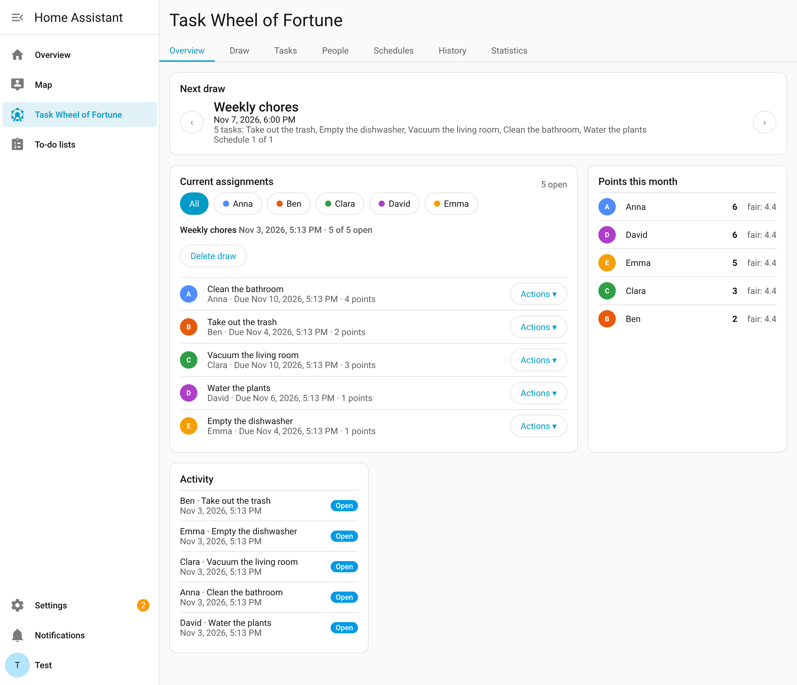
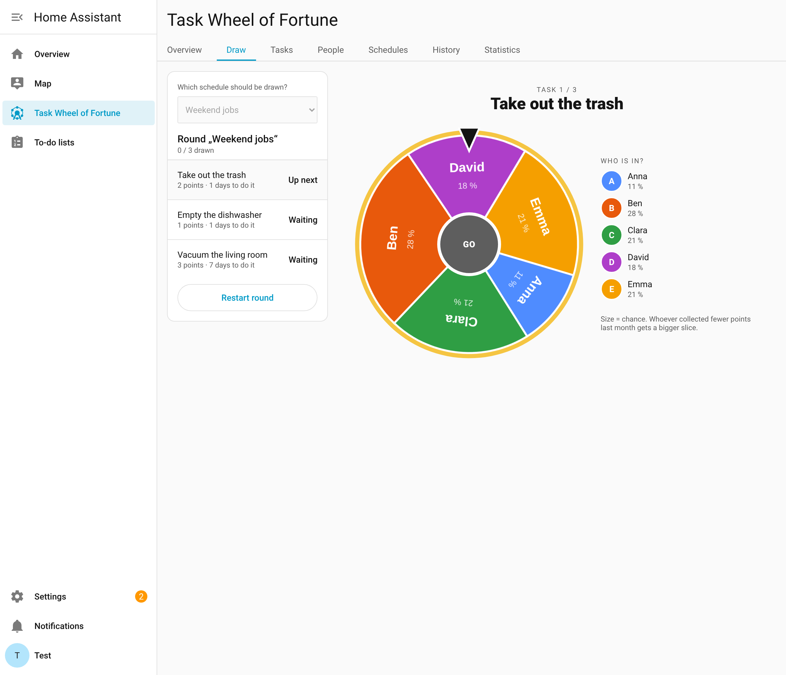
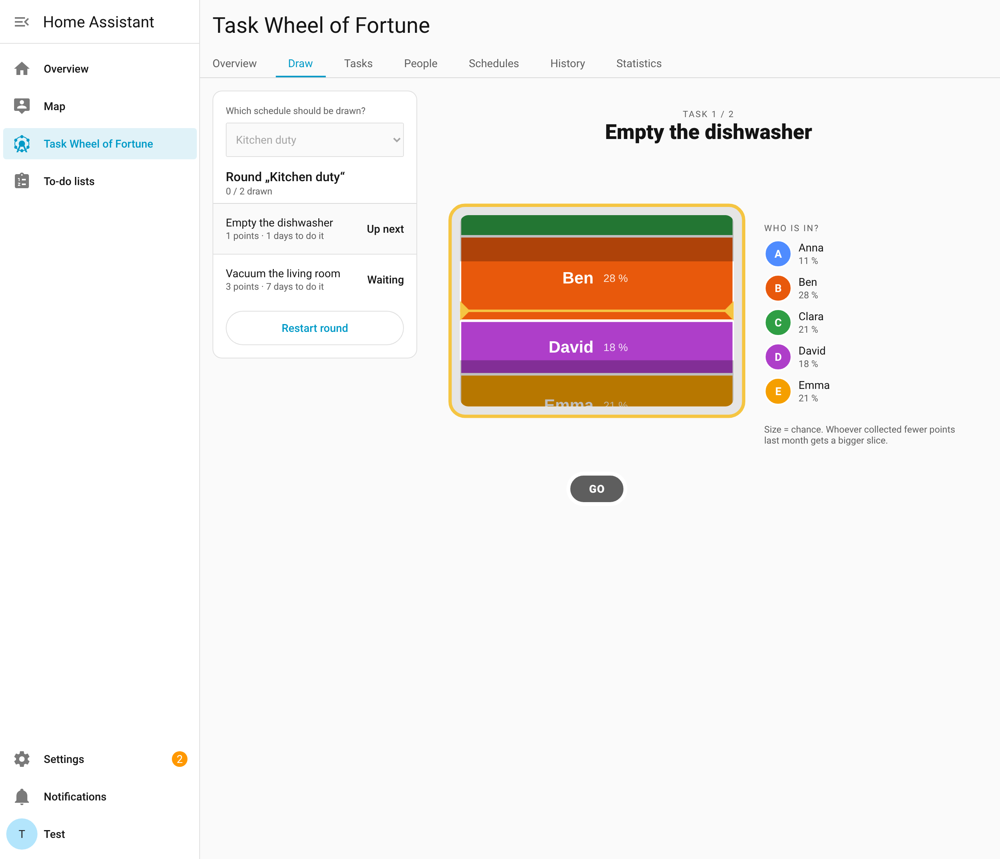
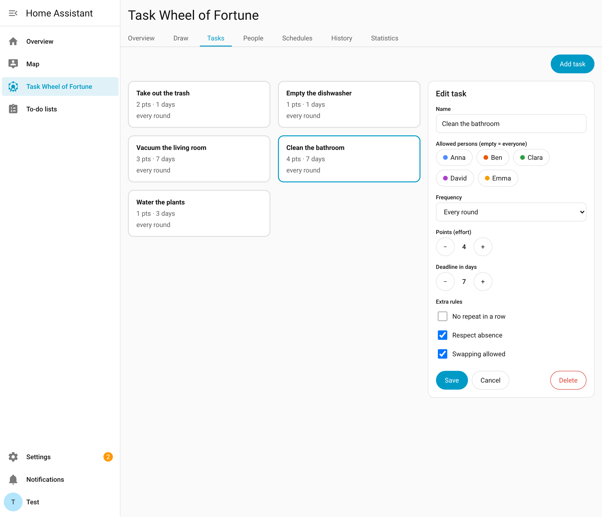
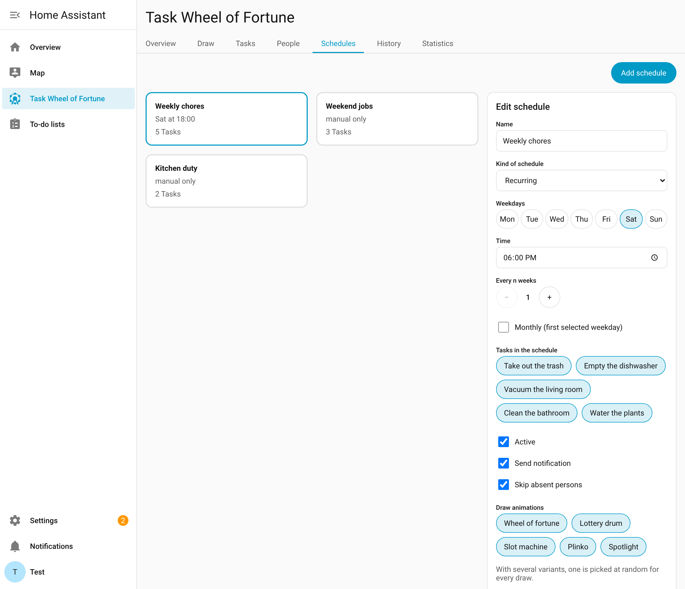
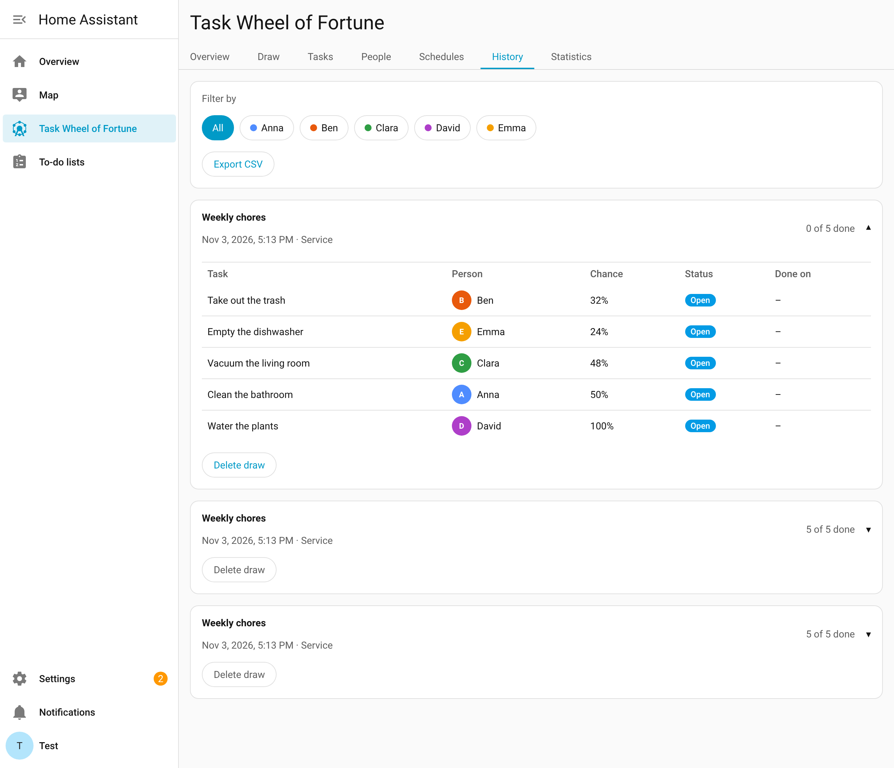
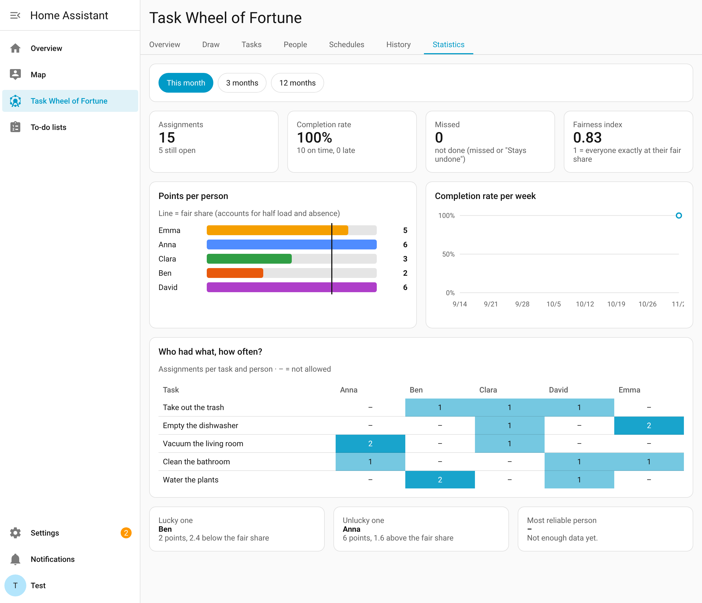

# Task Wheel of Fortune for Home Assistant

Distributes household chores fairly and with a bit of fun: a wheel of fortune draws who takes what. The odds
depend on who has done how much recently, who is around, and how much load each person can take.

> **Status:** version 0.2.0. All features below are implemented. Installation is done through HACS
> as a custom repository (see below). Feedback is welcome as an [issue](https://github.com/stacknoise/hass-task-wheel-of-fortune/issues).

## Installation via HACS

The integration is not (yet) in the default HACS store. It is installed as a **custom repository**. Prerequisites:
[HACS](https://hacs.xyz) is set up and Home Assistant is version 2025.6 or newer.

[](https://my.home-assistant.io/redirect/hacs_repository/?owner=stacknoise&repository=hass-task-wheel-of-fortune&category=integration)

The button opens the repository directly in your own Home Assistant instance (My Home Assistant, the address of the
instance has to be set once). Manually:

1. HACS → menu (⋮) → *Custom repositories* → `https://github.com/stacknoise/hass-task-wheel-of-fortune`,
   type *Integration* → *Add*
2. Search for "Task Wheel of Fortune" in HACS, *Download* it (pick the latest version) and restart Home Assistant
3. *Settings → Devices & services → Add integration → Task Wheel of Fortune*
4. **Task Wheel of Fortune** (shown as "Aufgaben-Glücksrad" if Home Assistant is set to German) appears in the sidebar; create people, tasks and schedules there

HACS reports updates like for any other integration. Without HACS: extract the folder `custom_components/task_wheel` from
the file `task_wheel.zip` of the respective [release](https://github.com/stacknoise/hass-task-wheel-of-fortune/releases)
to `config/custom_components/task_wheel` (the repository itself does not contain the built panel).

## Features

- **People** as their own objects, independent of HA users: color on the wheel, full or half load or paused,
  absences (one-off, on fixed weekdays, in a weekly rhythm such as "every 2nd week Fri–Fri"),
  optional notification
- **Tasks** with allowed people, points (effort), deadline and frequency: every round,
  at most n× per x days/weeks/months (e.g. 5× in 2 months, 1× in 2 weeks; sliding window of whole calendar periods), or a fixed interval with tolerance; optionally assigned to one or more Home Assistant areas (rooms), shown in the overview, draw, history and statistics
- **Schedules**: recurring, one-off or manual only
- **Draws** automatically or in the panel with an animation: wheel of fortune, lottery drum, slot machine, Plinko, spotlight, scratch cards, breaking news or an award ceremony; for the first five the size (segment, ball, row, slot, tile) equals the chance; scratch cards, breaking news and the award ceremony deliberately show no chances. With the scratch cards you scratch by hand (the draw starts with the first stroke) or let a coin do it; once the winning card is uncovered the draw is over. For each schedule you choose the allowed variants with a multi-select; if there are several, one is picked at random for every draw; with none selected, "Start round" draws everything at once and shows the task list right away
- **Fairness**: whoever has had fewer points relative to their fair share gets a bigger slice
- **Swapping with a joker**, only with people from the same draw who are allowed to get the task
- **"Stays undone"**: deliberately not doing an assignment; counts like missed in points and statistics
- **History** with CSV export and **statistics** (fair share, completion rate, task × person matrix)
- **Home Assistant integration**: services, events, sensors, a to-do list per person, buttons per schedule

## Screenshots

| | |
|---|---|
|  |  |
| **Overview:** open assignments, points this month, next draw | **Draw:** wheel of fortune, size = chance |
|  |  |
| **Draw:** the slot machine, one of eight animations | **Tasks:** points, deadline, frequency, rules |
|  |  |
| **Schedules:** recurring, once or manual | **History:** every draw with CSV export |
|  | |
| **Statistics:** fair share, completion rate, task × person | |

## Fairness and fair share

Next to a person's points, the panel shows their **fair share** ("fair: 1.15") under "Points this month" (overview) and in the
statistics. This is **not** "everyone gets the same amount", but the share that is due to the person according to their
**load capacity** and their **days present** in the period. Equal points therefore do not mean equal fair shares.

**Calculation**

1. A person's capacity = load capacity (full 1.0 · half 0.5 · paused 0) × number of days present in the period.
   Absences (one-off, fixed weekdays, weekly rhythm) reduce the days.
2. Fair share = total points of all people × the person's capacity ÷ sum of all capacities.
3. Points of an assignment: completed on time counts in full; late and missed ("Stays undone" included) count with the
   factor from the settings (default: late 1.0, missed 0). Open and swapped assignments do not count in the statistics
   yet, but count fully as load when drawing.
4. The period of the statistics is whole calendar months **up to today**; when drawing, the fairness window applies
   (default 30 days, adjustable in the settings).

**Example 1: everyone completes exactly 1 point, yet the fair shares differ**

It is Tuesday, 3 November. The "month" period therefore covers only Sunday, Monday and Tuesday. Five people have
each completed a task worth 1 point (5 points in total):

| Person | Presence | Days | Fair share | Points |
|---|---|---|---|---|
| Toni | always | 3 | 5 × 3 ÷ 13 = **1.15** | 1 |
| Andrea | always | 3 | **1.15** | 1 |
| Fabian | every 2 weeks Fri–Fri, present right now | 3 | **1.15** | 1 |
| Felix | not Sat and Sun | 2 (Mon, Tue) | 5 × 2 ÷ 13 = **0.77** | 1 |
| Laurenz | not Sat, Sun, Wed | 2 (Mon, Tue) | **0.77** | 1 |

The sum of the days is 13. Whoever is around on fewer days has less claim to tasks, so 1 point is **above** the fair share
for Felix and Laurenz. This evens out with every day, because capacity only grows on days present.
Fabian is only on par with Toni and Andrea as long as his presence phase covers the whole period. In his
week of absence his fair share drops.

**Example 2: half load capacity**

A month with 30 days, Anna (full) and Ben (half) are always present: capacity Anna 30, Ben 15. With 9 points in total,
Anna is due 9 × 30 ÷ 45 = **6** and Ben 9 × 15 ÷ 45 = **3** points. If each person has 4.5 points, Ben is above his
share and Anna below.

**Example 3: late and missed**

A task worth 2 points is completed late. If the "late" factor is set to 0.5, the person is credited 1
point; for "missed" (default 0) they get 0.

**Effect on the draw**

Whoever is below their fair share gets a bigger slice on the wheel. The weight is
`w = f × exp((f − a) ÷ f)` with the fair share `f` and the actual share `a` (the person's points ÷ points of
everyone), then limited to at least 0.5 % and at most 100 % and normalized to chances. Example: Anna and Ben are
both fully capable and always present (`f` = 50 %), Anna has 3 and Ben 1 point in the window (`a` = 75 % and 25 %). Then
Anna's weight is 0.50 × e^−0.5 ≈ 0.30 and Ben's is 0.50 × e^0.5 ≈ 0.82. Ben thus has about a 73 % chance, Anna about 27 %.
Without points in the window, everyone's chance is their fair share; people without capacity (paused or never present in the window) keep only the minimum weight of 0.5 %.

**Further indicators**

- **Fairness index** (statistics): 100 % means everyone has exactly their fair share; it falls with the sum of the
  deviations (index = 1 − ½ × Σ|points − fair share| ÷ total points).
- **Lucky one** is furthest below their fair share, **unlucky one** furthest above; both only with a real
  deviation and from two people on.

## Releasing (for developers)

1. Raise `version` in `custom_components/task_wheel/manifest.json`, add an entry to `CHANGELOG.md` and to the
   change log of `docs/CODE_DOKU.md`, via pull request to `main`
2. Set the tag: `git tag v0.2.0 && git push origin v0.2.0`, or enter the tag on GitHub under *Actions → Release → Run workflow* (the workflow creates it at the state of `main`)
3. The `Release` workflow checks that the tag and the manifest version match, builds the panel and attaches
   `task_wheel.zip` to the new GitHub release (see `hacs.json`: `zip_release`). Tags with a suffix (`v0.2.0-beta.1`)
   are published as a pre-release.

## Services and events

```yaml
action: task_wheel.draw
data:
  schedule: weekly-plan
```

| Service | Purpose |
|---|---|
| `task_wheel.draw` | Draw a round of a schedule |
| `task_wheel.complete` | Complete an assignment |
| `task_wheel.swap` | Swap an assignment with a joker |
| `task_wheel.set_absence` | Enter an absence for a person |

Events: `task_wheel_drawn`, `task_wheel_completed`, `task_wheel_swapped`, `task_wheel_missed`, `task_wheel_reminder`. With `animate_on`, `task_wheel.draw` additionally fires `task_wheel_animate` (a hint for a display). The payloads contain only identifiers, names and numbers.

A schedule and a person can be addressed by identifier or short name, a task by identifier or name. `task_wheel.complete` takes either `assignment_id` or `person` together with `task`.

Settings (jokers, fairness window, retention, points factors, grace period, panel for administrators only) are changed under *Settings → Devices & services → Task Wheel of Fortune → Configure*. Every night at 03:00, missed assignments are marked and rounds older than the retention period are deleted.

## Notifications

Each person can have a target: a `notify` entity (via `notify.send_message`) or a legacy service `notify.<name>`, e.g. `notify.mobile_app_anna`. Only existing targets of the `notify` domain are allowed; this is checked when saving and on every send.

| Occasion | Recipient |
|---|---|
| Round drawn (only if the schedule has "Send result as push message" enabled) | all people with a target, one line per person |
| Task swapped | the person who takes over the task |
| Reminder (schedule "manual only", after n, 2n, … days without a draw) | all people with a target |

A target shared by several people (e.g. a family channel) receives each message only once. The texts are in `custom_components/task_wheel/texts/` (de, en; other languages fall back to English). A failed send is logged and blocks neither the draw nor other targets.

## Panel

After setup, the entry "Task Wheel of Fortune" (`/task-wheel`) appears in the sidebar. The panel has the
tabs Overview, Draw, Tasks, People, Schedules, History and Statistics, loads the state via `snapshot` and
stays up to date via `subscribe`. The **Draw** tab is finished: choose a schedule, start a round (an open round
can be resumed), play the schedule's animation for each task (wheel of fortune, lottery drum, slot machine, Plinko, spotlight, scratch cards, breaking news or award ceremony, size = chance, "Who takes part?" with reasons; whoever already has a task in the round is no longer on the wheel for the further ones; surplus tasks stay open as "not distributable"; if only one person is left for a task, they are assigned without spinning),
draw the rest without animation and complete the round. The backend always determines the result; the animation only
follows it, and with "reduced motion" in the operating system it is skipped. **Overview**, **History**, **Statistics**, **Tasks**, **People** and **Schedules** are finished as well.

- **Overview:** next draw (with paging through the schedules), open assignments per schedule with a filter by person,
  an action menu per assignment with Complete and "Stays undone" (both with a confirmation popup) and Swap (only allowed, non-paused people of the same draw, with a note on the remaining jokers), points this month against the
  fair share, and the latest activity. The open assignments are grouped by **draw** (most recent first, with
  schedule and time); a draw without open assignments disappears from the list. A whole draw can be
  **deleted** after confirmation as long as none of its tasks is completed; it then also disappears from history and statistics.
  If a task is in several schedules, it can be drawn several times; each assignment is completed individually.
- **History:** expandable rounds (schedule, origin, assignments with chance and status, deleting a round after confirmation), filter by person, loading in
  pages and **CSV export** (semicolon, UTF-8 with BOM; fields that begin with `=`, `+`, `-`, `@`, a tab or a line break
  are defused with an apostrophe so that spreadsheet programs do not execute them as a formula).
- **Statistics:** period (month, 3 or 12 months), indicators, points against fair share, completion rate per week
  (SVG line chart without a charting library), task × person matrix and awards (lucky one, unlucky one,
  most reliable person). Empty periods show a note instead of empty charts.

**Tablet and smartphone:** the panel adapts to its own width. On a tablet in portrait mode and on a smartphone, the stage (wheel, result, "Next task") sits at the top of the draw and the round list below it; on a smartphone everything is single-column and compact, controls have touch size (44 px), and in narrow mode the Home Assistant menu button for the sidebar appears.

Texts are available in German and English (language from Home Assistant). The bundle is not checked in: before
trying it out, run `cd frontend && npm ci && npm run build`. If it is missing, the integration stays usable and writes a
warning to the log.

### People, tasks and schedules in the panel

The *People*, *Tasks* and *Schedules* tabs create, change and delete objects (administrators only). People and tasks cannot be deleted while they are still in use: a person not while a task allows them or they have open assignments; a task not while a schedule contains it or it is still assigned and open. The cards are laid out
in a grid; adding and editing open a popup (full screen on a smartphone, close with Escape or ✕), and deleting asks for confirmation in another popup. Backend errors appear at the affected field and as a note in the popup.

- **People:** color on the wheel, load capacity (full, half, paused), presence (one-off, weekdays, weekly rhythm) with a
  preview of the next four weeks, and optionally a notification entity (`notify.…`, with a search across the entities and services of Home Assistant, checked when saving).
- **Tasks:** allowed people, frequency (every round, at most n× per period, fixed interval with a timeline),
  points, deadline, minimum load capacity (any, at least half or full load only; whoever is below it does not get onto the wheel for the task and cannot take it over by swapping) and the extra rules "no repetition", "respect absence", "swap allowed". A task can optionally be assigned to a **room** (a Home Assistant area); the room is shown on the task card, in the overview, the draw, the history (also as a column in the CSV export) and the statistics. If an area is deleted in Home Assistant, the task keeps the assignment and shows "Unknown room" until you pick another one.
- **Schedules:** recurring, one-off or manual only, task selection, options and an example for `task_wheel.draw`
  and the event `task_wheel_drawn`.

## Panel API (WebSocket)

The panel talks to the backend through WebSocket commands with the prefix `task_wheel/`: `snapshot`, `subscribe`
(first the full state, then only changes per object), `history/list`, `statistics/get`, `availability/preview` (presence preview),
`assignment/complete`, `assignment/swap`, `assignment/skip`, `draw/begin|spin|spin_rest|commit|cancel` for every signed-in
user, and `round/delete`, `person/*`, `task/*`, `schedule/*` and `settings/update` for administrators only. All inputs
are validated against strict schemas (no unknown fields, limited lengths). If "Panel for administrators only" is set in the settings,
the read commands are also reserved for administrators. Details:
[docs/KONZEPT.md](docs/KONZEPT.md) §6.4 (in German).

## Entities

For every person and every (non-archived) schedule, the integration creates a device "Task Wheel <name>" with these entities. They appear and disappear with the people and schedules; the entity IDs result from the device name and the entity name (shown here with the English UI):

| Entity | Example | Content |
|---|---|---|
| Open tasks per person | `sensor.task_wheel_anna_open` | number of assignments not yet completed |
| Points this month per person | `sensor.task_wheel_anna_points` | points credited in the current month (late/missed factors from the settings) |
| To-do list per person | `todo.task_wheel_anna` | open tasks with deadline; **checking one off completes the assignment** (app, voice assistant), other changes are not possible |
| Next draw per schedule | `sensor.task_wheel_weekly_plan_next_draw` | timestamp; empty when paused or "manual only" |
| Draw button per schedule | `button.task_wheel_weekly_plan_draw` | draws the schedule as in the panel |

The entities do not poll; they update as soon as something changes for them (draw, completion, swap, missed, changed people and schedules).

## Documentation

The project documents are written in German.

| Document | Content |
|---|---|
| [docs/KONZEPT.md](docs/KONZEPT.md) | Technical concept: architecture, layers, patterns, data model, algorithms, interfaces, security, performance, code rules |
| [docs/ARBEITSPAKETE.md](docs/ARBEITSPAKETE.md) | Work packages AP-00 to AP-19 with dependencies, sizes and definition of done |
| [docs/CODE_DOKU.md](docs/CODE_DOKU.md) | Code documentation: metrics, thresholds, dependencies, change log, comparison with the [code documentation guideline](https://claude.ai/artifact/9txBo1nQLP7gMmYQfYcLJe) |
| [mockups/](mockups/) | Clickable UI mockups ([view interactively](https://claude.ai/artifact/NEch6MPsvESdj91pqQFHT7)) |

## Development

Short version of the rules (details in KONZEPT.md §10):

- Backend: Python 3.13, Home Assistant custom integration; frontend: Lit 3 + TypeScript (strict), built with Vite
- Factory + Strategy + Repository: factories create rule strategies by registration without `if/elif` chains, storage only through repositories
- Clear layers (constants, entry point, interfaces, application, domain, infrastructure); the import direction is checked in CI
- No literals in the code, everything through constants; no duplicated code
- Security and performance first: validated inputs, configuration for administrators only, drawing only in the backend
- **Every code change is logged in [docs/CODE_DOKU.md](docs/CODE_DOKU.md)**; the README is updated for visible changes

Commands:

```bash
# Backend (Python 3.13)
python3 -m venv .venv && . .venv/bin/activate && pip install -r requirements-dev.txt
ruff check . && ruff format --check . && mypy && lint-imports && pytest

# Frontend (Node 22)
cd frontend && npm ci && npm run lint && npm run typecheck && npm test && npm run build && npm run bundle-budget

# End-to-end test (Playwright against a real, fresh HA instance with the integration; runs in CI as job `e2e`)
# Procedure: build the frontend, start `hass -c <config>` with `custom_components/task_wheel`, then
cd e2e && npm ci && npx playwright install chromium && HA_URL=http://localhost:8123 npx playwright test

# Regenerate the README screenshots (a fresh HA instance with the integration is running on :8123, English UI)
cd e2e && npm ci && HA_LANGUAGE=en SHOT_DIR=../docs/screenshots npm run screenshots

# Generate the code documentation (docs/code-doku/index.html) and check thresholds
python3 docs/code-doku/generate.py --check
```

### Continuous integration

Pull requests and `main` run the jobs `hassfest`, `HACS validation`, `lint`, `typecheck`, `architecture`
(import direction, duplicates), `test-backend`, `test-frontend`, `build-frontend` (incl. bundle budget), `audit` and
`docs-check` (code changed ⇒ `docs/CODE_DOKU.md` changed) and `code-doku` (the generator runs, thresholds from `docs/CODE_DOKU.md` §1.1 are met). Dependabot keeps pip, npm and GitHub Actions up to date.

Please report security vulnerabilities confidentially, see [SECURITY.md](SECURITY.md).

## License

[MIT](LICENSE)
