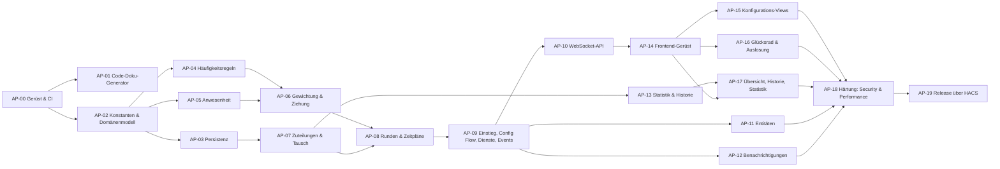

# Arbeitspakete: Task Wheel of Fortune

Stand: 2026-11-04 (AP-00 bis AP-19 umgesetzt, Nachträge bis Version 0.3.1 unten) · Grundlage: [KONZEPT.md](KONZEPT.md)

Größen: **S** ≈ bis 1 Tag · **M** ≈ 2–3 Tage · **L** ≈ 4–5 Tage (Richtwerte für eine Person).
Jedes Paket gilt erst als fertig, wenn die **gemeinsame Definition of Done** erfüllt ist.

## Gemeinsame Definition of Done

- ruff, mypy `--strict`, ESLint, TypeScript `strict` ohne Fehler; keine neuen Literale außerhalb der Konstanten
- Importrichtung (import-linter / eslint-plugin-boundaries) und Duplikatprüfung grün
- Tests für neue Logik; Domäne ≥ 95 % Zeilenabdeckung, Rest ≥ 85 %
- Komplexität je Funktion ≤ 8 (ruff `C901`), Wartbarkeitsindex je Modul ≥ 55 (siehe CODE_DOKU.md)
- **Änderungsprotokoll in CODE_DOKU.md ergänzt**, Generator gelaufen, Metriken/Abhängigkeiten aktuell
- README angepasst, wenn sich Verhalten, Dienste, Entitäten oder Installation ändern

## Übersicht und Reihenfolge

| AP | Titel | Schicht | Größe | Abhängig von |
|---|---|---|---|---|
| 00 | Projektgerüst, Tooling, CI | – | M | – |
| 01 | Code-Doku-Generator | Doku | M | 00 |
| 02 | Konstanten und Domänenmodell | 0, 4 | M | 00 |
| 03 | Persistenz (Repository, Store, Migration) | 5 | M | 02 |
| 04 | Häufigkeitsregeln (Factory + Strategien) | 4 | S | 02 |
| 05 | Anwesenheitsregeln (Factory + Strategien) | 4 | M | 02 |
| 06 | Fairness-Gewichtung und Ziehungs-Engine | 4 | M | 04, 05 |
| 07 | Zuteilungen, Fristen, Joker/Tausch | 3, 4 | M | 03 |
| 08 | Runden und Zeitpläne (DrawService, Scheduler, TriggerFactory) | 3, 5 | L | 06, 07 |
| 09 | Einstieg, Config Flow, Dienste, Events | 1, 2 | M | 08 |
| 10 | WebSocket-API inkl. Rechte und Subscriptions | 2 | M | 09 |
| 11 | Entitäten (Sensor, To-do, Button) über EntityFactory | 2 | M | 09 |
| 12 | Benachrichtigungen (NotifierFactory) | 3, 5 | S | 09 |
| 13 | Statistik-Service und Historie | 3 | M | 07 |
| 14 | Frontend-Gerüst (Lit, Vite, Panel, Store, i18n, API-Client) | FE | M | 10 |
| 15 | Views Personen, Aufgaben, Zeitpläne | FE | L | 14 |
| 16 | Glücksrad-Komponente und Auslosung-View | FE | L | 14 |
| 17 | Views Übersicht, Historie, Statistik | FE | L | 13, 14 |
| 18 | Härtung: Security-Review, Performance-Budget, E2E | alle | M | 11, 12, 15, 16, 17 |
| 19 | Release über HACS | – | S | 18 |

Parallelisierbar: AP-04/05 nach AP-02; AP-11/12/13 nach AP-09; AP-15/16/17 nach AP-14.

---

## AP-00 · Projektgerüst, Tooling, CI (M)

**Ziel:** Leeres, installierbares Gerüst, an dem alle Regeln automatisch geprüft werden.

- `custom_components/task_wheel/` mit `manifest.json` (Domain, Version, `config_flow: true`, `iot_class: calculated`, `dependencies: [http, frontend, panel_custom, websocket_api]`), `hacs.json`
- `pyproject.toml`: ruff (`target-version = py313`, Regelsätze inkl. `UP`, `PLR2004`, `C901`, `S`), mypy strict, pytest, coverage, import-linter-Verträge für die Schichten
- `frontend/`: `package.json` (gepinnte Versionen), TypeScript strict, ESLint (typescript-eslint strict, `no-magic-numbers`, boundaries), Prettier, Vitest, Vite-Build nach `custom_components/task_wheel/frontend/dist/` mit Inhalts-Hash
- GitHub Actions: hassfest, HACS-Validierung, Lint, Typprüfung, Tests, Frontend-Build, Bundle-Budget, Duplikatprüfung, `npm audit`, Prüfung „Code geändert ⇒ CODE_DOKU.md geändert“
- Dependabot für pip/npm/Actions

**Fertig, wenn:** Integration lässt sich in einer Test-HA-Instanz hinzufügen und wieder entfernen; CI ist grün.

## AP-01 · Code-Doku-Generator (M)

**Ziel:** Code-Dokumentation nach Vorlage der bestehenden Code-Dokus (Energy Card, Test Data Creator).

- `docs/code-doku/generate.py`: Python über `ast`, TypeScript über einen Token-Scanner; je Typ/Modul/Methode: LOC, zyklomatische Komplexität, Wartbarkeitsindex, Ca/Ce, Instabilität, „Test nennt Typ“, Signatur, Docstring, Zeilenbereich, Schicht
- `docs/code-doku/template.html`: Ansicht „Explorer“ (Schichten → Module → Typen → Methoden mit Quelltext) und „Abhängigkeiten“ (Karte)
- Ausgabe `docs/code-doku/index.html`, veröffentlicht als Artefakt „Task Wheel Code-Dokumentation“
- `--check`-Modus für CI: Schwellwerte aus CODE_DOKU.md, Abweichung ⇒ Fehler

**Fertig, wenn:** Generator läuft auf dem Gerüst, Seite zeigt alle Schichten, CI nutzt `--check`.

## AP-02 · Konstanten und Domänenmodell (M)

- `const/keys.py`, `limits.py`, `defaults.py`, `events.py`
- `domain/enums.py` (StrEnum), `domain/models.py` (frozen/slots-Dataclasses aus Konzept §4), `domain/errors.py`
- Typ-Aliase per PEP 695 (`type PersonId = str` …)
- Serialisierung (`to_dict`/`from_dict`) an einer Stelle je Modell, Validierung der Invarianten im `__post_init__`

**Fertig, wenn:** Modelle sind vollständig getestet (Rundreise Serialisierung, Invarianten).

## AP-03 · Persistenz (M)

- Protokolle `ConfigRepository`, `HistoryRepository` in `application/protocols.py`
- `infrastructure/repository/`: `ConfigStore`, `HistoryStore` auf `Store` mit `async_delay_save`, Migrationsfunktionen, Indizes im Speicher, Aufräumen nach Aufbewahrungsfrist
- In-Memory-Implementierung für Tests

**Fertig, wenn:** Laden/Speichern/Migration getestet; Indizes konsistent nach jeder Änderung.

## AP-04 · Häufigkeitsregeln (S)

- Protokoll `FrequencyRule.is_due(...)`, Strategien `EveryRound`, `MaxPerPeriod`, `Interval`
- `FrequencyRuleFactory` (Registry, keine Verzweigungen)

**Fertig, wenn:** Tabellengetriebene Tests für alle Arten inkl. Periodengrenzen (Wochenwechsel, Monatsende, Sommerzeit).

## AP-05 · Anwesenheitsregeln (M)

- Strategien `Once`, `WeeklyDays`, `WeekRhythm` (z. B. jede 2. Woche Fr–Fr, 2 von 4 Wochen, Ankerdatum)
- `AvailabilityRuleFactory`, Funktion „anwesend an Tag X“ und „anwesend im Fenster“
- Vorschau der nächsten 4 Wochen (für das Personen-Mockup)

**Fertig, wenn:** Tests decken Rhythmus über Jahreswechsel und Wechseltag ab.

## AP-06 · Fairness-Gewichtung und Ziehungs-Engine (M)

- Kandidatenfilter als Kette eigener Filterobjekte mit Ausschlussgrund
- `WeightingFactory` mit `Fairness` (Formel Konzept §5.3) und `Uniform`
- `DrawEngine.draw(...)` mit injiziertem RNG (`secrets.SystemRandom` in Produktion, fester RNG in Tests)

**Fertig, wenn:** Statistischer Test (10 000 Ziehungen) bestätigt Chancen innerhalb einer Toleranz; Laufzeit pro Runde gemessen und dokumentiert.

## AP-07 · Zuteilungen, Fristen, Joker/Tausch (M)

- Statusübergangstabelle (`domain/status.py`)
- `AssignmentService` (erledigen, täglicher Lauf „verpasst“, Punkte mit einstellbaren Faktoren für verspätet/verpasst), `SwapService` (Joker je Monat, Berechtigung der neuen Person)

**Fertig, wenn:** Alle Übergänge inkl. unzulässiger getestet; Joker-Rücksetzung zum Monatswechsel getestet.

## AP-08 · Runden und Zeitpläne (L)

- `DrawService`: automatische Runde in einem Schritt; Panel-Runde schrittweise (`begin`, `spin`, `spin_rest`, `commit`, `cancel`) mit Zeitlimit
- `TriggerFactory` (`recurring`, `once`, `manual`), `infrastructure/scheduler.py` auf `async_track_point_in_time`
- `ScheduleService`: nächste Auslosung berechnen, Zeitgeber gezielt neu setzen, Erinnerung bei „nur manuell“

**Fertig, wenn:** Zeitreise-Tests (freezegun bzw. `async_fire_time_changed`) für alle Zeitplanarten grün.

## AP-09 · Einstieg, Config Flow, Dienste, Events (M)

- `__init__.py` mit typisiertem `entry.runtime_data` (Komposition aller Objekte an einer Stelle)
- Config Flow (Einzelinstanz) + Options Flow (Joker, Fairness-Fenster, Aufbewahrung, Punktefaktoren verspätet/verpasst, Kulanzzeit, Panel nur für Admins)
- Dienste `draw`, `complete`, `swap`, `set_absence` mit Schemas, `services.yaml`, Übersetzungen
- Events aus Konzept §6.2

**Fertig, wenn:** Setup/Unload ohne Rückstände (Zeitgeber, Listener); Dienste per Test aufgerufen.

## AP-10 · WebSocket-API (M)

- Befehle je Bereich (Konzept §6.4), Schemas, `require_admin` für Konfiguration
- `subscribe` mit Deltas, Abmelden beim Schließen der Verbindung

**Fertig, wenn:** Rechte-Tests (Nicht-Admin wird abgewiesen), Schema-Tests (zu lange/zusätzliche Felder abgewiesen).

## AP-11 · Entitäten (M)

- `EntityFactory` mit `EntityDescription`-Tabellen; Sensor offen/Punkte je Person, To-do je Person, Sensor nächste Auslosung + Button je Zeitplan
- Anlegen/Entfernen beim Hinzufügen/Löschen von Personen und Zeitplänen, Dispatcher-Updates

**Fertig, wenn:** Entitäten erscheinen/verschwinden korrekt; To-do-Abhaken erledigt die Zuteilung.

## AP-12 · Benachrichtigungen (S)

- `NotifierFactory`: `notify.send_message` (Entität), Legacy-`notify.*`, keine
- Texte über Übersetzungen; Benachrichtigung nach Runde, bei Tausch, Erinnerung

**Fertig, wenn:** Ziel wird beim Speichern und Senden geprüft; Tests mit gemockten Diensten.

## AP-13 · Statistik-Service und Historie (M)

- Monatsaggregate inkrementell fortschreiben; KPIs, Punkte vs. fairer Anteil, Erledigungsquote pro Woche, Matrix Aufgabe × Person, Glückspilz/Pechvogel/Zuverlässigste Person
- Historie mit Filter und Seitenweise-Abfrage

**Fertig, wenn:** Aggregate stimmen mit Neuberechnung aus Rohdaten überein (Eigenschaftstest).

## AP-14 · Frontend-Gerüst (M)

- `task-wheel-panel` mit Tabs aus den Mockups, Routen als Konstanten, Views per `import()`
- Typisierter API-Client, Store mit `@lit/context`, i18n (de/en), Design-Tokens auf HA-Variablen
- Panel-Registrierung im Backend (`panel.py`, statischer Pfad)

**Fertig, wenn:** Panel lädt in HA, zeigt Snapshot, reagiert auf Deltas.

## AP-15 · Views Personen, Aufgaben, Zeitpläne (L)

- Formulare nach Mockups (Farbe, Anwesenheit mit 4-Wochen-Vorschau, Belastbarkeit, Benachrichtigung; erlaubte Personen, Häufigkeit mit Zeitstrahl, Zusatzregeln; Zeitplanarten, Aufgabenwahl, YAML-Beispiel)
- Gemeinsame Formular-Bausteine (Stepper, Chip-Auswahl, Segment-Umschalter) als eigene Komponenten

**Fertig, wenn:** CRUD vollständig, Validierungsfehler aus dem Backend werden angezeigt.

## AP-16 · Glücksrad und Auslosung (L)

- `tw-wheel` (SVG, Segmentgröße = Chance, Drehung zum vom Backend gelieferten Ergebnis, reduzierte Bewegung)
- Auslosung-View: Zeitplan wählen, je Aufgabe drehen, „Wer ist im Rad?“ mit Gründen, „Rest ohne Animation verlosen“, Abschluss mit Konfetti

**Fertig, wenn:** Ablauf deckt sich mit dem Mockup; Animation ruckelfrei (60 fps auf Tablet-Referenzgerät).

## AP-17 · Übersicht, Historie, Statistik (L)

- Übersicht: nächste Auslosung, Zuteilungen je Zeitplan mit Filter, Abhaken, Tauschen (nur erlaubte Personen, Joker-Hinweis), Punkte, Aktivität
- Historie: Runden aufklappbar, Filter nach Person, CSV-Export mit Entschärfung
- Statistik: KPIs, Balken mit fairem Anteil, Wochenquote, Matrix, Auszeichnungen (SVG, ohne Diagrammbibliothek)

**Fertig, wenn:** Alle Mockup-Inhalte mit Echtdaten; leere Zustände gestaltet.

## AP-18 · Härtung (M)

- Security-Review aller Eingänge (WebSocket, Dienste, To-do, CSV), Rechte, Grenzwerte
- Performance: Messung Rundenlaufzeit, Panel-Ladezeit, Bundle-Budget; Lasttest mit Obergrenzen
- End-to-End-Test mit Playwright gegen eine HA-Testinstanz (Auslosung, Erledigen, Tausch)

**Fertig, wenn:** Keine offenen Befunde der Stufe hoch/mittel; Messwerte in CODE_DOKU.md eingetragen.

## AP-19 · Release über HACS (S)

- Versionierung (SemVer), Release-Workflow baut Frontend und hängt ZIP an, `hacs.json` final
- README mit Screenshots, Installations- und Konfigurationsanleitung, Dienste/Events/Entitäten
- Brands-Eintrag (Symbol) vorbereiten

**Fertig, wenn:** Installation als benutzerdefiniertes HACS-Repository in einer frischen HA-Instanz erfolgreich.

---

## Nachträge nach AP-19 (Version 0.3.1 ergänzt)

Nach dem ersten Release kamen Änderungen auf Zuruf, ohne eigenes Arbeitspaket. Details je Änderung stehen im Änderungsprotokoll in [CODE_DOKU.md](CODE_DOKU.md) §4.

| PR | Inhalt |
|---|---|
| #60, #66, #70 | Hinzufügen und Bearbeiten in Popups; Zahlenfelder (+/−) paarweise nebeneinander; Abwesenheiten-Scrollbereich mit höchstens zwei sichtbaren Einträgen |
| #61 | Mindest-Belastbarkeit je Aufgabe (egal, halb, voll) |
| #62 | Panel für Tablet und Smartphone optimiert, vor allem die Auslosung |
| #65 | Titel je Sprache („Aufgaben-Glücksrad“ / „Task Wheel of Fortune“), HACS englisch |
| #67 | Zeitplan ohne gewählte Animation: Runde sofort auslosen, danach Aufgabenliste |
| #68, #71 | 16 Personenfarben, nach Farbton sortiert in zwei Reihen à 8 |
| #69 | Aufgaben einem Home-Assistant-Raum zuweisen |
| #72, #73, #75 | Animationen Rubbellose, Eilmeldung, Oscar-Verleihung (ohne Chance-Anzeige) samt Nachbesserungen |
| #63, #64 | README: Fairness erklärt, komplett auf Englisch |
| #74 | Version 0.2.0 |

### Version 0.3.0

| PR | Inhalt |
|---|---|
| #77 | Listen alphabetisch sortieren; mehrere Räume je Aufgabe (Speicherstand 1.3) |
| #78 | Häufigkeit „höchstens n× in x Tagen/Wochen/Monaten“; Auslosungsliste nur mit mitmachenden Personen (zufällige Auswahl) |
| #79, #80 | Statistik „Verlosungen je Aufgabe: Soll und Ist“, Formularlayout |
| – | Version 0.3.0 |

### Version 0.3.1

| PR | Inhalt |
|---|---|
| #82 | Räume im Soll/Ist; Scroll-Sprung im Panel behoben |
| – | Version 0.3.1 |
