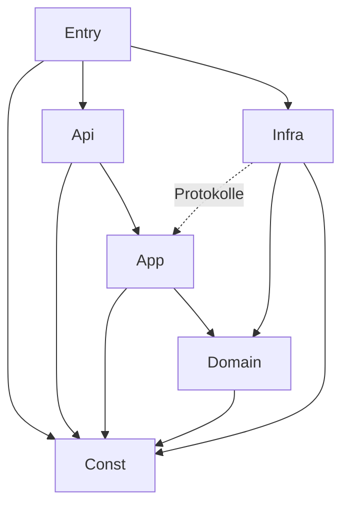

# Code-Dokumentation: Aufgaben-Glücksrad

Stand: 2026-11-03 · Code-Version: 0.0.1 (Gerüst, AP-00) · Vorlage: Code-Dokus „Detailed Energy Card“ und
„HASS Test Data Creator“

Dieses Dokument erfasst den Code mit seinen **Metriken** und **Abhängigkeiten** und protokolliert **jede
Codeänderung**. Es besteht aus zwei Teilen:

1. **Dieses Markdown-Dokument** (von Hand gepflegt): Messgrößen, Schwellwerte, Schichten, Modulübersicht,
   erlaubte Abhängigkeiten, Änderungsprotokoll.
2. **Die generierte Explorer-Seite** `docs/code-doku/index.html` (aus dem Quelltext erzeugt, nicht von Hand
   pflegen): Schichten → Module → Typen → Methoden mit Quelltext, Metriken je Element und Abhängigkeitskarte.
   Erzeugt mit `python3 docs/code-doku/generate.py`, veröffentlicht als Artefakt
   „Task Wheel Code-Dokumentation“. Generator und Vorlage entstehen in AP-01.

---

## 1. Messgrößen

Gleiche Messgrößen wie in den Vorlagen. Werte sind Näherungen eines Quelltext-Scanners, keine Compiler-Analyse.

| Kürzel | Messgröße | Bedeutung | Ebene |
|---|---|---|---|
| LOC | Codezeilen | Zeilen ohne Leerzeilen und reine Kommentare | Modul, Typ, Methode |
| CC | Zyklomatische Komplexität (McCabe) | Anzahl unabhängiger Pfade; Typ = Σ der Methoden | Methode, Typ |
| MI | Wartbarkeitsindex (0–100) | `max(0, (171 − 5,2·ln(V) − 0,23·CC − 16,2·ln(LOC)) · 100 / 171)` | Modul, Typ, Methode |
| Ce | Efferente Kopplung | Anzahl genutzter Typen/Module | Typ, Modul |
| Ca | Afferente Kopplung | Anzahl Typen/Module, die dieses nutzen | Typ, Modul |
| I | Instabilität | `Ce / (Ca + Ce)`; 0 = stabil, 1 = instabil | Typ, Modul |
| Test | Test nennt Typ | Mindestens ein Test referenziert den Typ | Typ |
| Cov | Zeilenabdeckung | aus pytest-cov / Vitest | Modul |
| Dup | Duplikate | doppelte Blöcke laut jscpd/pylint | Projekt |

### 1.1 Schwellwerte (in CI geprüft)

| Messgröße | grün | gelb | rot (CI schlägt fehl) |
|---|---|---|---|
| CC je Methode | ≤ 5 | 6–8 | > 8 |
| MI je Modul | ≥ 55 | 35–54 | < 35 |
| LOC je Methode | ≤ 30 | 31–50 | > 50 |
| LOC je Modul | ≤ 300 | 301–500 | > 500 |
| Instabilität Domäne | ≤ 0,5 | 0,51–0,8 | > 0,8 |
| Abdeckung Domäne | ≥ 95 % | 90–94 % | < 90 % |
| Abdeckung übrige | ≥ 85 % | 80–84 % | < 80 % |
| Duplikate | 0 | – | > 0 |
| Bundle (gzip) | ≤ 120 kB | 121–150 kB | > 150 kB |

---

## 2. Schichten und erlaubte Abhängigkeiten

| ID | Schicht | Verzeichnis | darf nutzen |
|---|---|---|---|
| `Const` | 0 Konstanten | `custom_components/task_wheel/const/` | – |
| `Entry` | 1 Einstieg | `__init__.py`, `config_flow.py`, `panel.py` | Api, App, Infra, Const |
| `Api` | 2 Schnittstellen | `services.py`, `websocket/`, `entities/` | App, Domain (nur Modelle), Const |
| `App` | 3 Anwendung | `application/` | Domain, Const (Infra nur über Protokolle) |
| `Domain` | 4 Domäne | `domain/` | Const |
| `Infra` | 5 Infrastruktur | `infrastructure/` | Domain, App (nur `protocols.py`), Const |
| `Panel` | Frontend | `frontend/src/` | intern: views → components → state/api → constants/i18n |

Geprüft durch `import-linter` (Python) und `eslint-plugin-boundaries` (TypeScript).



---

## 3. Modulübersicht

Geplante Module (Zielbild aus KONZEPT.md §3.3). Metriken werden ab AP-01 vom Generator eingetragen; bis dahin
steht „–“.

| Modul | Schicht | Verantwortung | Nutzt | LOC | CC | MI | Ca | Ce | I | Test |
|---|---|---|---|---|---|---|---|---|---|---|
| `const/keys.py` | Const | Speicher- und API-Schlüssel | – | – | – | – | – | – | – | – |
| `const/limits.py` | Const | Grenzwerte | – | – | – | – | – | – | – | – |
| `const/defaults.py` | Const | Standardwerte | – | – | – | – | – | – | – | – |
| `const/events.py` | Const | Event-, Dienst-, Befehlsnamen | – | – | – | – | – | – | – | – |
| `domain/models.py` | Domain | Modelle, Serialisierung | enums, errors | – | – | – | – | – | – | – |
| `domain/enums.py` | Domain | StrEnums | – | – | – | – | – | – | – | – |
| `domain/rules/` | Domain | `FrequencyRule`-Strategien, `FrequencyRuleFactory` | models | – | – | – | – | – | – | – |
| `domain/availability/` | Domain | `AvailabilityRule`-Strategien, Factory | models | – | – | – | – | – | – | – |
| `domain/weighting.py` | Domain | Gewichtung, `WeightingFactory` | models | – | – | – | – | – | – | – |
| `domain/draw_engine.py` | Domain | Kandidaten, Ziehung | rules, availability, weighting | – | – | – | – | – | – | – |
| `domain/status.py` | Domain | Statusübergänge | models, enums | – | – | – | – | – | – | – |
| `application/protocols.py` | App | Repository-, Clock-, Notifier-Protokolle | models | – | – | – | – | – | – | – |
| `application/draw_service.py` | App | Runden | draw_engine, protocols | – | – | – | – | – | – | – |
| `application/assignment_service.py` | App | Erledigen, Verpasst | status, protocols | – | – | – | – | – | – | – |
| `application/swap_service.py` | App | Tausch mit Joker | status, availability, protocols | – | – | – | – | – | – | – |
| `application/schedule_service.py` | App | Zeitpläne, nächste Auslosung | protocols | – | – | – | – | – | – | – |
| `application/statistics_service.py` | App | KPIs, Aggregate | protocols | – | – | – | – | – | – | – |
| `application/notification_service.py` | App | Texte, Empfänger | protocols | – | – | – | – | – | – | – |
| `infrastructure/repository/` | Infra | Store, Migration, Indizes | models, protocols | – | – | – | – | – | – | – |
| `infrastructure/scheduler.py` | Infra | HA-Zeitgeber, `TriggerFactory` | models | – | – | – | – | – | – | – |
| `infrastructure/notifier/` | Infra | `NotifierFactory` + Umsetzungen | protocols | – | – | – | – | – | – | – |
| `services.py` | Api | HA-Dienste | application | – | – | – | – | – | – | – |
| `websocket/` | Api | Panel-API | application | – | – | – | – | – | – | – |
| `entities/` | Api | `EntityFactory`, Sensor, To-do, Button | application | – | – | – | – | – | – | – |
| `__init__.py` | Entry | Setup, Komposition | alle | – | – | – | – | – | – | – |
| `config_flow.py` | Entry | Config- und Options-Flow | const | – | – | – | – | – | – | – |
| `panel.py` | Entry | Panel, statischer Pfad | const | – | – | – | – | – | – | – |
| `frontend/src/constants/` | Panel | Routen, Tokens, Grenzen | – | – | – | – | – | – | – | – |
| `frontend/src/i18n/` | Panel | Texte de/en | – | – | – | – | – | – | – | – |
| `frontend/src/api/` | Panel | WebSocket-Client | constants | – | – | – | – | – | – | – |
| `frontend/src/state/` | Panel | Store, Kontext | api | – | – | – | – | – | – | – |
| `frontend/src/components/` | Panel | `tw-wheel` u. a. | constants, i18n | – | – | – | – | – | – | – |
| `frontend/src/views/` | Panel | 7 Views | state, components | – | – | – | – | – | – | – |

### 3.1 Externe Abhängigkeiten

| Paket | Version | Schicht | Zweck |
|---|---|---|---|
| Home Assistant | ≥ 2025.6 (`hacs.json`); Tests laufen gegen die Version von `pytest-homeassistant-custom-component` 0.13.316 (HA 2026.2.3) | Entry, Api, Infra | Plattform |
| voluptuous | mit HA | Api | Schemas |
| lit | 3.3.3 (gepinnt) | Panel | Webcomponents |
| @lit/context | 1.1.6 (gepinnt) | Panel | Zustand |
| vite 8.3.5, typescript 6.0.3, eslint 10.14.0, vitest 5.1.0, typescript-eslint 8.72.1, eslint-plugin-boundaries 7.4.1, jscpd 5.4.2 | gepinnt (`frontend/package.json`) | Build/Test | Werkzeuge |
| ruff 0.17.3, mypy 2.4.1, import-linter 2.15, pylint 4.1.3, pytest-homeassistant-custom-component 0.13.316 | gepinnt (`requirements-dev.txt`) | Build/Test | Werkzeuge |

Laufzeitabhängigkeiten außerhalb von HA: **keine** (`requirements: []` im Manifest).

### 3.2 Messwerte Laufzeit

| Messung | Ziel | Ist |
|---|---|---|
| Runde mit 10 Aufgaben × 6 Personen | < 5 ms | – |
| Panel erster Snapshot | < 300 ms | – |
| Bundle gzip | ≤ 120 kB | – |

---

## 4. Änderungsprotokoll

**Pflicht:** Jede Änderung am Code bekommt hier einen Eintrag (neueste oben). Ein Eintrag nennt betroffene
Module, Art der Änderung, Auswirkung auf Metriken und Abhängigkeiten. CI prüft, dass bei Änderungen unter
`custom_components/` oder `frontend/src/` auch diese Datei geändert wurde.

| Datum | Version | AP | Module | Änderung | Metriken / Abhängigkeiten |
|---|---|---|---|---|---|
| 2026-11-03 | 0.0.1 | AP-02 | `const/` (`keys.py`, `limits.py`, `defaults.py`, `events.py`), `domain/` (`enums.py`, `errors.py`, `types.py`, `validation.py`, `serialization.py`, `models.py`), `tests/domain/`, `tests/test_const.py`, `pyproject.toml` (ruff `extend-immutable-calls` für `spec`) | neu: Konstanten (Speicher-/Fehlerschlüssel, Grenzwerte, Standardwerte, Event-/Dienst-/WebSocket-Namen); Domänenmodell nach KONZEPT §4 als `frozen`/`slots`-Dataclasses mit Invarianten in `__post_init__`, StrEnums, PEP-695-Aliase, Strategie-Arten (`OnceAbsence`/`WeeklyDaysAbsence`/`WeekRhythmAbsence`, `EveryRound`/`MaxPerPeriod`/`Interval`, `Recurring`/`OnceTrigger`/`ManualTrigger`) mit Registries (`MappingProxyType`) für die Fabriken aus AP-04/05/08; Serialisierung zentral in `serialization.py` (Decoder je Feld, unbekannte Felder und falsche Typen werden abgelehnt) | Domäne: ca. 420 Anweisungen, Abdeckung 99 % (Zweige), Konstanten 100 %; Duplikate 0; import-linter 5/5 grün; Abhängigkeit Domain → Const (erlaubt) |
| 2026-11-03 | 0.0.1 | AP-00 | `custom_components/task_wheel/` (`__init__.py`, `config_flow.py` mit Bestätigungsschritt, `brand/` Symbole, `const/`, Schichtpakete `domain/`, `application/`, `infrastructure/`, `websocket/`, `entities/`), `tools/check_docs_changed.py`, `frontend/src/` (`task-wheel-panel.ts`, `constants/`, `i18n/`, Platzhalter `api/`, `state/`, `components/`, `views/`) | neu: Projektgerüst. Einzelinstanz-Config-Flow, `manifest.json`, `hacs.json`, Konstantenpaket (`DOMAIN`, `INTEGRATION_NAME`), leere Schichtpakete; Lit-Panel-Gerüst mit i18n (de/en), Vite-Build mit Inhalts-Hash, Bundle-Budget; CI-Jobs `hassfest`, `HACS validation`, `lint`, `typecheck`, `architecture`, `test-backend`, `test-frontend`, `build-frontend`, `audit`, `docs-check`; Dependabot, Vorlagen, LICENSE (MIT), Docker-Testumgebung `dev/` | Python: 51 Anweisungen, Abdeckung 96 %, max. CC 3; Frontend: 11 Anweisungen, Abdeckung 100 %, Bundle 6,4 kB gzip; import-linter-Verträge: 5 (Schichten, Domäne frei von HA, Anwendung ohne Infrastruktur, Infrastruktur ohne Schnittstellen, Konstanten unabhängig); Duplikate 0 |
| 2026-11-03 | – | – | – | Annahmen §11 bestätigt; Punkte für verspätet/verpasst einstellbar (Settings, §5.4, AP-07, AP-09) | – |
| 2026-11-03 | – | – | – | Pattern entschieden: Factory + Strategy + Repository (KONZEPT §3.2, §10, README) | – |
| 2026-11-03 | – | – | – | Konzept, Arbeitspakete, Code-Doku-Struktur und README angelegt; noch kein Code | – |

Vorlage für neue Einträge:

```text
| JJJJ-MM-TT | x.y.z | AP-nn | pfad/modul.py, … | neu / geändert / entfernt: was und warum | LOC ±n, max. CC n, neue Abhängigkeit A → B |
```
