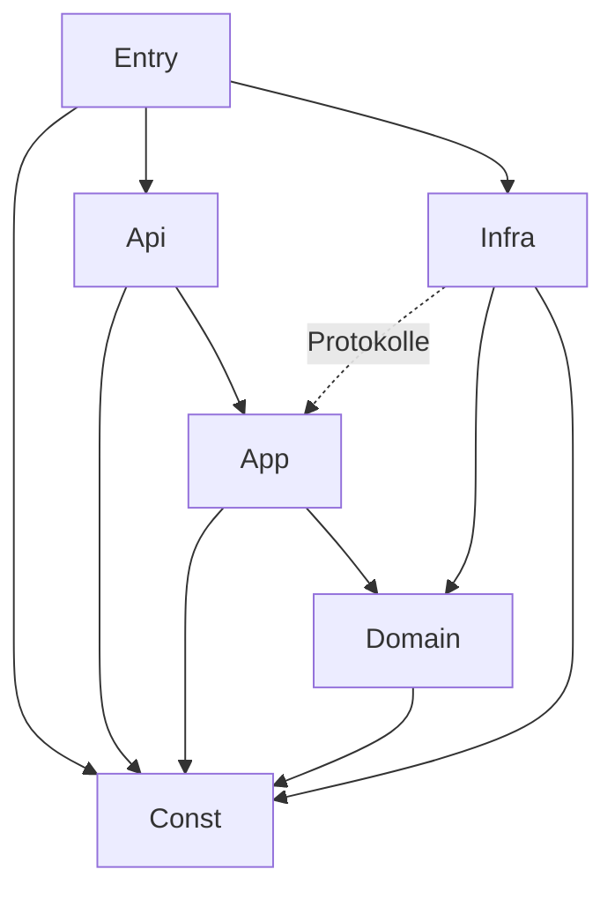

# Code-Dokumentation: Aufgaben-Glücksrad

Stand: 2026-11-03 · Code-Version: 0.0.1 (Gerüst, AP-00) · Vorlage: Code-Dokus „Detailed Energy Card“ und
„HASS Test Data Creator“

Dieses Dokument erfasst den Code mit seinen **Metriken** und **Abhängigkeiten** und protokolliert **jede
Codeänderung**. Es besteht aus zwei Teilen:

1. **Dieses Markdown-Dokument** (von Hand gepflegt): Messgrößen, Schwellwerte, Schichten, Modulübersicht,
   erlaubte Abhängigkeiten, Änderungsprotokoll.
2. **Die generierte Explorer-Seite** `docs/code-doku/index.html` (aus dem Quelltext erzeugt, nicht von Hand
   pflegen): Schichten → Module → Typen → Methoden mit Quelltext, Metriken je Element und Abhängigkeitskarte.
   Erzeugt mit `python3 docs/code-doku/generate.py`, veröffentlicht als Artefakt
   „Task Wheel Code-Dokumentation“. Generator: `tools/code_doku/` (Aufruf über `docs/code-doku/generate.py`), Vorlage: `docs/code-doku/template.html`. Die Seite wird nicht eingecheckt (`.gitignore`), CI erzeugt sie bei jedem Lauf; `--check` bricht bei roten Schwellwerten ab.

---

## 1. Messgrößen

Gleiche Messgrößen wie in den Vorlagen. Werte sind Näherungen eines Quelltext-Scanners, keine Compiler-Analyse.

| Kürzel | Messgröße | Bedeutung | Ebene |
|---|---|---|---|
| LOC | Codezeilen | Zeilen ohne Leerzeilen und reine Kommentare | Modul, Typ, Methode |
| CC | Zyklomatische Komplexität (McCabe) | Anzahl unabhängiger Pfade; Typ = Σ der Methoden | Methode, Typ |
| MI | Wartbarkeitsindex (0–100) | `max(0, (171 − 5,2·ln(V) − 0,23·CC − 16,2·ln(LOC)) · 100 / 171)` | Modul, Typ, Methode |
| Ce | Efferente Kopplung | Anzahl genutzter Typen/Module | Typ, Modul |
| Ca | Afferente Kopplung | Anzahl Typen/Module, die dieses nutzen | Typ, Modul |
| I | Instabilität | `Ce / (Ca + Ce)`; 0 = stabil, 1 = instabil | Typ, Modul |
| Test | Test nennt Typ | Mindestens ein Test referenziert den Typ | Typ |
| Cov | Zeilenabdeckung | aus pytest-cov / Vitest | Modul |
| Dup | Duplikate | doppelte Blöcke laut jscpd/pylint | Projekt |

### 1.1 Schwellwerte (in CI geprüft)

Auslegung durch den Generator (AP-01): Der **MI je Modul** ist der LOC-gewichtete Mittelwert der MI seiner Funktionen und Methoden; Module ohne Funktionen (reine Konstanten- oder Deklarationsdateien) werden nicht bewertet. Der reine Formelwert über das ganze Modul liegt schon bei etwa 100 LOC unter 55 und würde jedes größere Modul rot färben. Die **Instabilität der Domäne** wird erst bewertet, wenn ein Modul von anderen genutzt wird (Ca > 0); Fabriken (Dateiname enthält `factory`) sind ausgenommen, weil sie ihre Strategien kennen und gewollt instabil sind.


| Messgröße | grün | gelb | rot (CI schlägt fehl) |
|---|---|---|---|
| CC je Methode | ≤ 5 | 6–8 | > 8 |
| MI je Modul | ≥ 55 | 35–54 | < 35 |
| LOC je Methode | ≤ 30 | 31–50 | > 50 |
| LOC je Modul | ≤ 300 | 301–500 | > 500 |
| Instabilität Domäne | ≤ 0,5 | 0,51–0,9 | > 0,9 |
| Abdeckung Domäne | ≥ 95 % | 90–94 % | < 90 % |
| Abdeckung übrige | ≥ 85 % | 80–84 % | < 80 % |
| Duplikate | 0 | – | > 0 |
| Bundle (gzip) | ≤ 120 kB | 121–150 kB | > 150 kB |

---

## 2. Schichten und erlaubte Abhängigkeiten

| ID | Schicht | Verzeichnis | darf nutzen |
|---|---|---|---|
| `Const` | 0 Konstanten | `custom_components/task_wheel/const/` | – |
| `Entry` | 1 Einstieg | `__init__.py`, `config_flow.py`, `panel.py` | Api, App, Infra, Const |
| `Api` | 2 Schnittstellen | `services.py`, `websocket/`, `entities/` | App, Domain (nur Modelle), Const |
| `App` | 3 Anwendung | `application/` | Domain, Const (Infra nur über Protokolle) |
| `Domain` | 4 Domäne | `domain/` | Const |
| `Infra` | 5 Infrastruktur | `infrastructure/` | Domain, App (nur `protocols.py`), Const |
| `Panel` | Frontend | `frontend/src/` | intern: views → components → state/api → constants/i18n |

Geprüft durch `import-linter` (Python) und `eslint-plugin-boundaries` (TypeScript).



---

## 3. Modulübersicht

Geplante Module (Zielbild aus KONZEPT.md §3.3). Metriken werden ab AP-01 vom Generator eingetragen; bis dahin
steht „–“.

| Modul | Schicht | Verantwortung | Nutzt | LOC | CC | MI | Ca | Ce | I | Test |
|---|---|---|---|---|---|---|---|---|---|---|
| 2026-11-03 | – | – | `README.md` | geändert: Abschnitt „Lokale Testumgebung (Docker)“ entfernt; `dev/README.md` bleibt bestehen. Kein Code betroffen | – |
| `const/keys.py` | Const | Speicher- und API-Schlüssel | – | – | – | – | – | – | – | – |
| `const/limits.py` | Const | Grenzwerte | – | – | – | – | – | – | – | – |
| `const/defaults.py` | Const | Standardwerte | – | – | – | – | – | – | – | – |
| `const/events.py` | Const | Event-, Dienst-, Befehlsnamen | – | – | – | – | – | – | – | – |
| `domain/models.py` | Domain | Modelle, Serialisierung | enums, errors | – | – | – | – | – | – | – |
| `domain/enums.py` | Domain | StrEnums | – | – | – | – | – | – | – | – |
| `domain/rules/` | Domain | `FrequencyRule`-Strategien (`every_round`, `max_per_period`, `interval`), Perioden, `FrequencyRuleFactory` | models, enums, errors, validation | – | – | – | – | – | – | – |
| `domain/availability/` | Domain | `AvailabilityRule`-Strategien, Factory | models | – | – | – | – | – | – | – |
| `domain/draw/` | Domain | Kandidatenfilter (`PausedFilter`, `AbsenceFilter`, `NoRepeatFilter`, `CandidateFilterFactory`, `CandidateSelector`), Gewichtung (`FairnessWeighting`, `UniformWeighting`, `WeightingFactory`), `DrawEngine` mit injiziertem Zufall | models, enums, errors, availability, const | – | – | – | – | – | – | – |
| `domain/status.py` | Domain | Statusübergänge (Tabelle), Fristen, Punkte | models, enums, errors | – | – | – | – | – | – | ja |
| `domain/statistics/` | Domain | Monatsaggregate (inkrementell, Neuberechnung), Auswertung (KPIs, fairer Anteil, Matrix, Hervorhebungen, Wochenquote) | models, enums, status, rules/periods, serialization | – | – | – | – | – | – | ja |
| `domain/history.py` | Domain | `HistoryFilter` für die Historie | models, enums, validation | – | – | – | – | – | – | ja |
| `domain/swap.py` | Domain | Prüfregeln für den Tausch, Jokerzähler | availability, rules/periods, models | – | – | – | – | – | – | ja |
| `application/protocols.py` | App | Repository-, Recorder-, Clock-, Notifier-Protokolle | models, statistics/aggregate | – | – | – | – | – | – | – |
| `application/draw_service.py` | App | Runden | draw_engine, protocols | – | – | – | – | – | – | – |
| `application/assignment_service.py` | App | Erledigen, Verpasst | status, protocols, round_updates | – | – | – | – | – | – | ja |
| `application/round_updates.py` | App | Zuteilung lesen/ersetzen im Verlauf | protocols | – | – | – | – | – | – | ja |
| `application/swap_service.py` | App | Tausch mit Joker | status, swap, protocols, round_updates | – | – | – | – | – | – | ja |
| `application/schedule_service.py` | App | Zeitpläne, nächste Auslosung | protocols | – | – | – | – | – | – | – |
| `application/statistics_service.py` | App | Aggregate fortschreiben (`AssignmentRecorder`), Auswertung | domain/statistics, availability, protocols | – | – | – | – | – | – | ja |
| `application/history_service.py` | App | Historie: Filter, Seitenabfrage | domain/history, protocols | – | – | – | – | – | – | ja |
| `application/notification_service.py` | App | Texte, Empfänger | protocols | – | – | – | – | – | – | – |
| `infrastructure/repository/` | Infra | `ConfigStore`, `HistoryStore`, Migration, Indizes, `MemoryStore`, Fabrik | models, protocols | – | – | – | – | – | – | ja |
| `infrastructure/scheduler.py` | Infra | HA-Zeitgeber, `TriggerFactory` | models | – | – | – | – | – | – | – |
| `infrastructure/notifier/` | Infra | `NotifierFactory` + Umsetzungen | protocols | – | – | – | – | – | – | – |
| `services.py` | Api | HA-Dienste | application | – | – | – | – | – | – | – |
| `websocket/` | Api | Panel-API | application | – | – | – | – | – | – | – |
| `entities/` | Api | `EntityFactory`, Sensor, To-do, Button | application | – | – | – | – | – | – | – |
| `__init__.py` | Entry | Setup, Komposition | alle | – | – | – | – | – | – | – |
| `config_flow.py` | Entry | Config- und Options-Flow | const | – | – | – | – | – | – | – |
| `panel.py` | Entry | Panel, statischer Pfad | const | – | – | – | – | – | – | – |
| `frontend/src/constants/` | Panel | Routen, Tokens, Grenzen | – | – | – | – | – | – | – | – |
| `frontend/src/i18n/` | Panel | Texte de/en | – | – | – | – | – | – | – | – |
| `frontend/src/api/` | Panel | WebSocket-Client | constants | – | – | – | – | – | – | – |
| `frontend/src/state/` | Panel | Store, Kontext | api | – | – | – | – | – | – | – |
| `frontend/src/components/` | Panel | `tw-wheel` u. a. | constants, i18n | – | – | – | – | – | – | – |
| `frontend/src/views/` | Panel | 7 Views | state, components | – | – | – | – | – | – | – |

### 3.1 Externe Abhängigkeiten

| Paket | Version | Schicht | Zweck |
|---|---|---|---|
| Home Assistant | ≥ 2025.6 (`hacs.json`); Tests laufen gegen die Version von `pytest-homeassistant-custom-component` 0.13.316 (HA 2026.2.3) | Entry, Api, Infra | Plattform |
| voluptuous | mit HA | Api | Schemas |
| lit | 3.3.3 (gepinnt) | Panel | Webcomponents |
| @lit/context | 1.1.6 (gepinnt) | Panel | Zustand |
| vite 8.3.5, typescript 6.0.3, eslint 10.14.0, vitest 5.1.0, typescript-eslint 8.72.1, eslint-plugin-boundaries 7.4.1, jscpd 5.4.2 | gepinnt (`frontend/package.json`) | Build/Test | Werkzeuge |
| ruff 0.17.3, mypy 2.4.1, import-linter 2.15, pylint 4.1.3, pytest-homeassistant-custom-component 0.13.316 | gepinnt (`requirements-dev.txt`) | Build/Test | Werkzeuge |

Laufzeitabhängigkeiten außerhalb von HA: **keine** (`requirements: []` im Manifest).

### 3.2 Messwerte Laufzeit

| Messung | Ziel | Ist |
|---|---|---|
| Runde mit 10 Aufgaben × 6 Personen | < 5 ms | ca. 1,6 ms (AP-06, `tests/domain/draw/test_engine.py`, lokal gemessen) |
| Panel erster Snapshot | < 300 ms | – |
| Bundle gzip | ≤ 120 kB | – |

---

## 4. Änderungsprotokoll

**Pflicht:** Jede Änderung am Code bekommt hier einen Eintrag (neueste oben). Ein Eintrag nennt betroffene
Module, Art der Änderung, Auswirkung auf Metriken und Abhängigkeiten. CI prüft, dass bei Änderungen unter
`custom_components/` oder `frontend/src/` auch diese Datei geändert wurde.

| Datum | Version | AP | Module | Änderung | Metriken / Abhängigkeiten |
|---|---|---|---|---|---|
| 2026-11-03 | 0.0.1 | AP-13 | `domain/statistics/` (`aggregate.py`, `report.py`), `domain/history.py`, `domain/status.py` (`points_factor`), `application/statistics_service.py`, `application/history_service.py`, `application/protocols.py` (`AssignmentRecorder`, `HistoryRepository.rounds_since`), `application/round_updates.py`, `application/assignment_service.py`, `application/swap_service.py`, `infrastructure/repository/history_store.py` (`rounds_since` öffentlich), `const/limits.py`, `const/defaults.py`, `tests/` | neu: Monatsaggregate `Monat → Person → Aufgabe → Status → [Anzahl, Aufgabenpunkte]` (Punkte ohne Faktor, damit geänderte Einstellungen sie nicht entwerten), inkrementell fortgeschrieben: jede Statusänderung zieht den alten Beitrag ab und addiert den neuen (`AssignmentChange`), Monat = Monat des Rundenbeginns, leere Zellen werden entfernt, damit die Struktur der Neuberechnung (`recompute`, `StatisticsService.rebuild`) gleicht. `AssignmentService`/`SwapService` erhalten einen `AssignmentRecorder` (= `StatisticsService`) und melden jede Änderung; AP-08 ruft für neue Runden `record_round` auf. Auswertung `StatisticsService.report(now, months, weeks)`: KPIs (Erledigungsquote = erledigt / (erledigt + verpasst)), Punkte je Person (Faktoren aus den Einstellungen) gegen fairen Anteil (Kapazität = Belastbarkeit × anwesende Tage), Fairness-Index (1,0 = genau fair), Matrix Aufgabe × Person, Glückspilz/Pechvogel (kleinste/größte Abweichung vom fairen Anteil), Zuverlässigste Person (höchste Pünktlichkeitsquote, ab 3 abgeschlossenen), Wochenquote aus den Runden (nicht aus Monatsaggregaten, da Wochen quer zu Monaten liegen). Historie: `HistoryFilter` (Zeitplan, Person auch abgebend, Aufgabe, Status, Zeitraum) und `HistoryService.page` (neueste zuerst, `offset`/`limit` ≤ 200). Aggregate bleiben beim Aufräumen alter Runden erhalten. `AssignmentService`/`SwapService` verlangen den Recorder als dritten Parameter | Neue Module je 25–125 Anweisungen, Abdeckung 100 % (Zweige), max. CC 4; Duplikate 0; import-linter 5/5 grün; Eigenschaftstest (20 Zufallsläufe × 60 Schritte: Aggregate = Neuberechnung); Abhängigkeiten App → domain/statistics, Domain → status/rules/periods (alle erlaubt) |
| 2026-11-03 | 0.0.1 | AP-07 | `domain/status.py`, `domain/swap.py`, `domain/enums.py` (`AssignmentAction`), `domain/errors.py`, `application/assignment_service.py`, `application/swap_service.py`, `application/round_updates.py`, `infrastructure/repository/history_store.py`, `const/keys.py`, `const/limits.py`, `tests/domain/`, `tests/application/`, `tests/infrastructure/` | neu: Statusübergänge als Tabelle `(Status, Aktion) → Status` (offen/getauscht → pünktlich/verspätet/verpasst, offen → getauscht; alles andere `InvalidTransitionError`); Punkte je Status mit einstellbaren Faktoren (`awarded_points`); `AssignmentService` (`complete`, täglicher Lauf `mark_missed` nach Frist + Kulanzzeit, `points`); `SwapService` (`swap`, `jokers_left`): Prüfregeln als Tabelle in `domain/swap.py` (Tausch erlaubt, andere Person, Joker übrig, erlaubt, nicht pausiert, im Fristfenster anwesend), Joker werden je Kalendermonat aus den Tauschvermerken gezählt, ein Rücksetzen ist damit nicht nötig. Der Tausch ändert die bestehende Zuteilung (Person, Status `swapped`, Vermerk); eine Zuteilung kann nur einmal getauscht werden. Korrektur AP-03: der Index „offene Zuteilungen“ führt nun auch getauschte (noch nicht abgeschlossene) Zuteilungen (`PENDING_STATUSES`). Neue Fehlerschlüssel `ERR_INVALID_TRANSITION`, `ERR_SWAP_*`, `ERR_NO_JOKERS`; `OPEN_ASSIGNMENT_MAX_AGE_DAYS` begrenzt die Suche im Verlauf | Neue Module je 16–40 Anweisungen, Abdeckung 100 % (Zweige), max. CC 4; Duplikate 0; import-linter 5/5 grün; Abhängigkeiten App → Domain, App → Protokolle, Domain → availability/rules/models (alle erlaubt), Infra → `domain/status.py` |
| 2026-11-03 | 0.0.1 | AP-03 | `application/protocols.py`, `infrastructure/repository/` (`storage.py`, `config_store.py`, `history_store.py`, `migration.py`, `memory.py`, `factory.py`), `domain/errors.py`, `const/` (`keys.py`, `limits.py`, `defaults.py`), `tests/infrastructure/` | neu: Protokolle `ConfigRepository`/`HistoryRepository`; `ConfigStore` und `HistoryStore` (gebündeltes Speichern über `async_delay_save`, Grenzen je Ressource, unlesbare Daten ⇒ `StorageCorruptError` ohne Datenverlust); Indizes im Verlauf (Zuteilung → Runde, offene je Person, Zuteilungen je Aufgabe), Aufräumen nach Frist (`async_purge`); Migration als Tabelle `von-Version → (nach-Version, Funktion)` (aktuell leer, fehlende Schritte ⇒ `StorageVersionError`); `MemoryStore` als In-Memory-Ersatz für Tests; `factory.py` erzeugt die Stores mit `MigratingStore`. Neue Fehler `LimitReachedError`, `NotFoundError`, `StorageCorruptError`, `StorageVersionError`; Konstanten `STORE_SAVE_DELAY_SECONDS`, `MAX_STORED_ROUNDS`, Fehlerschlüssel | Abdeckung `application`/`infrastructure` (ohne `factory.py`, braucht HA) 100 %; Duplikate 0; import-linter 5/5 grün; Abhängigkeiten Infra → Domain, Infra → Const, App → Domain (alle erlaubt); `factory.py` ist nur mit Home Assistant testbar (CI) |
| 2026-11-03 | 0.0.1 | AP-06 | `domain/draw/` (`types.py`, `candidates.py`, `weighting.py`, `engine.py`), `domain/enums.py` (`ExclusionReason`), `const/defaults.py` (Fairness-Konstanten), `tests/domain/draw/` | neu: Filterkette als eigene Objekte mit Ausschlussgrund (Belastung, Anwesenheit im Fristfenster, keine Wiederholung nur wenn andere übrig) über `CandidateFilterFactory`/`CandidateSelector`; Gewichtungs-Strategien `FairnessWeighting` (Formel KONZEPT §5.3, Gewichte auf `[WEIGHT_MIN, WEIGHT_MAX]` begrenzt, ohne Kapazität gleichverteilt) und `UniformWeighting` über `WeightingFactory`; `DrawEngine.draw_round`/`draw_task` mit injizierter Zufallsquelle (`secure_random()` = `secrets.SystemRandom`), Ziehung per kumulierter Summe und binärer Suche; Punkte der Runde zählen sofort mit, Kapazitäten einmal je Runde; Aufgabe ohne Kandidaten ist „nicht verteilbar“. Häufigkeitsregel bleibt Sache des Aufrufers (AP-08) | ca. 150 Anweisungen, Abdeckung `draw/` 99 % (Zweige), max. CC 4; Laufzeit Runde 10 × 6 ca. 1,6 ms; statistischer Test 10 000 Ziehungen innerhalb ±2 Prozentpunkten; Duplikate 0; Abhängigkeit draw → models, enums, errors, availability, const (alle erlaubt) |
| 2026-11-03 | 0.0.1 | AP-05 | `domain/availability/` (`rule.py`, `strategies.py`, `factory.py`, `calendar.py`), `const/limits.py`, `const/defaults.py`, `tests/domain/availability/` | neu: Anwesenheitsregeln als Strategien (`OnceRule`, `WeeklyDaysRule`, `WeekRhythmRule`) hinter dem Protokoll `AvailabilityRule`; `AvailabilityRuleFactory` (Registry `MappingProxyType`, unbekannte Art → `UnknownKindError`); `PersonAvailability` kombiniert die Regeln einer Person (anwesend, wenn keine Regel abwesend meldet) mit `is_present`, `present_in_window`, `present_day_count` und `preview` (4 Wochen). Wochenrhythmus rechnet mit Fußboden-Division ab dem Wechseltag der Ankerwoche, korrekt vor dem Anker und über Jahreswechsel. Fensterlänge begrenzt (366 Tage), Vorschau 1–12 Wochen; neue Konstanten statt Literale | Domäne availability: ca. 95 Anweisungen, Abdeckung 100 % (Zweige), max. CC 3; Duplikate 0; import-linter 5/5 grün; Abhängigkeit availability → models, validation, errors, const (innerhalb der Domäne bzw. erlaubt) |
| 2026-11-03 | 0.0.1 | AP-04 | `domain/rules/` (`protocol.py`, `periods.py`, `strategies.py`, `factory.py`), `const/keys.py` (`FIELD_FREQUENCY`), `tests/domain/rules/` | neu: Protokoll `FrequencyRule.is_due(assigned, now)`, Strategien `EveryRoundRule`, `MaxPerPeriodRule`, `IntervalRule`, `FrequencyRuleFactory` (Registry `FrequencyKind -> Builder`, keine Verzweigungen). Perioden (Tag, Woche ab Montag, Monat) und Intervall rechnen in Kalendertagen der Zeitzone von `now` und sind damit sommerzeitfest; naive Zeitpunkte werden abgelehnt | ca. 60 Anweisungen, Abdeckung `rules/` 100 %, max. CC 3; Duplikate 0; import-linter 5/5 grün; Abhängigkeit rules → models, validation, enums, errors (alle Domain) |
| 2026-11-03 | 0.0.1 | AP-02 | `const/` (`keys.py`, `limits.py`, `defaults.py`, `events.py`), `domain/` (`enums.py`, `errors.py`, `types.py`, `validation.py`, `serialization.py`, `models.py`), `tests/domain/`, `tests/test_const.py`, `pyproject.toml` (ruff `extend-immutable-calls` für `spec`) | neu: Konstanten (Speicher-/Fehlerschlüssel, Grenzwerte, Standardwerte, Event-/Dienst-/WebSocket-Namen); Domänenmodell nach KONZEPT §4 als `frozen`/`slots`-Dataclasses mit Invarianten in `__post_init__`, StrEnums, PEP-695-Aliase, Strategie-Arten (`OnceAbsence`/`WeeklyDaysAbsence`/`WeekRhythmAbsence`, `EveryRound`/`MaxPerPeriod`/`Interval`, `Recurring`/`OnceTrigger`/`ManualTrigger`) mit Registries (`MappingProxyType`) für die Fabriken aus AP-04/05/08; Serialisierung zentral in `serialization.py` (Decoder je Feld, unbekannte Felder und falsche Typen werden abgelehnt) | Domäne: ca. 420 Anweisungen, Abdeckung 99 % (Zweige), Konstanten 100 %; Duplikate 0; import-linter 5/5 grün; Abhängigkeit Domain → Const (erlaubt) |
| 2026-11-03 | 0.0.1 | AP-01 | `tools/code_doku/` (neu: `constants`, `models`, `metrics`, `segments`, `python_scanner`, `ts_tokens`, `ts_scanner`, `layers`, `dependencies`, `thresholds`, `check`, `project`, `render`, `cli`), `docs/code-doku/generate.py`, `docs/code-doku/template.html` | neu: Code-Doku-Generator. Python über `ast`/`tokenize`, TypeScript über eigenen Token-Scanner; je Modul/Typ/Methode LOC, CC, MI, Ca/Ce/I, „Test nennt Typ“, Signatur, Docstring, Zeilenbereich, Schicht; Explorer-Seite mit Abhängigkeitskarte (Schichtverstöße rot); `--check` liest die Schwellwerte aus §1.1 (CC/LOC je Methode, MI/LOC je Modul, Instabilität Domäne); CI-Job `code-doku`; Auslegung der Schwellwerte in §1.1 ergänzt (MI je Modul gewichtet über Methoden, Instabilität erst ab Ca > 0, Fabriken ausgenommen; Grenze Instabilität Domäne rot ab 0,9); Tests `tests/test_code_doku_*.py`. Kein Code unter `custom_components/` oder `frontend/src/` geändert | Generator: 14 Module, max. CC je Funktion ≤ 8 (ruff C901), Abdeckung ≈ 95 %; Projekt (21 Module) alle Schwellwerte grün; keine Laufzeitabhängigkeit, nur Standardbibliothek |
| 2026-11-03 | 0.0.1 | AP-00 | `custom_components/task_wheel/` (`__init__.py`, `config_flow.py` mit Bestätigungsschritt, `brand/` Symbole, `const/`, Schichtpakete `domain/`, `application/`, `infrastructure/`, `websocket/`, `entities/`), `tools/check_docs_changed.py`, `frontend/src/` (`task-wheel-panel.ts`, `constants/`, `i18n/`, Platzhalter `api/`, `state/`, `components/`, `views/`) | neu: Projektgerüst. Einzelinstanz-Config-Flow, `manifest.json`, `hacs.json`, Konstantenpaket (`DOMAIN`, `INTEGRATION_NAME`), leere Schichtpakete; Lit-Panel-Gerüst mit i18n (de/en), Vite-Build mit Inhalts-Hash, Bundle-Budget; CI-Jobs `hassfest`, `HACS validation`, `lint`, `typecheck`, `architecture`, `test-backend`, `test-frontend`, `build-frontend`, `audit`, `docs-check`; Dependabot, Vorlagen, LICENSE (MIT), Anleitung für die vorhandene Docker-Testinstanz `dev/README.md` | Python: 51 Anweisungen, Abdeckung 96 %, max. CC 3; Frontend: 11 Anweisungen, Abdeckung 100 %, Bundle 6,4 kB gzip; import-linter-Verträge: 5 (Schichten, Domäne frei von HA, Anwendung ohne Infrastruktur, Infrastruktur ohne Schnittstellen, Konstanten unabhängig); Duplikate 0 |
| 2026-11-03 | – | – | – | Annahmen §11 bestätigt; Punkte für verspätet/verpasst einstellbar (Settings, §5.4, AP-07, AP-09) | – |
| 2026-11-03 | – | – | – | Pattern entschieden: Factory + Strategy + Repository (KONZEPT §3.2, §10, README) | – |
| 2026-11-03 | – | – | – | Konzept, Arbeitspakete, Code-Doku-Struktur und README angelegt; noch kein Code | – |

Vorlage für neue Einträge:

```text
| JJJJ-MM-TT | x.y.z | AP-nn | pfad/modul.py, … | neu / geändert / entfernt: was und warum | LOC ±n, max. CC n, neue Abhängigkeit A → B |
```
