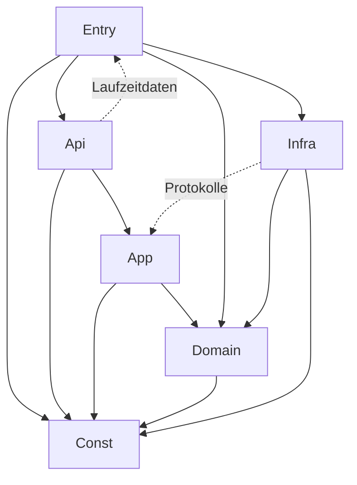

# Code-Dokumentation: Task Wheel of Fortune

Stand: 2026-11-04 · Code-Version: 0.6.0 · Vorlage: Code-Dokus „Detailed Energy Card“ und
„HASS Test Data Creator“

Dieses Dokument erfasst den Code mit seinen **Metriken** und **Abhängigkeiten** und protokolliert **jede
Codeänderung**. Es besteht aus zwei Teilen:

1. **Dieses Markdown-Dokument** (von Hand gepflegt): Messgrößen, Schwellwerte, Schichten, Modulübersicht,
   erlaubte Abhängigkeiten, Änderungsprotokoll.
2. **Die generierte Explorer-Seite** `docs/code-doku/index.html` (aus dem Quelltext erzeugt, nicht von Hand
   pflegen): Schichten → Namensräume → Typen → Properties/Felder und Methoden, drei Spalten (Baum, Details, Quelltext), Metriken je Element und Abhängigkeitskarte, nach dem [Leitfaden Code-Dokumentation](https://claude.ai/artifact/9txBo1nQLP7gMmYQfYcLJe) (siehe §5).
   Erzeugt mit `python3 docs/code-doku/generate.py`, veröffentlicht als Artefakt
   „Task Wheel Code-Dokumentation“. Generator: `tools/code_doku/` (Aufruf über `docs/code-doku/generate.py`), Vorlage: `docs/code-doku/template.html` (unverändert aus dem Leitfaden, Prüfsumme in `template.sha256`). Die Seite wird nicht eingecheckt (`.gitignore`), CI erzeugt sie bei jedem Lauf; `--check` bricht bei roten Schwellwerten ab.

---

## 1. Messgrößen

Gleiche Messgrößen wie in den Vorlagen. Werte sind Näherungen eines Quelltext-Scanners, keine Compiler-Analyse.

| Kürzel | Messgröße | Bedeutung | Ebene |
|---|---|---|---|
| LOC | Codezeilen | Zeilen ohne Leerzeilen und reine Kommentare | Modul, Typ, Methode |
| CC | Zyklomatische Komplexität (McCabe) | Anzahl unabhängiger Pfade; Typ = Σ der Methoden | Methode, Typ |
| MI | Wartbarkeitsindex (0–100) | `max(0, (171 − 5,2·ln(V) − 0,23·CC − 16,2·ln(LOC)) · 100 / 171)` | Modul, Typ, Methode |
| Ce | Efferente Kopplung | Anzahl genutzter Typen/Module | Typ, Modul |
| Ca | Afferente Kopplung | Anzahl Typen/Module, die dieses nutzen | Typ, Modul |
| I | Instabilität | `Ce / (Ca + Ce)`; 0 = stabil, 1 = instabil | Typ, Modul |
| Test | Test nennt Typ | Mindestens ein Test referenziert den Typ | Typ |
| Cov | Zeilenabdeckung | aus pytest-cov / Vitest | Modul |
| Dup | Duplikate | doppelte Blöcke laut jscpd/pylint | Projekt |

### 1.1 Schwellwerte

Die Spalte „Prüfung“ sagt, was die CI tatsächlich erzwingt. Alles andere sind **Richtwerte** für Reviews, kein Gate.

Auslegung durch den Generator (AP-01): Der **MI je Modul** ist der LOC-gewichtete Mittelwert der MI seiner Funktionen und Methoden; Module ohne Funktionen (reine Konstanten- oder Deklarationsdateien) werden nicht bewertet. Der reine Formelwert über das ganze Modul liegt schon bei etwa 100 LOC unter 55 und würde jedes größere Modul rot färben. Die **Instabilität der Domäne** wird erst bewertet, wenn ein Modul von anderen genutzt wird (Ca > 0); Fabriken (Dateiname enthält `factory`) sind ausgenommen, weil sie ihre Strategien kennen und gewollt instabil sind.

| Messgröße | grün | gelb | rot | Prüfung |
|---|---|---|---|---|
| CC je Methode | ≤ 5 | 6–8 | > 8 | `generate.py --check` (rot bricht ab) |
| MI je Modul | ≥ 55 | 35–54 | < 35 | `generate.py --check` (rot bricht ab) |
| LOC je Methode | ≤ 30 | 31–50 | > 50 | `generate.py --check` (rot bricht ab) |
| LOC je Modul | ≤ 300 | 301–500 | > 500 | `generate.py --check` (rot bricht ab) |
| Instabilität Domäne | ≤ 0,5 | 0,51–0,9 | > 0,9 | `generate.py --check` (rot bricht ab) |
| Abdeckung Domäne | ≥ 95 % | 90–94 % | < 90 % | Richtwert; nur global `pytest --cov-fail-under=85` (inkl. `tools/`) |
| Abdeckung übrige | ≥ 85 % | 80–84 % | < 80 % | `pytest --cov-fail-under=85` und Vitest-Schwellen 85 % (global) |
| Duplikate | 0 | – | > 0 | `pylint` (`duplicate-code`) und `jscpd` brechen bei jedem Fund ab |
| Bundle (gzip) | ≤ 120 kB | 121–150 kB | > 150 kB | `npm run bundle-budget`: hart bei > 120 kB (die Gelbstufe ist damit nicht erreichbar) |

Die Gelbwerte erzeugt der Generator als Ampel im Explorer; sie sind kein Gate. Stand 0.4.0 liegen einige Methoden und Module im gelben Bereich (u. a. MI < 55 bei `runtime.py`, LOC > 300 bei `views/draw.ts`); bei der nächsten Änderung dieser Dateien aufteilen, bevor ein Wert rot wird.

---

## 2. Schichten und erlaubte Abhängigkeiten

| ID | Schicht | Verzeichnis | darf nutzen |
|---|---|---|---|
| `Const` | 0 Konstanten | `custom_components/task_wheel/const/` | – |
| `Entry` | 1 Einstieg | `__init__.py`, `config_flow.py`, `runtime.py` (Kompositionswurzel `compose`), `entry_lookup.py`, `sensor.py`, `todo.py`, `button.py` | Api, App, Infra, Domain (`config_flow.py`: Fehler; `runtime.py`: Zufallsquelle), Const |
| `Api` | 2 Schnittstellen | `services.py`, `access.py`, `service_errors.py`, `websocket/`, `entities/` | App, Domain (nur Modelle), Const, Entry (nur `runtime.py` und `entry_lookup.py`: Zugriff auf die Laufzeitdaten des Eintrags) |
| `App` | 3 Anwendung | `application/` | Domain, Const (Infra nur über Protokolle) |
| `Domain` | 4 Domäne | `domain/` | Const |
| `Infra` | 5 Infrastruktur | `infrastructure/` (u. a. `panel.py`, `panel_bundle.py`) | Domain, App (nur `protocols.py` und `event_payloads.py`), Const |
| `Panel` | Frontend | `frontend/src/` | intern: views → components → state/api → constants/i18n |

Geprüft durch `import-linter` (Python; Verträge in `pyproject.toml`: Api → App → Domain, Domäne frei von Home Assistant und Infrastruktur, Anwendung kennt die Infrastruktur nicht, Infrastruktur nutzt keine Schnittstellen, Konstanten unabhängig) und `eslint-plugin-boundaries` (TypeScript). Die Abhängigkeitskarte des Explorers markiert Kanten, die gegen diese Tabelle verstoßen (`tools/code_doku/constants.py`: `LAYER_RULES`, `LAYER_ALLOWED`); sie bewertet nur Schichten, nicht einzelne Dateien wie `protocols.py`.



---

## 3. Modulübersicht

Module des Standes 0.4.0; diese Tabelle ist die maßgebliche Modulliste (KONZEPT.md §3.3 zeigt nur die Paketstruktur). Metriken je Modul, Typ und Methode stehen nicht hier, sondern in der generierten Explorer-Seite (siehe oben); sie werden bei jeder Codeänderung neu erzeugt. `tests/test_code_doku_modules.py` prüft, dass jede Python-Datei des Pakets (außer `__init__.py` in Unterpaketen) in dieser Tabelle vorkommt, einzeln oder über ihr Verzeichnis.

| Modul | Schicht | Verantwortung | Nutzt | Test |
|---|---|---|---|---|
| `const/keys.py` | Const | Speicher- und API-Schlüssel | – | – |
| `const/limits.py` | Const | Grenzwerte | – | – |
| `const/defaults.py` | Const | Standardwerte | – | – |
| `const/events.py` | Const | Event-, Dienst-, Befehlsnamen | – | – |
| `const/notification.py` | Const | Dienst-/Feldnamen, Zielmuster, Grenzen, Textschlüssel der Benachrichtigung | – | ja |
| `const/panel.py` | Const | Bezeichner des Panels (URL-Pfad, Elementname, statische Adresse, Schlüssel in `hass.data`) | – | – |
| `const/entities.py` | Const | Schlüssel, Gerätenamen und Signalnamen der Entitäten | – | – |
| `domain/models.py` | Domain | Modelle | enums, errors, serialization, types, validation | – |
| `domain/serialization.py` | Domain | `to_dict`/`from_dict` für alle Modelle an einer Stelle (Decoder in den Feld-Metadaten) | errors, const/keys | ja |
| `domain/errors.py` | Domain | Fachliche Ausnahmen mit übersetzbarem Schlüssel | – | ja |
| `domain/types.py` | Domain | Typ-Aliase (`PersonId`, `TaskId`, …) | – | – |
| `domain/validation.py` | Domain | Wiederverwendbare Invariantenprüfungen (`ValidationError`) | errors, const/keys, const/limits | ja |
| `domain/enums.py` | Domain | StrEnums | – | – |
| `domain/rules/` | Domain | `FrequencyRule`-Strategien (`every_round`, `max_per_period`, `interval`), Perioden, `FrequencyRuleFactory` | models, enums, errors, validation | – |
| `domain/availability/` | Domain | `AvailabilityRule`-Strategien, Factory | models | – |
| `domain/draw/` | Domain | `feasibility.py` (Machbarkeit: `feasible_persons`, `is_feasible`, `feasible_tasks`), `RoundDraft` (schrittweise Runde, unveränderlich), Kandidatenfilter (`PausedFilter`, `MinLoadFilter`, `AbsenceFilter`, `NoRepeatFilter`, `RoundTakenFilter`, `CandidateFilterFactory`, `CandidateSelector`), Zuordnung (`matching.py`: maximale Zuordnung Aufgabe ↔ Person, sichere Gewinner), Gewichtung (`FairnessWeighting`, `UniformWeighting`, `WeightingFactory`), `DrawEngine` mit injiziertem Zufall | models, enums, errors, availability, const | – |
| `domain/status.py` | Domain | Statusübergänge (Tabelle), Fristen, Punkte | models, enums, errors | ja |
| `domain/statistics/` | Domain | Monatsaggregate (inkrementell, Neuberechnung), Auswertung (KPIs, fairer Anteil, Matrix, Hervorhebungen, Wochenquote) | models, enums, status, rules/periods, serialization | ja |
| `domain/history.py` | Domain | `HistoryFilter` für die Historie | models, enums, validation | ja |
| `domain/deadline.py` | Domain | Frist am Zeitplan: `Deadline` (Beginn als Strategie-Tabelle, Dauer), `DeadlineWindow`, Rechnen mit Einheiten | enums, serialization, validation, const | ja |
| `domain/decisions.py` | Domain | Entscheidungslog: `DecisionRecord` (Auslosung, Tausch, Austausch), `TaskDecision`, `WheelEntry`, `ExcludedEntry`, `Exchange`, `DecisionFilter` | enums, serialization, validation | ja |
| `domain/swap.py` | Domain | Gegenzuteilung und Prüfregeln für den echten Tausch (je Richtung, beide Richtungen) | availability, rules/periods, models | ja |
| `domain/triggers/` | Domain | `TriggerStrategy` (`recurring`, `once`, `manual`), `TriggerFactory`, Ende einmaliger Pläne (Tabelle), Erinnerung | models, rules/periods, validation | ja |
| `application/protocols.py` | App | Repository-, Recorder-, Zeitgeber- (`TimerPort`), Ereignis-Protokolle (`RoundEvents`) | models, statistics/aggregate | – |
| `application/draw_service.py` | App | Runden: automatisch in einem Schritt, Panel schrittweise (`begin`, `spin`, `spin_rest`, `commit`, `cancel`) mit Zeitlimit | draw/, draw_inputs, protocols | ja |
| `application/runs.py` | App | Nächster regulärer Lauf eines Zeitplans, ohne die von manuellen Auslosungen ersetzten | triggers/, protocols | ja |
| `application/draw_inputs.py` | App | Eingaben einer Runde: Punkte im Fenster, Zuteilungszeitpunkte, fällige Aufgaben, `DrawContext` | draw/, rules, availability, protocols | ja |
| `application/ids.py` | App | Kennungen | – | – |
| `application/round_service.py` | App | `RoundService`: Auslosung löschen (Runde samt Zuteilungen), Punkte und Statistik zurückrechnen | errors, models, status, types, protocols | ja |
| `application/assignment_service.py` | App | Erledigen, Verpasst | status, protocols, round_updates | ja |
| `application/round_updates.py` | App | Zuteilung lesen/ersetzen im Verlauf | protocols | ja |
| `application/swap_service.py` | App | Echter Tausch zweier Zuteilungen einer Runde | status, swap, protocols, round_updates | ja |
| `application/schedule_service.py` | App | Zeitpläne: nächste Auslosung, Zeitgeber gezielt setzen, Erinnerungen | draw_service, triggers/, protocols | ja |
| `application/statistics_service.py` | App | Aggregate fortschreiben (`AssignmentRecorder`), Auswertung | domain/statistics, availability, protocols | ja |
| `application/decision_service.py` | App | Entscheidungslog schreiben (`record_draw`, `record_swap`, `record_exchange`), Seitenabfrage, tägliche Bereinigung | domain/decisions, domain/draw, protocols | ja |
| `application/history_service.py` | App | Historie: Filter, Seitenabfrage | domain/history, protocols | ja |
| `application/event_payloads.py` | App | Inhalt der Events (nur Kennungen, Namen, Zahlen) als reine Funktionen | models, protocols | ja |
| `application/maintenance_service.py` | App | Täglicher Wartungslauf: Verpasstes markieren, alte Runden löschen | assignment_service, daily, protocols | ja |
| `application/daily.py` | App | Nächster täglicher Zeitpunkt (über `TriggerFactory`) | triggers/, models | ja |
| `application/fanout.py` | App | `FanOutRoundEvents`: verteilt `RoundEvents` an mehrere Empfänger (Events, Entitäten, Benachrichtigung) | models, protocols | ja |
| `application/lookup.py` | App | Elemente über Kennung, Kurzname oder Name finden | errors | ja |
| `application/notification_service.py` | App | `NotificationService` (`RoundEvents`-Empfänger): Benachrichtigung nach Runde, bei Tausch und als Erinnerung, Ziele ohne Doppelte, Versand im Hintergrund, Zielprüfung (`check_target`) | notification_messages, protocols, names | ja |
| `application/notification_messages.py` | App | Titel und Nachricht aus Meldung, Namen und übersetzten Texten (reine Funktionen, Kürzung) | models, names, protocols | ja |
| `application/names.py` | App | Namen von Aufgabe, Person, Zeitplan für Meldungen (gelöschte über Kennung) | models, protocols | ja |
| `application/config_service.py` | App | Konfiguration ändern: Kennung, Kurzname, Verweise, Löschen mit Aufräumen | schedule_service, draw_service, models | ja |
| `application/views.py` | App | Snapshot und Delta je Objekt, Historieneinträge | draw_service, swap_service, schedule_service, wire | ja |
| `application/live_view.py` | App | `LiveView` (Abonnenten, Deltas), `ObservedTimers` | views, protocols | ja |
| `application/wire.py` | App | Ergebnisse als JSON | serialization, statistics/report | ja |
| `application/entity_state.py` | App | `EntityStateService`: Werte der Entitäten aus Indizes und Aggregaten (offen, Monatspunkte, nächste Auslosung) | domain/statistics, event_payloads, schedule_service, protocols | ja |
| `infrastructure/repository/` | Infra | `ConfigStore`, `HistoryStore`, Migration, Indizes, `MemoryStore`, Fabrik | models, protocols | ja |
| `infrastructure/panel.py` | Infra | Panel registrieren: gebautes Bundle als statischen Pfad bereitstellen, Seitenleiste mit Titel je Systemsprache | const/panel, const/defaults, panel_bundle | ja (nur CI) |
| `infrastructure/panel_bundle.py` | Infra | Findet das gebaute Bundle (Dateiname mit Inhalts-Hash), ohne Home Assistant | – | ja |
| `infrastructure/scheduler.py` | Infra | `HassTimerScheduler` (`async_track_point_in_time`) | – | ja (nur CI) |
| `infrastructure/events.py` | Infra | `HassRoundEvents`: feuert die Events auf dem HA-Bus (`RoundEvents`) | event_payloads, protocols | ja (nur CI) |
| `infrastructure/notifier/` | Infra | `NotifierFactory` (Registry Art → Sender: `EntitySender` mit `notify.send_message`, `ServiceSender` für Legacy-`notify.*`, `NoSender`), `classify` (nur `notify.*`), `HassNotifier` (Prüfung beim Speichern und Senden, Zeitlimit), `TextCatalog` (Texte aus `texts/<Sprache>.json`) | protocols, models, enums, errors | ja |
| `services.py` | Api | HA-Dienste `draw`, `complete`, `swap`, `set_absence` (Schemas, Tabelle Dienst → Handler, Fehlerübersetzung) | application, runtime | ja (nur CI) |
| `access.py` | Api | `ensure_allowed`: Zugriffsrecht für Dienste, Button und To-do-Liste (bei „nur Administratoren“) wie bei den WebSocket-Befehlen | – | ja (nur CI) |
| `service_errors.py` | Api | `to_service_error`: Fachfehler als übersetzbare `ServiceValidationError` für Dienste und Entitäten | domain/errors | ja (nur CI) |
| `websocket/` | Api | Panel-API: Befehlstabellen je Bereich (`read` inkl. `availability/preview`, `actions`, `config`), Schemas aus den Modellfeldern, Anmeldung und Rechteprüfung bei HA (`__init__.py`) | application, runtime, domain/models | ja (`__init__.py` nur CI) |
| `entities/` | Api | `EntityFactory` (Abgleich mit der Konfiguration, Anlegen/Entfernen), Sensoren, To-do, Button als `EntityDescription`-Tabellen, Dispatcher-Signale (`EntityEvents`) | application (`entity_state`), runtime, services | ja (nur CI) |
| `entry_lookup.py` | Entry | Geladene Config Entry finden (Dienste, WebSocket) | runtime | ja (nur CI) |
| `sensor.py`, `todo.py`, `button.py` | Entry | Plattform-Einstiege, die Home Assistant im Integrationsordner sucht; reichen `async_setup_entry` aus `entities/` durch | entities | ja (nur CI) |
| `__init__.py` | Entry | Setup/Entladen der Config Entry, Dienste anmelden, Zeitgeber setzen | runtime, services, infrastructure | ja (nur CI) |
| `runtime.py` | Entry | `TaskWheelData` (`entry.runtime_data`) und `compose`: Komposition aller Objekte an einer Stelle, ohne HA | application, domain | ja |
| `config_flow.py` | Entry | Config-Flow (Einzelinstanz) und Options-Flow (Einstellungen, Grenzen aus `limits`) | const, domain/models | ja (nur CI) |
| `frontend/src/constants/` | Panel | Routen, Tokens, Grenzen, Befehle und Grenzwerte der Ansichten (`insights.ts`) | – | – |
| `frontend/src/i18n/` | Panel | Texte de/en (`insights.*` für Übersicht, Historie, Statistik), Platzhalter, Formatierung (`format.ts`) | – | – |
| `frontend/src/api/` | Panel | WebSocket-Client, typisierte Sicht auf Objekte und Antworten (`models.ts`) | constants | – |
| `frontend/src/state/` | Panel | Store, Kontext, `AsyncValue` (asynchron geladener Wert einer Ansicht; auch die Anwesenheitsvorschau der Personen-Ansicht), `indexById`; keine Fachregeln (die liegen im Backend) | api | – |
| `frontend/src/components/` | Panel | `tw-tab-bar`, `tw-stat`, `tw-chips`, `tw-avatar`, `tw-badge`, gemeinsame Stile; Auslosungs-Animationen als `StageElement`-Strategien (`tw-wheel`, Lostrommel, Slot-Machine, Plinko, Scheinwerfer, Rubbellose, Eilmeldung, Oscar) mit `tw-stage` als Fabrik, `tw-dialog` (Popups für Hinzufügen/Bearbeiten/Bestätigen), `tw-room`, Formularbausteine | constants, i18n | – |
| `frontend/src/views/` | Panel | 7 Views, alle fertig: Übersicht (`overview*.ts`), Historie (`history*.ts`, `csv.ts`, `download.ts`), Statistik (`statistics*.ts`); Modelle (reine Funktionen) getrennt von den Elementen | state, components | – |
| `e2e/` | Test | Playwright-End-to-End-Test gegen eine echte HA-Instanz (Einrichtung über Onboarding und Config Flow, Auslosung → Tausch → Erledigen, Ladezeit des Panels) | – | – |
| `tests/performance/` | Test | Lasttest an den Obergrenzen mit Zeitbudgets | websocket-Harness, Factories | – |

### 3.1 Externe Abhängigkeiten

| Paket | Version | Schicht | Zweck |
|---|---|---|---|
| Home Assistant | ≥ 2025.6 (`hacs.json`); Tests laufen gegen die Version von `pytest-homeassistant-custom-component` 0.13.316 (HA 2026.2.3) | Entry, Api, Infra | Plattform |
| voluptuous | mit HA | Api | Schemas |
| lit | 3.3.3 (gepinnt) | Panel | Webcomponents |
| @lit/context | 1.1.6 (gepinnt) | Panel | Zustand |
| vite 8.3.5, typescript 6.0.3, eslint 10.14.0, vitest 5.1.0, typescript-eslint 8.72.1, eslint-plugin-boundaries 7.4.1, jscpd 5.4.2 | gepinnt (`frontend/package.json`) | Build/Test | Werkzeuge |
| ruff 0.17.3, mypy 2.4.1, import-linter 2.15, pylint 4.1.3, pytest-homeassistant-custom-component 0.13.316, pytest-cov 7.0.0, home-assistant-frontend 20260128.6 | gepinnt (`requirements-dev.txt`) | Build/Test | Werkzeuge |
| @playwright/test ^1.64.1 (Lockfile legt die Version fest), hassil und weitere HA-Basispakete | `e2e/package.json`, `e2e/requirements.txt` (Versionen der HA-Manifeste) | E2E | End-to-End-Test gegen eine echte HA-Instanz |

Laufzeitabhängigkeiten außerhalb von HA: **keine** (`requirements: []` im Manifest).

### 3.2 Messwerte Laufzeit

Gemessen in AP-18 auf dem Entwicklungsrechner (Python 3.13, ein Kern), Bestand an den Obergrenzen aus
`const/limits.py`: 30 Personen, 100 Aufgaben, 30 Zeitpläne; der Verlauf hat 2000 Runden à 10 Zuteilungen, ein realistischer Bestand, nicht die Obergrenze (`MAX_STORED_ROUNDS` = 20000, die tägliche Wartung löscht ältere Runden). Die Tests in
`tests/performance/test_limits.py` prüfen großzügige Budgets (Vielfaches der Messwerte), damit quadratisches
Verhalten auffällt.

| Messung | Ziel | Ist |
|---|---|---|
| Runde mit 10 Aufgaben × 6 Personen | < 5 ms | ca. 1,6 ms (AP-06, `tests/domain/draw/test_engine.py`) |
| Runde mit 100 Aufgaben × 30 Personen (Obergrenze) | < 5 s (CI misst mit Abdeckung ca. 10× langsamer) | ca. 120–130 ms, mit 2000 Runden Verlauf ca. 130–140 ms |
| Snapshot im Backend (Obergrenzen für Personen und Aufgaben, 2000 Runden Verlauf) | < 100 ms | 4 ms (vor AP-18: 48 ms, siehe Änderungsprotokoll) |
| Delta an 50 Abonnenten (`publish`) | < 100 ms | 4 ms (vor AP-18: 49 ms) |
| Statistik für 12 Monate und 52 Wochen | < 250 ms | ca. 18 ms |
| Historie, größte Seite (200 Einträge) | < 250 ms | ca. 24 ms |
| Anwesenheitsvorschau (20 Regeln, 12 Wochen) | < 50 ms | ca. 0,3 ms |
| Panel laden bis zur ersten Ansicht (Chromium, lokale HA-Instanz, `e2e/`) | < 5 s | ca. 1,2 s |
| Bundle gzip | ≤ 120 kB | 68,4 kB (`npm run bundle-budget`, Stand 0.4.0; 0.2.0: 66,9 kB; AP-18: 47,8 kB) |

Testabdeckung: Die Zahlen werden nicht von Hand fortgeschrieben, sondern stammen aus dem Bericht von `pytest` (Zeilen- und Zweigabdeckung inkl. `tools/`, Schwelle 85 %) und `npm test` (Vitest mit v8, Schwellen 85 %); zuletzt gemessen: Python 98,9 % (1115 Tests, Stand AP-18), Frontend 97,9 % Anweisungen (288 Tests, Stand 0.2.0). Seitdem ist Code hinzugekommen (Ziele, Zeiträume, Wiederkehrende Abwesenheiten, Migration 1.3); die aktuellen Werte zeigt der CI-Lauf. End-to-End-Test mit
Playwright (`e2e/`, CI-Job `e2e`): Auslosung, Tausch und Erledigen gegen eine echte Home-Assistant-Instanz.

---

## 4. Änderungsprotokoll

**Pflicht:** Jede Änderung am Code (`custom_components/`, `frontend/src/`), an den Werkzeugen (`tools/`), den E2E-Tests (`e2e/tests/`, `e2e/screenshots/`) und an der Pipeline (`.github/workflows/`, `.github/dependabot.yml`) bekommt hier eine **neue Tabellenzeile**: Module, Art der Änderung, Auswirkung auf Metriken und Abhängigkeiten.

Regeln für die Tabelle (die CI prüft sie, siehe unten):

- **Neueste oben:** Eine neue Zeile steht direkt unter der Kopfzeile der Tabelle (nicht in §3, nicht unten). Das Datum nimmt nach unten nie zu.
- **Version:** die Version, in der die Änderung ausgeliefert wird (bei noch nicht veröffentlichten Änderungen die kommende Version, z. B. `0.4.1`); nach unten nimmt sie nie zu. Zeilen ohne Release-Bezug (reine Konzeptarbeit) tragen `–`. Änderungen vor dem ersten Release stehen unter `0.1.0`, `0.1.1` wurde nie veröffentlicht (seine Änderungen sind in `0.2.0`).
- **Reihenfolge innerhalb eines Tages** folgt der Reihenfolge der Merges in `main` (neuester Merge oben).

CI: `tools/check_docs_changed.py` verlangt bei Änderungen an den oben genannten Pfaden eine **neue Protokollzeile** (Diff dieser Datei mit einer neuen Zeile, die mit einem Datum beginnt; bloßes Berühren der Datei genügt nicht; Dependabot ist ausgenommen). `tools/check_docs_consistency.py` prüft die Reihenfolge und Spalten dieser Tabelle, dass §3 nur Modulzeilen enthält und jede Python-Datei des Pakets dort vorkommt, und dass die Versionen in `manifest.json`, `pyproject.toml`, `frontend/package.json`, `e2e/package.json`, beiden Lockdateien und der Kopfzeile dieser Datei übereinstimmen.

| Datum | Version | AP | Module | Änderung | Metriken / Abhängigkeiten |
|---|---|---|---|---|---|
| 2026-11-05 | 0.6.0 | Räume im Dialog „Aufgabe austauschen“ | `frontend/src/views/{draw,draw-replace}.ts` (`RoomOf`, `ReplaceFlow`-Abhängigkeit `room`), neu `views/draw-people.ts` (`peopleList`, aus `draw.ts` ausgelagert, damit die Datei unter 500 Zeilen bleibt), `draw-flow.test.ts`, `CHANGELOG.md` | geändert (Wunsch Anton): Der Dialog zeigt die Räume der zu ersetzenden Aufgabe und jeder Ersatzaufgabe als Marken (`roomTags` über `#room`, wie in der Rundenliste); keine Duplizierung, die Raumdarstellung wird durchgereicht | 1 neues Modul, keine neuen Abhängigkeiten |
| 2026-11-05 | 0.6.0 | Dokumentation auf Stand gebracht | `README.md`, `docs/REFERENCE.md`, `docs/FAIRNESS.md`, `docs/KONZEPT.md`, `docs/ARBEITSPAKETE.md` | dokumentiert: Entscheidungslog (Tab, Aufbewahrung), Austausch vor dem Start, Warnung bei nicht vergebbaren Aufgaben, manuelles Auslösen mit „Gilt ab“ und Frist, Soll/Ist je Zeitplan, tägliche Aufgaben, Prüfung beim Speichern des Zeitplans, gleiche Segmente ohne Prozentzahlen (Fairness-Text), Nachträge 0.5.0 und 0.6.0 | keine Codeänderung, Metriken unverändert |
| 2026-11-05 | 0.6.0 | Release 0.6.0 | `manifest.json`, `pyproject.toml`, `frontend/package.json`, `e2e/package.json`, Lockdateien, `CHANGELOG.md`, `docs/` | geändert: Version 0.6.0 (Auslosung: Machbarkeit, Frist am Zeitplan, Austausch vor dem Start, Entscheidungslog u. a., #95 bis #115). Keine Logikänderung. | keine Änderung an Metriken und Abhängigkeiten |
| 2026-11-05 | 0.6.0 | Neue Auslosung nach Abschluss | `frontend/src/views/draw.ts` (Knopf „Runde abbrechen“ nur vor dem Abschluss), `i18n/` (`draw.restart`, `draw.done.again`), `e2e/screenshots/readme.spec.ts`, Tests, `CHANGELOG.md` | Rückmeldung Anton: Nach einer abgeschlossenen Runde war unklar, wie eine neue Auslosung beginnt. Der Knopf rechts heißt „Neue Auslosung starten“, der links entfällt nach dem Abschluss und heißt davor „Runde abbrechen“ (er verwirft die offene Runde). Verhalten unverändert (`DrawSession.restart`). | Keine neuen Module oder Abhängigkeiten |
| 2026-11-05 | 0.6.0 | Prozentanzeige im Rad entfernt | `frontend/src/components/{wheel,slot,plinko,spotlight}.ts`, `constants/wheel.ts`, `wheel.test.ts`, `CHANGELOG.md` | Rückmeldung Anton: Das Rad zeigte in den Segmenten noch Prozentzahlen. Entfernt: Text `.chance` und Import `formatPercent` im Rad, ungenutzte `.chance`-Stile in Slot, Plinko, Scheinwerfer; neuer Test, dass das Rad keine Prozentzahl zeigt. Keine Animation zeigt Chancen mehr | Entfernt: `WHEEL_CHANCE_RADIUS`, Abhängigkeit wheel → `i18n/format`; LOC −~20 |
| 2026-11-05 | 0.6.0 | Wer ist dabei: alle ohne Aufgabe | `frontend/src/views/draw.ts` (`#wheelSegments`, `#people` aus `waitingPersons`), `views/draw-rows.ts` (`personRows` durch `waitingPersons` ersetzt), `views/draw-styles.ts`, `i18n/keys.test.ts`, `domain/draw/{candidates,engine,types}.py` (Änderung aus #112 zurückgenommen), Tests, `docs/` | Rückmeldung Anton: „Wer ist dabei?“ und die Animationen zeigen alle Personen der Runde, die noch keine Aufgabe haben, gleich aktiv und gleich groß; Gründe und Ausgrauen entfallen, damit die Zuseher nicht sehen, wer die Aufgabe bekommen darf. Das Backend zieht unverändert nur unter den möglichen Personen (Segmente und Chancen im Entscheidungslog bleiben wahr). Die Rad-Änderung aus #112 im Backend entfällt, weil das Panel das Rad selbst aufbaut. | Entfernt: `personRows`, `Row`, 1 Konstante; Backend wieder auf Stand vor #112; keine neue Abhängigkeit |
| 2026-11-05 | 0.6.0 | Animation immer, keine Prozente | `frontend/src/views/draw.ts` (`#animate` mit `last`, `#autoSpin` nur für die letzte Aufgabe, `#people`, `#result`), `views/draw-rows.ts` (`personRows` ohne Chance), `components/{drum,plinko,slot,spotlight}.ts` (keine Prozenttexte), `constants/{animations,plinko}.ts` (`CHANCE_FREE_ANIMATIONS`, `PLINKO_CHANCE_Y`, `PLINKO_MIN_CHANCE_WIDTH` entfernt), `i18n/` (`draw.who.hint`, `draw.chance` entfernt), Tests, `docs/` | Fehlerbehebung/Rückmeldung Anton: Das Panel spielte die Animation nicht ab, wenn das Rad nur ein Segment hatte; jetzt dreht es bei jeder Aufgabe, nur die allerletzte Aufgabe mit höchstens einer Person wird direkt zugewiesen. Prozentzahlen entfallen überall in der Auslosung (verrieten den Ausgang). | Entfernt: 3 Konstanten, 2 Übersetzungsschlüssel, 5 Importe, rund 40 LOC; keine neue Abhängigkeit |
| 2026-11-05 | 0.6.0 | Personen-Chip bricht nicht mehr um | `frontend/src/views/draw-styles.ts` | geändert (Fehlerbehebung): Der Chip der zugeteilten Person hatte `max-width: 50%` in einer `auto`-Spalte und `overflow-wrap: anywhere`; die Spalte schrumpfte dadurch auf Mindestbreite und der Name brach je Buchstabe um. Jetzt behält der Chip seine natürliche Breite (`white-space: nowrap`, sehr lange Namen kürzt `text-overflow` bei 10 em), den verbleibenden Platz bekommt der Aufgabentext, der umbricht | keine neuen Module, keine neuen Abhängigkeiten |
| 2026-11-05 | 0.6.0 | Rundenliste: Person rechts | `frontend/src/views/{draw,draw-rows,draw-styles}.ts`, neu `views/{task-row,winner-chip}.ts` | geändert (Wunsch Anton): Ist eine Aufgabe zugeteilt, steht die Person rechts in der Zeile als auffälliger Chip (Marke + fetter Name, Rand und Tönung in ihrer Farbe über `--tw-person-color`); der Status links entfällt dann, nur „nicht verteilbar“, „ist dran“ und „wartet“ bleiben. Der Zeilenaufbau liegt in `taskRow` (draw.ts unter der Zeilengrenze), `winnerOf` und `taskStatus` sind reine Funktionen in `draw-rows.ts` | 2 neue Module, keine neuen Abhängigkeiten |
| 2026-11-05 | 0.6.0 | Zeitplan speichern: „in jeder Runde“ vergebbar | `domain/models.py` (`Task.every_round`, `Task.is_mandatory`), `application/draw_inputs.py` (`unassignable_every_round`, Auswahl bevorzugt `is_mandatory`), `application/config_service.py` (`_ensure_every_round_assignable`), `const/keys.py` (`ERR_SCHEDULE_UNASSIGNABLE`, `PH_TASKS`), `translations/{de,en}.json`, `frontend/src/i18n/`, `docs/KONZEPT.md` (§5.1), Tests | neu: Beim Anlegen/Ändern eines Zeitplans prüft `ConfigService` per `unassignable_tasks` (ohne Abwesenheit), ob die Aufgaben „in jeder Runde“ an verschiedene Personen gehen können; sonst `ValidationError(task_ids, schedule_tasks_unassignable)`. Die Auswahl der Runde stellt Aufgaben „in jeder Runde“ und tägliche gleichberechtigt voran (`is_mandatory`) | neu: 3 Funktionen/Eigenschaften, CC ≤ 3; `config_service` hängt jetzt von `draw_inputs` ab (gleiche Schicht) |
| 2026-11-05 | 0.6.0 | Auswahl nur vergebbarer Aufgaben | `domain/draw/feasibility.py` (`pick_assignable`), `application/draw_inputs.py` (`select_assignable` ersetzt `limit_to_participants`, `_priority`; `_seats` und `_pick` entfallen), `application/draw_service.py` (`_start`), `docs/KONZEPT.md` (§5.1), Tests | geändert: Die Auswahl der Runde wählt per Greedy über das Matching (Personen ↔ Aufgaben, Matroid: größtmöglich, tägliche zuerst, Rest zufällig) nur Aufgabenmengen, die sich vollständig vergeben lassen; Aufgaben ohne mögliche Person oder mit Konkurrenz um zu wenige Personen bleiben draußen. Die Warnung vor dem Start bleibt als Absicherung | neu: 1 Funktion, 1 Hilfsfunktion, 2 entfallen, CC ≤ 4; keine neuen Abhängigkeiten |
| 2026-11-05 | 0.6.0 | Rundenliste ohne Umbrüche (Variante B) | `frontend/src/views/{draw,draw-replace,draw-styles}.ts`, `constants/layout.ts` | geändert (Wunsch Anton): Aufgabenzeilen mit Statusstreifen links (grün = ist dran), Name auf voller Breite, darunter Statuszeile (Status · Punkte) und Räume, „Austauschen“ als runder Icon-Knopf (⇄, Beschriftung per `title`/`aria-label`); die Spalten für Status und Knopf und die Smartphone-Sonderregel entfallen. Die Karte links ist auf dem Desktop breiter (`DRAW_CARD_MIN` 300 px, `DRAW_CARD_MAX` 460 px statt 260/340 px) | keine neuen Module, keine neuen Abhängigkeiten |
| 2026-11-05 | 0.6.0 | Warnung vor unvergebbaren Aufgaben | `domain/draw/matching.py` (`unplaceable`), `domain/draw/feasibility.py` (`unassignable_tasks`), `domain/draw/draft.py` (`RoundDraft.unplaceable`), `application/views.py` (`panel_round_view`), `const/keys.py` (`WIRE_UNPLACEABLE`), `frontend/src/{api/types,state/draw-session,views/draw,views/draw-summary,views/draw-styles,i18n}` (`needsConfirmation`, `confirmUnplaceable`, `unplaceableNotice`), Tests | neu: Vor dem Start liefert die Panel-Runde `unplaceable_task_ids` (Aufgaben, bei denen es in mindestens einer größten Zuordnung Personen ↔ Aufgaben leer ausgeht, über abwechselnde Pfade; nutzt `feasible_persons` und den `reach`-Zwischenspeicher der Runde). Das Panel zeigt dann eine Warnung mit diesen Aufgaben („Trotzdem auslosen“ / „Abbrechen“); Drehen und Direktverteilen sind bis zur Bestätigung gesperrt, auch ohne Animation; nach einem Austausch wird neu geprüft | neu: 3 Funktionen, 1 Property, CC ≤ 4; keine neuen Abhängigkeiten |
| 2026-11-05 | 0.6.0 | Austausch: Vergebbarkeit, Auto-Dreh, Layout | `domain/draw/{matching,feasibility}.py` (`assignable_count`, `assignable_tasks`), `application/draw_service.py` (`replacements(panel_round_id, task_id, now)`, `_keeps_round`), `websocket/actions.py` (`draw/replacements` braucht `task_id`), `frontend/src/{api/client,state/draw-session,views/draw,views/draw-replace,views/draw-styles}.ts` (`awaitsSpin`, Grid-Zeilen), `components/draw-start-dialog.ts`, `constants/forms.ts` (Option „morgen um 10:00“ entfällt), Tests | geändert: Eine Aufgabe ersetzt eine andere nur, wenn die Runde danach mindestens so viele Aufgaben an verschiedene Personen vergeben kann wie vorher (Test 1 und Test 2 nur für Andrea: nur gegeneinander tauschbar); der Admin-Austausch startet keine Auslosung mehr von allein (die erste Aufgabe startet nur per Klick, nie automatisch); Aufgabenzeilen als Grid mit festen Spalten für Status und Knopf (Smartphone: Name oben, Status und Knopf darunter); „Gilt ab“ ohne „morgen um 10:00“ | neu: 3 Funktionen/Methoden, CC ≤ 4; keine neuen Abhängigkeiten |
| 2026-11-05 | 0.6.0 | Entscheidungslog bei Löschen | `application/round_service.py` (`RoundService.delete` ruft `forget_round`), `application/decision_service.py` (`forget_round`), `application/protocols.py` (`DecisionRepository.forget_round`, `DecisionRecorder.forget_round`, `NoDecisions`), `infrastructure/repository/decision_store.py` (`forget_round`), `runtime.py`, `tests/application/test_decision_service.py` | behoben: Beim Löschen einer Auslosung (auch einer nicht zu Ende geführten) entfernt das Entscheidungslog nun deren Einträge (Auslosung und Tausch dieser Runde); Einträge anderer Runden und der Admin-Austausch vor dem Start bleiben bis zur Aufbewahrungsfrist | `RoundService` → `DecisionRecorder` (Protokoll, bereits bekannt); keine neuen Module, CC unverändert; Duplikate 0 |
| 2026-11-05 | 0.6.0 | Alte Speicherstände | `infrastructure/repository/migration.py` (`_drop_task_due_days`, `_without_due_days`), `const/keys.py` (`STORE_MINOR_VERSION` 5, `KEY_DUE_DAYS`), `tests/infrastructure/test_repository.py`, `tests/infrastructure/test_decision_store.py` | geändert: Speicherversion 1.5 verwirft das mit #100 entfernte `due_days` der Aufgaben beim Laden (die Frist liegt am Zeitplan); Konfiguration, Verlauf und Entscheidungslog stufen auf 1.5 hoch; behebt „stored data damaged (tasks.due_days: unknown_field)“ | Ce unverändert (nur `const.keys`); keine neue Abhängigkeit |
| 2026-11-04 | 0.6.0 | Nichts fällig | `application/draw_service.py` (`_start`), `application/schedule_service.py` (`_draw_and_finish`), `const/keys.py` (`ERR_NOTHING_DUE`), `translations/de.json`, `translations/en.json`, `frontend/src/i18n/`, `tests/application/`, `docs/KONZEPT.md` (§5.2) | geändert: Bleibt nach Häufigkeitsregel und Begrenzung auf die mitmachenden Personen keine Aufgabe übrig, lehnt `_start` die Auslosung mit `draw_nothing_due` ab, statt eine leere Runde zu speichern (gilt für `draw` und `begin`; eine offene Panel-Runde bleibt unberührt). Die automatische Auslosung loggt das als Info „übersprungen“ statt als Warnung mit Stacktrace; ein einmaliger Plan gilt dann nicht als erledigt. Bestehender Test zur Abwesenheit angepasst, neue Tests für Maximum erreicht, niemand verfügbar und Zeitgeber | neu: 1 Konstante, 1 Zweig in `_start`, 1 in `_draw_and_finish`; keine neuen Abhängigkeiten |
| 2026-11-04 | 0.6.0 | Verbesserungen 1, 2, 4 (Frist am Zeitplan, Machbarkeit, manuelles Auslösen) | `domain/deadline.py` (neu: `Deadline`, `DeadlineWindow`), `domain/draw/feasibility.py` (neu), `application/runs.py` (neu), `domain/models.py` (`Schedule.deadline`, `Assignment.starts_at`, `Round.replaces`; **entfernt:** `Task.due_days`), `domain/enums.py` (`DeadlineStart`, `DeadlineUnit`), `domain/draw/{types,candidates,draft}.py` (`DrawContext.window`, `AbsenceFilter` prüft das Fenster, Zuteilung mit `starts_at`/`due_at` aus dem Fenster), `domain/swap.py` (Fenster ab `starts_at`), `application/draw_service.py` (`draw(window)`, `begin(window, replace_next)`, `ERR_REPLACE_UNCONFIRMED`), `application/draw_inputs.py`, `application/schedule_service.py` (`round_committed`, `next_run` über `runs.py`), `websocket/actions.py` (`draw/begin` mit Pflichtfeldern), `const/{limits,defaults,keys}.py`, `translations/{de,en}.json`, `frontend/src/` (`components/{deadline-editor,duration-input,draw-start-dialog}.ts` neu, `views/{schedules,tasks,draw}.ts`, `state/`, `api/`, `i18n/`), `e2e/`, Tests, `docs/KONZEPT.md`, `README.md`, `docs/REFERENCE.md`, `CHANGELOG.md` | geändert (Entscheidung von Anton, 2026-11-04): Die Frist gehört dem Zeitplan (Beginn: sofort, Versatz, Folgetag, Wochentag; Dauer in Stunden bis Monaten); `due_days` der Aufgabe entfällt ohne Migration. Machbarkeit ersetzt die Prüfung „Tag der Auslosung“ (0.5.1, #96): Kandidat ist, wer irgendwann im Fenster „gilt ab“ bis Frist anwesend ist (plus erlaubt, Belastbarkeit); die Prüfung ist als `feasible_persons`/`is_feasible`/`feasible_tasks` wiederverwendbar. Manuelles Auslösen verlangt Gilt-ab und Frist; bei eingeplanten Zeitplänen bestätigt der Admin das Vorziehen des nächsten Laufs, der Lauf entfällt (`Round.replaces`, dauerhaft über den Verlauf) | Neue Module je ≤ 130 LOC, max. CC ≤ 8; 80 neue Backend-Tests (HA-freie Schichten 1328 grün), Frontend 343 Tests, Bundle 73,5 kB gzip; import-linter 6/6; keine neue Abhängigkeit |
| 2026-11-04 | 0.6.0 | Admin-Austausch vor der Auslosung | `domain/draw/{draft,engine,types}.py` (`RoundDraft.started`/`replace_task`, `TaskReplacement`), `application/draw_service.py` (`replacements`, `replace_task`, `_known_schedule`), `application/draw_inputs.py` (`respecting_schedule`), `websocket/actions.py` (`draw/replacements`, `draw/replace_task`, nur Admin), `const/{keys,events}.py`, `translations/{de,en}.json`, `frontend/src/{api,state,views,i18n,constants}` (`views/draw-replace.ts`: `ReplaceFlow`, Dialog „Aufgabe austauschen“, `canReplace`, `DrawSession.replaceTask`), Tests | neu: Vor dem ersten Dreh tauscht der Admin eine Aufgabe der Panel-Runde gegen eine Aufgabe desselben Zeitplans, die nicht in der Runde ist und im Zeitfenster der Frist machbar ist (`is_feasible` aus `domain/draw/feasibility.py`, Fenster der Frist); danach Fehler `draw_already_started`, sonst `draw_replacement_invalid`/`draw_replacement_infeasible`. Entscheidung Anton 2026-11-04 | neu: 6 Methoden/Funktionen, CC ≤ 4; keine neuen Abhängigkeiten |
| 2026-11-04 | 0.6.0 | Entscheidungslog | `domain/decisions.py` (neu), `domain/enums.py` (`DecisionKind`), `domain/models.py` (`Settings.decision_retention_days`), `application/decision_service.py` (neu), `application/protocols.py` (`DecisionRepository`, `DecisionRecorder`, `NoDecisions`), `application/{draw_service,swap_service,maintenance_service}.py`, `infrastructure/repository/{decision_store,factory,migration}.py`, `runtime.py`, `__init__.py`, `config_flow.py`, `websocket/read.py` (`decisions/list`), `const/`, `translations/`, `frontend/src/` (`views/decisions*.ts`, `views/load-more.ts`, `state/paged-list.ts` ersetzt die doppelte Nachladelogik in `history.ts`, `api/`, `constants/`, `i18n/`), Tests | neu: Jede Auslosung hält je Aufgabe fest, wer im Rad war (mit Chance), wer warum nicht (Gründe der Filterkette plus `not_allowed`) und wer gezogen wurde; Namen werden mitgespeichert, damit Einträge nach Umbenennen oder Löschen lesbar bleiben. Personentausch und der Admin-Austausch einer Aufgabe (`DrawService.replace_task`, Vermerk „vor dem Start“) stehen im Log. Eigener Speicher `task_wheel.decisions`, Aufbewahrung `decision_retention_days` (Standard 7, 1 bis 365; Optionen der Integration), tägliche Bereinigung im Wartungslauf, Obergrenze 5000 Einträge. WebSocket `decisions/list` (Filter Zeitplan, Person, Aufgabe, Art, Zeitraum), für alle angemeldeten Benutzer. Panel: neuer Tab „Entscheidungslog“ nach der Statistik, aufklappbar, Filter Ergebnis, Zeitplan, Person | neue Module je unter 200 LOC, max. CC 5; neue Abhängigkeiten: `DrawService`/`SwapService` → `DecisionRecorder`, `MaintenanceService` → `DecisionService`, `compose` → `DecisionRepository`; Duplikate 0 |
| 2026-11-04 | 0.6.0 | Vorbereitung ohne Animation | `frontend/src/state/draw-session.ts` (`DrawState.direct`, `begin(…, prepare)`), `frontend/src/views/{draw,draw-summary}.ts` (`stageNotice`, `#autoSpin` pausiert), `frontend/src/i18n/{de,en}.ts`, Tests | geändert: Zeitpläne ohne Animation lösen für Administratoren nicht mehr sofort aus, sondern zeigen die bereite Runde (Austausch möglich) bis „Aufgaben direkt verteilen“; für andere Benutzer unverändert. Folge zu Admin-Austausch, Wunsch Anton 2026-11-04 | neu: 1 Zustandsfeld, 1 Parameter, CC ≤ 3; keine neuen Abhängigkeiten |
| 2026-11-04 | 0.6.0 | Admin-Austausch vor der Auslosung | `domain/draw/{draft,engine,types}.py` (`RoundDraft.started`/`replace_task`, `DrawEngine.is_doable`, `TaskReplacement`), `application/draw_service.py` (`replacements`, `replace_task`, `_known_schedule`), `application/draw_inputs.py` (`respecting_schedule`), `websocket/actions.py` (`draw/replacements`, `draw/replace_task`, nur Admin), `const/{keys,events}.py`, `translations/{de,en}.json`, `frontend/src/{api,state,views,i18n,constants}` (`views/draw-replace.ts`: `ReplaceFlow`, Dialog „Aufgabe austauschen“, `canReplace`, `DrawSession.replaceTask`), Tests | neu: Vor dem ersten Dreh tauscht der Admin eine Aufgabe der Panel-Runde gegen eine Aufgabe desselben Zeitplans, die nicht in der Runde ist und mit den heute anwesenden Personen machbar ist (`CandidateSelector.eligible` nicht leer); danach Fehler `draw_already_started`, sonst `draw_replacement_invalid`/`draw_replacement_infeasible`. Entscheidung Anton 2026-11-04 | neu: 6 Methoden/Funktionen, CC ≤ 4; keine neuen Abhängigkeiten |
| 2026-11-04 | 0.6.0 | Soll/Ist je Zeitplan | `domain/statistics/goals.py` (`TaskGoal.schedule_id`, `task_goal`, `build_goals`), `application/statistics_service.py` (`_goals`), `frontend/src/views/statistics.ts` (`#goalsCard`, `#goalTable`), `api/models.ts`, `constants/insights.ts` (`GOALS_SCROLL_MAX_HEIGHT`), Tests | geändert: Soll und Ist werden je Zeitplan berechnet (nur dessen Auslosungen zählen; eine Aufgabe in mehreren Zeitplänen erscheint je Zeitplan, archivierte Zeitpläne entfallen). Das Panel gruppiert sie in einer Scrollbox mit auf- und zuklappbaren Zeitplänen. Wire: `goals[].schedule_id` neu | `build_goals` nimmt zuerst die Zeitpläne; keine neue Abhängigkeit, Komplexität unverändert niedrig |
| 2026-11-04 | 0.6.0 | Tägliche Aufgaben in jeder Runde | `const/limits.py` (`DAILY_EVERY`), `domain/models.py` (`MaxPerPeriod.is_daily`, `Task.is_daily`), `application/draw_inputs.py` (`_pick`), `tests/application/test_draw_inputs.py` | geändert: Täglich anfallende Aufgaben (Häufigkeit „höchstens n× in 1 Tag“) sind in jeder Auslosung dabei; die Begrenzung auf so viele Aufgaben wie Personen füllt die übrigen Plätze zufällig auf. Gibt es mehr tägliche Aufgaben als Plätze, wird unter ihnen zufällig gewählt | `limit_to_participants` unverändert (CC 3), `_random_pick` → `_pick` (CC 3 → 4), keine neuen Abhängigkeiten zwischen Schichten |
| 2026-11-04 | 0.6.0 | Abwesende nicht in Auslosung | `domain/draw/candidates.py` (`AbsenceFilter` prüft `is_present(heute)` statt `present_in_window`), `application/draw_inputs.py` (`_seats` zählt heute anwesende Personen), `tests/domain/draw/test_candidates.py`, `docs/KONZEPT.md`, `CHANGELOG.md` | geändert: Wer am Tag der Auslosung abwesend ist (einmalig, Wochentage, Rhythmus, wiederkehrend), ist kein Kandidat mehr; bisher genügte ein anwesender Tag im Fristfenster. Tausch (`domain/swap.py`) und Kapazität der Statistik behalten das Fenster. | Abhängigkeit unverändert; `AbsenceFilter` nutzt `PersonAvailability.is_present` statt `present_in_window` |
| 2026-11-04 | 0.6.0 | Draw-Ansicht entlastet | `frontend/src/views/{draw,draw-window}.ts` (`drawWindowDialog`, `drawFailure`, `TwDrawView.#schedule`) | Refactoring ohne Verhaltensänderung: Dialog zu Gilt-ab/Frist und Fehlermeldung ausgelagert, Zeitplan-Suche dedupliziert (Modulgrenze 500 LOC) | neu: 3 Funktionen/Methoden, CC ≤ 2; keine neuen Abhängigkeiten |
| 2026-11-04 | 0.5.0 | Release 0.5.0 | `manifest.json`, `pyproject.toml`, `frontend/package.json`, `e2e/package.json`, Lockdateien, `CHANGELOG.md`, `docs/` | geändert: Version 0.5.0 (echter Tausch statt Joker, Abbruch nur für Administratoren, monatlicher Zeitplan, Review-Korrekturen aus #87–#90). Keine Logikänderung. | keine Änderung an Metriken und Abhängigkeiten |
| 2026-11-04 | 0.5.0 | Entscheidung Eigentümer (echter Tausch) | `domain/swap.py` (`SwapSide`, `find_counterpart`, `ensure_direction_possible`, `ensure_swap_possible` für beide Richtungen; **entfernt:** `jokers_used_by_person`, `jokers_left`, Prüfungen `no_jokers_left` und `swap_person_not_in_round`), `application/swap_service.py` (`swap` tauscht zwei Zuteilungen; **entfernt:** `jokers_left`, `jokers_left_for`), `application/views.py` (`SnapshotBuilder` ohne `SwapService`, kein `jokers_left` je Person, kein `person_ids` im Rundenkopf), `application/notification_messages.py`/`texts/` (Text „Aufgabe getauscht“), `const/keys.py` (neu `ERR_SWAP_NO_OPEN_ASSIGNMENT`; entfernt `ERR_NO_JOKERS`, `ERR_SWAP_NOT_IN_ROUND`, `WIRE_JOKERS_LEFT`, `WIRE_PERSON_IDS`), `translations/{de,en}.json`, `runtime.py`, `frontend/src/` (`views/overview-model.ts` `swapTargets` liefert Person samt offener Aufgabe, `views/overview-assignments.ts`, `api/models.ts`, `i18n/`), Tests, `docs/KONZEPT.md` §5.4, `README.md`, `CHANGELOG.md` | geändert (Entscheidung von Anton, 2026-11-04): Der Tausch ist ein echter Tausch Aufgabe gegen Aufgabe innerhalb einer Runde (bisher bekam die Zielperson die Aufgabe zusätzlich, Befund BE-23). `SwapService.swap(assignment_id, to_person_id, now)` behält die Signatur; die Gegenzuteilung ist die offene Zuteilung der Zielperson in derselben Runde (früheste Frist), sonst `swap_person_has_no_open_assignment`. Die Regeln (tauschbar, erlaubt, nicht pausiert, Belastbarkeit, Anwesenheit) gelten in beiden Richtungen über dieselbe Funktion; beide Zuteilungen wechseln Status `swapped`, Person und `Swap`-Vermerk und werden über `store_assignments` atomar gespeichert (Aggregate stimmen mit der Neuberechnung), je Zuteilung ein Event `assignment_swapped`. Der Tausch hat nichts mit Jokern zu tun: Prüfung, Zähler und Anzeige entfallen; `jokers_per_month` (Options Flow, `Settings`, Speicherstand) bleibt für später reserviert, keine Migration. Panel: Auswahl zeigt „Person (Aufgabe)“ nur für Personen derselben Runde mit offener Aufgabe, Hinweis bei fehlenden Zielen, Knopf gesperrt bei bereits getauschter Zuteilung | Entfernt: Jokerzähler, zwei Prüfregeln, zwei Konstanten, Rundenkopf-Feld `person_ids`; neue Tests für beide Richtungen, Punkte/Statistik, fehlendes oder unzulässiges Gegenstück, Runde, Doppeltausch; Schichten unverändert (import-linter grün) |
| 2026-11-04 | 0.5.0 | BE-24, DO-23 | `application/draw_service.py` (`begin`, `cancel`, `_has_results`), `websocket/{__init__,command,actions}.py` (`Request.is_admin`), `services.py` (`_ensure_one_target`), `const/keys.py`, `translations/{de,en}.json`, `frontend/src/i18n/{de,en}.ts`, Tests | geändert: Eine Panel-Runde mit schon gezogenen Ergebnissen dürfen nur Administratoren verwerfen (`draw/cancel`) oder durch erneutes `draw/begin` ersetzen (Fehler `draw_cancel_admin_only`); vor dem ersten Ergebnis darf jeder schließen. Der Dienst `complete` ohne eindeutiges Ziel wirft einen übersetzten `ServiceValidationError` (`target_required`) statt `vol.Invalid`. Entscheidung Anton 2026-11-04 | neu: 1 Methode, 1 Hilfsfunktion, CC ≤ 3; keine neuen Abhängigkeiten |
| 2026-11-04 | 0.5.0 | BE-09 | `domain/triggers/strategies.py` (`RecurringStrategy._is_first_selected_day`), `tests/domain/triggers/test_triggers.py` | geändert: „Monatlich“ löst jetzt wirklich nur am **ersten** gewählten Wochentag des Monats aus (ein Termin je Monat); bisher löste es mit mehreren Wochentagen (z. B. Mo+Do) an jedem gewählten Wochentag der ersten sieben Tage aus. Entscheidung Anton 2026-11-04 | neu: 1 Methode, CC ≤ 3; keine neuen Abhängigkeiten |
| 2026-11-04 | – | README überarbeitet | `README.md`, `docs/{FAIRNESS,REFERENCE,DEVELOPMENT}.md` (neu), Kommentar in `tools/check_docs_consistency.py` | geändert: README für Endnutzer (Nutzen, Screenshots, Installation, Schnellstart); Fairness-Erklärung, Referenz (Dienste, Ereignisse, Entitäten, Panel, WebSocket) und Entwicklung/Release/CI in eigene Dokumente verschoben; kein Code | – |
| 2026-11-04 | 0.5.0 | Review Frontend (FE-01, FE-02, FE-03, FE-04, FE-05, FE-19) | `frontend/src/state/{store,draw-session,index}.ts`, `components/{motion,stage-base}.ts`, `constants/{draw,routes,index}.ts`, `views/draw.ts`, `task-wheel-panel.ts`, Tests | geändert (Review Frontend, Korrektheit): `Store` zählt Ladegenerationen und beendet Abonnements, die nach `stop()` oder bei überlappendem Reconnect eintreffen, neu `Store.reload()`; `MotionToken.cancelled` und `Promise.race` in `StageElement.spinTo`, damit ein abgebrochener Lauf den Aufrufer nicht mehr hängen lässt (`landed()` in `finally`); `DrawSession` verwirft Antworten nach „Neu starten“ (Generationszähler), Knopf in `busy` gesperrt, Phasen als `DRAW_PHASE`, reine Funktionen `isIdle`, `canSkip`, `shownCount`; die Sitzung überlebt den Tabwechsel; Panel fängt Ladefehler einer Ansicht ab (Fehlertext, „Erneut versuchen“), zeigt bei Verbindungsfehler mit altem Stand ein Banner | LOC +~190, max. CC 7, keine neue Abhängigkeit zwischen Schichten |
| 2026-11-04 | 0.5.0 | Review Frontend (FE-10, FE-11, FE-26, FE-27) | `frontend/src/components/{modal,dialog,confirm-dialog,action-menu,tab-bar,styles}.ts`, `views/{config-view,overview,history,statistics}.ts`, `constants/panel.ts`, `test-setup.testing.ts`, Tests | geändert (Barrierefreiheit): `tw-dialog` und `tw-confirm-dialog` nutzen das native `<dialog>` über die gemeinsame Basis `ModalElement` (Fokusfalle, inerter Hintergrund, Escape, Fokusrückgabe; Rückfrage beginnt bei „Abbrechen“); Aktionsmenü mit Pfeiltasten, Pos1/Ende, Fokus ins Menü und Rückgabe, Klick-Zuhörer nur solange es offen ist; Tabellen mit `scope` und verstecktem `caption`; Strg-/Cmd-/Mittelklick auf Tabs bleibt beim Browser; Karten der Konfigurationsansichten als `role=button` mit Namen statt Block-Inhalt im `<button>`; `<div>` nicht mehr in `<span>`; Rubbel-Canvas `aria-hidden` | neu: `components/modal.ts` (ModalElement), Abhängigkeit Dialoge → modal; LOC +~150 |
| 2026-11-04 | 0.5.0 | Review Frontend (FE-12, FE-20, FE-24) | `frontend/src/views/{history,overview,statistics}.ts`, `constants/insights.ts`, Tests | geändert (Laden): Historie holt bei Live-Änderung und nach dem Löschen alle bisher gezeigten Runden in einer Anfrage neu (`LOAD_KEEP`, höchstens `HISTORY_PAGE_SIZE_MAX`), „Mehr laden“ bleibt erhalten; Übersicht nutzt `LiveLoad` und lädt nach einer Aktion nur einmal (über das Delta); Statistik setzt beim Laden `aria-busy` und dimmt die alten Zahlen | LOC -~15, keine neue Abhängigkeit |
| 2026-11-04 | 0.5.0 | Review Frontend (FE-13, FE-21) | `frontend/src/task-wheel-panel.ts`, `api/client.ts`, `state/{areas,context,index}.ts`, `views/{draw,history,overview,statistics,tasks}.ts`, Tests | geändert (Leistung): `hass` ist ein eigener Zugriffsweg und löst nur bei geänderter Sprache, geänderten Räumen oder Diensten ein Neuzeichnen aus (das neueste `hass` geht trotzdem an `ApiClient` und Menü-Knopf); `ApiClient.areas()` und `notifyTargets()` sind nach Identität der Quellen zwischengespeichert (Sortierung mit `compareText`), `areaNames` je Liste, `StoreController.areaNames()` ersetzt fünf Aufrufe | neu: `Memo` in `api/client.ts`; weniger Arbeit je HA-Zustandsänderung |
| 2026-11-04 | 0.5.0 | Review Frontend (FE-14, FE-15) | `frontend/src/i18n/{format,index}.ts`, `components/{summaries,format,index,wheel,drum,slot,plinko,spotlight}.ts`, `views/{draw,draw-rows}.ts`, Tests | geändert: `Intl`-Formatierer werden pro Sprache einmal gebaut (`perLanguage`); `formatDateTime` und `formatPercent` ersetzen `toLocaleString` und `percentText` (Prozent folgt der Sprache); `fill()` entfernt, Platzhalter über `translate(key, lang, params)` | entfernt: `percentText`, `fill` |
| 2026-11-04 | 0.5.0 | Review Frontend (FE-16, FE-17) | `frontend/src/components/{avatar,format,oscar,chips,chip-select,scratch}.ts`, `views/{draw,persons,statistics-charts,draw-styles}.ts`, `state/{color,lookup,index}.ts`, `constants/insights.ts`, Tests | geändert (Sicherheit, Duplikate): `tw-avatar` ist die einzige Marke (Größe über `--tw-avatar-size`), Initial über `initialOf` (Intl.Segmenter, Emoji bleiben ganz); neu `safeColor` (nur `#rrggbb`) beim Einlesen der Personen, Farben in Stilangaben über `styleMap` statt Zeichenketten | neu: `state/color.ts`; entfernt: `INITIAL_LENGTH`, vier Kopien des Avatar-Markups |
| 2026-11-04 | 0.5.0 | Review Frontend (FE-18) | `frontend/eslint.config.js`, `src/constants/{colors,tokens,layout,index}.ts`, `components/{oscar,news,scratch,spotlight,wheel,drum,slot,plinko,segmented,modal}.ts`, `views/{config-view,draw-styles}.ts` | geändert (Lint, Konstanten): neue Regel `no-restricted-syntax` verbietet Hex-, rgb- und hsl-Werte außerhalb von `constants/` (auch in `css`-Vorlagen); alle Farben stehen jetzt als Tokens (`--tw-color-white`, `-ink`, `-stage`, `--tw-glow-gold`) oder in `constants/colors.ts`; Kartenbreiten der Auslosung in `constants/layout.ts`. Längen, Dauern und Winkel in CSS bleiben in den Komponenten | neu: `constants/colors.ts` |
| 2026-11-04 | 0.5.0 | Review Frontend (FE-22) | `frontend/src/components/wheel.ts`, Tests | geändert: `TwWheel` erbt von `StageElement` (gemeinsames Abbruch- und Reduced-Motion-Verhalten, `MotionToken.sleep` statt eigenem Zeitgeber, `language` für die Prozentanzeige) | LOC -~25, Abhängigkeit wheel → stage-base |
| 2026-11-04 | 0.5.0 | Review Frontend (FE-23, FE-25, FE-28) | `frontend/src/views/{download,registry,index}.ts`, `i18n/{de,en,keys.test}.ts`, entfernt: `views/section-view.ts`, Tests | geändert/entfernt: Download hängt den Link ins Dokument und gibt die Objekt-URL verzögert frei (`REVOKE_DELAY_MS`); Totcode `SectionView`/`defineView` und 15 ungenutzte Übersetzungsschlüssel entfernt, `SectionViewElement` als schmaler Typ; neuer Test prüft Parität de/en, Platzhalter und ungenutzte Schlüssel | LOC -~110 |
| 2026-11-04 | 0.5.0 | BE-10 (Teil) | application/views | Literal "schedule_id" in panel_round_view durch WS_FIELD_SCHEDULE_ID ersetzt | übrige Literale offen |
| 2026-11-04 | 0.5.0 | BE-15 | application/schedule_service | arm_all holt beim Start einmalige Termine nach, die in der Ausfallzeit lagen und noch keine Runde haben (danach gilt after wie sonst) | Erinnerung mit 'zuletzt erinnert am' nicht umgesetzt |
| 2026-11-04 | 0.5.0 | BE-28 | application/round_updates, application/assignment_service | Neues store_assignments: je Runde ein Speichern und ein Fortschreiben der Aggregate; mark_missed nutzt es | Verpasst-Lauf: 1 Speichern je Runde statt je Zuteilung |
| 2026-11-04 | 0.5.0 | BE-08 | domain/serialization, infrastructure/repository/history_store | Feldnamen je Datenklasse einmal ermittelt; HistoryStore kodiert beim Speichern nur geänderte Runden neu (Zwischenspeicher je Runde) | Speichern O(geänderte Runden) |
| 2026-11-04 | 0.5.0 | BE-12, BE-19, BE-11 (f) | `domain/draw/engine.py` (`draw_round` entfernt, `draw_task`/`preview_task` mit `capacity` und `reach`), `domain/draw/draft.py` (`capacity`, `reach`), `domain/draw/candidates.py` (`_reach`), `domain/draw/matching.py` (`max_matching` entfernt), `domain/swap.py` (`jokers_used` entfernt), `domain/availability/calendar.py` (`present_day_count` gemerkt), Tests (`draw_round` und `max_matching` als Testhilfen über `RoundDraft`) | geändert (Befunde BE-12, BE-19, BE-11 f): Die Kapazitäten je Person werden einmal je Runde berechnet und der Erreichbarkeits-Zwischenspeicher wird über alle Ziehungen der Runde geteilt (bisher rechnete jede Ziehung beides neu, der Zwischenspeicher mit `setdefault` sparte nichts); `present_day_count` merkt sich je Fenster das Ergebnis. Entfernt: die nur von Tests genutzten `DrawEngine.draw_round` (doppelte Rundenlogik von `RoundDraft`), `matching.max_matching` und `swap.jokers_used`; die Tests ziehen jetzt über `RoundDraft`, also über den Betriebspfad. `StatisticsService.rebuild` bleibt als Reparaturfunktion bestehen (Entscheidung des Eigentümers: als Befehl anbieten oder löschen). | Entfernt: 3 Funktionen (rund 55 LOC), Duplikat der Rundenlogik beseitigt; Auslosung mit 30 Personen und 100 Aufgaben rechnet Kapazität und Erreichbarkeit je Runde statt je Ziehung |
| 2026-11-04 | 0.5.0 | BE-17, BE-22, BE-29 | `websocket/subscriptions.py` (neu, `SubscriptionBook`), `websocket/__init__.py`, `websocket/command.py` (`subscribes`), `websocket/read.py`, `const/limits.py` (`MAX_SUBSCRIPTIONS_PER_CONNECTION`), `application/notification_service.py` (`_send_one`), `application/lookup.py`, `domain/errors.py` (`AmbiguousReferenceError`), `const/keys.py` (`ERR_AMBIGUOUS`), `translations/`, Tests | geändert (Befunde BE-17, BE-22, BE-29): Je WebSocket-Verbindung gibt es höchstens zwei Abonnements; ein weiteres ersetzt das älteste (ein Client kann die 50 globalen Plätze nicht mehr allein belegen). Der Sammelversand von Benachrichtigungen protokolliert auch Fehler, die keine Fachfehler sind (z. B. ein abgelehntes Schema des Benachrichtigungsdienstes), und stört weder die übrigen Ziele noch den Hintergrundtask. Dienste lösen einen mehrdeutigen Namen nicht mehr still auf: `find_by_ref` wirft `ambiguous_reference`, wenn mehrere Elemente passen (z. B. zwei Aufgaben desselben Namens). | neu: 1 Modul, 1 Klasse, 1 Fehlerart; keine neuen Abhängigkeiten |
| 2026-11-04 | 0.5.0 | BE-02, BE-03, BE-18, BE-20, BE-25, BE-26 | `access.py` (neu, `ensure_allowed`), `service_errors.py` (neu, `to_service_error`, `to_setup_error`), `services.py`, `entities/base.py`, `entities/button.py`, `entities/todo.py`, `application/config_service.py` (`add_absence`), `application/live_view.py` (`drop_all`, `AccessWatch`), `runtime.py`, `__init__.py` (`_follow_panel_visibility`, Reihenfolge Panel), `translations/`, `pyproject.toml` (import-linter), `docs/KONZEPT.md` (§8), Tests | geändert (Befunde BE-02, BE-03, BE-18, BE-20, BE-25, BE-26): „Panel nur für Administratoren“ gilt auch für die Dienste, den Button „Auslosen“ und das Abhaken in der To-do-Liste (Aufrufe ohne Benutzer bleiben erlaubt). Beim Aktivieren werden bestehende Abonnements abgemeldet, und der Seitenleisteneintrag wird neu registriert statt erst nach einem Neustart zu folgen. Das Panel wird nach den Plattformen registriert und beim Entladen über `async_on_unload` entfernt (kein ValueError beim erneuten Einrichten). Beschädigter oder zu neuer Speicher bricht das Setup mit einem übersetzten `ConfigEntryError` ab. `set_absence` ruft `ConfigService.add_absence` (Fachlogik und Speicherzugriff nicht mehr in `services.py`); `to_service_error` liegt in `service_errors.py`, `services` steht im Schichtvertrag der Schnittstellen, ein neuer Vertrag verbietet Domäne und Anwendung die Einstiegsmodule. | neu: 2 Module, 1 Vertrag in import-linter (6 Verträge); keine neuen Abhängigkeiten |
| 2026-11-04 | 0.5.0 | BE-06, BE-07 | `application/draw_service.py` (`_ensure_known`, `_ensure_not_flooded`, `commit`), `infrastructure/repository/history_store.py` (`_evict_oldest_closed`), `const/limits.py` (`DRAW_MIN_INTERVAL_SECONDS`), `const/keys.py` (`ERR_DRAW_TOO_SOON`, `PH_SECONDS`), `translations/de.json`, `translations/en.json`, `docs/KONZEPT.md` (§8.1), Tests | geändert (Befunde BE-06, BE-07): Eine Runde wird nur gespeichert, wenn Zeitplan, Personen und Aufgaben noch existieren (sonst `NotFoundError`, die Panel-Runde entfällt). Von Hand oder per Dienst ausgelöste Runden desselben Zeitplans brauchen 30 Sekunden Abstand (`draw_too_soon`; automatische Auslosungen nicht betroffen). Ist `MAX_STORED_ROUNDS` erreicht, entfällt die älteste abgeschlossene Runde (Aggregate bleiben) statt alle weiteren Auslosungen abzulehnen. Nicht umgesetzt: Begrenzung der Panel-Runden je Benutzer (die Auslosung kennt den Benutzer nicht). | neu: 2 Hilfsmethoden, 1 Funktion; keine neuen Abhängigkeiten |
| 2026-11-04 | 0.5.0 | BE-11 (a-e) | `const/keys.py` (`RESOURCE_*`), `const/limits.py` (`ONE_DAY`, `ONE_WEEK`, `OPEN_ASSIGNMENT_MAX_AGE`, `RECENT_HISTORY`), `domain/enums.py` (`PENDING_STATUSES`, `DONE_STATUSES`, `UNDONE_STATUSES`, `CLOSED_STATUSES`, `WITHOUT_DONE_AT_STATUSES`), `domain/rules/periods.py` (`week_start`), `domain/status.py`, `domain/models.py`, `domain/statistics/`, `domain/triggers/strategies.py`, `domain/availability/`, `domain/draw/engine.py`, `application/` (`config_service`, `swap_service`, `draw_service`, `round_service`, `round_updates`, `assignment_service`, `draw_inputs`, `live_view`, `statistics_service`, `views`), `infrastructure/repository/`, `entities/signals.py`, `services.py`, `entities/todo.py` | geändert (Befund BE-11 a-e, kein duplizierter Code): Ressourcennamen für Fehler, Statusmengen und Zeitspannen haben je eine Quelle in `const/` bzw. `domain/enums.py` statt je Modul eigener Kopien; `week_start` ersetzt zwei Kopien von `_monday`; `SnapshotBuilder` liest die offenen Zuteilungen einmal für Zuteilungen und Runden; `EntityEvents` führt Erledigt/Verpasst/Unerledigt auf eine Methode zurück. Keine Verhaltensänderung. | Duplikate verringert; keine neuen Abhängigkeiten |
| 2026-11-04 | 0.5.0 | BE-04, BE-05 | `application/schedule_service.py` (`_on_fire`, `_draw_and_finish`, `check_reminders`), `application/maintenance_service.py` (`run`), Tests | geändert (Befunde BE-04, BE-05): Ein einmaliger Zeitplan wird nur nach gelungener Auslosung archiviert, gelöscht oder auf manuell gestellt; schlägt die Auslosung fehl, bleibt er unverändert. Der nächste Zeitgeber (Zeitplan, tägliche Erinnerung, Wartung) wird auch dann gesetzt, wenn der Rückruf unerwartet eine Ausnahme wirft (Zeitplan per `try/finally`, Erinnerung und Wartung vor der Arbeit). | neu: 1 Hilfsmethode; keine Änderung an Abhängigkeiten |
| 2026-11-04 | 0.5.0 | BE-01, BE-16 | `const/limits.py` (`RETENTION_MIN` = längster Verlaufsbedarf, `OPEN_ASSIGNMENT_SAFETY_DAYS`), `const/defaults.py` (`DEFAULT_HISTORY_RETENTION_DAYS`), `const/keys.py` (`STORE_MINOR_VERSION` 4), `infrastructure/repository/history_store.py` (`async_purge`, `_has_pending`), `infrastructure/repository/migration.py` (`_retention_floor`), Tests | geändert (Befund BE-01, BE-16): Die Aufbewahrung beträgt mindestens so viele Tage, wie Häufigkeitsregeln, Fairness-Fenster und offene Zuteilungen Verlauf brauchen (373); der Speicher 1.4 hebt kürzere gespeicherte Werte beim Laden an. Der nächtliche Aufräumlauf behält Runden mit offenen oder getauschten Zuteilungen. Das Suchfenster der offenen Zuteilungen hat einen Sicherheitstag mehr, damit Zuteilungen mit längster Frist plus Kulanz auch bei Sommerzeit noch als verpasst markiert werden. | neu: 1 Migrationsschritt (1.3 -> 1.4), 1 Hilfsfunktion; keine neuen Abhängigkeiten |
| 2026-11-04 | 0.5.0 | Doku-Review: Werkzeuge | `tools/check_docs_changed.py` (Präfixe um `tools/`, `e2e/tests/`, `e2e/screenshots/`, `.github/workflows/`, `.github/dependabot.yml` erweitert; verlangt eine neue Protokollzeile statt nur eine Änderung der Datei; `doc_diff`; Dependabot ausgenommen), `tools/check_docs_consistency.py` (neu: Versionen aller Release-Dateien, §3 nur Modulzeilen und vollständig gegenüber dem Paket, §4 neueste oben mit nicht steigender Version), `tools/code_doku/constants.py` (`LAYER_RULES`: `runtime.py`, `entry_lookup.py`, `sensor.py`, `todo.py`, `button.py` als Entry statt Other, nicht vorhandenes `panel.py` entfernt; `LAYER_ALLOWED`: Entry → Domain, Api → Entry), Tests `tests/test_check_docs_changed.py`, `tests/test_check_docs_consistency.py`, `tests/test_code_doku_scanners.py` | neu / geändert: Doku-Gate und Konsistenzprüfung (CI-Job `docs-check`); die Abhängigkeitskarte des Explorers meldet keine unzulässigen Kanten mehr (vorher 32 durch fehlende Schichtzuordnung; 13 echte Kanten, die §2 jetzt erlaubt: Api → Entry für Laufzeitdaten, Entry → Domain für Modelle und Fehler) | `tools/` wird vom Generator nicht erfasst; ruff C901 ≤ 8, pylint 10/10, neue Abhängigkeiten nur Standardbibliothek |
| 2026-11-04 | 0.5.0 | Doku-Review: Pipeline | `.github/workflows/release.yml` (Job `verify`: Tag = Manifest-Version, Commit in `main`, alle CI-Jobs grün auf dem Commit, wartet auf laufende Jobs; Job `release` mit `npm ci --ignore-scripts`, prüft die Einstiegsdatei des Panels, hängt `SHA256SUMS` an; `contents: write` nur noch im letzten Job), `.github/workflows/ci.yml` und `validate.yml` (`concurrency`, `timeout-minutes`, `persist-credentials: false`; `docs-check` ruft `check_docs_consistency.py`), `.github/workflows/audit.yml` (neu: wöchentlich `npm audit` und `pip-audit`), `SECURITY.md` | geändert: Releases entstehen nur aus `main` mit grüner CI; Tag-Pushes und der manuelle Start funktionieren weiter (die Prüfung gilt für Tags ab dieser Änderung, ein früher gepushter Tag nutzt den Workflow seines Commits) | keine Änderung an Metriken und Abhängigkeiten |
| 2026-11-04 | – | Doku-Review: Dokumente | `docs/CODE_DOKU.md` (§1.1 mit Spalte „Prüfung“, §2 Schichtregeln wie im Generator, §3 ohne Protokollzeilen und Metrikspalten, fehlende Module ergänzt, §3.2, §4 sortiert mit Version der Auslieferung und Regeln), `docs/KONZEPT.md` (§2, §3, §4, §5, §6, §7), `docs/ARBEITSPAKETE.md`, `README.md`, `CHANGELOG.md` | geändert: Dokumente an das tatsächliche Verhalten angeglichen; kein Code | – |
| 2026-11-04 | 0.4.0 | Release 0.4.0 | `manifest.json`, `pyproject.toml`, `frontend/package.json`, `e2e/package.json`, Lockdateien, `CHANGELOG.md`, `README.md`, `docs/` | geändert: Version 0.4.0 (wiederkehrende Abwesenheiten, Statistik aktualisiert sich nach jeder Aktion). Keine Logikänderung. | keine Änderung an Metriken und Abhängigkeiten |
| 2026-11-04 | 0.4.0 | Wiederkehrende Abwesenheit | `domain/{models,enums}.py`, `domain/availability/{strategies,factory,__init__}.py`, `const/limits.py`, `frontend/src/{api/config-types,components/absence-editor,constants/forms,state/factories,i18n/{de,en}}.ts`, Tests, `README.md`, `CHANGELOG.md`, `docs/{KONZEPT,CODE_DOKU}.md` | neu: Abwesenheitsart `recurring` (`RecurringAbsence`: `weekdays`, `interval_weeks` 1–52, `start`, optionales `end`; Beginn nicht nach Ende) mit Strategie `RecurringRule` (Woche = Montag bis Sonntag, Zählung ab der Woche von `start`, Hilfsfunktion `_monday`) und Eintrag in der Registry der `AvailabilityRuleFactory`; alle Auswertungen laufen über `PersonAvailability`, deshalb gelten sie ohne weitere Änderung für Auslosung, Fristfenster, Kapazität und Vorschau; Panel: Art „Wiederkehrend" im Abwesenheitseditor (Wochentage, Stepper, Von/Bis), Fabrik `ABSENCE_BUILDERS.recurring`; keine Migration (neue Art, bestehende Daten unverändert) | Python +5 Tests; Frontend +1 Test; keine neue Abhängigkeit |
| 2026-11-04 | 0.4.0 | Statistik live | `frontend/src/views/statistics.ts` (`willUpdate` lädt über `RevisionTracker` bei geänderten Zuteilungen neu), `statistics.test.ts` | geändert: wie die Historie lädt die Statistik neu, sobald sich die Zuteilungen im Store ändern (nicht bei anderen Änderungen) | Abhängigkeit `views` → `state/revision` (bereits von der Historie genutzt) |
| 2026-11-04 | 0.3.1 | Release 0.3.1 | `manifest.json`, `pyproject.toml`, `frontend/package.json`, `e2e/package.json`, Lockdateien, `CHANGELOG.md`, `README.md`, `docs/` | geändert: Version 0.3.1 (Räume im Soll/Ist, Scroll-Sprung behoben; #82 kam nach dem Tag v0.3.0). Keine Logikänderung. | keine Änderung an Metriken und Abhängigkeiten |
| 2026-11-04 | 0.3.1 | Räume im Soll-Ist, Scroll-Sprung | `frontend/src/views/statistics.ts` (Räume in `#goalsCard`), `frontend/src/components/tab-bar.ts` (`updated` verschiebt nur die Leiste und nur bei Wechsel von `active`/`tabs`, statt `scrollIntoView` bei jedem Neuzeichnen), Tests | geändert: `scrollIntoView({block: 'nearest'})` zog bei jedem Neuzeichnen (jede Store-Änderung) die Seite zur Leiste und damit nach oben; jetzt wird nur `nav.scrollLeft` gesetzt | keine neuen Abhängigkeiten, Komplexität unverändert |
| 2026-11-04 | 0.3.0 | Release 0.3.0 | `manifest.json`, `pyproject.toml`, `frontend/package.json`, `e2e/package.json`, Lockdateien, `CHANGELOG.md`, `README.md`, `docs/` | geändert: Version 0.3.0 (Sortierung, mehrere Räume, Häufigkeit pro Zeitraum, Soll und Ist in der Statistik). Keine Logikänderung. | keine Änderung an Metriken und Abhängigkeiten |
| 2026-11-04 | 0.3.0 | Soll-Ist je Aufgabe | `domain/statistics/goals.py` (`GoalWindow`, `TaskGoal`, `build_goals`, `goals_start`; ersetzt `ScheduleGoal`), `domain/rules/periods.py` (`shift_periods`), `const/defaults.py` (`DEFAULT_GOAL_WINDOWS`), `application/statistics_service.py`, `application/wire.py`, `frontend/src/views/statistics.ts` (Box `#goalsCard` als Tabelle), `api/models.ts`, i18n, Tests | geändert: Statt Erreichungsgrad je Zeitplan zeigt `statistics/get` je Aufgabe mit `max_per_period` das Soll gegen die verlosten (und erledigten) Zuteilungen im laufenden Fenster und in 3 früheren, lückenlos aneinander anschließenden Fenstern aus je `every` Perioden; aus den Rohdaten | max. CC 4, Abdeckung `goals.py` 100 %; Abhängigkeiten unverändert |
| 2026-11-04 | 0.3.0 | Erreichungsgrad | `domain/statistics/goals.py` (neu: `TaskGoal`, `ScheduleGoal`, `build_goals`), `domain/statistics/report.py` (`goals`), `application/statistics_service.py` (`_goals`), `application/wire.py`, `frontend/src/views/statistics.ts` (Box `#goalsCard`), `components/frequency-editor.ts` (Anzahl und Anzahl Zeiträume nebeneinander), `api/models.ts`, i18n, Tests | neu: Erreichungsgrad je aktivem Zeitplan = erledigte Zuteilungen im Fenster der Regel `max_per_period` (gedeckelt am Soll) durch Soll; berechnet aus den Rohdaten der letzten 12 Monate, nicht aus den Aggregaten; `statistics/get` liefert `goals` | +1 Modul (CC max. 5), Abdeckung `goals.py` 100 %; Abhängigkeit statistics → rules, status, models (Domain) |
| 2026-11-04 | 0.3.0 | Auslosungsliste nur relevante Aufgaben | `application/draw_inputs.py` (`limit_to_participants`), `application/draw_service.py`, `tests/application/test_draw_inputs.py` | neu: Die Runde enthält höchstens so viele fällige Aufgaben wie Personen mitmachen können (nicht pausiert, im Fristfenster anwesend, außer der Zeitplan ignoriert Abwesenheit); bei mehr Aufgaben wählt die injizierte Zufallsquelle gleichverteilt aus (nicht vorhersehbar), die Reihenfolge der Auswahl bleibt die des Zeitplans | +3 Funktionen (max. CC 4), Abhängigkeit application → `domain.enums` (erlaubt) |
| 2026-11-04 | 0.3.0 | Häufigkeit pro Zeitraum | `domain/models.py` (`MaxPerPeriod.every`), `domain/rules/periods.py` (`window_start`), `domain/rules/strategies.py`, `const/limits.py`, `const/defaults.py`, `frontend/src/` (`frequency-editor`, `summaries`, `factories`, `forms`, `config-types`, i18n), Tests | geändert: „höchstens n× in x Tagen/Wochen/Monaten“ als gleitendes Fenster aus x Kalenderperioden (laufende plus vorherige); `every` hat Standard 1, gespeicherte Aufgaben bleiben ohne Migration unverändert gültig; `RECENT_HISTORY_DAYS` deckt x Monate ab | +1 Feld, +1 Funktion (CC 2), Abdeckung `rules/` 100 %; Abhängigkeiten unverändert |
| 2026-11-04 | 0.3.0 | Sortierung und mehrere Räume | `const/{keys,limits}.py`, `domain/{models,serialization}.py`, `infrastructure/repository/migration.py`, `frontend/src/{api/{client,collate,config-types,models,index,fake-hass.testing},state/{sort,areas,lookup,store,index},views/{room,tasks,overview,overview-assignments,draw,history,history-model,statistics,statistics-model},constants/{api,insights},i18n/{de,en}}.ts`, Tests, `README.md`, `CHANGELOG.md`, `docs/{KONZEPT,CODE_DOKU}.md` | neu: Aufgabe hat mehrere Räume (`Task.area_ids: tuple[str, ...]`, Doppelte entfallen, höchstens `MAX_AREAS_PER_TASK` = 20; Decoder `unique_tuple_of`); Speicherstand 1.3: Migrationsschritt `_task_areas` macht aus `area_id` die Liste `area_ids` (Verlauf-Store nur Versionssprung); Panel: Mehrfachauswahl (`tw-chip-select`) im Aufgaben-Popup, `roomsOf` statt `roomOf`, `roomTags` zeigt alle Räume, CSV-Zelle mit `ROOM_SEPARATOR`; Sortierung: `state/sort.ts` ordnet Personen, Aufgaben und Zeitpläne im `Store` nach jedem Snapshot und Delta (Identität bleibt bei geordneten Listen), `api/collate.ts` liefert den sprachabhängigen Vergleich (`Intl.Collator`, ohne Groß-/Kleinschreibung, Zahlen numerisch) auch für die Raumliste (`ApiClient.language`) | Python +3 Tests; Frontend +7 Tests; neue Abhängigkeiten `state/sort` → `api/collate`, `api/client` → `api/collate` |
| 2026-11-04 | 0.3.0 | Dokumentationsabgleich | `README.md`, `CHANGELOG.md`, `docs/{KONZEPT,ARBEITSPAKETE,CODE_DOKU}.md` | geändert: Dokumente auf Stand 0.2.0 gebracht (Animationen ohne Chance-Anzeige, acht Animationsarten, Titel je Sprache, Nachträge #60–#75, Kopf und Modulübersicht der Code-Doku, Messwerte Bundle 66,9 kB und 288 Frontend-Tests); kein Code | keine |
| 2026-11-04 | 0.2.0 | AP-19 | `manifest.json`, `pyproject.toml`, `frontend/package.json`, `e2e/package.json`, Lockdateien, `CHANGELOG.md`, `README.md` | geändert: Version 0.2.0 für den zweiten HACS-Release (0.1.1 wurde nie getaggt). Keine Logikänderung. | keine Änderung an Metriken und Abhängigkeiten |
| 2026-11-04 | 0.2.0 | Nachbesserung Oscar | `frontend/src/components/oscar.ts` | geändert (Rückmeldung Anton): Der Zettel liegt anfangs vollständig im Kuvert (hinter der Vordertasche) und ragt nicht mehr unten heraus; er wird nach oben herausgezogen (`translateY(-75%)`). Nur CSS | keine Änderung an Metriken und Abhängigkeiten |
| 2026-11-04 | 0.2.0 | Nachbesserung Animationen | `frontend/src/components/` (geändert: `oscar`, `news`, `scratch`), `constants/scratch.ts`, `i18n/` (`oscar.chance` entfällt, Texte ohne Chance), Tests | geändert (Rückmeldung Anton): (1) Oscar: das Papier liegt jetzt in der Rückwand des Kuvert und kommt vor der Vordertasche heraus (Schichtfolge Rückwand, Karte, Vordertasche, Klappe; geöffnete Klappe hinter der Karte). (2) Eilmeldung und Rubbellose sitzen vertikal mittig: Der Host ist durch `* { display: block }` in `tw-stage` überschrieben worden, deshalb tragen die Elemente einen eigenen Rahmen (`.frame`). (3) Keine Chance-Anzeige in den neuen Animationen (Nominierte, Verkündung, Schlagzeile, Silberschicht); auch „Wer ist dabei?“ zeigt dort keine Prozente und keinen Hinweis „Größe = Chance“ (`CHANCE_FREE_ANIMATIONS` in `constants/animations.ts`, `views/draw.ts`, `views/draw-rows.ts` `personRows(…, showChance, …)`, neuer Test `draw-rows.test.ts`) | Frontend: keine neuen Module, Duplikate 0 |
| 2026-11-04 | 0.2.0 | Personenfarben (Anordnung) | `frontend/src/constants/forms.ts`, `frontend/src/views/persons.ts`, `docs/CODE_DOKU.md` | geändert (UI-Rückmeldung): `PERSON_COLORS` nach Farbton sortiert (Verlauf Rot → Weinrot, Grau zuletzt); Farbauswahl als Raster mit `PERSON_COLOR_COLUMNS` = 8 Spalten, also zwei volle Reihen statt 13+3; Felder wachsen nie über 32 px und bleiben quadratisch (`aspect-ratio`). Neue Konstante `DEFAULT_PERSON_COLOR` ersetzt `PERSON_COLORS[0]` als Standardfarbe | Keine neue Abhängigkeit |
| 2026-11-04 | 0.2.0 | Animationen Rubbellose, Eilmeldung, Oscar | `domain/enums.py` (`AnimationKind` +3), `frontend/src/` (neu: `components/` `scratch`, `scratch-geometry`, `news`, `oscar`, `decoys`, `constants/` `scratch`, `news`, `oscar`; geändert: `components/` `stage-base` (`taskName`, `language`, Rücksetzen auch bei neuer Aufgabe), `stage`, `index`, `constants/animations.ts` (`EVENT_STAGE_START`), `i18n/`, `views/draw.ts`; neu: `views/draw-rows.ts` (`personRows` aus `draw.ts` herausgelöst, damit das Modul unter 500 LOC bleibt)), Tests, `mockups/Auslosung-Alternativen-2.html`, `README.md`, `docs/KONZEPT.md` | neu (Wunsch Anton): drei weitere Auslosungsarten über die Registry `STAGE_TAGS`. **Rubbellose**: je Person ein Canvas-Los mit Silberschicht; Rubbeln von Hand (Zeiger-Ereignisse, ab 50 % frei gilt ein Los als aufgedeckt) löst per Ereignis `tw-stage-start` die Ziehung aus, „Auslosen“ lässt eine Münze (`coinStroke`) direkt das Gewinnerlos freirubbeln; ist das Gewinnerlos frei, endet die Animation, die Nieten bleiben zu. **Eilmeldung**: Zeitung mit bis zu zwei Gerüchten (`decoysOf`), zuletzt Titelseite mit Stempel. **Oscar**: Vorhang, Scheinwerfer, Umschlag, Verkündung „{Aufgabe} geht an {Name}“ mit Konfetti. Aufgabenname und Sprache kommen über `taskName`/`language` in die Bühne; Texte DE/EN. Alle Animationen dauern unter 4 s | Frontend: 7 neue Module, Duplikate 0, `tw-stage-start` neu (Bühne → Ansicht); Backend: nur der Aufzählungswert je Art |
| 2026-11-04 | 0.2.0 | – | `domain/models.py`, `const/limits.py`, `frontend/src/{api/{client,types,models,config-types,index,fake-hass.testing},state/{areas,lookup,index},components/{room,index},views/{room,tasks,overview,overview-assignments,draw,draw-summary,history,history-model,statistics,statistics-model},constants/panel,i18n/*,task-wheel-panel}.ts`, Tests, `README.md`, `docs/KONZEPT.md`, `docs/CODE_DOKU.md` | neu: Raum je Aufgabe (`Task.area_id`, optional, Länge geprüft über `AREA_ID_MAX_LENGTH`; keine Migration, Standard leer); Panel liest die Bereiche aus `hass.areas` (`ApiClient.areas`, `useHass` hält das `hass`-Objekt aktuell), `roomOf`/`areaNames` lösen Kennungen auf (gelöschter Bereich = „Unbekannter Raum“); neue Komponente `tw-room` und Hilfsfunktion `roomTag`; Auswahl „Raum“ im Aufgaben-Popup; Raum in Aufgabenkarte, Übersicht (Zuteilungen, Aktivität), Auslosung (Liste, Bühne, Ergebnis, Abschluss), Historie (Tabelle, CSV-Spalte) und Statistik (Matrix); `drawSummary` aus `draw.ts` nach `draw-summary.ts` ausgelagert (Modulgrenze 500 LOC) | Python +3 Tests; Frontend +5 Tests, `draw.ts` LOC −; neue Abhängigkeiten `views` → `state/areas`, `views/room`, `components/room` |
| 2026-11-04 | 0.2.0 | Auslosung ohne Animation | `domain/models.py` (`Schedule.animations` 0–5 statt 1–5), `frontend/src/state/` (`animation.ts`, `draw-session.ts`: `begin(scheduleId, animated)`, `#drawRemaining`), `views/draw.ts`, `i18n/`, Tests (`test_models.py`, `animation.test.ts`, `draw-flow.test.ts`), `README.md`, `docs/KONZEPT.md` | geändert (Wunsch Anton): Ist im Zeitplan keine Animation gewählt (leere Liste), loste „Runde starten“ sofort alles aus (`spin_rest`), schließe die Runde ab und zeige direkt die Aufgabenliste mit den Zuteilungen; dasselbe bei „Fortsetzen“. Ältere Zeitpläne ohne Feld behalten den Standard `wheel`. `pickAnimation` liefert bei leerer Auswahl `undefined`; `drawRest` und der Start ohne Animation teilen `#drawRemaining` (kein duplizierter Code) | Keine neuen Module oder Abhängigkeiten; max. CC je Funktion ≤ 8 |
| 2026-11-04 | 0.2.0 | Nachbesserung Popups | `frontend/src/components/` (geändert: `formStyles`, `frequency-editor`, `absence-editor`), `views/tasks.ts` | geändert: gemeinsame Klasse `.pair` in `formStyles` (Raster mit `auto-fit`, Mindestbreite 150 px, bricht auf schmalen Geräten um) für Zahlenfelder nebeneinander: Abstand + Toleranz, Punkte + Frist, Von + Bis der einmaligen Abwesenheit. Die Abwesenheitsregeln stehen in einem Scrollcontainer (`RULES_MAX_HEIGHT` 340 px, zwei Einträge ohne Scrollbalken) | Frontend: keine neuen Module, keine neuen Abhängigkeiten |
| 2026-11-04 | 0.2.0 | Personenfarben | `frontend/src/constants/forms.ts`, `docs/CODE_DOKU.md` | geändert: `PERSON_COLORS` von 8 auf 16 Farben erweitert (Rosa, Indigo, Violett, Smaragd, Oliv, Braun, Gold, Weinrot); mittlere Sättigung, damit sie im Glücksrad sowie im hellen und dunklen Theme lesbar bleiben; keine neue Logik, Auswahl bricht bereits um | Keine Metrikänderung, keine neue Abhängigkeit |
| 2026-11-04 | 0.2.0 | Titel de/en | `const/defaults.py` (`INTEGRATION_NAME_DE`, `GERMAN_LANGUAGE_PREFIX`), `infrastructure/panel.py` (`sidebar_title`), `translations/de.json`, `frontend/src/i18n/de.ts`, Tests (`test_panel_title.py`, `task-wheel-panel.test.ts`, `index.test.ts`) | neu: Der Titel erscheint zweisprachig. Home Assistant übersetzt Panel-Titel der Seitenleiste nicht, deshalb wählt `sidebar_title` den Titel beim Registrieren nach `hass.config.language` (de → „Aufgaben-Glücksrad“, sonst „Task Wheel of Fortune“); Panel-Überschrift und Einrichtungsdialog folgen der Sprache des Benutzers über die Übersetzungen. HACS-Name und `manifest.json` bleiben englisch. | keine Änderung an Abhängigkeiten, 1 Funktion neu |
| 2026-11-03 | 0.2.0 | – | `README.md`, `CHANGELOG.md`, `docs/CODE_DOKU.md` | geändert: README komplett auf Englisch übersetzt, Abschnitt „Installation via HACS“ steht ganz oben; kein Code | keine |
| 2026-11-03 | 0.2.0 | – | `README.md`, `CHANGELOG.md`, `docs/CODE_DOKU.md` | geändert: README-Abschnitt „Fairness und fairer Anteil“ mit Formeln und Beispielen (Anwesenheitstage, Belastbarkeit, Punktefaktoren, Gewichtung beim Auslosen, Fairness-Index); kein Code | keine |
| 2026-11-03 | 0.2.0 | – | `domain/{models,enums,swap}.py`, `domain/draw/candidates.py`, `const/keys.py`, `translations/{de,en}.json`, `frontend/src/{views/tasks,api/config-types,constants/forms,i18n/de,i18n/en}.ts`, Tests, `README.md`, `docs/KONZEPT.md`, `docs/CODE_DOKU.md` | neu: Mindest-Belastbarkeit je Aufgabe (`Task.min_load: Load`, Standard `paused` = egal; `Task.accepts_load`); neuer harter Filter `MinLoadFilter` (Grund `ExclusionReason.LOAD` = `load_too_low`, nur in der Kette, wenn die Aufgabe etwas verlangt) und Tauschregel `swap_person_load_too_low`; Formular „Aufgabe“ mit Auswahl „Mindest-Belastbarkeit“, Konstante `MIN_LOADS`; vorhandene Aufgaben gelten als „egal“, keine Migration nötig (Standardwert) | Python +2 Tests Filter, +1 Tauschfall; Frontend Tests angepasst, keine neue Abhängigkeit |
| 2026-11-03 | 0.2.0 | AP-19 | `views/draw-styles.ts`, `views/draw.ts`, `task-wheel-panel.ts`, `components/tab-bar.ts`, `components/styles.ts` (`phoneQuery`, `stackedQuery`, Touch-Mindesthöhe), `constants/layout.ts` (neu), `constants/tokens.ts` (`--tw-control-height`), `components/chips.ts`, `chip-select.ts`, `segmented.ts`, `absence-editor.ts`, `views/statistics.ts`, Test `task-wheel-panel.test.ts` | geändert: Layout für Tablet und Smartphone. Die Auslosung misst die Breite des Panels per Container-Query (nicht des Geräts): unter 880 px steht die Bühne über der Karte, unter 560 px kompakt (kleinere Nabe, Personen in zwei Spalten, Ergebnis mit voller Breite direkt unter dem Rad); der Abschlussbildschirm liegt im Fluss statt als Überlagerung (kein Abschneiden langer Listen); ohne Auslosung entfällt die leere Bühne. Das Panel zeigt im schmalen Modus den Menü-Knopf von Home Assistant (`ha-menu-button`), kompaktere Ränder, Sicherheitsabstand unten; die Tab-Leiste hat Touch-Höhe, keine Scrollleiste und hält den aktiven Tab sichtbar. Bedienelemente nutzen `--tw-control-height` (36 px, auf Touch-Geräten 44 px). Statistik-Kennzahlen stehen auf dem Smartphone zu zweit. Keine Logikänderung. | neue Konstanten (`PHONE_MAX_WIDTH`, `STACKED_MAX_WIDTH`, `TOUCH_CONTROL_HEIGHT`); keine neuen Modulabhängigkeiten außer `constants/layout.ts` ← `components/styles.ts` |
| 2026-11-03 | 0.2.0 | Popups | `frontend/src/` (neu: `components/dialog.ts`; geändert: `components/index`, `constants/panel.ts`, `views/config-view.ts`, `config-views.test`) | geändert: Hinzufügen und Bearbeiten von Personen, Aufgaben und Zeitplänen öffnen ein Popup statt eines Formulars neben den Karten. Neue Komponente `tw-dialog` (modal, Titel mit ✕, scrollender Inhalt, feste Fußzeile im Slot `actions`, Escape schließt, auf Breiten bis `DIALOG_COMPACT_MAX_WIDTH` Vollbild für Smartphones). `ConfigView` zeigt die Karten im Raster, das Formular im `tw-dialog` und fragt vor dem Löschen in `tw-confirm-dialog` nach (statt zweitem Klick auf den Knopf). Neue Konstanten `DIALOG_*`, `KEY_ESCAPE`, Tag `dialog` | Frontend: 1 neues Modul, Duplikate 0, 253 Tests grün, Bundle 59,4 kB gzip (Budget 120 kB); `views/` → `components/` wie bisher, keine neuen Abhängigkeiten |
| 2026-11-03 | 0.2.0 | AP-19 | `e2e/screenshots/readme.spec.ts`, `e2e/playwright.screenshots.config.ts`, `e2e/support/ha.ts` (`HA_LANGUAGE`), `docs/screenshots/`, `README.md` | neu: Playwright-Skript, das mit englischem Beispielbestand (5 Personen, 5 Aufgaben, 3 Zeitpläne, 3 Auslosungen) die Screenshots der README erzeugt (`npm run screenshots` in `e2e/`); die Bilder liegen in `docs/screenshots/`. Das Onboarding der E2E-Einrichtung nimmt die Sprache aus `HA_LANGUAGE` (Standard `de`). Kein Produktivcode geändert. | keine Änderung an Metriken und Abhängigkeiten |
| 2026-11-03 | 0.2.0 | AP-19 | `const/defaults.py` (`INTEGRATION_NAME`), `manifest.json`, `hacs.json`, `translations/de.json`, `frontend/src/i18n/de.ts`, Tests (`task-wheel-panel.test.ts`, `index.test.ts`) | geändert: Der Name der Integration lautet überall „Task Wheel of Fortune“ (vorher deutsch „Aufgaben-Glücksrad“): HACS, Integrationsliste, Seitenleiste, Titel des Panels auch in der deutschen Übersetzung. Version 0.1.1. Keine Logikänderung. | keine Änderung an Metriken und Abhängigkeiten |
| 2026-11-03 | 0.1.0 | AP-19 | `custom_components/task_wheel/manifest.json`, `pyproject.toml`, `frontend/package.json`, `e2e/package.json` | geändert: Version von 0.0.1 auf 0.1.0 für die erste Veröffentlichung über HACS (Release-Workflow `.github/workflows/release.yml`, Tag `v0.1.0`). Kein Code geändert. | keine Änderung an Metriken und Abhängigkeiten |
| 2026-11-03 | 0.1.0 | Löschen sperren | `application/{config_service,protocols}.py`, `infrastructure/repository/history_store.py`, `runtime.py`, `websocket/config.py`, `frontend/src/i18n/{de,en}.ts`, Tests, `README.md`, `docs/KONZEPT.md`, `docs/CODE_DOKU.md` | geändert: `ConfigService.delete_person` und `delete_task` lehnen mit `in_use` ab, solange Aufgaben die Person erlauben, offene Zuteilungen bestehen oder ein Zeitplan die Aufgabe enthält (kein stilles Streichen mehr); gemeinsame Prüfung `_ensure_unused`; neu `HistoryRepository.open_for_task`; `ConfigService` bekommt das Verlaufs-Repository, `id_factory` nur noch per Schlüsselwort; Fehlertext nennt die Ursachen | – |
| 2026-11-03 | 0.1.0 | AP-15 (Zeitstrahl Tage) | `frontend/src/components/{timeline,form.test}.ts`, `frontend/src/constants/forms.ts`, `docs/CODE_DOKU.md` | geändert: Zeitstrahl zeigt alle Tage von 1 bis Abstand + Toleranz; ein Balken mit Farbverlauf (gedämpft vor dem Fenster, hell am Ziel, Tageslinien bis `TIMELINE_GRID_MAX`), Zahlen mittig unter den Tageszellen (Tag 1, Schritte, letzter Tag; `scaleDays`); Konstanten `TIMELINE_GRID_MAX`, `TIMELINE_HALF` | – |
| 2026-11-03 | 0.1.0 | – | `frontend/src/state/{revision,index}.ts`, `frontend/src/views/{history,overview}.ts`, Tests, `docs/CODE_DOKU.md` | geändert: Historie und Übersicht (Punkte, Aktivität) laden neu, sobald sich die Zuteilungen live ändern (neue Auslosung, erledigt, verpasst, unerledigt, Tausch, gelöscht); bisher luden sie nur beim ersten Öffnen und nach eigenen Aktionen, die gemerkten Ansichten blieben veraltet. Neu: `RevisionTracker` und `assignmentRevision` (Kennzeichen aus Zuteilungen und Auslosungsköpfen) | Frontend LOC +45, neue Abhängigkeit `views` → `state/revision` |
| 2026-11-03 | 0.1.0 | Fix Zuteilung | `domain/draw/matching.py` (neu), `domain/draw/candidates.py`, `domain/draw/engine.py`, `domain/draw/draft.py`, `domain/enums.py` (`ExclusionReason.NEEDED`), `frontend/src/i18n/`, `tests/domain/draw/`, `docs/KONZEPT.md` §5.2 | Fehlerbehebung (Rückmeldung Anton): Eine Aufgabe blieb unvergeben, weil die letzte freie Person sie zuletzt hatte. Ursache: „Keine Wiederholung“ zählte vor dem Filter „schon in der Runde“ auch Personen, die nichts mehr bekommen. Filter haben jetzt `soft` (nur „Keine Wiederholung“ ist weich); harte Filter laufen zuerst, dann die Zuordnung, dann die weichen. Neu `matching.py` (Kuhn-Verfahren): `safe_winners` lässt nur Personen im Rad, bei denen insgesamt so viele Aufgaben verteilt werden wie möglich (Grund `needed`). Unverteilt bleibt nur, was bei mehr Aufgaben als Personen nicht passt bzw. bei mehr Personen als Aufgaben. `draw_task`/`preview_task` nehmen die folgenden Aufgaben (`rest`) | Backend 449 Tests der HA-freien Schichten grün (u. a. Zufallstest gegen das Maximum); `safe_winners` rechnet je Aufgabe einmal (eine Zuordnung plus erweiternde Pfade) und die möglichen Personen je Aufgabe werden je Runde einmal ermittelt, `PersonAvailability.present_in_window` merkt sich das Ergebnis je Fenster (`domain/availability/calendar.py`); Ziehung bei 100 Aufgaben × 30 Personen lokal 0,8 s statt 4,2 s; neue Funktionen je ≤ 12 LOC; keine neue Abhängigkeit |
| 2026-11-03 | 0.1.0 | AP-15 (Zeitstrahl Skala) | `frontend/src/` (geändert: `components/timeline`, `components/form.test`, `constants/forms`, `i18n/de`, `i18n/en`) | geändert: Beschriftungen des Zeitstrahls bleiben in der Box (Zeile mit Umbruch statt Positionierung, die Marke „Ziel“ ist ein Strich im Balken); „frühestens“, „Ziel“ und „spätestens“ überlappen auch bei gleichen Werten nicht. Neu: Skala mit Tageszahlen über die ganze Breite (gleichmäßige Schritte, höchstens 8 Zahlen, am Rand eingeklemmt) | Frontend: keine neuen Module, Duplikate 0; keine neuen Abhängigkeiten |
| 2026-11-03 | 0.1.0 | AP-17 | `frontend/src/views/statistics.ts` | geändert: Abstände zwischen allen Boxen der Statistik einheitlich über `--tw-space-field` (Host als Grid mit `gap`, Karten ohne eigenen Außenabstand, Kennzahlen, Paar und Auszeichnungen mit gleichem `gap`); doppelte `.pair`-Regel zusammengeführt. | keine Änderung an Metriken und Abhängigkeiten |
| 2026-11-03 | 0.1.0 | Doku | `tools/code_doku/` (neu: `schema`, `schema_models`; geändert: `models`, `constants`, `python_scanner`, `ts_scanner`, `render`, `cli`, `dependencies`), `docs/code-doku/template.html`, `docs/code-doku/template.sha256`, `tests/test_code_doku_*.py` | geändert: Code-Doku-Seite nach dem Leitfaden Code-Dokumentation. Die Vorlage des Leitfadens ersetzt die eigene (drei Spalten, Properties, Hover-Texte, Startzustand eingeklappt); der Generator prüft ihre Prüfsumme und liefert Schema 2 (Typen mit Properties/Feldern/Konstanten/Aufzählungswerten, Methoden inkl. „ohne Rumpf“, Abhängigkeiten auf Typ-Ebene, Quelltext je Datei). Scanner erfassen Properties; Modul-Funktionen und -Konstanten erscheinen als statischer Eintrag je Datei. Schwellwerte und `--check` unverändert (arbeiten auf dem Bericht je Modul) | `tools/code_doku/` +ca. 430 LOC, neue Module `schema`, `schema_models`, keine neue Abhängigkeit, Tests +6 |
| 2026-11-03 | 0.1.0 | AP-18 (Nachbesserung 2) | `.github/workflows/ci.yml`, `e2e/package.json` | geändert: Der Job `e2e` lädt bei einem Fehler `e2e/test-results` (Spuren, Seitenabbild) als Artefakt hoch; Ereignisse (Navigation, WebSocket, Konsole) und Seitenzustand werden bei einem Fehler ins Protokoll geschrieben. Ursache der sporadischen Fehler: der Service-Worker der Home-Assistant-Oberfläche lädt die Seite ein paar Sekunden nach dem ersten Aufruf neu (`controllerchange`) und setzt dabei die laufende Auslosung zurück; der Test sperrt Service-Worker (`serviceWorkers: 'block'`). Playwright auf 1.64.1 (Dependabot #47) | Kein Code geändert, Metriken unverändert |
| 2026-11-03 | 0.1.0 | AP-18 (Nachbesserung) | `.github/dependabot.yml`, `e2e/requirements.txt` | geändert: Dependabot ignoriert die Pakete in `e2e/requirements.txt` (hassil, home-assistant-intents, mutagen, pyturbojpeg, pymicro-vad, av, pyspeex-noise u. a.). Sie müssen genau den Versionen entsprechen, die die installierte Home-Assistant-Version in ihren Manifesten festlegt; ein Anheben allein (PR #48) ließ den E2E-Job rot werden, weil das Panel in Home Assistant nicht mehr lud. Sie werden zusammen mit `pytest-homeassistant-custom-component` angehoben | Kein Code geändert, Metriken unverändert |
| 2026-11-03 | 0.1.0 | – | `frontend/src/components/{action-menu,confirm-dialog,confirm-action,index}.ts`, `frontend/src/views/{overview,overview-assignments,history}.ts`, `frontend/src/constants/panel.ts`, `frontend/src/i18n/insights.{de,en}.ts`, Tests, `docs/CODE_DOKU.md` | neu: `tw-action-menu` (ein Knopf „Aktionen“ mit Menü, Einträge als `ActionItem`, Rückfrage je Eintrag, Escape und Klick daneben schließen, Ereignis `tw-action`) und `tw-confirm-dialog` (modale Rückfrage, `tw-confirm`/`tw-cancel`); geändert: `tw-confirm-action` nutzt den Dialog (kein doppelter Dialogcode), „Erledigt“, „Tauschen“ und „Bleibt unerledigt“ der Zuteilungen liegen im Aktionsmenü (kein Umbruch mehr, „Erledigt“ und „Bleibt unerledigt“ mit Popup), Chancen-Text in den Zuteilungen entfernt, Rundenkopf der Historie mit einheitlichem Abstand `--tw-space-field`; E2E-Test bedient das Aktionsmenü (`e2e/tests/flow.spec.ts`) | Frontend LOC +190, neue Abhängigkeit `overview-assignments` → `action-menu` |
| 2026-11-03 | 0.1.0 | AP-18 | `frontend/src/components/define.ts` (neu: `defineOnce`), alle Dateien mit `customElements.define` unter `components/`, `views/`, `task-wheel-panel.ts`, `entities/factory.py` (`_device_of`), `tests/`, `frontend/src/components/define.test.ts` | geändert: (1) Elemente werden über `defineOnce` angemeldet; wertet der Browser das Bundle ein zweites Mal aus, entfällt der Fehler „name has already been used“. (2) `async_get_device` (entfällt in Home Assistant 2027.8) ersetzt durch die Suche unter den Geräten der Config Entry (`async_entries_for_config_entry`), das funktioniert mit alter und neuer HA-Version | `entities/factory.py` +11 LOC, `components/define.ts` +9 LOC, max. CC unverändert, Duplikate 0 |
| 2026-11-03 | 0.1.0 | AP-18 | `websocket/read.py` (neu: Befehl `availability/preview`), `domain/availability/calendar.py` (`PersonAvailability.of_rules`, `week_preview`), `domain/swap.py` (`jokers_used_by_person`), `application/swap_service.py` (`jokers_left_for`), `application/views.py` (Jokerzähler einmal je Snapshot), `const/` (`events.py`, `keys.py`), `frontend/src/` (`api/client.ts` `availabilityPreview`, `constants/api.ts`, `views/persons.ts`, `components/absence-editor.ts`, `state/dates.ts`; **entfernt:** `state/presence.ts` samt Test, `dayNumber`/`dateOfDay`/`weekdayOf`, `PREVIEW_WEEKS`), `e2e/` (neu), `tests/` (`websocket/test_hardening.py`, `performance/test_limits.py`), `.github/` (CI-Job `e2e`, Dependabot) | geändert/neu: **Härtung.** (1) Duplizierte Regel entfernt: die Anwesenheitsvorschau der Personen-Ansicht spiegelte `domain/availability/strategies.py` in TypeScript; jetzt rechnet nur das Backend (WebSocket-Befehl `availability/preview`, Schema begrenzt Regelzahl auf `MAX_ABSENCES_PER_PERSON`, Wochen auf 1–12), das Panel zeigt das Ergebnis über `AsyncValue`; bei ungültigen Regeln bleibt die letzte Vorschau stehen. (2) Sicherheits-Review aller Eingänge (WebSocket, Dienste, To-do, CSV, Benachrichtigungsziel, Panel, Rechte) ohne Befund hoch/mittel, siehe KONZEPT §8.1; Härtungstests mit fehlerhaften Werten für jedes Feld jedes Befehls (nur Schema- oder Fachfehler, nie eine Ausnahme). (3) Performance-Befund behoben: der Snapshot zählte die Joker je Person mit eigenem Durchlauf über alle jüngsten Zuteilungen (O(Personen × Zuteilungen), 48 ms an den Obergrenzen, bei jeder Änderung für alle Abonnenten); jetzt ein Durchlauf für alle (4 ms). (4) Lasttest an den Obergrenzen mit Budgets, Playwright-End-to-End-Test gegen echte HA-Instanz (CI-Job `e2e`, `npm audit` und Dependabot auch für `e2e/`) | `custom_components/` +87 / −19 Zeilen, `frontend/src/` +91 / −156 Zeilen (netto −65, mit Tests), max. CC je Funktion ≤ 8, keine neue Laufzeitabhängigkeit, Entwicklungsabhängigkeit `@playwright/test` 1.63.0 (nur `e2e/`), Schichten unverändert (import-linter 5 von 5), Duplikate 0, Bundle 47,8 kB gzip |
| 2026-11-03 | 0.1.0 | AP-15 (Aufgaben für alle) | `custom_components/task_wheel/` (geändert: `domain/models`, `domain/draw/candidates`, `domain/swap`), `frontend/src/` (geändert: `state/lookup`, `state/index`, `views/draw`, `views/overview-model`, `views/persons`, `i18n/de`, `i18n/en`) | geändert: Eine Aufgabe ohne erlaubte Personen gilt für alle (`Task.allows`; Auslosung, Tausch, Panel). Die Auslosung im Panel zeigt nur Personen, die für mindestens eine Aufgabe der Runde erlaubt sind (`participantsOf`) | Backend und Frontend: keine neuen Module, Duplikate 0; keine neuen Abhängigkeiten |
| 2026-11-03 | 0.1.0 | – | `frontend/src/views/overview.ts`, `frontend/src/views/overview-assignments.ts`, `docs/CODE_DOKU.md` | geändert: Gruppenkopf der „Aktuellen Zuteilungen“ (Titelzeile, „Auslosung löschen“, Liste) mit einheitlichem Abstand `--tw-space-field` (`.group-head` als Spalte mit gleichem `gap`, Liste mit gleichem Abstand darunter) statt verschieden enger Ränder | Frontend 243 Tests, keine neue Abhängigkeit |
| 2026-11-03 | 0.1.0 | Auslosungs-Animationen (Nachbesserung) | `frontend/src/components/plinko-geometry.ts` (`pegColumns` neu, `reachable`, `below`, `pickFrom` statt `stepBack`), `plinko-geometry.test.ts` | geändert (Rückmeldung Anton): Der Einwurfpunkt der Kugel verrät das Zielfach nicht mehr. Statt den Weg rückwärts vom Ziel zu würfeln (Einwurf lag dann meist über dem Ziel), wird je Reihe berechnet, von welchen Stiften das Ziel noch erreichbar ist; der Einwurf ist ein zufälliger solcher Stift der ersten Reihe und jeder weitere Schritt ein zufälliger erreichbarer Nachbar. Neuer Test: jedes Fach ist von mehreren Einwurfstellen erreichbar, die Kugel landet immer im Gewinnerfach | Keine neuen Module oder Abhängigkeiten; max. CC je Funktion ≤ 8 |
| 2026-11-03 | 0.1.0 | – | `domain/{enums,status,models,swap}.py`, `domain/statistics/report.py`, `application/{assignment_service,swap_service,views,protocols,fanout}.py`, `entities/signals.py`, `infrastructure/events.py`, `websocket/actions.py`, `const/{events,keys}.py`, `translations/`, `frontend/src/` (`components/confirm-action.ts` umbenannt aus `confirm-delete.ts`, `views/overview*.ts`, `api/{client,models}.ts`, `constants/insights.ts`, `i18n/`), `README.md`, `docs/KONZEPT.md`, `docs/CODE_DOKU.md` | neu: Tauschen nur innerhalb einer Auslosung und Status „Bleibt unerledigt“. **Tausch:** `SwapContext.round_persons` (Personen mit Zuteilung in der Runde) und neue Prüfregel `swap_person_not_in_round` vor der Jokerprüfung; der Kopf der Runde im Snapshot nennt `person_ids`, das Panel bietet nur diese Personen an (`swapTargets`). **Bleibt unerledigt:** Status `skipped`, Aktion `skip` (offen/getauscht → skipped), `AssignmentService.skip`, Event `RoundEvents.assignment_skipped` (Entitäten aktualisieren sich), WebSocket-Befehl `task_wheel/assignment/skip` (jeder Benutzer); Punkte über `missed_points_factor`; die Statistik zählt `skipped` mit `missed` (Erledigungsquote, Kennzahl, Wochenquote, Zuverlässigkeit), Aggregate führen den Status getrennt. **Panel:** Knopf je Zuteilung mit Rückfrage über die verallgemeinerte Komponente `tw-confirm-action` (Beschriftung der Bestätigung einstellbar), Badge „Bleibt unerledigt“ | Backend 663 Tests, 99 % Abdeckung; Frontend 148 Tests, Duplikate 0; Abhängigkeiten unverändert gerichtet |
| 2026-11-03 | 0.1.0 | Auslosungs-Animationen | `domain/enums.py` (`AnimationKind`), `domain/models.py` (`Schedule.animations`, `DEFAULT_ANIMATIONS`), `frontend/src/` (neu: `components/` `stage`, `stage-base`, `motion`, `drum`, `drum-geometry`, `drum-balls`, `drum-shapes`, `slot`, `slot-geometry`, `plinko`, `plinko-geometry`, `spotlight`, `spotlight-geometry`, `state/animation.ts`, `constants/` `animations`, `motion`, `drum`, `slot`, `plinko`, `spotlight`; geändert: `views/draw`, `views/draw-styles`, `views/schedules`, `state/lookup`, `api/config-types`, `i18n/`), `tests/domain/test_models.py`, `README.md`, `docs/KONZEPT.md` | neu (Wunsch Anton): Alternativen zum Glücksrad: Lostrommel, Slot-Machine, Plinko, Scheinwerfer (Kartenziehen entfiel). Der Zeitplan trägt `animations` (1–5 verschiedene Arten, Standard `wheel`, ältere Zeitpläne ohne Feld laden mit Standard); im Zeitplan-Formular Mehrfachauswahl. Bei jedem Start einer Auslosung wählt das Panel zufällig eine erlaubte Art (`pickAnimation`, nur Optik; der Gewinner steht im Backend fest und die Animation läuft nur dorthin). Muster: Strategy + Registry (`STAGE_TAGS`, keine Verzweigungen nach Art); `tw-stage` baut das Element, `StageElement` ist die Schablone (`spinTo` → `settle` bei reduzierter Bewegung, sonst `play`); `MotionToken` bricht Animationen ab. Größe = Chance in jeder Variante, Berechnungen als reine, getestete Funktionen (`*-geometry.ts`). Der Startknopf sitzt beim Rad in der Mitte, bei den anderen darunter (`START_PLACEMENT`). Texte „Wer ist dabei?“ und „Los“ statt Rad-Bezug | Frontend: 95 Module, Abdeckung 98 % Zeilen / 89 % Zweige (236 Tests), Bundle 56,0 kB gzip (Budget 120 kB), Duplikate 0, `generate.py --check` grün; Backend: 1 Enum, 1 Feld, Tests grün; keine neue Laufzeitabhängigkeit |
| 2026-11-03 | 0.1.0 | – | `application/round_service.py` (neu), `application/{protocols,statistics_service,fanout,views}.py`, `domain/statistics/aggregate.py`, `infrastructure/repository/history_store.py`, `infrastructure/events.py`, `entities/signals.py`, `websocket/actions.py`, `const/{events,keys}.py`, `runtime.py`, `frontend/src/` (`components/confirm-delete.ts` neu, `views/round-delete.ts` neu, `views/overview*.ts`, `views/history*.ts`, `api/{client,models,index}.ts`, `constants/{api,panel}.ts`, `i18n/`), `README.md`, `docs/KONZEPT.md`, `docs/CODE_DOKU.md` | neu: Auslosungen löschen und gruppieren. **Backend:** `RoundService.delete` entfernt eine Runde samt allen Zuteilungen (`HistoryRepository.remove_round`), nimmt sie mit Anzahl und Punkten aus den Monatsaggregaten (`AssignmentRecorder.forget_round`, `AssignmentChange.after` darf leer sein) und meldet `RoundEvents.round_deleted` (Entitäten werden aktualisiert, FanOut leitet weiter); WebSocket-Befehl `task_wheel/round/delete` nur für Administratoren; Snapshot-Sammlung `rounds` (Kopf der Runden mit offenen Zuteilungen: Zeitplan, Beginn, `total`, `done`) mit Deltas wie die übrigen. **Panel:** Übersicht gruppiert die offenen Zuteilungen nach Auslosung (jüngste zuerst, `groupByRound` ersetzt `groupBySchedule`), Historie und Übersicht löschen über die gemeinsame Komponente `tw-confirm-delete` (Rückfrage; gesperrt mit Begründung, sobald eine Aufgabe erledigt ist) und die Hilfsfunktion `roundDelete`. Entscheidung (Anton): Löschen nur, solange keine Zuteilung der Runde erledigt ist (`RoundHasDoneError`, `DONE_STATUSES`); verpasste und offene Zuteilungen werden samt Punkten aus den Aggregaten genommen | Backend 636 Tests, 99 % Abdeckung; Frontend 144 Tests, Bundle 49,2 kB gzip (Budget 120 kB), Duplikate 0; Abhängigkeiten unverändert gerichtet; neue Abhängigkeit `RoundService` → `HistoryRepository`, `AssignmentRecorder`, `RoundEvents` |
| 2026-11-03 | 0.1.0 | AP-19 | `application/draw_inputs.py`, `tests/`, `README.md`, `docs/KONZEPT.md` | geändert: Sperre aus AP-19 zurückgenommen (`tasks_open_elsewhere` entfernt). Eine Aufgabe, die in mehreren Zeitplänen steht, kann mehrfach ausgelost werden, auch an dieselbe Person; jede Zuteilung kennt ihren Zeitplan (`schedule_id`) und wird einzeln erledigt. Die Anzeige je Auslosung kommt aus dem Thread „Auslosungen gruppieren“ | Backend 433 Tests der HA-freien Schichten grün; keine neue Abhängigkeit; ca. −15 LOC |
| 2026-11-03 | 0.1.0 | AP-15 (Entitätensuche) | `frontend/src/` (geändert: `api/client`, `api/types`, `api/index`, `api/fake-hass.testing`, `constants/forms`, `components/field`, `views/persons`, `i18n/de`, `i18n/en`, `config-views.test`) | neu: `ApiClient.notifyTargets()` liefert die `notify`-Entitäten (mit Anzeigename) und `notify`-Dienste aus `hass.states` und `hass.services`, sortiert und ohne Doppelte (`send_message` ist kein Ziel). `tw-field` bekommt die Eigenschaft `suggestions` (native `datalist`): Tippen sucht nach Kennung und Anzeigename, freie Eingabe bleibt möglich. Im Personen-Dialog nutzt das Feld Benachrichtigungs-Entität diese Vorschläge | Frontend: keine neuen Module, Duplikate 0; keine neuen Abhängigkeiten |
| 2026-11-03 | 0.1.0 | AP-15 (Nachbesserung 4) | `frontend/src/components/` (geändert: `timeline`) | geändert: Zeitstrahl neu aufgebaut. Das helle Feld deckt genau das Toleranzfenster von „frühestens“ bis „spätestens“ ab, davor und danach steht der abgedunkelte Bereich (hinter dem Fenster bleibt ein Stück Skala). Die Beschriftungen stehen unter den jeweiligen Positionen (Ziel über dem Balken) | Frontend: keine neuen Module, Duplikate 0; keine neuen Abhängigkeiten |
| 2026-11-03 | – | – | `README.md` | geändert: Abschnitt „Lokale Testumgebung (Docker)“ entfernt; `dev/README.md` bleibt bestehen. Kein Code betroffen | – |
| 2026-11-03 | 0.1.0 | AP-19 | `domain/models.py` (`Assignment.schedule_id`, Prüfung in `Round`), `domain/draw/draft.py`, `application/draw_inputs.py` (`tasks_open_elsewhere`), `infrastructure/repository/migration.py`, `const/keys.py` (`KEY_ASSIGNMENTS`, `KEY_SCHEDULE_ID`, `STORE_MINOR_VERSION` 2), `frontend/src/` (`api/models.ts`, `views/overview-model.ts`), `tests/`, `README.md`, `docs/KONZEPT.md` | geändert: Zuteilungen kennen den auslosenden Zeitplan (`schedule_id`, Pflichtfeld, muss zur Runde passen). Die Übersicht gruppiert danach statt nach dem ersten Zeitplan mit der Aufgabe; Zuteilungen gelöschter Zeitpläne stehen unter „Ohne Zeitplan“. Migration 1.1 → 1.2 setzt bei bestehenden Zuteilungen den Zeitplan ihrer Runde ein (Config-Store: Schritt ohne Änderung, beide Stores teilen die Versionsnummer). Erledigen gilt für alle Pläne: `due_tasks` lässt Aufgaben aus, die in einem anderen Zeitplan noch offen oder getauscht sind; die Häufigkeitsregeln zählten schon je Aufgabe über alle Pläne | Backend 429 Tests der HA-freien Schichten grün, Frontend 137 Tests; neue Funktionen je ≤ 8 LOC, max. CC 3; Duplikate 0; keine neue Abhängigkeit, keine Laufzeitabhängigkeit |
| 2026-11-03 | 0.1.0 | AP-15 (Nachbesserung 2) | `frontend/src/` (geändert: `constants/tokens.ts`, `components/` `formStyles`, `chip-select`, `absence-editor`, `frequency-editor`, `trigger-editor`, `index`, `views/` `config-view`, `schedules`) | geändert: einheitlicher Feldabstand über das Token `--tw-space-field` (16 px) und die gemeinsame Klasse `stackStyles` für alle Editoren sowie das Formular der Ansichten; die Schalter eines Formulars stehen gruppiert ohne zusätzlichen Abstand. Chip-Auswahl mit Eigenschaft `compact` (eine Zeile, gleich breite Chips) für die Wochentage Mo bis So, damit sie nicht umbrechen | Frontend: keine neuen Module, Duplikate 0, Abdeckung ≈ 89 % Zweige; keine neuen Abhängigkeiten |
| 2026-11-03 | 0.1.0 | AP-15 (Nachbesserung 3) | `frontend/src/components/` (geändert: `timeline`, `form.test`) | geändert: Der Zeitstrahl zeigt neben „frühestens“ auch „spätestens“ (Intervall + Toleranz); die Skala reicht bis dorthin. Die Felder der Häufigkeitsregel stehen als direkte Kinder des Editors im einheitlichen Feldabstand | Frontend: keine neuen Module, Duplikate 0; keine neuen Abhängigkeiten |
| 2026-11-03 | 0.1.0 | AP-15 (Nachbesserung) | `frontend/src/` (neu: `components/select.ts`; geändert: `components/` `absence-editor`, `frequency-editor`, `trigger-editor`, `index`, `form.test`, `views/` `persons`, `config-view`, `constants/forms.ts`, `config-views.test`) | geändert: Wahl der Art (Häufigkeit, Auslöser, Abwesenheit, Wechseltag, „danach“, Belastbarkeit) als Dropdown `tw-select` statt Segment-Umschalter, weil die Segmente bei schmalem Panel umbrachen; der Segment-Umschalter bleibt für kurze Beschriftungen (Zeitraum Tag/Woche/Monat). Karten bekommen mehr Abstand zwischen den Zeilen (`.card > div`). Neue Komponente `tw-select` (natives `select`, meldet `tw-change`) | Frontend: 1 neues Modul, Duplikate 0, Abdeckung unverändert (≈ 89 % Zweige), Bundle unverändert im Budget; keine neuen Abhängigkeiten |
| 2026-11-03 | 0.1.0 | AP-16 | `domain/draw/engine.py` (`preview_task`, `_wheel`, `draw_round` führt die Rundenbesetzung mit), `domain/draw/draft.py` (`preview`), `application/draw_service.py` (`preview`), `websocket/actions.py`, `const/events.py` (`draw/preview`), `frontend/src/` (`api/`, `state/draw-session`, `views/draw`, `views/draw-styles`, `components/wheel`, `constants/tokens`, `i18n/`), Tests | geändert (UI-Rückmeldung): Neuer lesender Befehl `draw/preview` liefert das Rad der nächsten Aufgabe (Segmente, Chancen, Ausschlüsse) ohne zu ziehen; die Ziehung danach zeigt dasselbe Rad. `DrawSession` lädt die Vorschau nach `begin`, `resume` und `next`, das Rad ist also schon vor dem Drehen gefüllt (schlägt der Aufruf fehl, bleibt es leer). Die Segmentliste des Rads wird nach Inhalt zwischengespeichert, damit das Rad beim Neuzeichnen seine Drehung behält (vorher sprang es nach dem Anhalten auf 0 zurück). Gestaltung: Bühne ohne eigenen Hintergrund, alle Farben aus den Theme-Tokens (Tokens `--tw-color-stage*` entfallen), Abstände in der Aufgabenliste, gleich große Schaltflächen ohne Umbruch (alle Schaltflächen der linken Spalte, auch im Startzustand, teilen eine Breite), erste Schaltfläche „Aufgaben direkt verteilen“, Hinweistext tiefer | Frontend: Bundle 48,1 kB gzip (Budget 120 kB), Duplikate 0; Backend: 1 neue Methode je Schicht, keine neue Abhängigkeit |
| 2026-11-03 | 0.1.0 | AP-16 | `domain/enums.py` (`ExclusionReason.TAKEN`), `domain/draw/types.py` (`DrawContext.round_holders`), `domain/draw/draft.py` (`_advance` trägt den Gewinner ein), `domain/draw/candidates.py` (`RoundTakenFilter`), `frontend/src/i18n/`, `tests/domain/draw/`, `tests/application/test_draw_service.py`, `docs/KONZEPT.md` §5.2 | geändert (Rückmeldung aus dem ersten Test): Wer in einer Runde schon eine Aufgabe gezogen hat, ist für die weiteren Aufgaben derselben Runde nicht mehr im Rad. Neuer Filter am Ende der Kette (Grund `taken`, erscheint unter „Wer ist im Rad?“), der immer wirkt: eine Person bekommt in einer Runde nie zwei Aufgaben, überzählige Aufgaben bleiben als „nicht verteilbar“ unverteilt (Anzeige im Panel und im Protokoll der Runde). Frontend (`views/draw.ts`): Bleibt für die nächste Aufgabe höchstens eine erlaubte Person ohne Aufgabe übrig, zieht das Panel ohne Klick (`draw/spin`, das Backend prüft weiter Pause und Abwesenheit) und dreht das Rad nicht, wenn das Ergebnis nur ein Segment hat. Die Rundenbesetzung wandert wie Punkte und letzte Inhaber durch `RoundDraft`. Bestehender Test zur Last offener Zuteilungen angepasst (eine Aufgabe je Runde), neue Tests für Filter, Verlauf und Runde | Python: 1 neue Klasse, 3 Anweisungen in `draft.py`, Filterkette 4 statt 3 Einträge, max. CC unverändert; keine neue Abhängigkeit |
| 2026-11-03 | 0.1.0 | AP-15 | `frontend/src/` (neu: `views/config-view.ts`, `components/` `field`, `toggle`, `stepper`, `chip-select`, `segmented`, `week-preview`, `timeline`, `absence-editor`, `frequency-editor`, `trigger-editor`, `change`, `localized`, `options`, `summaries`, `formStyles`, `state/` `dates`, `presence`, `factories`, `api/` `config-types`, `collections`, `errors`, `constants/forms.ts`; geändert: `views/` `persons`, `tasks`, `schedules`, `api/` `client`, `types`, `fake-hass.testing`, `state/` `store`, `context`, `i18n/` `de`, `en`, `index`, `constants/api.ts`), `frontend/eslint.config.js` | neu: Ansichten Personen, Aufgaben, Zeitpläne mit vollständigem Anlegen, Ändern und Löschen über die WebSocket-Befehle `task_wheel/{person,task,schedule}/{create,update,delete}`. Gemeinsame Basis `ConfigView` (Karten links, Formular rechts, Löschen erst nach Bestätigung, Fehlerhinweis); die Unterklassen liefern nur Karte, Formular und Umwandlung Objekt ↔ Entwurf ↔ Nachricht. Fehler des Backends (`{ code, message }`, bei Prüffehlern `Feld: Schlüssel`) zerlegt `api/errors.ts`; der Text steht am betroffenen Feld und im Hinweis (`translateError`, Schlüssel `error.*` in de/en). Formular-Bausteine als eigene Komponenten ohne Kenntnis von Store und API: Stepper, Chip-Auswahl, Segment-Umschalter, Feld, Schalter, Wochenvorschau, Zeitstrahl, dazu die Editoren für Anwesenheit (einmalig / Wochentage / Wochenrhythmus mit 4-Wochen-Vorschau), Häufigkeit (jede Runde / max. n× je Zeitraum / festes Intervall mit Zeitstrahl) und Auslöser (wiederkehrend / einmalig / manuell). Neue Arten stehen in Tabellen statt in Verzweigungen (Renderer je Art, Fabriken `ABSENCE_BUILDERS`, `FREQUENCY_BUILDERS`, `TRIGGER_BUILDERS`). Die Vorschau der Anwesenheit (`state/presence.ts`) spiegelt `domain/availability/strategies.py` im Browser, damit sie ohne Speichern sofort folgt. Der Zeitplan zeigt ein Beispiel für `task_wheel.draw` und das Ereignis `task_wheel_drawn`. `Store.client` und `StoreController.client` geben Ansichten Zugriff auf den `ApiClient`. ESLint: `no-magic-numbers` ist in `src/constants/` ausgeschaltet (dort stehen die Literale). Backend unverändert (Speichern ruft weiterhin `ConfigService`, der das Benachrichtigungsziel mit `check_target` prüft) | Frontend: 46 Module, Abdeckung 98 % Zeilen / 88 % Zweige (57 Tests), Bundle 26,6 kB gzip (Budget 120 kB), Duplikate 0, Architekturregeln grün; größte Methoden ≤ 50 LOC; neue Abhängigkeiten nur innerhalb der Schichten (views → components → state/api → constants/i18n); keine neue Laufzeitabhängigkeit |
| 2026-11-03 | 0.1.0 | AP-17 | `frontend/src/views/overview.ts` | geändert: Datum und Uhrzeit der Aktivitätsliste stehen immer in einer eigenen Zeile unter „Name · Aufgabe“, das Badge bleibt rechts (Rückmeldung Anton); die Historie zeigt Datum und Herkunft einer Runde bereits in einer Zeile unter dem Zeitplan | Keine neuen Module, Metriken unverändert, Duplikate 0 |
| 2026-11-03 | 0.1.0 | AP-17 | `frontend/src/` (`components/styles.ts`, `views/overview.ts`, `views/history.ts`, `views/statistics.ts`) | geändert: festes Layout statt wechselndem Umbruch (Rückmeldung Anton). Zeilen der Aktivitäts- und Punkteliste brechen nie um (`.row.nowrap`); Badge, Punkte und Zusammenfassung stehen immer rechts und umbrechen nicht (`.fixed`), nur der Text links bricht innerhalb seiner Spalte. Boxen einer Reihe sind immer gleich hoch: Raster der Übersicht mit `align-items: stretch`, Abstände über `gap` statt Außenabstand der Karten, ebenso in der Statistik (`.pair`) | Keine neuen Module; Abdeckung unverändert, Duplikate 0, `generate.py --check` grün |
| 2026-11-03 | 0.1.0 | AP-17 | `frontend/src/` (`views/` `overview`, `overview-assignments`, `overview-model`, `history`, `history-model`, `csv`, `download`, `statistics`, `statistics-charts`, `statistics-model`, `person-chips`; `components/` `chips`, `avatar`, `badge`, `styles`; `api/` `client`, `models`, `types`; `state/` `async-value`, `lookup`, `store`, `context`; `constants/` `insights`, `panel`, `tokens`; `i18n/` `insights.de`, `insights.en`, `format`, `index`), `README.md`, `docs/CODE_DOKU.md` | geändert: Übersicht, Historie und Statistik mit Echtdaten statt Zählern. **Übersicht:** nächste Auslosung aus `next_run` der Zeitpläne (Blättern), offene Zuteilungen je Zeitplan (eine Zuteilung kennt nur ihre Aufgabe, sie gehört zum ersten Zeitplan mit dieser Aufgabe; sonst „Ohne Zeitplan“) mit Filter, Erledigen (`assignment/complete`) und Tauschen (`assignment/swap`) nur auf erlaubte, nicht pausierte Personen, Joker-Hinweis und Sperre bei `swap_allowed = false` oder 0 Jokern; Punkte aus `statistics/get`, Aktivität aus `history/list`; Änderungen am Stand kommen per Delta, Punkte und Aktivität werden nach einer Aktion neu geladen. **Historie:** Runden aufklappbar, Filter serverseitig (`person_id`), Nachladen über `next_offset`, CSV-Export aller Seiten (Obergrenze `EXPORT_MAX_PAGES` × `EXPORT_PAGE_SIZE`) mit Entschärfung von Formelzeichen (`csvCell`: `= + - @` Tabulator, Zeilenumbruch → Hochkomma) und Anführungszeichen um jedes Feld. **Statistik:** Zeitraum 1/3/12 Monate, Kennzahlen, Balken gegen fairen Anteil (HTML/CSS), Liniendiagramm je Woche (SVG, Lücke statt Wert 0 bei Wochen ohne Abschluss), Matrix mit Farbstufen und „–“ für nicht erlaubte Personen, Auszeichnungen; leerer Zeitraum zeigt Hinweis. Neu: Komponenten `tw-chips` (Auswahl, Ereignis `tw-chip-select`), `tw-avatar`, `tw-badge` (Ton aus Tabelle `STATUS_TONES`, Text trägt die Bedeutung), gemeinsame Stile `viewStyles`; `ApiClient.history/statistics/complete/swap`; `modelsOf` (typisierte Sicht auf Sammlungen des Snapshots); `AsyncValue` (verwirft überholte Antworten); `Store.client`; Texte mit Platzhaltern (`translate(key, language, params)`), Formatierung über `Intl` (`format.ts`); neue Tokens für Erfolg/Warnung/Info/Füllung. Sicherheit: kein `innerHTML`, alle Werte aus Lit-Bindungen, Farbe der Person als Stilwert nur in Eigenschaften | Frontend: 48 Module, Abdeckung 98 % Zeilen / 88 % Zweige, Bundle 35,3 kB gzip nach Merge mit AP-16 (Budget 120 kB), Duplikate 0, Architekturregeln grün; `generate.py --check` grün (Methoden ≤ 50 LOC, CC ≤ 8); Abhängigkeiten unverändert gerichtet views → components → state/api → constants/i18n; keine neue Laufzeitabhängigkeit, kein Backend geändert |
| 2026-11-03 | 0.1.0 | AP-16 | `frontend/src/components/` (`wheel`, `wheel-geometry`, `format`, `confetti`), `state/` (`draw-session`, `lookup`, `store`, `context`), `api/` (`client`, `types`), `views/` (`draw`, `draw-styles`), `constants/` (`wheel`, `api`, `panel`, `tokens`), `i18n/`, Tests | neu: Tab „Auslosung“. `tw-wheel` (SVG, Segmentgröße = Chance, reine Geometrie in `wheel-geometry`; Drehung per CSS-Transform mit Übergang, also auf der GPU; `spinTo(id)` dreht zum vom Backend gelieferten Gewinner und endet bei `transitionend` oder per Zeitgeber; bei `prefers-reduced-motion` Sprung ohne Animation). `tw-confetti` (feste Bahnen, kein Zufall, bei reduzierter Bewegung unsichtbar). `DrawSession` (state) führt den Ablauf als Phasen `choose → busy → ready → spinning → revealed → done/error` und ruft `draw/begin`, `spin`, `spin_rest`, `commit`, `cancel` über `ApiClient`; Aktionen außerhalb ihrer Phase werden ignoriert. Das Ergebnis der Ziehung kommt ausschließlich aus dem Backend (`secrets.SystemRandom`), das Frontend zeigt Segmente und Gewinner nur an. Das Ergebnis der gerade drehenden Aufgabe bleibt in der Liste verborgen, bis das Rad steht. Offene Panel-Runden aus dem Snapshot lassen sich fortsetzen. `lookup` liest Personen, Aufgaben und Zeitpläne mit Rückfallwerten aus den Wire-Objekten. Der Backend-Umfang ist unverändert (die Befehle gab es seit AP-10). Neue Tokens `--tw-color-stage*`, `--tw-color-rim` | Frontend: 29 Module, Abdeckung 99 % Zeilen / 91 % Zweige, 56 Tests, Bundle 22,1 kB gzip (Budget 120 kB), Duplikate 0, Schwellwerte eingehalten (`draw.ts` 469 LOC); neue Abhängigkeiten views → state (`DrawSession`, `lookup`), components → constants/i18n unverändert; keine neue Laufzeitabhängigkeit |
| 2026-11-03 | 0.1.0 | AP-14 | `frontend/src/` (`task-wheel-panel.ts`, `constants/` `api`, `panel`, `routes`, `tokens`, `api/` `client`, `types`, `state/` `store`, `delta`, `context`, `components/` `tab-bar`, `stat`, `styles`, `views/` `registry`, `section-view`, sieben Ansichten, `i18n/`), `frontend/` (`vite.config.ts`, `eslint.config.js`, `.jscpd.json`), `custom_components/task_wheel/` (`const/panel.py`, `infrastructure/panel.py`, `infrastructure/panel_bundle.py`, `__init__.py`), `tests/` | neu: Frontend-Gerüst. Panel `task-wheel-panel` mit den sieben Tabs der Mockups; Pfade als Tabelle `ROUTES` (`/overview` …), Ansichten je Tab über `import()` aus der Tabelle `VIEW_LOADERS` (`views/registry.ts`), Navigation per Adresse (`history.pushState` + `location-changed`, Route von Home Assistant hat Vorrang). `ApiClient` (typisiert: `snapshot`, `subscribe`, `onReconnect`) kennt nur die Teile von `hass`, die er braucht (`HassApi`). `Store`: erst Abonnement, dann Snapshot (Deltas vor dem Snapshot sind darin enthalten und werden verworfen), danach `applyDelta` (je Objekt-Kennung ersetzen/entfernen, unveränderte Sammlungen behalten ihre Identität); nach Verbindungsabbruch wird neu abonniert und geladen. Verteilung über `@lit/context` (`storeContext`), Ansichten lesen ihn über `StoreController`. Komponenten kennen nur Eigenschaften und Ereignisse (`tw-tab-bar`, `tw-stat`). Design-Tokens `--tw-*` aus `constants/tokens.ts` auf HA-Variablen gemappt. i18n de/en, Sprache aus `hass.locale`, Basissprache bei `de-AT`. Alle Ansichten sind Gerüste (`defineView(tag, Sammlungen)` zeigt Zähler) und werden in AP-15 bis AP-17 ausgebaut. Backend: `infrastructure/panel.py` stellt `frontend/dist` unter `/task_wheel_static` bereit (`cache_headers`, einmal je Start) und meldet das Panel `task-wheel` (Symbol `mdi:ferris-wheel`, `require_admin` = Einstellung `panel_admin_only`) beim Laden der Config Entry an bzw. beim Entladen ab; `panel_bundle.find_bundle_name` findet die Einstiegsdatei mit Inhalts-Hash (ohne HA testbar); fehlt das Bundle, gibt es eine Warnung statt eines Fehlers. Testhilfen `*.testing.ts` sind von Abdeckung, Duplikatprüfung und Magic-Number-Regel ausgenommen | Frontend: 25 Module, Abdeckung 98 % Zeilen / 90 % Zweige, Bundle 13,4 kB gzip (Budget 120 kB), Duplikate 0, Architekturregeln grün (views → components → state/api → constants/i18n); Backend: 3 neue Module je 3–20 Anweisungen, `panel_bundle` 100 % (Zweige), `panel.py` und `tests/test_setup.py` prüft die CI; neue Abhängigkeit Entry → Infra (`panel`), Infra → HA (`frontend`, `panel_custom`, `http`; im Manifest schon enthalten); keine neue Laufzeitabhängigkeit |
| 2026-11-03 | 0.1.0 | AP-11 | `entities/` (neu: `base.py`, `factory.py`, `signals.py`, `sensor.py`, `todo.py`, `button.py`), Plattform-Einstiege `sensor.py`, `todo.py`, `button.py` (reichen nach `entities/` durch, weil HA sie im Integrationsordner erwartet), `application/entity_state.py` (neu), `application/event_payloads.py` (`task_name` öffentlich), `runtime.py` (`TaskWheelData.entity_state`), `__init__.py`, `const/entities.py` (neu), `translations/`, `tests/` | neu: Entitäten nach KONZEPT §6.3. `EntityFactory` gleicht je Plattform die Entitäten mit der Konfiguration ab (beim Start und über `ConfigRepository.subscribe` bei jeder Änderung): neue Personen und Zeitpläne bekommen ihre Entitäten, gelöschte verlieren sie samt leerem Gerät (Abgleich mit der Entity-Registry, ohne eigenen Zustand), geänderte melden sich über ihr Signal, ein neuer Name benennt das Gerät um (Entity-IDs bleiben stabil). Je Person: Sensor `open` (offene und getauschte Zuteilungen), Sensor `points` (Monatspunkte mit Faktoren aus den Einstellungen), To-do-Liste (Hauptentität des Geräts; nur Abhaken erlaubt, es erledigt die Zuteilung über `AssignmentService.complete`; fremde oder nicht mehr offene Zuteilungen werden abgelehnt). Je nicht archiviertem Zeitplan: Sensor `next_draw` (Zeitstempel, rechnet nach dem Zeitpunkt selbst neu, falls die Auslosung ausfiel) und Button `draw` (Herkunft `manual`). Beschreibungen als Tabellen (`PERSON_SENSORS`, `SCHEDULE_SENSORS`); Werte liest `EntityStateService` ausschließlich aus Indizes und Aggregaten, `should_poll = False`. `EntityEvents` (Empfänger hinter `FanOutRoundEvents`) sendet nach Runde, Erledigen, Verpasst und Tausch ein Dispatcher-Signal nur an die betroffenen Personen bzw. den Zeitplan. Neue Übersetzungen für Entitäten und den Fehler `todo_complete_only` (de/en) | Neue Module je 8–110 Anweisungen, Abdeckung der HA-freien Module (`entity_state.py`) 100 %, Entitäten prüft die CI (`tests/test_entities.py`); max. CC 4; Duplikate 0; import-linter 5/5 grün; Abhängigkeiten Api (`entities/`) → App (`entity_state`, `round_updates`, `protocols`), Domain (nur Modelle), Const, `runtime`, `services` (nur `to_service_error`); App → Domain/statistics (erlaubt); keine neue Laufzeitabhängigkeit |
| 2026-11-03 | 0.1.0 | AP-10 | `websocket/` (`__init__.py`, `command.py`, `schemas.py`, `read.py`, `actions.py`, `config.py`, `registry.py`), `entry_lookup.py`, `runtime.py`, `services.py`, `__init__.py`, `application/` (`config_service.py`, `live_view.py`, `views.py`, `wire.py`, `draw_service.py`), `domain/errors.py` (`InUseError`), `const/` (`events.py`, `keys.py`, `limits.py`), `tests/websocket/`, `tests/application/test_config_service.py`, `tests/test_websocket.py` | neu: Panel-API unter `task_wheel/`. Jeder Befehl ist ein `Command` (Name, Schema, Recht, Handler, „ändert“) in einer Tabelle je Bereich: Lesen (`snapshot`, `subscribe`, `history/list`, `statistics/get`), Erledigen/Tauschen, Auslosen (`draw/begin`/`spin`/`spin_rest`/`commit`/`cancel`) für jeden angemeldeten Benutzer; `person/*`, `task/*`, `schedule/*` (anlegen, ändern, löschen) und `settings/update` nur für Administratoren. Die Handler kennen Home Assistant nicht; `websocket/__init__.py` meldet sie an, prüft das Recht (`Unauthorized`; bei `panel_admin_only` auch Nicht-Administratoren), setzt Fachfehler in Fehlerantworten mit dem Übersetzungsschlüssel als Code um und meldet Abonnements beim Schließen der Verbindung ab. Schemas: je Nachricht `extra=PREVENT_EXTRA` (auch `id`, `type`), Felder der Konfigurationsobjekte werden aus den Modellfeldern abgeleitet (kein zweites Feldverzeichnis), Werte sind in Länge, Anzahl und Tiefe begrenzt (`WS_*`-Grenzen); die fachliche Prüfung übernimmt `Model.from_dict`. `ConfigService`: Kennung vergibt der Dienst, Kurzname wird aus dem Namen abgeleitet und eindeutig gemacht; Verweise werden geprüft (erlaubte Personen, Aufgaben im Zeitplan); Löschen einer Person/Aufgabe streicht sie aus Aufgaben/Zeitplänen, scheitert mit `InUseError`, wenn dort nichts übrig bliebe; Zeitpläne laufen über `ScheduleService.save`/`delete` (Zeitgeber), Löschen verwirft offene Panel-Runden (`DrawService.discard_for` öffentlich). Beim Anlegen/Ändern einer Person prüft `ConfigService` das Benachrichtigungsziel über `NotificationService.check_target` (nur bei geändertem Ziel; Fehler `InvalidNotifyTargetError`). `LiveView`: Snapshot (Personen mit Jokern, Aufgaben, Zeitpläne mit nächster Auslosung, offene Zuteilungen, Panel-Runden, Einstellungen) und danach Deltas je Objekt-Kennung (`upsert`/`remove`); gerechnet wird nur mit Abonnenten (Obergrenze `MAX_SUBSCRIPTIONS`); Auslöser: jeder ändernde Befehl, Dienste, Änderungen am `ConfigRepository` (`subscribe` aus AP-11) und alles, was ein Zeitgeber auslöst (`ObservedTimers`). `TaskWheelData` um `configuration` und `live` erweitert. Ergebnisse als JSON über `wire.to_wire` (Modelle, Dataclasses, berechnete Werte) | Neue Module je 4–131 Anweisungen, Abdeckung 100 % (Zweige) für alle HA-freien Module, `websocket/__init__.py` und `entry_lookup.py` prüft die CI (`tests/test_websocket.py`: Nicht-Administrator wird bei allen 10 Konfigurationsbefehlen abgewiesen, Abonnement, Abmelden, Fehlercodes); max. CC 5; Duplikate 0; import-linter 5/5 grün; Abhängigkeiten Api → App (`views`, `wire`, `config_service`), App → Domain, Entry → App; keine neue Laufzeitabhängigkeit |
| 2026-11-03 | 0.1.0 | AP-12 | `application/` (`notification_service.py`, `notification_messages.py`, `names.py`, `event_payloads.py`, `protocols.py`), `infrastructure/notifier/` (`target.py`, `senders.py`, `factory.py`, `hass_notifier.py`, `texts.py`), `texts/` (`de.json`, `en.json`), `const/notification.py`, `const/keys.py`, `domain/enums.py` (`NotifyTargetKind`), `domain/errors.py`, `runtime.py`, `__init__.py`, `translations/`, `tests/` | neu: Benachrichtigungen als weiterer `RoundEvents`-Empfänger hinter der gemeinsamen Verteilung (AP-11). `NotificationService` schickt das Rundenergebnis (nur wenn `Schedule.notify`, eine Zeile je Person) und die Erinnerung (unabhängig von `notify`) an alle Personen mit Ziel, den Tausch an die übernehmende Person; ein von mehreren Personen geteiltes Ziel bekommt jede Meldung einmal; Senden läuft im Hintergrund, ein Fehler bei einem Ziel stoppt weder Auslosung noch andere Ziele (Warnung im Protokoll). `NotifierFactory` wählt per Registry die Versandart: `notify_entity` (`notify.send_message`), `notify_service` (Legacy `notify.<name>`), `none` (lehnt ab). Sicherheit: Ziel muss `notify.[a-z0-9_]+` entsprechen, `notify.send_message` ist kein Ziel, es wird nie ein Dienst außerhalb `notify` aufgerufen; Ziel wird beim Speichern (`NotificationService.check_target`, von AP-10/15 aufzurufen) und bei jedem Senden geprüft; Zeitlimit 10 s. Texte nur über Übersetzungen (`texts/de.json`, `texts/en.json`, Rückfall Englisch, Sprachcode wird als Dateiname geprüft), Werte werden nie als Vorlage gelesen. Nachrichten werden auf 1000 Zeichen gekürzt. Namenshilfen aus `event_payloads` nach `names.py` verschoben (kein doppelter Code). `compose` nimmt `notifications` entgegen und legt es in `TaskWheelData` ab. Neue Fehler `InvalidNotifyTargetError`, `NotifyFailedError` | Neue Module je 8–70 Anweisungen, Abdeckung 100 % (Zweige), max. CC 3; Duplikate 0; Abhängigkeiten App → Protokolle/Domain, Infra → HA, Domain, Protokolle (alle erlaubt); keine neue Laufzeitabhängigkeit |
| 2026-11-03 | 0.1.0 | AP-11 | `application/fanout.py` (neu), `application/protocols.py` (`ConfigRepository.subscribe`), `infrastructure/repository/` (`storage.py` `ChangeListeners`, `config_store.py`), `tests/` | neu: Grundlage für mehrere Empfänger hinter `RoundEvents` (AP-11/12) und für Änderungsmeldungen der Konfiguration. `FanOutRoundEvents(*sinks)` verteilt jede Meldung an alle Empfänger in fester Reihenfolge; ein fehlerhafter Empfänger wird protokolliert und stört die anderen nicht. `ConfigRepository.subscribe(listener)` meldet einen Empfänger an, den `ConfigStore` nach jeder Änderung an Personen, Aufgaben, Zeitplänen und Einstellungen ruft (Abmeldefunktion zurück, mehrfach aufrufbar; Fehler eines Empfängers werden protokolliert, die Änderung bleibt gültig) | Neue Module je 14–25 Anweisungen, Abdeckung 100 % (Zweige), max. CC 3; Duplikate 0; import-linter 5/5 grün; Abhängigkeiten App → Domain-Modelle, App → Protokolle, Infra → nur Standardbibliothek (alle erlaubt) |
| 2026-11-03 | 0.1.0 | AP-09 | `__init__.py`, `runtime.py`, `services.py`, `services.yaml`, `config_flow.py`, `infrastructure/events.py`, `application/` (`event_payloads.py`, `maintenance_service.py`, `daily.py`, `lookup.py`, `protocols.py`, `assignment_service.py`, `swap_service.py`, `schedule_service.py`), `domain/models.py` (`Settings.panel_admin_only`), `const/` (`keys.py`, `events.py`, `defaults.py`, `limits.py`), `translations/`, `pyproject.toml` (ruff-Ausnahme `ARG004`), `tests/` | neu: Einstieg. `compose` baut alle Dienste an einer Stelle (ohne HA, testbar) und liefert `TaskWheelData` als typisiertes `entry.runtime_data`; `async_setup_entry` lädt beide Speicher, setzt `arm_all` und startet die Wartung, `async_unload_entry` ruft `disarm_all` auf und sichert den Bestand. `ScheduleService.save`/`delete` ändern einen Zeitplan und rufen `arm`/`disarm` auf (Zugang für AP-10). Dienste `draw` (Herkunft `service`, mit `animate_on` zusätzlich Event `task_wheel_animate`), `complete` (Kennung oder Person + Aufgabe, Zuteilung mit frühester Frist), `swap`, `set_absence` (vergangene einmalige Abwesenheiten entfallen wegen der Obergrenze): voluptuous-Schemas ohne unbekannte Felder und mit Längengrenzen, Tabelle Dienst → Handler, Fachfehler werden zu `ServiceValidationError` mit Übersetzungsschlüssel und Platzhaltern. Events: `RoundEvents` um `assignment_completed`/`swapped`/`missed` und `animation_requested` erweitert, Umsetzung `HassRoundEvents` (Inhalt aus reinen Funktionen in `event_payloads`, nur Kennungen, Namen, Zahlen); `AssignmentService`/`SwapService` erhalten die Events als optionalen vierten Parameter. `MaintenanceService`: täglich 03:00 und beim Start `mark_missed` (feuert `task_wheel_missed`) und Löschen alter Runden nach der Aufbewahrungsfrist im Hintergrund. Options Flow: Joker, Fairness-Fenster, Aufbewahrung, Punktefaktoren verspätet/verpasst, Kulanzzeit, Panel nur für Administratoren; schreibt in dieselbe Quelle wie das Panel (`ConfigRepository.set_settings`), Zahlenfelder mit Grenzen aus `limits`. Neues Feld `Settings.panel_admin_only` (Standard `False`, abwärtskompatibel). Übersetzungen de/en für Optionen, Dienste und Fehler | Neue Module je 8–110 Anweisungen, Abdeckung der HA-freien Module 97–100 % (Zweige), HA-Module (`__init__`, `services`, `config_flow`, `infrastructure/events`) prüft die CI; max. CC 4; Duplikate 0; import-linter 5/5 grün; Abhängigkeiten Entry → Api/App/Infra (erlaubt), Infra → `application/event_payloads` und Protokolle, App → Domain; keine neue Laufzeitabhängigkeit |
| 2026-11-03 | 0.1.0 | AP-08 | `domain/triggers/` (`protocol.py`, `strategies.py`, `factory.py`, `lifecycle.py`, `reminder.py`), `domain/draw/draft.py`, `domain/models.py` (`Schedule.archived`), `domain/status.py` (`counted_points`), `domain/errors.py` (`DrawRejectedError`), `application/` (`draw_service.py`, `draw_inputs.py`, `schedule_service.py`, `ids.py`, `protocols.py`), `infrastructure/scheduler.py`, `const/` (`defaults.py`, `limits.py`, `keys.py`), `tests/` | neu: Auslöser als Strategien hinter `TriggerStrategy.next_fire(after)` (wiederkehrend mit Wochentagen, Uhrzeit, Ankerwoche oder „erster Wochentag im Monat“, sommerzeitfest in der Zeitzone von `after`; einmalig; nur manuell) über `TriggerFactory` (Registry); Ende eines einmaligen Plans als Tabelle (`keep_manual` ⇒ manuell, `archive` ⇒ `archived`, `delete`); Erinnerung nach n, 2n, … Tagen ohne Auslosung. `RoundDraft` (unveränderlich) zieht eine Runde schrittweise oder in einem Zug, Punkte und letzte Inhaber fließen in die nächste Ziehung ein. `DrawService`: `draw` (automatisch/Dienst), Panel-Runde `begin`/`spin`/`spin_rest`/`commit`/`cancel` mit Zeitlimit `PANEL_ROUND_TIMEOUT_MINUTES` und Obergrenze `MAX_OPEN_PANEL_ROUNDS`; jede neue Runde wird über den `AssignmentRecorder` (`record_round`) in die Monatsaggregate aufgenommen; Häufigkeitsregel, Fairness-Punkte (Offenes zählt voll) und Anwesenheit (`skip_absent`) werden einmal je Runde aus Konfiguration und Verlauf gelesen. `ScheduleService`: ein Zeitgeber je aktivem Zeitplan (gezielt neu setzen, alle abmelden), tägliche Erinnerungsprüfung 09:00. `HassTimerScheduler` setzt `TimerPort` mit `async_track_point_in_time` um. Neues Feld `Schedule.archived` (Standard `False`, abwärtskompatibel). Ereignisse laufen über das Protokoll `RoundEvents` (Umsetzung AP-09/12) | Neue Module je 4–60 Anweisungen, Abdeckung 100 % (Zweige, ohne `scheduler.py`, das HA braucht), max. CC 4; Duplikate 0; import-linter 5/5 grün; Abhängigkeiten App → Domain, App → Protokolle, Infra → HA (alle erlaubt), Domain → Const |
| 2026-11-03 | 0.1.0 | AP-13 | `domain/statistics/` (`aggregate.py`, `report.py`), `domain/history.py`, `domain/status.py` (`points_factor`), `application/statistics_service.py`, `application/history_service.py`, `application/protocols.py` (`AssignmentRecorder`, `HistoryRepository.rounds_since`), `application/round_updates.py`, `application/assignment_service.py`, `application/swap_service.py`, `infrastructure/repository/history_store.py` (`rounds_since` öffentlich), `const/limits.py`, `const/defaults.py`, `tests/` | neu: Monatsaggregate `Monat → Person → Aufgabe → Status → [Anzahl, Aufgabenpunkte]` (Punkte ohne Faktor, damit geänderte Einstellungen sie nicht entwerten), inkrementell fortgeschrieben: jede Statusänderung zieht den alten Beitrag ab und addiert den neuen (`AssignmentChange`), Monat = Monat des Rundenbeginns, leere Zellen werden entfernt, damit die Struktur der Neuberechnung (`recompute`, `StatisticsService.rebuild`) gleicht. `AssignmentService`/`SwapService` erhalten einen `AssignmentRecorder` (= `StatisticsService`) und melden jede Änderung; AP-08 ruft für neue Runden `record_round` auf. Auswertung `StatisticsService.report(now, months, weeks)`: KPIs (Erledigungsquote = erledigt / (erledigt + verpasst)), Punkte je Person (Faktoren aus den Einstellungen) gegen fairen Anteil (Kapazität = Belastbarkeit × anwesende Tage), Fairness-Index (1,0 = genau fair), Matrix Aufgabe × Person, Glückspilz/Pechvogel (kleinste/größte Abweichung vom fairen Anteil), Zuverlässigste Person (höchste Pünktlichkeitsquote, ab 3 abgeschlossenen), Wochenquote aus den Runden (nicht aus Monatsaggregaten, da Wochen quer zu Monaten liegen). Historie: `HistoryFilter` (Zeitplan, Person auch abgebend, Aufgabe, Status, Zeitraum) und `HistoryService.page` (neueste zuerst, `offset`/`limit` ≤ 200). Aggregate bleiben beim Aufräumen alter Runden erhalten. `AssignmentService`/`SwapService` verlangen den Recorder als dritten Parameter | Neue Module je 25–125 Anweisungen, Abdeckung 100 % (Zweige), max. CC 4; Duplikate 0; import-linter 5/5 grün; Eigenschaftstest (20 Zufallsläufe × 60 Schritte: Aggregate = Neuberechnung); Abhängigkeiten App → domain/statistics, Domain → status/rules/periods (alle erlaubt) |
| 2026-11-03 | 0.1.0 | AP-07 | `domain/status.py`, `domain/swap.py`, `domain/enums.py` (`AssignmentAction`), `domain/errors.py`, `application/assignment_service.py`, `application/swap_service.py`, `application/round_updates.py`, `infrastructure/repository/history_store.py`, `const/keys.py`, `const/limits.py`, `tests/domain/`, `tests/application/`, `tests/infrastructure/` | neu: Statusübergänge als Tabelle `(Status, Aktion) → Status` (offen/getauscht → pünktlich/verspätet/verpasst, offen → getauscht; alles andere `InvalidTransitionError`); Punkte je Status mit einstellbaren Faktoren (`awarded_points`); `AssignmentService` (`complete`, täglicher Lauf `mark_missed` nach Frist + Kulanzzeit, `points`); `SwapService` (`swap`, `jokers_left`): Prüfregeln als Tabelle in `domain/swap.py` (Tausch erlaubt, andere Person, Joker übrig, erlaubt, nicht pausiert, im Fristfenster anwesend), Joker werden je Kalendermonat aus den Tauschvermerken gezählt, ein Rücksetzen ist damit nicht nötig. Der Tausch ändert die bestehende Zuteilung (Person, Status `swapped`, Vermerk); eine Zuteilung kann nur einmal getauscht werden. Korrektur AP-03: der Index „offene Zuteilungen“ führt nun auch getauschte (noch nicht abgeschlossene) Zuteilungen (`PENDING_STATUSES`). Neue Fehlerschlüssel `ERR_INVALID_TRANSITION`, `ERR_SWAP_*`, `ERR_NO_JOKERS`; `OPEN_ASSIGNMENT_MAX_AGE_DAYS` begrenzt die Suche im Verlauf | Neue Module je 16–40 Anweisungen, Abdeckung 100 % (Zweige), max. CC 4; Duplikate 0; import-linter 5/5 grün; Abhängigkeiten App → Domain, App → Protokolle, Domain → availability/rules/models (alle erlaubt), Infra → `domain/status.py` |
| 2026-11-03 | 0.1.0 | AP-03 | `application/protocols.py`, `infrastructure/repository/` (`storage.py`, `config_store.py`, `history_store.py`, `migration.py`, `memory.py`, `factory.py`), `domain/errors.py`, `const/` (`keys.py`, `limits.py`, `defaults.py`), `tests/infrastructure/` | neu: Protokolle `ConfigRepository`/`HistoryRepository`; `ConfigStore` und `HistoryStore` (gebündeltes Speichern über `async_delay_save`, Grenzen je Ressource, unlesbare Daten ⇒ `StorageCorruptError` ohne Datenverlust); Indizes im Verlauf (Zuteilung → Runde, offene je Person, Zuteilungen je Aufgabe), Aufräumen nach Frist (`async_purge`); Migration als Tabelle `von-Version → (nach-Version, Funktion)` (aktuell leer, fehlende Schritte ⇒ `StorageVersionError`); `MemoryStore` als In-Memory-Ersatz für Tests; `factory.py` erzeugt die Stores mit `MigratingStore`. Neue Fehler `LimitReachedError`, `NotFoundError`, `StorageCorruptError`, `StorageVersionError`; Konstanten `STORE_SAVE_DELAY_SECONDS`, `MAX_STORED_ROUNDS`, Fehlerschlüssel | Abdeckung `application`/`infrastructure` (ohne `factory.py`, braucht HA) 100 %; Duplikate 0; import-linter 5/5 grün; Abhängigkeiten Infra → Domain, Infra → Const, App → Domain (alle erlaubt); `factory.py` ist nur mit Home Assistant testbar (CI) |
| 2026-11-03 | 0.1.0 | AP-06 | `domain/draw/` (`types.py`, `candidates.py`, `weighting.py`, `engine.py`), `domain/enums.py` (`ExclusionReason`), `const/defaults.py` (Fairness-Konstanten), `tests/domain/draw/` | neu: Filterkette als eigene Objekte mit Ausschlussgrund (Belastung, Anwesenheit im Fristfenster, keine Wiederholung nur wenn andere übrig) über `CandidateFilterFactory`/`CandidateSelector`; Gewichtungs-Strategien `FairnessWeighting` (Formel KONZEPT §5.3, Gewichte auf `[WEIGHT_MIN, WEIGHT_MAX]` begrenzt, ohne Kapazität gleichverteilt) und `UniformWeighting` über `WeightingFactory`; `DrawEngine.draw_round`/`draw_task` mit injizierter Zufallsquelle (`secure_random()` = `secrets.SystemRandom`), Ziehung per kumulierter Summe und binärer Suche; Punkte der Runde zählen sofort mit, Kapazitäten einmal je Runde; Aufgabe ohne Kandidaten ist „nicht verteilbar“. Häufigkeitsregel bleibt Sache des Aufrufers (AP-08) | ca. 150 Anweisungen, Abdeckung `draw/` 99 % (Zweige), max. CC 4; Laufzeit Runde 10 × 6 ca. 1,6 ms; statistischer Test 10 000 Ziehungen innerhalb ±2 Prozentpunkten; Duplikate 0; Abhängigkeit draw → models, enums, errors, availability, const (alle erlaubt) |
| 2026-11-03 | 0.1.0 | AP-05 | `domain/availability/` (`rule.py`, `strategies.py`, `factory.py`, `calendar.py`), `const/limits.py`, `const/defaults.py`, `tests/domain/availability/` | neu: Anwesenheitsregeln als Strategien (`OnceRule`, `WeeklyDaysRule`, `WeekRhythmRule`) hinter dem Protokoll `AvailabilityRule`; `AvailabilityRuleFactory` (Registry `MappingProxyType`, unbekannte Art → `UnknownKindError`); `PersonAvailability` kombiniert die Regeln einer Person (anwesend, wenn keine Regel abwesend meldet) mit `is_present`, `present_in_window`, `present_day_count` und `preview` (4 Wochen). Wochenrhythmus rechnet mit Fußboden-Division ab dem Wechseltag der Ankerwoche, korrekt vor dem Anker und über Jahreswechsel. Fensterlänge begrenzt (366 Tage), Vorschau 1–12 Wochen; neue Konstanten statt Literale | Domäne availability: ca. 95 Anweisungen, Abdeckung 100 % (Zweige), max. CC 3; Duplikate 0; import-linter 5/5 grün; Abhängigkeit availability → models, validation, errors, const (innerhalb der Domäne bzw. erlaubt) |
| 2026-11-03 | 0.1.0 | AP-04 | `domain/rules/` (`protocol.py`, `periods.py`, `strategies.py`, `factory.py`), `const/keys.py` (`FIELD_FREQUENCY`), `tests/domain/rules/` | neu: Protokoll `FrequencyRule.is_due(assigned, now)`, Strategien `EveryRoundRule`, `MaxPerPeriodRule`, `IntervalRule`, `FrequencyRuleFactory` (Registry `FrequencyKind -> Builder`, keine Verzweigungen). Perioden (Tag, Woche ab Montag, Monat) und Intervall rechnen in Kalendertagen der Zeitzone von `now` und sind damit sommerzeitfest; naive Zeitpunkte werden abgelehnt | ca. 60 Anweisungen, Abdeckung `rules/` 100 %, max. CC 3; Duplikate 0; import-linter 5/5 grün; Abhängigkeit rules → models, validation, enums, errors (alle Domain) |
| 2026-11-03 | 0.1.0 | AP-02 | `const/` (`keys.py`, `limits.py`, `defaults.py`, `events.py`), `domain/` (`enums.py`, `errors.py`, `types.py`, `validation.py`, `serialization.py`, `models.py`), `tests/domain/`, `tests/test_const.py`, `pyproject.toml` (ruff `extend-immutable-calls` für `spec`) | neu: Konstanten (Speicher-/Fehlerschlüssel, Grenzwerte, Standardwerte, Event-/Dienst-/WebSocket-Namen); Domänenmodell nach KONZEPT §4 als `frozen`/`slots`-Dataclasses mit Invarianten in `__post_init__`, StrEnums, PEP-695-Aliase, Strategie-Arten (`OnceAbsence`/`WeeklyDaysAbsence`/`WeekRhythmAbsence`, `EveryRound`/`MaxPerPeriod`/`Interval`, `Recurring`/`OnceTrigger`/`ManualTrigger`) mit Registries (`MappingProxyType`) für die Fabriken aus AP-04/05/08; Serialisierung zentral in `serialization.py` (Decoder je Feld, unbekannte Felder und falsche Typen werden abgelehnt) | Domäne: ca. 420 Anweisungen, Abdeckung 99 % (Zweige), Konstanten 100 %; Duplikate 0; import-linter 5/5 grün; Abhängigkeit Domain → Const (erlaubt) |
| 2026-11-03 | 0.1.0 | AP-01 | `tools/code_doku/` (neu: `constants`, `models`, `metrics`, `segments`, `python_scanner`, `ts_tokens`, `ts_scanner`, `layers`, `dependencies`, `thresholds`, `check`, `project`, `render`, `cli`), `docs/code-doku/generate.py`, `docs/code-doku/template.html` | neu: Code-Doku-Generator. Python über `ast`/`tokenize`, TypeScript über eigenen Token-Scanner; je Modul/Typ/Methode LOC, CC, MI, Ca/Ce/I, „Test nennt Typ“, Signatur, Docstring, Zeilenbereich, Schicht; Explorer-Seite mit Abhängigkeitskarte (Schichtverstöße rot); `--check` liest die Schwellwerte aus §1.1 (CC/LOC je Methode, MI/LOC je Modul, Instabilität Domäne); CI-Job `code-doku`; Auslegung der Schwellwerte in §1.1 ergänzt (MI je Modul gewichtet über Methoden, Instabilität erst ab Ca > 0, Fabriken ausgenommen; Grenze Instabilität Domäne rot ab 0,9); Tests `tests/test_code_doku_*.py`. Kein Code unter `custom_components/` oder `frontend/src/` geändert | Generator: 14 Module, max. CC je Funktion ≤ 8 (ruff C901), Abdeckung ≈ 95 %; Projekt (21 Module) alle Schwellwerte grün; keine Laufzeitabhängigkeit, nur Standardbibliothek |
| 2026-11-03 | 0.1.0 | AP-00 | `custom_components/task_wheel/` (`__init__.py`, `config_flow.py` mit Bestätigungsschritt, `brand/` Symbole, `const/`, Schichtpakete `domain/`, `application/`, `infrastructure/`, `websocket/`, `entities/`), `tools/check_docs_changed.py`, `frontend/src/` (`task-wheel-panel.ts`, `constants/`, `i18n/`, Platzhalter `api/`, `state/`, `components/`, `views/`) | neu: Projektgerüst. Einzelinstanz-Config-Flow, `manifest.json`, `hacs.json`, Konstantenpaket (`DOMAIN`, `INTEGRATION_NAME`), leere Schichtpakete; Lit-Panel-Gerüst mit i18n (de/en), Vite-Build mit Inhalts-Hash, Bundle-Budget; CI-Jobs `hassfest`, `HACS validation`, `lint`, `typecheck`, `architecture`, `test-backend`, `test-frontend`, `build-frontend`, `audit`, `docs-check`; Dependabot, Vorlagen, LICENSE (MIT), Anleitung für die vorhandene Docker-Testinstanz `dev/README.md` | Python: 51 Anweisungen, Abdeckung 96 %, max. CC 3; Frontend: 11 Anweisungen, Abdeckung 100 %, Bundle 6,4 kB gzip; import-linter-Verträge: 5 (Schichten, Domäne frei von HA, Anwendung ohne Infrastruktur, Infrastruktur ohne Schnittstellen, Konstanten unabhängig); Duplikate 0 |
| 2026-11-03 | – | – | – | Annahmen §11 bestätigt; Punkte für verspätet/verpasst einstellbar (Settings, §5.4, AP-07, AP-09) | – |
| 2026-11-03 | – | – | – | Pattern entschieden: Factory + Strategy + Repository (KONZEPT §3.2, §10, README) | – |
| 2026-11-03 | – | – | – | Konzept, Arbeitspakete, Code-Doku-Struktur und README angelegt; noch kein Code | – |

Vorlage für neue Einträge:

```text
| JJJJ-MM-TT | x.y.z | AP-nn | pfad/modul.py, … | neu / geändert / entfernt: was und warum | LOC ±n, max. CC n, neue Abhängigkeit A → B |
```

---

## 5. Abgleich mit dem Leitfaden Code-Dokumentation

Maßgeblich ist der [Leitfaden Code-Dokumentation](https://claude.ai/artifact/9txBo1nQLP7gMmYQfYcLJe) (Version 1.0, Stand 2026-11-03). Er ist die globale Definition für alle Code-Dokus; dieser Abschnitt hält fest, wo diese Doku ihm folgt und wo sie abweicht.

### 5.1 Übereinstimmung mit dem Leitfaden

| Thema | Leitfaden | Stand hier |
|---|---|---|
| Ergebnis | Eine selbstständige HTML-Datei, aus dem Quelltext erzeugt, nie von Hand gepflegt | `docs/code-doku/index.html`, Generator `docs/code-doku/generate.py` |
| Ablageort, Aufruf | `docs/code-doku/index.html`, Generator daneben, Aufruf in der Entwicklungsanleitung | `docs/DEVELOPMENT.md` |
| Vorlage | `template.html` des Leitfadens, unverändert (Prüfsumme) | identisch; der Generator bricht bei abweichender Prüfsumme ab (`template.sha256`) |
| Datenmodell | Schema 2: Typen mit Properties, Methoden, Metriken, Abhängigkeiten, Quelltext je Datei | wie Leitfaden, erzeugt aus Python (`ast`) und TypeScript (Token-Scanner) |
| Oberfläche | Explorer (drei Spalten) und Abhängigkeiten | wie Leitfaden, weil die Vorlage unverändert ist |
| Teststatus | Kein erfundener Status | „Test nennt Typ“ wird aus den Testordnern gelesen (`tests/`, `*.test.ts`) |
| Veröffentlichung | Als Artifact oder im Repo | Artefakt „Task Wheel Code-Dokumentation“, bei Codeänderungen neue Version |

Die Konsolenausgabe nennt Typen, Methoden, Properties/Felder und Dateien.

### 5.2 Abbildung von Python und TypeScript auf das Schema

| Schema | Python | TypeScript |
|---|---|---|
| Projekt / Schicht | Schicht nach §2 (`Const`, `Domain`, `App`, `Infra`, `Api`, `Entry`) | `Panel` |
| Namensraum | Schicht + Modulpfad (z. B. `Domain.domain.status`) | Schicht + Dateipfad |
| Typ | Klasse; Aufzählung (nur Enum-Werte) als `enum` | `class`, `interface`, `enum` |
| Modul-Eintrag | je Datei mit Funktionen oder Konstanten ein statischer Eintrag mit dem Dateinamen (bei `__init__.py` dem Ordnernamen) | ebenso (bei `index.ts` dem Ordnernamen) |
| Properties und Felder | Klassenattribute (`x: int = 0`), Aufzählungswerte, Konstanten (`Final`, GROSSBUCHSTABEN); eingefrorene Datenklassen und `NamedTuple` als `readonly` | Felder, Schnittstellen-Member, Aufzählungswerte, Konstanten auf oberster Ebene |
| Methoden | Methoden und Funktionen; `__init__` als Konstruktor; Protokoll-Member (`...`) und `@abstractmethod` als „ohne Rumpf“ | Methoden von Klassen (Funktionen und Pfeilfunktionen im Modul-Eintrag) |
| Abhängigkeit | Namen, die in einem importierten Modul (oder im eigenen) definiert sind: Typen, Funktionen, Konstanten, Modulname | ebenso |

### 5.3 Ampelwerte

Der Leitfaden färbt CC ≤ 5 grün, ≤ 10 gelb, darüber rot; MI ≥ 55 grün, ≥ 35 gelb; Instabilität ≤ 0,5 grün, ≤ 0,8 gelb. Die Schwellwerte in §1.1 sind bewusst enger (CC rot ab 9, passend zu ruff `C901` ≤ 8) bzw. für die Instabilität weiter gefasst (gelb bis 0,9, siehe dortige Auslegung). Sie bleiben die Quelle für die CI-Prüfung.

### 5.4 Bekannte Grenzen

Wie im Leitfaden (§10) gilt: Der Scanner arbeitet mit Quelltext-Mustern, nicht mit einem Compiler.

- Python wird über `ast` gelesen, TypeScript über einen Token-Scanner; Typauflösung findet nicht statt. Abhängigkeiten entstehen aus Importen und Namen, nicht aus Laufzeitverhalten (Registrierungen in Fabriken, dynamische Importe, Reflection).
- „Test nennt Typ“ heißt nur: ein Test erwähnt den Namen. Es sagt nichts über die Abdeckung (dafür gibt es `Cov`).
- Abhängigkeiten sind namensbasiert: Ein gleichnamiger Bezeichner in einem importierten Modul zählt als Nutzung (kann zu viel erfassen).
- Werte sind Näherungen (siehe §1); die Schwellwerte beurteilen sie, ersetzen aber kein Review.
- Konfigurationsdateien (`manifest.json`, `services.yaml`, Übersetzungen) und Mockups werden nicht dokumentiert.
