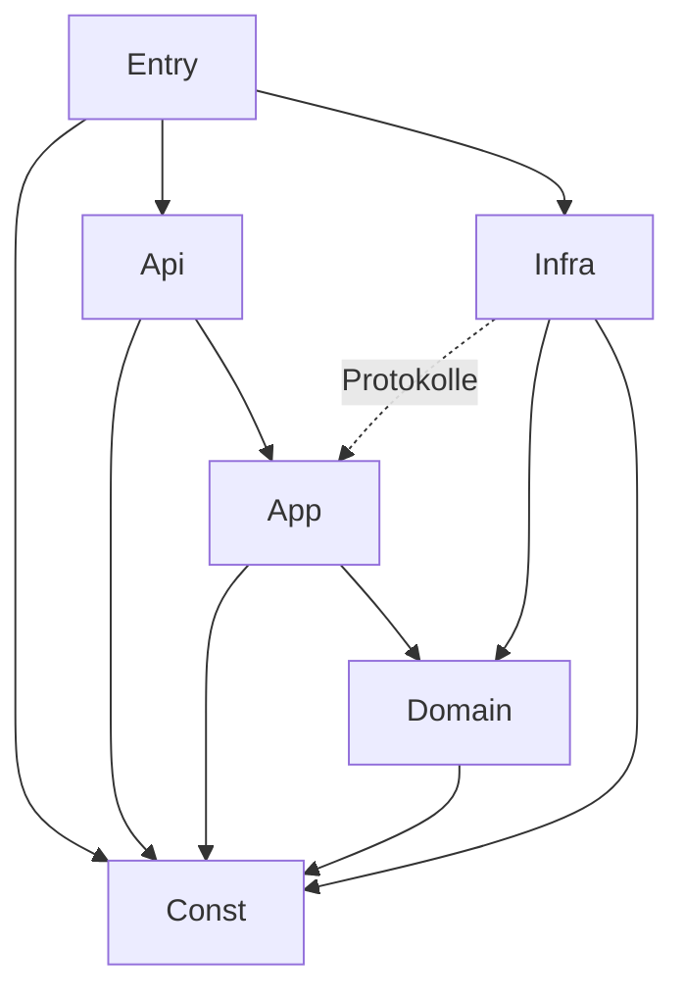

# Code-Dokumentation: Aufgaben-Glücksrad

Stand: 2026-11-03 · Code-Version: 0.0.1 (bis AP-15) · Vorlage: Code-Dokus „Detailed Energy Card“ und
„HASS Test Data Creator“

Dieses Dokument erfasst den Code mit seinen **Metriken** und **Abhängigkeiten** und protokolliert **jede
Codeänderung**. Es besteht aus zwei Teilen:

1. **Dieses Markdown-Dokument** (von Hand gepflegt): Messgrößen, Schwellwerte, Schichten, Modulübersicht,
   erlaubte Abhängigkeiten, Änderungsprotokoll.
2. **Die generierte Explorer-Seite** `docs/code-doku/index.html` (aus dem Quelltext erzeugt, nicht von Hand
   pflegen): Schichten → Module → Typen → Methoden mit Quelltext, Metriken je Element und Abhängigkeitskarte.
   Erzeugt mit `python3 docs/code-doku/generate.py`, veröffentlicht als Artefakt
   „Task Wheel Code-Dokumentation“. Generator: `tools/code_doku/` (Aufruf über `docs/code-doku/generate.py`), Vorlage: `docs/code-doku/template.html`. Die Seite wird nicht eingecheckt (`.gitignore`), CI erzeugt sie bei jedem Lauf; `--check` bricht bei roten Schwellwerten ab.

---

## 1. Messgrößen

Gleiche Messgrößen wie in den Vorlagen. Werte sind Näherungen eines Quelltext-Scanners, keine Compiler-Analyse.

| Kürzel | Messgröße | Bedeutung | Ebene |
|---|---|---|---|
| LOC | Codezeilen | Zeilen ohne Leerzeilen und reine Kommentare | Modul, Typ, Methode |
| CC | Zyklomatische Komplexität (McCabe) | Anzahl unabhängiger Pfade; Typ = Σ der Methoden | Methode, Typ |
| MI | Wartbarkeitsindex (0–100) | `max(0, (171 − 5,2·ln(V) − 0,23·CC − 16,2·ln(LOC)) · 100 / 171)` | Modul, Typ, Methode |
| Ce | Efferente Kopplung | Anzahl genutzter Typen/Module | Typ, Modul |
| Ca | Afferente Kopplung | Anzahl Typen/Module, die dieses nutzen | Typ, Modul |
| I | Instabilität | `Ce / (Ca + Ce)`; 0 = stabil, 1 = instabil | Typ, Modul |
| Test | Test nennt Typ | Mindestens ein Test referenziert den Typ | Typ |
| Cov | Zeilenabdeckung | aus pytest-cov / Vitest | Modul |
| Dup | Duplikate | doppelte Blöcke laut jscpd/pylint | Projekt |

### 1.1 Schwellwerte (in CI geprüft)

Auslegung durch den Generator (AP-01): Der **MI je Modul** ist der LOC-gewichtete Mittelwert der MI seiner Funktionen und Methoden; Module ohne Funktionen (reine Konstanten- oder Deklarationsdateien) werden nicht bewertet. Der reine Formelwert über das ganze Modul liegt schon bei etwa 100 LOC unter 55 und würde jedes größere Modul rot färben. Die **Instabilität der Domäne** wird erst bewertet, wenn ein Modul von anderen genutzt wird (Ca > 0); Fabriken (Dateiname enthält `factory`) sind ausgenommen, weil sie ihre Strategien kennen und gewollt instabil sind.


| Messgröße | grün | gelb | rot (CI schlägt fehl) |
|---|---|---|---|
| CC je Methode | ≤ 5 | 6–8 | > 8 |
| MI je Modul | ≥ 55 | 35–54 | < 35 |
| LOC je Methode | ≤ 30 | 31–50 | > 50 |
| LOC je Modul | ≤ 300 | 301–500 | > 500 |
| Instabilität Domäne | ≤ 0,5 | 0,51–0,9 | > 0,9 |
| Abdeckung Domäne | ≥ 95 % | 90–94 % | < 90 % |
| Abdeckung übrige | ≥ 85 % | 80–84 % | < 80 % |
| Duplikate | 0 | – | > 0 |
| Bundle (gzip) | ≤ 120 kB | 121–150 kB | > 150 kB |

---

## 2. Schichten und erlaubte Abhängigkeiten

| ID | Schicht | Verzeichnis | darf nutzen |
|---|---|---|---|
| `Const` | 0 Konstanten | `custom_components/task_wheel/const/` | – |
| `Entry` | 1 Einstieg | `__init__.py`, `config_flow.py`, `panel.py` | Api, App, Infra, Const |
| `Api` | 2 Schnittstellen | `services.py`, `websocket/`, `entities/` | App, Domain (nur Modelle), Const |
| `App` | 3 Anwendung | `application/` | Domain, Const (Infra nur über Protokolle) |
| `Domain` | 4 Domäne | `domain/` | Const |
| `Infra` | 5 Infrastruktur | `infrastructure/` | Domain, App (nur `protocols.py`), Const |
| `Panel` | Frontend | `frontend/src/` | intern: views → components → state/api → constants/i18n |

Geprüft durch `import-linter` (Python) und `eslint-plugin-boundaries` (TypeScript).



---

## 3. Modulübersicht

Geplante Module (Zielbild aus KONZEPT.md §3.3). Metriken werden ab AP-01 vom Generator eingetragen; bis dahin
steht „–“.

| Modul | Schicht | Verantwortung | Nutzt | LOC | CC | MI | Ca | Ce | I | Test |
|---|---|---|---|---|---|---|---|---|---|---|
| 2026-11-03 | – | – | `README.md` | geändert: Abschnitt „Lokale Testumgebung (Docker)“ entfernt; `dev/README.md` bleibt bestehen. Kein Code betroffen | – |
| `const/keys.py` | Const | Speicher- und API-Schlüssel | – | – | – | – | – | – | – | – |
| `const/limits.py` | Const | Grenzwerte | – | – | – | – | – | – | – | – |
| `const/defaults.py` | Const | Standardwerte | – | – | – | – | – | – | – | – |
| `const/events.py` | Const | Event-, Dienst-, Befehlsnamen | – | – | – | – | – | – | – | – |
| `domain/models.py` | Domain | Modelle, Serialisierung | enums, errors | – | – | – | – | – | – | – |
| `domain/enums.py` | Domain | StrEnums | – | – | – | – | – | – | – | – |
| `domain/rules/` | Domain | `FrequencyRule`-Strategien (`every_round`, `max_per_period`, `interval`), Perioden, `FrequencyRuleFactory` | models, enums, errors, validation | – | – | – | – | – | – | – |
| `domain/availability/` | Domain | `AvailabilityRule`-Strategien, Factory | models | – | – | – | – | – | – | – |
| `domain/draw/` | Domain | `RoundDraft` (schrittweise Runde, unveränderlich), Kandidatenfilter (`PausedFilter`, `AbsenceFilter`, `NoRepeatFilter`, `CandidateFilterFactory`, `CandidateSelector`), Gewichtung (`FairnessWeighting`, `UniformWeighting`, `WeightingFactory`), `DrawEngine` mit injiziertem Zufall | models, enums, errors, availability, const | – | – | – | – | – | – | – |
| `domain/status.py` | Domain | Statusübergänge (Tabelle), Fristen, Punkte | models, enums, errors | – | – | – | – | – | – | ja |
| `domain/statistics/` | Domain | Monatsaggregate (inkrementell, Neuberechnung), Auswertung (KPIs, fairer Anteil, Matrix, Hervorhebungen, Wochenquote) | models, enums, status, rules/periods, serialization | – | – | – | – | – | – | ja |
| `domain/history.py` | Domain | `HistoryFilter` für die Historie | models, enums, validation | – | – | – | – | – | – | ja |
| `domain/swap.py` | Domain | Prüfregeln für den Tausch, Jokerzähler | availability, rules/periods, models | – | – | – | – | – | – | ja |
| `application/protocols.py` | App | Repository-, Recorder-, Zeitgeber- (`TimerPort`), Ereignis-Protokolle (`RoundEvents`) | models, statistics/aggregate | – | – | – | – | – | – | – |
| `application/draw_service.py` | App | Runden: automatisch in einem Schritt, Panel schrittweise (`begin`, `spin`, `spin_rest`, `commit`, `cancel`) mit Zeitlimit | draw/, draw_inputs, protocols | – | – | – | – | – | – | ja |
| `application/draw_inputs.py` | App | Eingaben einer Runde: Punkte im Fenster, Zuteilungszeitpunkte, fällige Aufgaben, `DrawContext` | draw/, rules, availability, protocols | – | – | – | – | – | – | ja |
| `application/ids.py` | App | Kennungen | – | – | – | – | – | – | – | – |
| `application/assignment_service.py` | App | Erledigen, Verpasst | status, protocols, round_updates | – | – | – | – | – | – | ja |
| `application/round_updates.py` | App | Zuteilung lesen/ersetzen im Verlauf | protocols | – | – | – | – | – | – | ja |
| `application/swap_service.py` | App | Tausch mit Joker | status, swap, protocols, round_updates | – | – | – | – | – | – | ja |
| `application/schedule_service.py` | App | Zeitpläne: nächste Auslosung, Zeitgeber gezielt setzen, Erinnerungen | draw_service, triggers/, protocols | – | – | – | – | – | – | ja |
| `application/statistics_service.py` | App | Aggregate fortschreiben (`AssignmentRecorder`), Auswertung | domain/statistics, availability, protocols | – | – | – | – | – | – | ja |
| `application/history_service.py` | App | Historie: Filter, Seitenabfrage | domain/history, protocols | – | – | – | – | – | – | ja |
| `application/event_payloads.py` | App | Inhalt der Events (nur Kennungen, Namen, Zahlen) als reine Funktionen | models, protocols | – | – | – | – | – | – | ja |
| `application/maintenance_service.py` | App | Täglicher Wartungslauf: Verpasstes markieren, alte Runden löschen | assignment_service, daily, protocols | – | – | – | – | – | – | ja |
| `application/daily.py` | App | Nächster täglicher Zeitpunkt (über `TriggerFactory`) | triggers/, models | – | – | – | – | – | – | ja |
| `application/fanout.py` | App | `FanOutRoundEvents`: verteilt `RoundEvents` an mehrere Empfänger (Events, Entitäten, Benachrichtigung) | models, protocols | – | – | – | – | – | – | ja |
| `application/lookup.py` | App | Elemente über Kennung, Kurzname oder Name finden | errors | – | – | – | – | – | – | ja |
| `application/notification_service.py` | App | `NotificationService` (`RoundEvents`-Empfänger): Benachrichtigung nach Runde, bei Tausch und als Erinnerung, Ziele ohne Doppelte, Versand im Hintergrund, Zielprüfung (`check_target`) | notification_messages, protocols, names | – | – | – | – | – | – | ja |
| `application/notification_messages.py` | App | Titel und Nachricht aus Meldung, Namen und übersetzten Texten (reine Funktionen, Kürzung) | models, names, protocols | – | – | – | – | – | – | ja |
| `application/names.py` | App | Namen von Aufgabe, Person, Zeitplan für Meldungen (gelöschte über Kennung) | models, protocols | – | – | – | – | – | – | ja |
| `infrastructure/repository/` | Infra | `ConfigStore`, `HistoryStore`, Migration, Indizes, `MemoryStore`, Fabrik | models, protocols | – | – | – | – | – | – | ja |
| `infrastructure/scheduler.py` | Infra | `HassTimerScheduler` (`async_track_point_in_time`) | – | – | – | – | – | – | – | ja (nur CI) |
| `domain/triggers/` | Domain | `TriggerStrategy` (`recurring`, `once`, `manual`), `TriggerFactory`, Ende einmaliger Pläne (Tabelle), Erinnerung | models, rules/periods, validation | – | – | – | – | – | – | ja |
| `infrastructure/events.py` | Infra | `HassRoundEvents`: feuert die Events auf dem HA-Bus (`RoundEvents`) | event_payloads, protocols | – | – | – | – | – | – | ja (nur CI) |
| `infrastructure/notifier/` | Infra | `NotifierFactory` (Registry Art → Sender: `EntitySender` mit `notify.send_message`, `ServiceSender` für Legacy-`notify.*`, `NoSender`), `classify` (nur `notify.*`), `HassNotifier` (Prüfung beim Speichern und Senden, Zeitlimit), `TextCatalog` (Texte aus `texts/<Sprache>.json`) | protocols, models, enums, errors | – | – | – | – | – | – | ja |
| `const/notification.py` | Const | Dienst-/Feldnamen, Zielmuster, Grenzen, Textschlüssel der Benachrichtigung | – | – | – | – | – | – | – | ja |
| `services.py` | Api | HA-Dienste `draw`, `complete`, `swap`, `set_absence` (Schemas, Tabelle Dienst → Handler, Fehlerübersetzung) | application, runtime | – | – | – | – | – | – | ja (nur CI) |
| `websocket/` | Api | Panel-API: Befehlstabellen je Bereich (`read`, `actions`, `config`), Schemas aus den Modellfeldern, Anmeldung und Rechteprüfung bei HA (`__init__.py`) | application, runtime, domain/models | – | – | – | – | – | – | ja (`__init__.py` nur CI) |
| `application/config_service.py` | App | Konfiguration ändern: Kennung, Kurzname, Verweise, Löschen mit Aufräumen | schedule_service, draw_service, models | – | – | – | – | – | – | ja |
| `application/views.py` | App | Snapshot und Delta je Objekt, Historieneinträge | draw_service, swap_service, schedule_service, wire | – | – | – | – | – | – | ja |
| `application/live_view.py` | App | `LiveView` (Abonnenten, Deltas), `ObservedTimers` | views, protocols | – | – | – | – | – | – | ja |
| `application/wire.py` | App | Ergebnisse als JSON | serialization, statistics/report | – | – | – | – | – | – | ja |
| `entry_lookup.py` | Entry | Geladene Config Entry finden (Dienste, WebSocket) | runtime | – | – | – | – | – | – | ja (nur CI) |
| `entities/` | Api | `EntityFactory` (Abgleich mit der Konfiguration, Anlegen/Entfernen), Sensoren, To-do, Button als `EntityDescription`-Tabellen, Dispatcher-Signale (`EntityEvents`) | application (`entity_state`), runtime, services | – | – | – | – | – | – | ja (nur CI) |
| `application/entity_state.py` | App | `EntityStateService`: Werte der Entitäten aus Indizes und Aggregaten (offen, Monatspunkte, nächste Auslosung) | domain/statistics, event_payloads, schedule_service, protocols | – | – | – | – | – | – | ja |
| `const/entities.py` | Const | Schlüssel, Gerätenamen und Signalnamen der Entitäten | – | – | – | – | – | – | – | – |
| `sensor.py`, `todo.py`, `button.py` | Entry | Plattform-Einstiege, die Home Assistant im Integrationsordner sucht; reichen `async_setup_entry` aus `entities/` durch | entities | – | – | – | – | – | – | ja (nur CI) |
| `__init__.py` | Entry | Setup/Entladen der Config Entry, Dienste anmelden, Zeitgeber setzen | runtime, services, infrastructure | – | – | – | – | – | – | ja (nur CI) |
| `runtime.py` | Entry | `TaskWheelData` (`entry.runtime_data`) und `compose`: Komposition aller Objekte an einer Stelle, ohne HA | application, domain | – | – | – | – | – | – | ja |
| `config_flow.py` | Entry | Config-Flow (Einzelinstanz) und Options-Flow (Einstellungen, Grenzen aus `limits`) | const, domain/models | – | – | – | – | – | – | ja (nur CI) |
| `panel.py` | Entry | Panel, statischer Pfad | const | – | – | – | – | – | – | – |
| `frontend/src/constants/` | Panel | Routen, Tokens, Grenzen, Befehle und Grenzwerte der Ansichten (`insights.ts`) | – | – | – | – | – | – | – | – |
| `frontend/src/i18n/` | Panel | Texte de/en (`insights.*` für Übersicht, Historie, Statistik), Platzhalter, Formatierung (`format.ts`) | – | – | – | – | – | – | – | – |
| `frontend/src/api/` | Panel | WebSocket-Client, typisierte Sicht auf Objekte und Antworten (`models.ts`) | constants | – | – | – | – | – | – | – |
| `frontend/src/state/` | Panel | Store, Kontext, `AsyncValue` (asynchron geladener Wert einer Ansicht), `indexById` | api | – | – | – | – | – | – | – |
| `frontend/src/components/` | Panel | `tw-tab-bar`, `tw-stat`, `tw-chips`, `tw-avatar`, `tw-badge`, gemeinsame Stile; `tw-wheel` folgt in AP-16 | constants, i18n | – | – | – | – | – | – | – |
| `frontend/src/views/` | Panel | 7 Views; fertig: Übersicht (`overview*.ts`), Historie (`history*.ts`, `csv.ts`, `download.ts`), Statistik (`statistics*.ts`); Modelle (reine Funktionen) getrennt von den Elementen | state, components | – | – | – | – | – | – | – |

### 3.1 Externe Abhängigkeiten

| Paket | Version | Schicht | Zweck |
|---|---|---|---|
| Home Assistant | ≥ 2025.6 (`hacs.json`); Tests laufen gegen die Version von `pytest-homeassistant-custom-component` 0.13.316 (HA 2026.2.3) | Entry, Api, Infra | Plattform |
| voluptuous | mit HA | Api | Schemas |
| lit | 3.3.3 (gepinnt) | Panel | Webcomponents |
| @lit/context | 1.1.6 (gepinnt) | Panel | Zustand |
| vite 8.3.5, typescript 6.0.3, eslint 10.14.0, vitest 5.1.0, typescript-eslint 8.72.1, eslint-plugin-boundaries 7.4.1, jscpd 5.4.2 | gepinnt (`frontend/package.json`) | Build/Test | Werkzeuge |
| ruff 0.17.3, mypy 2.4.1, import-linter 2.15, pylint 4.1.3, pytest-homeassistant-custom-component 0.13.316 | gepinnt (`requirements-dev.txt`) | Build/Test | Werkzeuge |

Laufzeitabhängigkeiten außerhalb von HA: **keine** (`requirements: []` im Manifest).

### 3.2 Messwerte Laufzeit

| Messung | Ziel | Ist |
|---|---|---|
| Runde mit 10 Aufgaben × 6 Personen | < 5 ms | ca. 1,6 ms (AP-06, `tests/domain/draw/test_engine.py`, lokal gemessen) |
| Panel erster Snapshot | < 300 ms | – |
| Bundle gzip | ≤ 120 kB | – |

---

## 4. Änderungsprotokoll

**Pflicht:** Jede Änderung am Code bekommt hier einen Eintrag (neueste oben). Ein Eintrag nennt betroffene
Module, Art der Änderung, Auswirkung auf Metriken und Abhängigkeiten. CI prüft, dass bei Änderungen unter
`custom_components/` oder `frontend/src/` auch diese Datei geändert wurde.

| Datum | Version | AP | Module | Änderung | Metriken / Abhängigkeiten |
|---|---|---|---|---|---|
| 2026-11-03 | 0.0.1 | AP-19 | `application/draw_inputs.py`, `tests/`, `README.md`, `docs/KONZEPT.md` | geändert: Sperre aus AP-19 zurückgenommen (`tasks_open_elsewhere` entfernt). Eine Aufgabe, die in mehreren Zeitplänen steht, kann mehrfach ausgelost werden, auch an dieselbe Person; jede Zuteilung kennt ihren Zeitplan (`schedule_id`) und wird einzeln erledigt. Die Anzeige je Auslosung kommt aus dem Thread „Auslosungen gruppieren“ | Backend 433 Tests der HA-freien Schichten grün; keine neue Abhängigkeit; ca. −15 LOC |
| 2026-11-03 | 0.0.1 | AP-19 | `domain/models.py` (`Assignment.schedule_id`, Prüfung in `Round`), `domain/draw/draft.py`, `application/draw_inputs.py` (`tasks_open_elsewhere`), `infrastructure/repository/migration.py`, `const/keys.py` (`KEY_ASSIGNMENTS`, `KEY_SCHEDULE_ID`, `STORE_MINOR_VERSION` 2), `frontend/src/` (`api/models.ts`, `views/overview-model.ts`), `tests/`, `README.md`, `docs/KONZEPT.md` | geändert: Zuteilungen kennen den auslosenden Zeitplan (`schedule_id`, Pflichtfeld, muss zur Runde passen). Die Übersicht gruppiert danach statt nach dem ersten Zeitplan mit der Aufgabe; Zuteilungen gelöschter Zeitpläne stehen unter „Ohne Zeitplan“. Migration 1.1 → 1.2 setzt bei bestehenden Zuteilungen den Zeitplan ihrer Runde ein (Config-Store: Schritt ohne Änderung, beide Stores teilen die Versionsnummer). Erledigen gilt für alle Pläne: `due_tasks` lässt Aufgaben aus, die in einem anderen Zeitplan noch offen oder getauscht sind; die Häufigkeitsregeln zählten schon je Aufgabe über alle Pläne | Backend 429 Tests der HA-freien Schichten grün, Frontend 137 Tests; neue Funktionen je ≤ 8 LOC, max. CC 3; Duplikate 0; keine neue Abhängigkeit, keine Laufzeitabhängigkeit |
| 2026-11-03 | 0.0.1 | AP-15 (Nachbesserung 2) | `frontend/src/` (geändert: `constants/tokens.ts`, `components/` `formStyles`, `chip-select`, `absence-editor`, `frequency-editor`, `trigger-editor`, `index`, `views/` `config-view`, `schedules`) | geändert: einheitlicher Feldabstand über das Token `--tw-space-field` (16 px) und die gemeinsame Klasse `stackStyles` für alle Editoren sowie das Formular der Ansichten; die Schalter eines Formulars stehen gruppiert ohne zusätzlichen Abstand. Chip-Auswahl mit Eigenschaft `compact` (eine Zeile, gleich breite Chips) für die Wochentage Mo bis So, damit sie nicht umbrechen | Frontend: keine neuen Module, Duplikate 0, Abdeckung ≈ 89 % Zweige; keine neuen Abhängigkeiten |
| 2026-11-03 | 0.0.1 | AP-15 (Nachbesserung 3) | `frontend/src/components/` (geändert: `timeline`, `form.test`) | geändert: Der Zeitstrahl zeigt neben „frühestens“ auch „spätestens“ (Intervall + Toleranz); die Skala reicht bis dorthin. Die Felder der Häufigkeitsregel stehen als direkte Kinder des Editors im einheitlichen Feldabstand | Frontend: keine neuen Module, Duplikate 0; keine neuen Abhängigkeiten |
| 2026-11-03 | 0.0.1 | AP-15 (Nachbesserung) | `frontend/src/` (neu: `components/select.ts`; geändert: `components/` `absence-editor`, `frequency-editor`, `trigger-editor`, `index`, `form.test`, `views/` `persons`, `config-view`, `constants/forms.ts`, `config-views.test`) | geändert: Wahl der Art (Häufigkeit, Auslöser, Abwesenheit, Wechseltag, „danach“, Belastbarkeit) als Dropdown `tw-select` statt Segment-Umschalter, weil die Segmente bei schmalem Panel umbrachen; der Segment-Umschalter bleibt für kurze Beschriftungen (Zeitraum Tag/Woche/Monat). Karten bekommen mehr Abstand zwischen den Zeilen (`.card > div`). Neue Komponente `tw-select` (natives `select`, meldet `tw-change`) | Frontend: 1 neues Modul, Duplikate 0, Abdeckung unverändert (≈ 89 % Zweige), Bundle unverändert im Budget; keine neuen Abhängigkeiten |
| 2026-11-03 | 0.0.1 | Auslosungs-Animationen | `domain/enums.py` (`AnimationKind`), `domain/models.py` (`Schedule.animations`, `DEFAULT_ANIMATIONS`), `frontend/src/` (neu: `components/` `stage`, `stage-base`, `motion`, `drum`, `drum-geometry`, `drum-balls`, `drum-shapes`, `slot`, `slot-geometry`, `plinko`, `plinko-geometry`, `spotlight`, `spotlight-geometry`, `state/animation.ts`, `constants/` `animations`, `motion`, `drum`, `slot`, `plinko`, `spotlight`; geändert: `views/draw`, `views/draw-styles`, `views/schedules`, `state/lookup`, `api/config-types`, `i18n/`), `tests/domain/test_models.py`, `README.md`, `docs/KONZEPT.md` | neu (Wunsch Anton): Alternativen zum Glücksrad: Lostrommel, Slot-Machine, Plinko, Scheinwerfer (Kartenziehen entfiel). Der Zeitplan trägt `animations` (1–5 verschiedene Arten, Standard `wheel`, ältere Zeitpläne ohne Feld laden mit Standard); im Zeitplan-Formular Mehrfachauswahl. Bei jedem Start einer Auslosung wählt das Panel zufällig eine erlaubte Art (`pickAnimation`, nur Optik; der Gewinner steht im Backend fest und die Animation läuft nur dorthin). Muster: Strategy + Registry (`STAGE_TAGS`, keine Verzweigungen nach Art); `tw-stage` baut das Element, `StageElement` ist die Schablone (`spinTo` → `settle` bei reduzierter Bewegung, sonst `play`); `MotionToken` bricht Animationen ab. Größe = Chance in jeder Variante, Berechnungen als reine, getestete Funktionen (`*-geometry.ts`). Der Startknopf sitzt beim Rad in der Mitte, bei den anderen darunter (`START_PLACEMENT`). Texte „Wer ist dabei?“ und „Los“ statt Rad-Bezug | Frontend: 95 Module, Abdeckung 98 % Zeilen / 89 % Zweige (236 Tests), Bundle 56,0 kB gzip (Budget 120 kB), Duplikate 0, `generate.py --check` grün; Backend: 1 Enum, 1 Feld, Tests grün; keine neue Laufzeitabhängigkeit |
| 2026-11-03 | 0.0.1 | AP-15 (Nachbesserung 4) | `frontend/src/components/` (geändert: `timeline`) | geändert: Zeitstrahl neu aufgebaut. Das helle Feld deckt genau das Toleranzfenster von „frühestens“ bis „spätestens“ ab, davor und danach steht der abgedunkelte Bereich (hinter dem Fenster bleibt ein Stück Skala). Die Beschriftungen stehen unter den jeweiligen Positionen (Ziel über dem Balken) | Frontend: keine neuen Module, Duplikate 0; keine neuen Abhängigkeiten |
| 2026-11-03 | 0.0.1 | AP-16 | `domain/draw/engine.py` (`preview_task`, `_wheel`, `draw_round` führt die Rundenbesetzung mit), `domain/draw/draft.py` (`preview`), `application/draw_service.py` (`preview`), `websocket/actions.py`, `const/events.py` (`draw/preview`), `frontend/src/` (`api/`, `state/draw-session`, `views/draw`, `views/draw-styles`, `components/wheel`, `constants/tokens`, `i18n/`), Tests | geändert (UI-Rückmeldung): Neuer lesender Befehl `draw/preview` liefert das Rad der nächsten Aufgabe (Segmente, Chancen, Ausschlüsse) ohne zu ziehen; die Ziehung danach zeigt dasselbe Rad. `DrawSession` lädt die Vorschau nach `begin`, `resume` und `next`, das Rad ist also schon vor dem Drehen gefüllt (schlägt der Aufruf fehl, bleibt es leer). Die Segmentliste des Rads wird nach Inhalt zwischengespeichert, damit das Rad beim Neuzeichnen seine Drehung behält (vorher sprang es nach dem Anhalten auf 0 zurück). Gestaltung: Bühne ohne eigenen Hintergrund, alle Farben aus den Theme-Tokens (Tokens `--tw-color-stage*` entfallen), Abstände in der Aufgabenliste, gleich große Schaltflächen ohne Umbruch (alle Schaltflächen der linken Spalte, auch im Startzustand, teilen eine Breite), erste Schaltfläche „Aufgaben direkt verteilen“, Hinweistext tiefer | Frontend: Bundle 48,1 kB gzip (Budget 120 kB), Duplikate 0; Backend: 1 neue Methode je Schicht, keine neue Abhängigkeit |
| 2026-11-03 | 0.0.1 | AP-16 | `domain/enums.py` (`ExclusionReason.TAKEN`), `domain/draw/types.py` (`DrawContext.round_holders`), `domain/draw/draft.py` (`_advance` trägt den Gewinner ein), `domain/draw/candidates.py` (`RoundTakenFilter`), `frontend/src/i18n/`, `tests/domain/draw/`, `tests/application/test_draw_service.py`, `docs/KONZEPT.md` §5.2 | geändert (Rückmeldung aus dem ersten Test): Wer in einer Runde schon eine Aufgabe gezogen hat, ist für die weiteren Aufgaben derselben Runde nicht mehr im Rad. Neuer Filter am Ende der Kette (Grund `taken`, erscheint unter „Wer ist im Rad?“), der immer wirkt: eine Person bekommt in einer Runde nie zwei Aufgaben, überzählige Aufgaben bleiben als „nicht verteilbar“ unverteilt (Anzeige im Panel und im Protokoll der Runde). Frontend (`views/draw.ts`): Bleibt für die nächste Aufgabe höchstens eine erlaubte Person ohne Aufgabe übrig, zieht das Panel ohne Klick (`draw/spin`, das Backend prüft weiter Pause und Abwesenheit) und dreht das Rad nicht, wenn das Ergebnis nur ein Segment hat. Die Rundenbesetzung wandert wie Punkte und letzte Inhaber durch `RoundDraft`. Bestehender Test zur Last offener Zuteilungen angepasst (eine Aufgabe je Runde), neue Tests für Filter, Verlauf und Runde | Python: 1 neue Klasse, 3 Anweisungen in `draft.py`, Filterkette 4 statt 3 Einträge, max. CC unverändert; keine neue Abhängigkeit |
| 2026-11-03 | 0.0.1 | AP-15 | `frontend/src/` (neu: `views/config-view.ts`, `components/` `field`, `toggle`, `stepper`, `chip-select`, `segmented`, `week-preview`, `timeline`, `absence-editor`, `frequency-editor`, `trigger-editor`, `change`, `localized`, `options`, `summaries`, `formStyles`, `state/` `dates`, `presence`, `factories`, `api/` `config-types`, `collections`, `errors`, `constants/forms.ts`; geändert: `views/` `persons`, `tasks`, `schedules`, `api/` `client`, `types`, `fake-hass.testing`, `state/` `store`, `context`, `i18n/` `de`, `en`, `index`, `constants/api.ts`), `frontend/eslint.config.js` | neu: Ansichten Personen, Aufgaben, Zeitpläne mit vollständigem Anlegen, Ändern und Löschen über die WebSocket-Befehle `task_wheel/{person,task,schedule}/{create,update,delete}`. Gemeinsame Basis `ConfigView` (Karten links, Formular rechts, Löschen erst nach Bestätigung, Fehlerhinweis); die Unterklassen liefern nur Karte, Formular und Umwandlung Objekt ↔ Entwurf ↔ Nachricht. Fehler des Backends (`{ code, message }`, bei Prüffehlern `Feld: Schlüssel`) zerlegt `api/errors.ts`; der Text steht am betroffenen Feld und im Hinweis (`translateError`, Schlüssel `error.*` in de/en). Formular-Bausteine als eigene Komponenten ohne Kenntnis von Store und API: Stepper, Chip-Auswahl, Segment-Umschalter, Feld, Schalter, Wochenvorschau, Zeitstrahl, dazu die Editoren für Anwesenheit (einmalig / Wochentage / Wochenrhythmus mit 4-Wochen-Vorschau), Häufigkeit (jede Runde / max. n× je Zeitraum / festes Intervall mit Zeitstrahl) und Auslöser (wiederkehrend / einmalig / manuell). Neue Arten stehen in Tabellen statt in Verzweigungen (Renderer je Art, Fabriken `ABSENCE_BUILDERS`, `FREQUENCY_BUILDERS`, `TRIGGER_BUILDERS`). Die Vorschau der Anwesenheit (`state/presence.ts`) spiegelt `domain/availability/strategies.py` im Browser, damit sie ohne Speichern sofort folgt. Der Zeitplan zeigt ein Beispiel für `task_wheel.draw` und das Ereignis `task_wheel_drawn`. `Store.client` und `StoreController.client` geben Ansichten Zugriff auf den `ApiClient`. ESLint: `no-magic-numbers` ist in `src/constants/` ausgeschaltet (dort stehen die Literale). Backend unverändert (Speichern ruft weiterhin `ConfigService`, der das Benachrichtigungsziel mit `check_target` prüft) | Frontend: 46 Module, Abdeckung 98 % Zeilen / 88 % Zweige (57 Tests), Bundle 26,6 kB gzip (Budget 120 kB), Duplikate 0, Architekturregeln grün; größte Methoden ≤ 50 LOC; neue Abhängigkeiten nur innerhalb der Schichten (views → components → state/api → constants/i18n); keine neue Laufzeitabhängigkeit |
| 2026-11-03 | 0.0.1 | AP-17 | `frontend/src/views/overview.ts` | geändert: Datum und Uhrzeit der Aktivitätsliste stehen immer in einer eigenen Zeile unter „Name · Aufgabe“, das Badge bleibt rechts (Rückmeldung Anton); die Historie zeigt Datum und Herkunft einer Runde bereits in einer Zeile unter dem Zeitplan | Keine neuen Module, Metriken unverändert, Duplikate 0 |
| 2026-11-03 | 0.0.1 | AP-17 | `frontend/src/` (`components/styles.ts`, `views/overview.ts`, `views/history.ts`, `views/statistics.ts`) | geändert: festes Layout statt wechselndem Umbruch (Rückmeldung Anton). Zeilen der Aktivitäts- und Punkteliste brechen nie um (`.row.nowrap`); Badge, Punkte und Zusammenfassung stehen immer rechts und umbrechen nicht (`.fixed`), nur der Text links bricht innerhalb seiner Spalte. Boxen einer Reihe sind immer gleich hoch: Raster der Übersicht mit `align-items: stretch`, Abstände über `gap` statt Außenabstand der Karten, ebenso in der Statistik (`.pair`) | Keine neuen Module; Abdeckung unverändert, Duplikate 0, `generate.py --check` grün |
| 2026-11-03 | 0.0.1 | AP-17 | `frontend/src/` (`views/` `overview`, `overview-assignments`, `overview-model`, `history`, `history-model`, `csv`, `download`, `statistics`, `statistics-charts`, `statistics-model`, `person-chips`; `components/` `chips`, `avatar`, `badge`, `styles`; `api/` `client`, `models`, `types`; `state/` `async-value`, `lookup`, `store`, `context`; `constants/` `insights`, `panel`, `tokens`; `i18n/` `insights.de`, `insights.en`, `format`, `index`), `README.md`, `docs/CODE_DOKU.md` | geändert: Übersicht, Historie und Statistik mit Echtdaten statt Zählern. **Übersicht:** nächste Auslosung aus `next_run` der Zeitpläne (Blättern), offene Zuteilungen je Zeitplan (eine Zuteilung kennt nur ihre Aufgabe, sie gehört zum ersten Zeitplan mit dieser Aufgabe; sonst „Ohne Zeitplan“) mit Filter, Erledigen (`assignment/complete`) und Tauschen (`assignment/swap`) nur auf erlaubte, nicht pausierte Personen, Joker-Hinweis und Sperre bei `swap_allowed = false` oder 0 Jokern; Punkte aus `statistics/get`, Aktivität aus `history/list`; Änderungen am Stand kommen per Delta, Punkte und Aktivität werden nach einer Aktion neu geladen. **Historie:** Runden aufklappbar, Filter serverseitig (`person_id`), Nachladen über `next_offset`, CSV-Export aller Seiten (Obergrenze `EXPORT_MAX_PAGES` × `EXPORT_PAGE_SIZE`) mit Entschärfung von Formelzeichen (`csvCell`: `= + - @` Tabulator, Zeilenumbruch → Hochkomma) und Anführungszeichen um jedes Feld. **Statistik:** Zeitraum 1/3/12 Monate, Kennzahlen, Balken gegen fairen Anteil (HTML/CSS), Liniendiagramm je Woche (SVG, Lücke statt Wert 0 bei Wochen ohne Abschluss), Matrix mit Farbstufen und „–“ für nicht erlaubte Personen, Auszeichnungen; leerer Zeitraum zeigt Hinweis. Neu: Komponenten `tw-chips` (Auswahl, Ereignis `tw-chip-select`), `tw-avatar`, `tw-badge` (Ton aus Tabelle `STATUS_TONES`, Text trägt die Bedeutung), gemeinsame Stile `viewStyles`; `ApiClient.history/statistics/complete/swap`; `modelsOf` (typisierte Sicht auf Sammlungen des Snapshots); `AsyncValue` (verwirft überholte Antworten); `Store.client`; Texte mit Platzhaltern (`translate(key, language, params)`), Formatierung über `Intl` (`format.ts`); neue Tokens für Erfolg/Warnung/Info/Füllung. Sicherheit: kein `innerHTML`, alle Werte aus Lit-Bindungen, Farbe der Person als Stilwert nur in Eigenschaften | Frontend: 48 Module, Abdeckung 98 % Zeilen / 88 % Zweige, Bundle 35,3 kB gzip nach Merge mit AP-16 (Budget 120 kB), Duplikate 0, Architekturregeln grün; `generate.py --check` grün (Methoden ≤ 50 LOC, CC ≤ 8); Abhängigkeiten unverändert gerichtet views → components → state/api → constants/i18n; keine neue Laufzeitabhängigkeit, kein Backend geändert |
| 2026-11-03 | 0.0.1 | AP-16 | `frontend/src/components/` (`wheel`, `wheel-geometry`, `format`, `confetti`), `state/` (`draw-session`, `lookup`, `store`, `context`), `api/` (`client`, `types`), `views/` (`draw`, `draw-styles`), `constants/` (`wheel`, `api`, `panel`, `tokens`), `i18n/`, Tests | neu: Tab „Auslosung“. `tw-wheel` (SVG, Segmentgröße = Chance, reine Geometrie in `wheel-geometry`; Drehung per CSS-Transform mit Übergang, also auf der GPU; `spinTo(id)` dreht zum vom Backend gelieferten Gewinner und endet bei `transitionend` oder per Zeitgeber; bei `prefers-reduced-motion` Sprung ohne Animation). `tw-confetti` (feste Bahnen, kein Zufall, bei reduzierter Bewegung unsichtbar). `DrawSession` (state) führt den Ablauf als Phasen `choose → busy → ready → spinning → revealed → done/error` und ruft `draw/begin`, `spin`, `spin_rest`, `commit`, `cancel` über `ApiClient`; Aktionen außerhalb ihrer Phase werden ignoriert. Das Ergebnis der Ziehung kommt ausschließlich aus dem Backend (`secrets.SystemRandom`), das Frontend zeigt Segmente und Gewinner nur an. Das Ergebnis der gerade drehenden Aufgabe bleibt in der Liste verborgen, bis das Rad steht. Offene Panel-Runden aus dem Snapshot lassen sich fortsetzen. `lookup` liest Personen, Aufgaben und Zeitpläne mit Rückfallwerten aus den Wire-Objekten. Der Backend-Umfang ist unverändert (die Befehle gab es seit AP-10). Neue Tokens `--tw-color-stage*`, `--tw-color-rim` | Frontend: 29 Module, Abdeckung 99 % Zeilen / 91 % Zweige, 56 Tests, Bundle 22,1 kB gzip (Budget 120 kB), Duplikate 0, Schwellwerte eingehalten (`draw.ts` 469 LOC); neue Abhängigkeiten views → state (`DrawSession`, `lookup`), components → constants/i18n unverändert; keine neue Laufzeitabhängigkeit |
| 2026-11-03 | 0.0.1 | AP-14 | `frontend/src/` (`task-wheel-panel.ts`, `constants/` `api`, `panel`, `routes`, `tokens`, `api/` `client`, `types`, `state/` `store`, `delta`, `context`, `components/` `tab-bar`, `stat`, `styles`, `views/` `registry`, `section-view`, sieben Ansichten, `i18n/`), `frontend/` (`vite.config.ts`, `eslint.config.js`, `.jscpd.json`), `custom_components/task_wheel/` (`const/panel.py`, `infrastructure/panel.py`, `infrastructure/panel_bundle.py`, `__init__.py`), `tests/` | neu: Frontend-Gerüst. Panel `task-wheel-panel` mit den sieben Tabs der Mockups; Pfade als Tabelle `ROUTES` (`/overview` …), Ansichten je Tab über `import()` aus der Tabelle `VIEW_LOADERS` (`views/registry.ts`), Navigation per Adresse (`history.pushState` + `location-changed`, Route von Home Assistant hat Vorrang). `ApiClient` (typisiert: `snapshot`, `subscribe`, `onReconnect`) kennt nur die Teile von `hass`, die er braucht (`HassApi`). `Store`: erst Abonnement, dann Snapshot (Deltas vor dem Snapshot sind darin enthalten und werden verworfen), danach `applyDelta` (je Objekt-Kennung ersetzen/entfernen, unveränderte Sammlungen behalten ihre Identität); nach Verbindungsabbruch wird neu abonniert und geladen. Verteilung über `@lit/context` (`storeContext`), Ansichten lesen ihn über `StoreController`. Komponenten kennen nur Eigenschaften und Ereignisse (`tw-tab-bar`, `tw-stat`). Design-Tokens `--tw-*` aus `constants/tokens.ts` auf HA-Variablen gemappt. i18n de/en, Sprache aus `hass.locale`, Basissprache bei `de-AT`. Alle Ansichten sind Gerüste (`defineView(tag, Sammlungen)` zeigt Zähler) und werden in AP-15 bis AP-17 ausgebaut. Backend: `infrastructure/panel.py` stellt `frontend/dist` unter `/task_wheel_static` bereit (`cache_headers`, einmal je Start) und meldet das Panel `task-wheel` (Symbol `mdi:ferris-wheel`, `require_admin` = Einstellung `panel_admin_only`) beim Laden der Config Entry an bzw. beim Entladen ab; `panel_bundle.find_bundle_name` findet die Einstiegsdatei mit Inhalts-Hash (ohne HA testbar); fehlt das Bundle, gibt es eine Warnung statt eines Fehlers. Testhilfen `*.testing.ts` sind von Abdeckung, Duplikatprüfung und Magic-Number-Regel ausgenommen | Frontend: 25 Module, Abdeckung 98 % Zeilen / 90 % Zweige, Bundle 13,4 kB gzip (Budget 120 kB), Duplikate 0, Architekturregeln grün (views → components → state/api → constants/i18n); Backend: 3 neue Module je 3–20 Anweisungen, `panel_bundle` 100 % (Zweige), `panel.py` und `tests/test_setup.py` prüft die CI; neue Abhängigkeit Entry → Infra (`panel`), Infra → HA (`frontend`, `panel_custom`, `http`; im Manifest schon enthalten); keine neue Laufzeitabhängigkeit |
| 2026-11-03 | 0.0.1 | AP-11 | `entities/` (neu: `base.py`, `factory.py`, `signals.py`, `sensor.py`, `todo.py`, `button.py`), Plattform-Einstiege `sensor.py`, `todo.py`, `button.py` (reichen nach `entities/` durch, weil HA sie im Integrationsordner erwartet), `application/entity_state.py` (neu), `application/event_payloads.py` (`task_name` öffentlich), `runtime.py` (`TaskWheelData.entity_state`), `__init__.py`, `const/entities.py` (neu), `translations/`, `tests/` | neu: Entitäten nach KONZEPT §6.3. `EntityFactory` gleicht je Plattform die Entitäten mit der Konfiguration ab (beim Start und über `ConfigRepository.subscribe` bei jeder Änderung): neue Personen und Zeitpläne bekommen ihre Entitäten, gelöschte verlieren sie samt leerem Gerät (Abgleich mit der Entity-Registry, ohne eigenen Zustand), geänderte melden sich über ihr Signal, ein neuer Name benennt das Gerät um (Entity-IDs bleiben stabil). Je Person: Sensor `open` (offene und getauschte Zuteilungen), Sensor `points` (Monatspunkte mit Faktoren aus den Einstellungen), To-do-Liste (Hauptentität des Geräts; nur Abhaken erlaubt, es erledigt die Zuteilung über `AssignmentService.complete`; fremde oder nicht mehr offene Zuteilungen werden abgelehnt). Je nicht archiviertem Zeitplan: Sensor `next_draw` (Zeitstempel, rechnet nach dem Zeitpunkt selbst neu, falls die Auslosung ausfiel) und Button `draw` (Herkunft `manual`). Beschreibungen als Tabellen (`PERSON_SENSORS`, `SCHEDULE_SENSORS`); Werte liest `EntityStateService` ausschließlich aus Indizes und Aggregaten, `should_poll = False`. `EntityEvents` (Empfänger hinter `FanOutRoundEvents`) sendet nach Runde, Erledigen, Verpasst und Tausch ein Dispatcher-Signal nur an die betroffenen Personen bzw. den Zeitplan. Neue Übersetzungen für Entitäten und den Fehler `todo_complete_only` (de/en) | Neue Module je 8–110 Anweisungen, Abdeckung der HA-freien Module (`entity_state.py`) 100 %, Entitäten prüft die CI (`tests/test_entities.py`); max. CC 4; Duplikate 0; import-linter 5/5 grün; Abhängigkeiten Api (`entities/`) → App (`entity_state`, `round_updates`, `protocols`), Domain (nur Modelle), Const, `runtime`, `services` (nur `to_service_error`); App → Domain/statistics (erlaubt); keine neue Laufzeitabhängigkeit |
| 2026-11-03 | 0.0.1 | AP-10 | `websocket/` (`__init__.py`, `command.py`, `schemas.py`, `read.py`, `actions.py`, `config.py`, `registry.py`), `entry_lookup.py`, `runtime.py`, `services.py`, `__init__.py`, `application/` (`config_service.py`, `live_view.py`, `views.py`, `wire.py`, `draw_service.py`), `domain/errors.py` (`InUseError`), `const/` (`events.py`, `keys.py`, `limits.py`), `tests/websocket/`, `tests/application/test_config_service.py`, `tests/test_websocket.py` | neu: Panel-API unter `task_wheel/`. Jeder Befehl ist ein `Command` (Name, Schema, Recht, Handler, „ändert“) in einer Tabelle je Bereich: Lesen (`snapshot`, `subscribe`, `history/list`, `statistics/get`), Erledigen/Tauschen, Auslosen (`draw/begin`/`spin`/`spin_rest`/`commit`/`cancel`) für jeden angemeldeten Benutzer; `person/*`, `task/*`, `schedule/*` (anlegen, ändern, löschen) und `settings/update` nur für Administratoren. Die Handler kennen Home Assistant nicht; `websocket/__init__.py` meldet sie an, prüft das Recht (`Unauthorized`; bei `panel_admin_only` auch Nicht-Administratoren), setzt Fachfehler in Fehlerantworten mit dem Übersetzungsschlüssel als Code um und meldet Abonnements beim Schließen der Verbindung ab. Schemas: je Nachricht `extra=PREVENT_EXTRA` (auch `id`, `type`), Felder der Konfigurationsobjekte werden aus den Modellfeldern abgeleitet (kein zweites Feldverzeichnis), Werte sind in Länge, Anzahl und Tiefe begrenzt (`WS_*`-Grenzen); die fachliche Prüfung übernimmt `Model.from_dict`. `ConfigService`: Kennung vergibt der Dienst, Kurzname wird aus dem Namen abgeleitet und eindeutig gemacht; Verweise werden geprüft (erlaubte Personen, Aufgaben im Zeitplan); Löschen einer Person/Aufgabe streicht sie aus Aufgaben/Zeitplänen, scheitert mit `InUseError`, wenn dort nichts übrig bliebe; Zeitpläne laufen über `ScheduleService.save`/`delete` (Zeitgeber), Löschen verwirft offene Panel-Runden (`DrawService.discard_for` öffentlich). Beim Anlegen/Ändern einer Person prüft `ConfigService` das Benachrichtigungsziel über `NotificationService.check_target` (nur bei geändertem Ziel; Fehler `InvalidNotifyTargetError`). `LiveView`: Snapshot (Personen mit Jokern, Aufgaben, Zeitpläne mit nächster Auslosung, offene Zuteilungen, Panel-Runden, Einstellungen) und danach Deltas je Objekt-Kennung (`upsert`/`remove`); gerechnet wird nur mit Abonnenten (Obergrenze `MAX_SUBSCRIPTIONS`); Auslöser: jeder ändernde Befehl, Dienste, Änderungen am `ConfigRepository` (`subscribe` aus AP-11) und alles, was ein Zeitgeber auslöst (`ObservedTimers`). `TaskWheelData` um `configuration` und `live` erweitert. Ergebnisse als JSON über `wire.to_wire` (Modelle, Dataclasses, berechnete Werte) | Neue Module je 4–131 Anweisungen, Abdeckung 100 % (Zweige) für alle HA-freien Module, `websocket/__init__.py` und `entry_lookup.py` prüft die CI (`tests/test_websocket.py`: Nicht-Administrator wird bei allen 10 Konfigurationsbefehlen abgewiesen, Abonnement, Abmelden, Fehlercodes); max. CC 5; Duplikate 0; import-linter 5/5 grün; Abhängigkeiten Api → App (`views`, `wire`, `config_service`), App → Domain, Entry → App; keine neue Laufzeitabhängigkeit |
| 2026-11-03 | 0.0.1 | AP-12 | `application/` (`notification_service.py`, `notification_messages.py`, `names.py`, `event_payloads.py`, `protocols.py`), `infrastructure/notifier/` (`target.py`, `senders.py`, `factory.py`, `hass_notifier.py`, `texts.py`), `texts/` (`de.json`, `en.json`), `const/notification.py`, `const/keys.py`, `domain/enums.py` (`NotifyTargetKind`), `domain/errors.py`, `runtime.py`, `__init__.py`, `translations/`, `tests/` | neu: Benachrichtigungen als weiterer `RoundEvents`-Empfänger hinter der gemeinsamen Verteilung (AP-11). `NotificationService` schickt das Rundenergebnis (nur wenn `Schedule.notify`, eine Zeile je Person) und die Erinnerung (unabhängig von `notify`) an alle Personen mit Ziel, den Tausch an die übernehmende Person; ein von mehreren Personen geteiltes Ziel bekommt jede Meldung einmal; Senden läuft im Hintergrund, ein Fehler bei einem Ziel stoppt weder Auslosung noch andere Ziele (Warnung im Protokoll). `NotifierFactory` wählt per Registry die Versandart: `notify_entity` (`notify.send_message`), `notify_service` (Legacy `notify.<name>`), `none` (lehnt ab). Sicherheit: Ziel muss `notify.[a-z0-9_]+` entsprechen, `notify.send_message` ist kein Ziel, es wird nie ein Dienst außerhalb `notify` aufgerufen; Ziel wird beim Speichern (`NotificationService.check_target`, von AP-10/15 aufzurufen) und bei jedem Senden geprüft; Zeitlimit 10 s. Texte nur über Übersetzungen (`texts/de.json`, `texts/en.json`, Rückfall Englisch, Sprachcode wird als Dateiname geprüft), Werte werden nie als Vorlage gelesen. Nachrichten werden auf 1000 Zeichen gekürzt. Namenshilfen aus `event_payloads` nach `names.py` verschoben (kein doppelter Code). `compose` nimmt `notifications` entgegen und legt es in `TaskWheelData` ab. Neue Fehler `InvalidNotifyTargetError`, `NotifyFailedError` | Neue Module je 8–70 Anweisungen, Abdeckung 100 % (Zweige), max. CC 3; Duplikate 0; Abhängigkeiten App → Protokolle/Domain, Infra → HA, Domain, Protokolle (alle erlaubt); keine neue Laufzeitabhängigkeit |
| 2026-11-03 | 0.0.1 | AP-11 | `application/fanout.py` (neu), `application/protocols.py` (`ConfigRepository.subscribe`), `infrastructure/repository/` (`storage.py` `ChangeListeners`, `config_store.py`), `tests/` | neu: Grundlage für mehrere Empfänger hinter `RoundEvents` (AP-11/12) und für Änderungsmeldungen der Konfiguration. `FanOutRoundEvents(*sinks)` verteilt jede Meldung an alle Empfänger in fester Reihenfolge; ein fehlerhafter Empfänger wird protokolliert und stört die anderen nicht. `ConfigRepository.subscribe(listener)` meldet einen Empfänger an, den `ConfigStore` nach jeder Änderung an Personen, Aufgaben, Zeitplänen und Einstellungen ruft (Abmeldefunktion zurück, mehrfach aufrufbar; Fehler eines Empfängers werden protokolliert, die Änderung bleibt gültig) | Neue Module je 14–25 Anweisungen, Abdeckung 100 % (Zweige), max. CC 3; Duplikate 0; import-linter 5/5 grün; Abhängigkeiten App → Domain-Modelle, App → Protokolle, Infra → nur Standardbibliothek (alle erlaubt) |
| 2026-11-03 | 0.0.1 | AP-09 | `__init__.py`, `runtime.py`, `services.py`, `services.yaml`, `config_flow.py`, `infrastructure/events.py`, `application/` (`event_payloads.py`, `maintenance_service.py`, `daily.py`, `lookup.py`, `protocols.py`, `assignment_service.py`, `swap_service.py`, `schedule_service.py`), `domain/models.py` (`Settings.panel_admin_only`), `const/` (`keys.py`, `events.py`, `defaults.py`, `limits.py`), `translations/`, `pyproject.toml` (ruff-Ausnahme `ARG004`), `tests/` | neu: Einstieg. `compose` baut alle Dienste an einer Stelle (ohne HA, testbar) und liefert `TaskWheelData` als typisiertes `entry.runtime_data`; `async_setup_entry` lädt beide Speicher, setzt `arm_all` und startet die Wartung, `async_unload_entry` ruft `disarm_all` auf und sichert den Bestand. `ScheduleService.save`/`delete` ändern einen Zeitplan und rufen `arm`/`disarm` auf (Zugang für AP-10). Dienste `draw` (Herkunft `service`, mit `animate_on` zusätzlich Event `task_wheel_animate`), `complete` (Kennung oder Person + Aufgabe, Zuteilung mit frühester Frist), `swap`, `set_absence` (vergangene einmalige Abwesenheiten entfallen wegen der Obergrenze): voluptuous-Schemas ohne unbekannte Felder und mit Längengrenzen, Tabelle Dienst → Handler, Fachfehler werden zu `ServiceValidationError` mit Übersetzungsschlüssel und Platzhaltern. Events: `RoundEvents` um `assignment_completed`/`swapped`/`missed` und `animation_requested` erweitert, Umsetzung `HassRoundEvents` (Inhalt aus reinen Funktionen in `event_payloads`, nur Kennungen, Namen, Zahlen); `AssignmentService`/`SwapService` erhalten die Events als optionalen vierten Parameter. `MaintenanceService`: täglich 03:00 und beim Start `mark_missed` (feuert `task_wheel_missed`) und Löschen alter Runden nach der Aufbewahrungsfrist im Hintergrund. Options Flow: Joker, Fairness-Fenster, Aufbewahrung, Punktefaktoren verspätet/verpasst, Kulanzzeit, Panel nur für Administratoren; schreibt in dieselbe Quelle wie das Panel (`ConfigRepository.set_settings`), Zahlenfelder mit Grenzen aus `limits`. Neues Feld `Settings.panel_admin_only` (Standard `False`, abwärtskompatibel). Übersetzungen de/en für Optionen, Dienste und Fehler | Neue Module je 8–110 Anweisungen, Abdeckung der HA-freien Module 97–100 % (Zweige), HA-Module (`__init__`, `services`, `config_flow`, `infrastructure/events`) prüft die CI; max. CC 4; Duplikate 0; import-linter 5/5 grün; Abhängigkeiten Entry → Api/App/Infra (erlaubt), Infra → `application/event_payloads` und Protokolle, App → Domain; keine neue Laufzeitabhängigkeit |
| 2026-11-03 | 0.0.1 | AP-08 | `domain/triggers/` (`protocol.py`, `strategies.py`, `factory.py`, `lifecycle.py`, `reminder.py`), `domain/draw/draft.py`, `domain/models.py` (`Schedule.archived`), `domain/status.py` (`counted_points`), `domain/errors.py` (`DrawRejectedError`), `application/` (`draw_service.py`, `draw_inputs.py`, `schedule_service.py`, `ids.py`, `protocols.py`), `infrastructure/scheduler.py`, `const/` (`defaults.py`, `limits.py`, `keys.py`), `tests/` | neu: Auslöser als Strategien hinter `TriggerStrategy.next_fire(after)` (wiederkehrend mit Wochentagen, Uhrzeit, Ankerwoche oder „erster Wochentag im Monat“, sommerzeitfest in der Zeitzone von `after`; einmalig; nur manuell) über `TriggerFactory` (Registry); Ende eines einmaligen Plans als Tabelle (`keep_manual` ⇒ manuell, `archive` ⇒ `archived`, `delete`); Erinnerung nach n, 2n, … Tagen ohne Auslosung. `RoundDraft` (unveränderlich) zieht eine Runde schrittweise oder in einem Zug, Punkte und letzte Inhaber fließen in die nächste Ziehung ein. `DrawService`: `draw` (automatisch/Dienst), Panel-Runde `begin`/`spin`/`spin_rest`/`commit`/`cancel` mit Zeitlimit `PANEL_ROUND_TIMEOUT_MINUTES` und Obergrenze `MAX_OPEN_PANEL_ROUNDS`; jede neue Runde wird über den `AssignmentRecorder` (`record_round`) in die Monatsaggregate aufgenommen; Häufigkeitsregel, Fairness-Punkte (Offenes zählt voll) und Anwesenheit (`skip_absent`) werden einmal je Runde aus Konfiguration und Verlauf gelesen. `ScheduleService`: ein Zeitgeber je aktivem Zeitplan (gezielt neu setzen, alle abmelden), tägliche Erinnerungsprüfung 09:00. `HassTimerScheduler` setzt `TimerPort` mit `async_track_point_in_time` um. Neues Feld `Schedule.archived` (Standard `False`, abwärtskompatibel). Ereignisse laufen über das Protokoll `RoundEvents` (Umsetzung AP-09/12) | Neue Module je 4–60 Anweisungen, Abdeckung 100 % (Zweige, ohne `scheduler.py`, das HA braucht), max. CC 4; Duplikate 0; import-linter 5/5 grün; Abhängigkeiten App → Domain, App → Protokolle, Infra → HA (alle erlaubt), Domain → Const |
| 2026-11-03 | 0.0.1 | AP-13 | `domain/statistics/` (`aggregate.py`, `report.py`), `domain/history.py`, `domain/status.py` (`points_factor`), `application/statistics_service.py`, `application/history_service.py`, `application/protocols.py` (`AssignmentRecorder`, `HistoryRepository.rounds_since`), `application/round_updates.py`, `application/assignment_service.py`, `application/swap_service.py`, `infrastructure/repository/history_store.py` (`rounds_since` öffentlich), `const/limits.py`, `const/defaults.py`, `tests/` | neu: Monatsaggregate `Monat → Person → Aufgabe → Status → [Anzahl, Aufgabenpunkte]` (Punkte ohne Faktor, damit geänderte Einstellungen sie nicht entwerten), inkrementell fortgeschrieben: jede Statusänderung zieht den alten Beitrag ab und addiert den neuen (`AssignmentChange`), Monat = Monat des Rundenbeginns, leere Zellen werden entfernt, damit die Struktur der Neuberechnung (`recompute`, `StatisticsService.rebuild`) gleicht. `AssignmentService`/`SwapService` erhalten einen `AssignmentRecorder` (= `StatisticsService`) und melden jede Änderung; AP-08 ruft für neue Runden `record_round` auf. Auswertung `StatisticsService.report(now, months, weeks)`: KPIs (Erledigungsquote = erledigt / (erledigt + verpasst)), Punkte je Person (Faktoren aus den Einstellungen) gegen fairen Anteil (Kapazität = Belastbarkeit × anwesende Tage), Fairness-Index (1,0 = genau fair), Matrix Aufgabe × Person, Glückspilz/Pechvogel (kleinste/größte Abweichung vom fairen Anteil), Zuverlässigste Person (höchste Pünktlichkeitsquote, ab 3 abgeschlossenen), Wochenquote aus den Runden (nicht aus Monatsaggregaten, da Wochen quer zu Monaten liegen). Historie: `HistoryFilter` (Zeitplan, Person auch abgebend, Aufgabe, Status, Zeitraum) und `HistoryService.page` (neueste zuerst, `offset`/`limit` ≤ 200). Aggregate bleiben beim Aufräumen alter Runden erhalten. `AssignmentService`/`SwapService` verlangen den Recorder als dritten Parameter | Neue Module je 25–125 Anweisungen, Abdeckung 100 % (Zweige), max. CC 4; Duplikate 0; import-linter 5/5 grün; Eigenschaftstest (20 Zufallsläufe × 60 Schritte: Aggregate = Neuberechnung); Abhängigkeiten App → domain/statistics, Domain → status/rules/periods (alle erlaubt) |
| 2026-11-03 | 0.0.1 | AP-07 | `domain/status.py`, `domain/swap.py`, `domain/enums.py` (`AssignmentAction`), `domain/errors.py`, `application/assignment_service.py`, `application/swap_service.py`, `application/round_updates.py`, `infrastructure/repository/history_store.py`, `const/keys.py`, `const/limits.py`, `tests/domain/`, `tests/application/`, `tests/infrastructure/` | neu: Statusübergänge als Tabelle `(Status, Aktion) → Status` (offen/getauscht → pünktlich/verspätet/verpasst, offen → getauscht; alles andere `InvalidTransitionError`); Punkte je Status mit einstellbaren Faktoren (`awarded_points`); `AssignmentService` (`complete`, täglicher Lauf `mark_missed` nach Frist + Kulanzzeit, `points`); `SwapService` (`swap`, `jokers_left`): Prüfregeln als Tabelle in `domain/swap.py` (Tausch erlaubt, andere Person, Joker übrig, erlaubt, nicht pausiert, im Fristfenster anwesend), Joker werden je Kalendermonat aus den Tauschvermerken gezählt, ein Rücksetzen ist damit nicht nötig. Der Tausch ändert die bestehende Zuteilung (Person, Status `swapped`, Vermerk); eine Zuteilung kann nur einmal getauscht werden. Korrektur AP-03: der Index „offene Zuteilungen“ führt nun auch getauschte (noch nicht abgeschlossene) Zuteilungen (`PENDING_STATUSES`). Neue Fehlerschlüssel `ERR_INVALID_TRANSITION`, `ERR_SWAP_*`, `ERR_NO_JOKERS`; `OPEN_ASSIGNMENT_MAX_AGE_DAYS` begrenzt die Suche im Verlauf | Neue Module je 16–40 Anweisungen, Abdeckung 100 % (Zweige), max. CC 4; Duplikate 0; import-linter 5/5 grün; Abhängigkeiten App → Domain, App → Protokolle, Domain → availability/rules/models (alle erlaubt), Infra → `domain/status.py` |
| 2026-11-03 | 0.0.1 | AP-03 | `application/protocols.py`, `infrastructure/repository/` (`storage.py`, `config_store.py`, `history_store.py`, `migration.py`, `memory.py`, `factory.py`), `domain/errors.py`, `const/` (`keys.py`, `limits.py`, `defaults.py`), `tests/infrastructure/` | neu: Protokolle `ConfigRepository`/`HistoryRepository`; `ConfigStore` und `HistoryStore` (gebündeltes Speichern über `async_delay_save`, Grenzen je Ressource, unlesbare Daten ⇒ `StorageCorruptError` ohne Datenverlust); Indizes im Verlauf (Zuteilung → Runde, offene je Person, Zuteilungen je Aufgabe), Aufräumen nach Frist (`async_purge`); Migration als Tabelle `von-Version → (nach-Version, Funktion)` (aktuell leer, fehlende Schritte ⇒ `StorageVersionError`); `MemoryStore` als In-Memory-Ersatz für Tests; `factory.py` erzeugt die Stores mit `MigratingStore`. Neue Fehler `LimitReachedError`, `NotFoundError`, `StorageCorruptError`, `StorageVersionError`; Konstanten `STORE_SAVE_DELAY_SECONDS`, `MAX_STORED_ROUNDS`, Fehlerschlüssel | Abdeckung `application`/`infrastructure` (ohne `factory.py`, braucht HA) 100 %; Duplikate 0; import-linter 5/5 grün; Abhängigkeiten Infra → Domain, Infra → Const, App → Domain (alle erlaubt); `factory.py` ist nur mit Home Assistant testbar (CI) |
| 2026-11-03 | 0.0.1 | AP-06 | `domain/draw/` (`types.py`, `candidates.py`, `weighting.py`, `engine.py`), `domain/enums.py` (`ExclusionReason`), `const/defaults.py` (Fairness-Konstanten), `tests/domain/draw/` | neu: Filterkette als eigene Objekte mit Ausschlussgrund (Belastung, Anwesenheit im Fristfenster, keine Wiederholung nur wenn andere übrig) über `CandidateFilterFactory`/`CandidateSelector`; Gewichtungs-Strategien `FairnessWeighting` (Formel KONZEPT §5.3, Gewichte auf `[WEIGHT_MIN, WEIGHT_MAX]` begrenzt, ohne Kapazität gleichverteilt) und `UniformWeighting` über `WeightingFactory`; `DrawEngine.draw_round`/`draw_task` mit injizierter Zufallsquelle (`secure_random()` = `secrets.SystemRandom`), Ziehung per kumulierter Summe und binärer Suche; Punkte der Runde zählen sofort mit, Kapazitäten einmal je Runde; Aufgabe ohne Kandidaten ist „nicht verteilbar“. Häufigkeitsregel bleibt Sache des Aufrufers (AP-08) | ca. 150 Anweisungen, Abdeckung `draw/` 99 % (Zweige), max. CC 4; Laufzeit Runde 10 × 6 ca. 1,6 ms; statistischer Test 10 000 Ziehungen innerhalb ±2 Prozentpunkten; Duplikate 0; Abhängigkeit draw → models, enums, errors, availability, const (alle erlaubt) |
| 2026-11-03 | 0.0.1 | AP-05 | `domain/availability/` (`rule.py`, `strategies.py`, `factory.py`, `calendar.py`), `const/limits.py`, `const/defaults.py`, `tests/domain/availability/` | neu: Anwesenheitsregeln als Strategien (`OnceRule`, `WeeklyDaysRule`, `WeekRhythmRule`) hinter dem Protokoll `AvailabilityRule`; `AvailabilityRuleFactory` (Registry `MappingProxyType`, unbekannte Art → `UnknownKindError`); `PersonAvailability` kombiniert die Regeln einer Person (anwesend, wenn keine Regel abwesend meldet) mit `is_present`, `present_in_window`, `present_day_count` und `preview` (4 Wochen). Wochenrhythmus rechnet mit Fußboden-Division ab dem Wechseltag der Ankerwoche, korrekt vor dem Anker und über Jahreswechsel. Fensterlänge begrenzt (366 Tage), Vorschau 1–12 Wochen; neue Konstanten statt Literale | Domäne availability: ca. 95 Anweisungen, Abdeckung 100 % (Zweige), max. CC 3; Duplikate 0; import-linter 5/5 grün; Abhängigkeit availability → models, validation, errors, const (innerhalb der Domäne bzw. erlaubt) |
| 2026-11-03 | 0.0.1 | AP-04 | `domain/rules/` (`protocol.py`, `periods.py`, `strategies.py`, `factory.py`), `const/keys.py` (`FIELD_FREQUENCY`), `tests/domain/rules/` | neu: Protokoll `FrequencyRule.is_due(assigned, now)`, Strategien `EveryRoundRule`, `MaxPerPeriodRule`, `IntervalRule`, `FrequencyRuleFactory` (Registry `FrequencyKind -> Builder`, keine Verzweigungen). Perioden (Tag, Woche ab Montag, Monat) und Intervall rechnen in Kalendertagen der Zeitzone von `now` und sind damit sommerzeitfest; naive Zeitpunkte werden abgelehnt | ca. 60 Anweisungen, Abdeckung `rules/` 100 %, max. CC 3; Duplikate 0; import-linter 5/5 grün; Abhängigkeit rules → models, validation, enums, errors (alle Domain) |
| 2026-11-03 | 0.0.1 | AP-02 | `const/` (`keys.py`, `limits.py`, `defaults.py`, `events.py`), `domain/` (`enums.py`, `errors.py`, `types.py`, `validation.py`, `serialization.py`, `models.py`), `tests/domain/`, `tests/test_const.py`, `pyproject.toml` (ruff `extend-immutable-calls` für `spec`) | neu: Konstanten (Speicher-/Fehlerschlüssel, Grenzwerte, Standardwerte, Event-/Dienst-/WebSocket-Namen); Domänenmodell nach KONZEPT §4 als `frozen`/`slots`-Dataclasses mit Invarianten in `__post_init__`, StrEnums, PEP-695-Aliase, Strategie-Arten (`OnceAbsence`/`WeeklyDaysAbsence`/`WeekRhythmAbsence`, `EveryRound`/`MaxPerPeriod`/`Interval`, `Recurring`/`OnceTrigger`/`ManualTrigger`) mit Registries (`MappingProxyType`) für die Fabriken aus AP-04/05/08; Serialisierung zentral in `serialization.py` (Decoder je Feld, unbekannte Felder und falsche Typen werden abgelehnt) | Domäne: ca. 420 Anweisungen, Abdeckung 99 % (Zweige), Konstanten 100 %; Duplikate 0; import-linter 5/5 grün; Abhängigkeit Domain → Const (erlaubt) |
| 2026-11-03 | 0.0.1 | AP-01 | `tools/code_doku/` (neu: `constants`, `models`, `metrics`, `segments`, `python_scanner`, `ts_tokens`, `ts_scanner`, `layers`, `dependencies`, `thresholds`, `check`, `project`, `render`, `cli`), `docs/code-doku/generate.py`, `docs/code-doku/template.html` | neu: Code-Doku-Generator. Python über `ast`/`tokenize`, TypeScript über eigenen Token-Scanner; je Modul/Typ/Methode LOC, CC, MI, Ca/Ce/I, „Test nennt Typ“, Signatur, Docstring, Zeilenbereich, Schicht; Explorer-Seite mit Abhängigkeitskarte (Schichtverstöße rot); `--check` liest die Schwellwerte aus §1.1 (CC/LOC je Methode, MI/LOC je Modul, Instabilität Domäne); CI-Job `code-doku`; Auslegung der Schwellwerte in §1.1 ergänzt (MI je Modul gewichtet über Methoden, Instabilität erst ab Ca > 0, Fabriken ausgenommen; Grenze Instabilität Domäne rot ab 0,9); Tests `tests/test_code_doku_*.py`. Kein Code unter `custom_components/` oder `frontend/src/` geändert | Generator: 14 Module, max. CC je Funktion ≤ 8 (ruff C901), Abdeckung ≈ 95 %; Projekt (21 Module) alle Schwellwerte grün; keine Laufzeitabhängigkeit, nur Standardbibliothek |
| 2026-11-03 | 0.0.1 | AP-00 | `custom_components/task_wheel/` (`__init__.py`, `config_flow.py` mit Bestätigungsschritt, `brand/` Symbole, `const/`, Schichtpakete `domain/`, `application/`, `infrastructure/`, `websocket/`, `entities/`), `tools/check_docs_changed.py`, `frontend/src/` (`task-wheel-panel.ts`, `constants/`, `i18n/`, Platzhalter `api/`, `state/`, `components/`, `views/`) | neu: Projektgerüst. Einzelinstanz-Config-Flow, `manifest.json`, `hacs.json`, Konstantenpaket (`DOMAIN`, `INTEGRATION_NAME`), leere Schichtpakete; Lit-Panel-Gerüst mit i18n (de/en), Vite-Build mit Inhalts-Hash, Bundle-Budget; CI-Jobs `hassfest`, `HACS validation`, `lint`, `typecheck`, `architecture`, `test-backend`, `test-frontend`, `build-frontend`, `audit`, `docs-check`; Dependabot, Vorlagen, LICENSE (MIT), Anleitung für die vorhandene Docker-Testinstanz `dev/README.md` | Python: 51 Anweisungen, Abdeckung 96 %, max. CC 3; Frontend: 11 Anweisungen, Abdeckung 100 %, Bundle 6,4 kB gzip; import-linter-Verträge: 5 (Schichten, Domäne frei von HA, Anwendung ohne Infrastruktur, Infrastruktur ohne Schnittstellen, Konstanten unabhängig); Duplikate 0 |
| 2026-11-03 | – | – | – | Annahmen §11 bestätigt; Punkte für verspätet/verpasst einstellbar (Settings, §5.4, AP-07, AP-09) | – |
| 2026-11-03 | – | – | – | Pattern entschieden: Factory + Strategy + Repository (KONZEPT §3.2, §10, README) | – |
| 2026-11-03 | – | – | – | Konzept, Arbeitspakete, Code-Doku-Struktur und README angelegt; noch kein Code | – |
| 2026-11-03 | 0.0.1 | – | `application/round_service.py` (neu), `application/{protocols,statistics_service,fanout,views}.py`, `domain/statistics/aggregate.py`, `infrastructure/repository/history_store.py`, `infrastructure/events.py`, `entities/signals.py`, `websocket/actions.py`, `const/{events,keys}.py`, `runtime.py`, `frontend/src/` (`components/confirm-delete.ts` neu, `views/round-delete.ts` neu, `views/overview*.ts`, `views/history*.ts`, `api/{client,models,index}.ts`, `constants/{api,panel}.ts`, `i18n/`), `README.md`, `docs/KONZEPT.md`, `docs/CODE_DOKU.md` | neu: Auslosungen löschen und gruppieren. **Backend:** `RoundService.delete` entfernt eine Runde samt allen Zuteilungen (`HistoryRepository.remove_round`), nimmt sie mit Anzahl und Punkten aus den Monatsaggregaten (`AssignmentRecorder.forget_round`, `AssignmentChange.after` darf leer sein) und meldet `RoundEvents.round_deleted` (Entitäten werden aktualisiert, FanOut leitet weiter); WebSocket-Befehl `task_wheel/round/delete` nur für Administratoren; Snapshot-Sammlung `rounds` (Kopf der Runden mit offenen Zuteilungen: Zeitplan, Beginn, `total`, `done`) mit Deltas wie die übrigen. **Panel:** Übersicht gruppiert die offenen Zuteilungen nach Auslosung (jüngste zuerst, `groupByRound` ersetzt `groupBySchedule`), Historie und Übersicht löschen über die gemeinsame Komponente `tw-confirm-delete` (Rückfrage; gesperrt mit Begründung, sobald eine Aufgabe erledigt ist) und die Hilfsfunktion `roundDelete`. Entscheidung (Anton): Löschen nur, solange keine Zuteilung der Runde erledigt ist (`RoundHasDoneError`, `DONE_STATUSES`); verpasste und offene Zuteilungen werden samt Punkten aus den Aggregaten genommen | Backend 636 Tests, 99 % Abdeckung; Frontend 144 Tests, Bundle 49,2 kB gzip (Budget 120 kB), Duplikate 0; Abhängigkeiten unverändert gerichtet; neue Abhängigkeit `RoundService` → `HistoryRepository`, `AssignmentRecorder`, `RoundEvents` |
| 2026-11-03 | 0.0.1 | AP-15 (Entitätensuche) | `frontend/src/` (geändert: `api/client`, `api/types`, `api/index`, `api/fake-hass.testing`, `constants/forms`, `components/field`, `views/persons`, `i18n/de`, `i18n/en`, `config-views.test`) | neu: `ApiClient.notifyTargets()` liefert die `notify`-Entitäten (mit Anzeigename) und `notify`-Dienste aus `hass.states` und `hass.services`, sortiert und ohne Doppelte (`send_message` ist kein Ziel). `tw-field` bekommt die Eigenschaft `suggestions` (native `datalist`): Tippen sucht nach Kennung und Anzeigename, freie Eingabe bleibt möglich. Im Personen-Dialog nutzt das Feld Benachrichtigungs-Entität diese Vorschläge | Frontend: keine neuen Module, Duplikate 0; keine neuen Abhängigkeiten |

Vorlage für neue Einträge:

```text
| JJJJ-MM-TT | x.y.z | AP-nn | pfad/modul.py, … | neu / geändert / entfernt: was und warum | LOC ±n, max. CC n, neue Abhängigkeit A → B |
```
