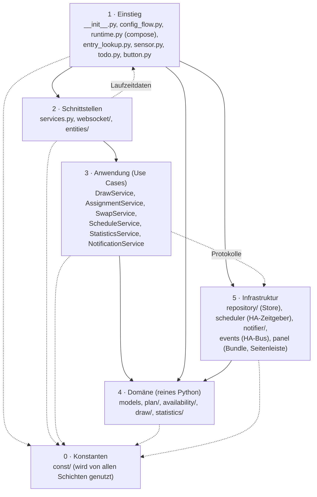
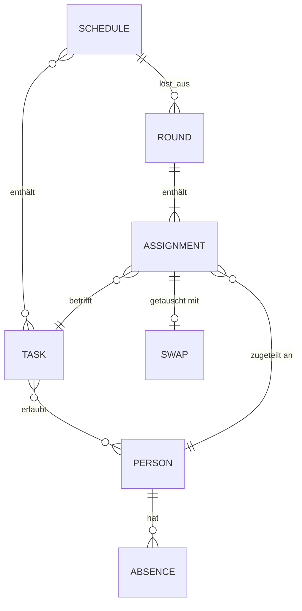
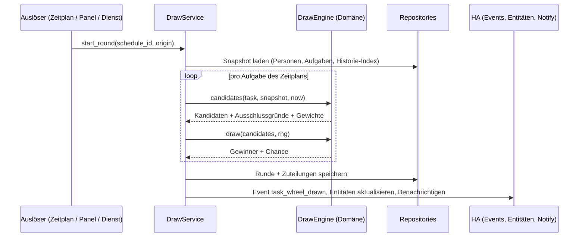

# Technisches Konzept: Task Wheel of Fortune für Home Assistant

Stand: 2026-11-05 (Version 0.7.0) · Status: **Abgestimmt** (Pattern und Annahmen §11 bestätigt) · Grundlage: UI-Mockups in `mockups/` (PR #1)

Dieses Dokument beschreibt Architektur, Datenmodell, Algorithmen, Schnittstellen und Qualitätsregeln der
Erweiterung. Die Umsetzung ist in [ARBEITSPAKETE.md](ARBEITSPAKETE.md) geschnitten, der Code selbst wird in
[CODE_DOKU.md](CODE_DOKU.md) mit Metriken und Abhängigkeiten erfasst.

---

## 1. Ziel und Umfang

Eine HACS-installierbare Home-Assistant-Erweiterung (Domain `task_wheel`), die Haushaltsaufgaben fair und
nachvollziehbar per Glücksrad an Personen verteilt.

| Bereich | Umfang (aus den Mockups) |
|---|---|
| Personen | Eigene Objekte (keine HA-Benutzer), Farbe im Rad, Belastbarkeit (voll / halb / pausiert), Anwesenheitsregeln, optionaler Benachrichtigungsdienst |
| Aufgaben | Erlaubte Personen, Punkte (Aufwand), Mindest-Belastbarkeit, Räume, Zusatzregeln (keine Wiederholung, Abwesenheit beachten, Tausch erlaubt); die Häufigkeit steht am Zeitplan |
| Zeitpläne | Gültig ab (Datum + Uhrzeit), Intervall (alle n Stunden/Tage/Wochen), automatisch oder manuell, Lauf (Standard 30 Tage), je Aufgabe „mindestens n× je Lauf“ oder „jede Auslosung“; Planvorschau mit Warnungen; Animationen je Zeitplan |
| Auslosung | Automatisch per Zeitplan oder manuell im Panel mit Animation (Glücksrad, Lostrommel, Slot-Machine, Plinko, Scheinwerfer, Rubbellose, Eilmeldung, Oscar-Verleihung, je Zeitplan wählbar (leer = sofort ohne Animation), bei mehreren zufällig je Auslosung); jede Auslosung gehört zu einem Zeitplan |
| Zuteilungen | Abhaken, Fristen, Status (offen, pünktlich, verspätet, getauscht, verpasst, „Bleibt unerledigt“), Tausch zweier Aufgaben innerhalb einer Auslosung |
| Historie | Runden mit Zuteilungen, Chance, Status, Filter, CSV-Export |
| Statistik | KPIs, Punkte vs. fairer Anteil, Erledigungsquote pro Woche, Matrix Aufgabe × Person, Glückspilz/Pechvogel, Soll/Ist der Verlosungen je Zeitplan |
| Entscheidungslog | Je Auslosung und Aufgabe: Rad, Ausschlussgründe, Gewinner; Tausch und Admin-Austausch; Aufbewahrung einstellbar |
| HA-Integration | Dienste, Events, Sensoren, To-do-Listen, Buttons, Benachrichtigungen, Frontend-Panel in der Seitenleiste |

Nicht im ersten Release: Mehrmandantenfähigkeit (mehrere Haushalte), Lovelace-Karte (eigenes optionales Paket),
Synchronisation mit externen Kalendern.

---

## 2. Technologie und Zielplattform

| Thema | Entscheidung | Begründung |
|---|---|---|
| Backend-Sprache | Python **3.13** (Mindestversion von HA 2025.x/2026.x) | Aktuellste von HA unterstützte Syntax |
| Python-Syntax | PEP 695 `type`-Aliase und generische Klassen, `match`, `@dataclass(slots=True, frozen=True, kw_only=True)`, `StrEnum`, `Self`, `override` (PEP 698), `ExceptionGroup` wo sinnvoll | Speicher und Zugriffsgeschwindigkeit (slots), Unveränderlichkeit (frozen), eindeutige Typen |
| HA-Mindestversion | 2025.6 (wird im Gerüst-Paket final gepinnt) | `entry.runtime_data`, `StaticPathConfig`, `notify.send_message`, Todo-Plattform |
| Frontend | **Lit 3** + **TypeScript ≥ 5** (aktuell 6.x, strict), ES2022-Module, Build mit **Vite** | HA selbst nutzt Lit; kleinste Bundle-Größe; Templates escapen automatisch |
| Grafik | SVG für das Rad, CSS-Transform für die Drehung, `prefers-reduced-motion` respektiert | Kein Canvas-Neuzeichnen pro Frame, GPU-beschleunigt |
| Zufall | `secrets.SystemRandom` | Nicht vorhersagbar, keine Seed-Manipulation; Ergebnis entsteht nur im Backend |
| Persistenz | `homeassistant.helpers.storage.Store` (JSON, versioniert, mit Migration) | Kein eigener DB-Zugriff nötig, Backups durch HA |
| Tests | pytest + `pytest-homeassistant-custom-component`, Vitest fürs Frontend | Standard im HA-Ökosystem |
| Qualität | ruff (strenges Regelset), mypy `--strict`, ESLint + typescript-eslint strict, Prettier | Durchsetzung der Code-Regeln in CI |
| Verteilung | HACS (Typ „Integration“), Frontend-Bundle liegt in der Integration | Ein Repository, eine Installation |

---

## 3. Architektur

### 3.1 Schichten

Abhängigkeiten zeigen **nur nach unten**. Keine Schicht kennt die darüberliegende. Die Domäne importiert
nichts aus `homeassistant` und ist dadurch ohne HA testbar und schnell.



| Schicht | Aufgabe | Darf nutzen | Darf **nicht** |
|---|---|---|---|
| 0 Konstanten | Schlüssel, Grenzen, Standardwerte, Event- und Dienstnamen | – | Logik enthalten |
| 1 Einstieg | Setup/Unload der Config Entry, Panel registrieren, Komposition (Objekte verdrahten in `runtime.compose`), Plattform-Einstiege | 2, 3, 4 (Modelle und Fehler), 5 | Fachlogik enthalten |
| 2 Schnittstellen | Eingaben validieren (voluptuous), Rechte prüfen, an Use Cases weiterreichen, Entitäten bereitstellen | 3, 4 (nur Modelle), 1 (nur `runtime.py`, `entry_lookup.py`: Zugriff auf die Laufzeitdaten des Eintrags) | Store direkt lesen/schreiben |
| 3 Anwendung | Abläufe orchestrieren, Transaktionen, Events feuern | 4, 5 (über Protokolle) | HA-Objekte an die Domäne geben |
| 4 Domäne | Regeln, Gewichtung, Ziehung, Statusübergänge | 0 | `homeassistant`, I/O, Uhr (Zeit kommt als Parameter) |
| 5 Infrastruktur | Speichern, Zeitgeber, Benachrichtigung, Events auf dem HA-Bus, Panel-Registrierung | 4 (Modelle), 3 (nur `protocols.py` und `event_payloads.py`) | Use Cases aufrufen |

Die Anwendungsschicht spricht die Infrastruktur nur über `typing.Protocol`-Schnittstellen an
(`ConfigRepository`, `HistoryRepository`, `TimerPort`, `RoundEvents`, `Notifier` in `application/protocols.py`; die Uhr ist ein injiziertes Callable `data.clock`). Das hält die Schichten austauschbar und testbar.

### 3.2 Entwurfsmuster

Vorgabe: **Factory Pattern**, ergänzt um **Strategy** und **Repository** (entschieden, siehe unten). Es wird an allen Stellen eingesetzt, an denen aus Konfiguration Objekte
unterschiedlicher Art entstehen. Damit keine `if/elif`-Ketten entstehen, sind die Fabriken
**registrierungsbasiert**: eine unveränderliche Zuordnung `Art → Erzeuger` (`MappingProxyType`), Auswahl per
Schlüssel, unbekannte Arten werfen eine eigene Ausnahme.

| Fabrik | Erzeugt aus | Arten |
|---|---|---|
| `AvailabilityRuleFactory` | `AbsenceConfig` | `once`, `weekly_days`, `week_rhythm`, `recurring` |
| `WeightingFactory` | `Settings.weighting` | `fairness` (Standard), `uniform` |
| `NotifierFactory` | Ziel des Benachrichtigungsdienstes | `notify_entity` (`notify.send_message`), `notify_service` (Legacy `notify.*`), `none` |
| `EntityFactory` | Personen, Zeitpläne | Sensoren, To-do-Listen, Buttons über `EntityDescription`-Tabellen |
| Komposition (`compose` in `runtime.py`, keine Fabrik) | Config Entry | Verdrahtet Repositories, Services und Fabriken einmal beim Setup |

> **Entschieden (2026-11-03, Anton): Factory + Strategy + Repository.**
> - **Factory** ist das Leitmuster für die Erzeugung (Tabelle oben).
> - **Strategy:** Die Fabriken erzeugen Objekte, deren *Verhalten* sich je Art unterscheidet. Jede Regelart ist
>   eine Klasse mit derselben Schnittstelle (z. B. `AvailabilityRule.is_present(...)`,
>   `Weighting.weigh(...)`); Aufrufer kennen nur die Schnittstelle.
> - **Repository:** Persistenz liegt hinter `ConfigRepository` und `HistoryRepository` (`typing.Protocol`);
>   Services greifen nie direkt auf den `Store` zu. Für Tests gibt es eine In-Memory-Implementierung.

### 3.3 Verzeichnisstruktur

Nur Pakete und Schlüsseldateien; die vollständige Modulliste mit Verantwortung steht in
[CODE_DOKU.md](CODE_DOKU.md) §3.

```text
custom_components/task_wheel/
├── __init__.py              # Einstieg: async_setup_entry / async_unload_entry
├── manifest.json
├── config_flow.py           # Einzelinstanz, Optionen (Joker/Monat – für später reserviert –, Fairness-Fenster, Aufbewahrung, Aufbewahrung des Entscheidungslogs)
├── runtime.py               # TaskWheelData (entry.runtime_data) und compose: Objekte verdrahten
├── entry_lookup.py          # geladene Config Entry für Dienste und WebSocket finden
├── sensor.py, todo.py, button.py  # Plattform-Einstiege, reichen an entities/ durch
├── services.py              # task_wheel.draw, complete, swap, set_absence
├── services.yaml
├── const/                   # Schicht 0 (keys, limits, defaults, events, entities, notification, panel)
├── domain/                  # Schicht 4 (ohne homeassistant-Import)
│   ├── models.py            # Person, Task, Schedule, Round, Assignment, …
│   ├── serialization.py     # to_dict/from_dict für alle Modelle
│   ├── enums.py, errors.py, types.py, validation.py
│   ├── plan/                # window (Perioden), due (Fälligkeit, Abstände), preview (Planvorschau)
│   ├── availability/        # AvailabilityRule-Strategien + Factory
│   ├── dates.py             # Kalenderhilfen (week_start, local_date)
│   ├── draw/                # candidates, feasibility, matching, weighting, draft, engine, types
│   ├── decisions.py         # Entscheidungslog (Einträge, Ausschlussgründe)
│   ├── statistics/          # aggregate, report, goals
│   ├── status.py            # Statusübergänge der Zuteilungen
│   ├── history.py           # HistoryFilter
│   └── swap.py              # Prüfregeln für den Tausch
├── application/             # Schicht 3: Use Cases (draw_service, draw_inputs, assignment_service,
│                            #   swap_service, schedule_service, round_service, config_service,
│                            #   statistics_service, history_service, decision_service, notification_service, …),
│                            #   protocols.py, views/live_view/wire (Panel-Daten), fanout, event_payloads
├── infrastructure/          # Schicht 5
│   ├── repository/          # ConfigStore, HistoryStore, DecisionStore, Migrationen
│   ├── scheduler.py         # HA-Zeitgeber (TimerPort)
│   ├── notifier/            # NotifierFactory + Implementierungen
│   ├── events.py            # RoundEvents auf dem HA-Bus
│   └── panel.py, panel_bundle.py  # Panel registrieren, gebautes Bundle finden
├── websocket/               # Schicht 2: Befehle je Bereich (read, actions, config)
├── entities/                # Schicht 2: sensor, todo, button, EntityFactory
├── texts/, translations/    # Benachrichtigungstexte, de.json/en.json
└── frontend/dist/           # gebautes Panel (nicht von Hand bearbeiten)

frontend/                    # Quellcode des Panels
├── src/
│   ├── constants/           # Routen, Ereignisnamen, Grenzen, Design-Tokens
│   ├── i18n/                # de.ts, en.ts, typisierte Schlüssel
│   ├── api/                 # typisierter WebSocket-Client
│   ├── state/               # Store + @lit/context
│   ├── components/          # tw-wheel, tw-chips, tw-schedule-editor, …
│   ├── views/               # overview, draw, tasks, persons, schedules, history, statistics, decisions
│   └── task-wheel-panel.ts  # Einstieg
├── vite.config.ts
└── package.json

docs/                        # Konzept, Arbeitspakete, Code-Doku (+ Generator)
tests/                       # backend (pytest) – frontend-Tests liegen unter frontend/src/**/*.test.ts
e2e/                         # Playwright gegen eine echte Home-Assistant-Instanz
```

---

## 4. Datenmodell

Alle Modelle sind `@dataclass(slots=True, frozen=True, kw_only=True)`. Änderungen erzeugen neue Instanzen
(`dataclasses.replace`), dadurch gibt es keine geteilten veränderlichen Zustände zwischen Panel, Diensten und
Zeitgebern. IDs sind `uuid4().hex`; Slugs (für Entity-IDs) werden einmalig aus dem Namen erzeugt und bleiben stabil.



| Modell | Wichtige Felder |
|---|---|
| `Person` | `id`, `name`, `slug`, `color`, `load: Load` (`full`=1,0 · `half`=0,5 · `paused`=0), `absences: tuple[AbsenceConfig, ...]`, `notify_target: str \| None` |
| `AbsenceConfig` | `kind` + Felder je Art: `once(start, end)`, `weekly_days(weekdays)`, `week_rhythm(present_weeks, cycle_weeks, change_weekday, anchor)`, `recurring(weekdays, interval_weeks, start, end?)` (abwesend an den Wochentagen jeder n-ten Woche ab der Woche von `start`, bis einschließlich `end`; ohne `end` unbefristet) |
| `Task` | `id`, `name`, `points`, `allowed: frozenset[PersonId]` (leer = alle Personen), `no_repeat`, `respect_absence`, `swap_allowed`, `min_load: Load` (Mindest-Belastbarkeit, Standard `paused` = egal; `half` = mindestens halbe, `full` = nur volle Last), `area_ids: tuple[str, ...]` (null bis `MAX_AREAS_PER_TASK` HA-Bereiche/Räume ohne Doppelte, nur Anzeige; die Namen kommen im Panel aus `hass.areas`, ein gelöschter Bereich erscheint als „Unbekannter Raum“; Speicherstand 1.3 macht aus dem früheren einzelnen `area_id` eine Liste) |
| `Interval` | `unit: hour \| day \| week`, `every` (1 bis 1000); `hours` = Länge einer Periode |
| `Schedule` | `id`, `name`, `slug`, `start` (mit Zeitzone), `interval: Interval`, `automatic`, `run_days` (Standard 30, 1 bis 365; ein Intervall muss in den Lauf passen), `entries: tuple[ScheduleEntry, ...]`, `enabled`, `notify`, `skip_absent`, `archived`, `animations: tuple[AnimationKind, ...]` (0 bis 8 verschiedene Arten, Standard `wheel`; leer = ohne Animation sofort auslosen); abgeleitet: `task_ids`, `draws_per_run` = `run_days × 24 ÷ Intervallstunden` (archiviert ⇒ nicht aktiv, nie auslösbar) |
| `ScheduleEntry` | `task_id`, `mode: min_count \| every_draw`, `min_count` (1 bis 1000, nur bei `min_count`) |
| `Round` | `id`, `schedule_id`, `origin: auto \| manual \| service`, `started_at`, `finished_at`, `assignments` |
| `Assignment` | `id`, `round_id`, `schedule_id` (auslosender Zeitplan), `task_id`, `person_id`, `chance` (0–1), `points`, `due_at`, `status`, `done_at`, `swap: Swap \| None` |
| `Settings` | `jokers_per_month` (für später reserviert, derzeit ohne Wirkung), `fairness_window_days`, `history_retention_days`, `weighting`, `late_points_factor` (0–1, Standard 1,0), `missed_points_factor` (−1–0, Standard 0), `missed_grace_hours`, `panel_admin_only` (Standard aus), `decision_retention_days` (1–365, Standard 7; Aufbewahrung des Entscheidungslogs) |

### 4.1 Speicher

| Store | Inhalt | Schreibstrategie |
|---|---|---|
| `task_wheel.config` (Version 1, Unterversion 3) | Personen, Aufgaben, Zeitpläne, Einstellungen | `async_delay_save` (gebündelt, Verzögerung als Konstante) |
| `task_wheel.decisions` (Version 1, Unterversion 4) | Entscheidungslog: je Auslosung, Tausch und Austausch ein Eintrag mit Rad, Ausschlussgründen und Gewinner | `async_delay_save`; Bereinigung nach `decision_retention_days` (Standard 7) einmal täglich, höchstens 5000 Einträge |
| `task_wheel.history` (Version 1, Unterversion 3) | Runden, Zuteilungen, Monatsaggregate pro Person/Aufgabe | `async_delay_save`; Aufräumen nach `history_retention_days` einmal täglich |

Version 1.2 (beide Stores): Zuteilungen tragen `schedule_id`; die Migration 1.1 → 1.2 setzt den Zeitplan der Runde ein.

Version 1.3 (beide Stores): Aufgaben tragen `area_ids` (Liste) statt des einzelnen `area_id`; die Migration 1.2 → 1.3 der Konfiguration macht daraus eine Liste (`_task_areas`), die des Verlaufs ändert das Schema nicht.

Migrationen laufen über `Store(..., minor_version=...)` und `_async_migrate_func`; jede Migration ist eine
eigene, getestete Funktion.

Im Speicher hält das Repository Indizes (`dict[PersonId, Person]`, offene Zuteilungen je Person, letzte
Zuteilung je Aufgabe), damit Regelprüfungen und Entitäten ohne Durchlauf der Historie auskommen.

---

## 5. Fachliche Abläufe und Algorithmen

### 5.1 Ablauf einer Runde



Vor der Ziehung wählt `select_assignable` (`application/draw_inputs.py`, Kern `pick_assignable` in `domain/draw/feasibility.py`) aus den fälligen Aufgaben eine größtmögliche Menge, die sich **vollständig** an verschiedene Personen vergeben lässt (je Person höchstens eine Aufgabe; erlaubt, belastbar, in der Periode anwesend; Matching Personen ↔ Aufgaben). „Jede Auslosung“-Aufgaben sind zuerst dabei, danach kommen die fälligen Aufgaben (§5.2a) in gewichteter Zufallsreihenfolge (die injizierte Zufallsquelle, nicht vorhersehbar); die Aufgaben der Runde werden anschließend in zufälliger Reihenfolge gezogen (`shuffled`), sonst wäre bei eingeschränkten Aufgaben die Folge der Gewinner in jeder Runde dieselbe. Aufgaben, die niemand übernehmen kann oder die um dieselben Personen konkurrieren und leer ausgingen (z. B. zwei Aufgaben, die nur eine Person darf), kommen in dieser Runde gar nicht vor und zählen nicht als verlost; bleibt dadurch eine Lücke, füllt die erste vergebbare noch nicht fällige Aufgabe sie auf; bleibt nichts übrig, gilt „Keine Aufgabe fällig“. Gibt es wegen Abwesenheit weniger Personen als Aufgaben „in jeder Runde“, ist das in Ordnung: Die Aufgaben „jede Auslosung“ gehen zuerst hinein, unter ihnen entscheidet der Zufall. Beim Speichern eines Zeitplans wird dagegen geprüft, ob sich die Aufgaben „jede Auslosung“ der Konfiguration nach (erlaubte Personen, Belastbarkeit, ohne Abwesenheit) an verschiedene Personen vergeben lassen; sonst wird er nicht gespeichert (`schedule_tasks_unassignable`). Eine Runde enthält also nie eine Aufgabe, die nicht vergeben werden kann; die Warnung vor dem Start (`unplaceable_task_ids`) bleibt als Absicherung, etwa nach einem Admin-Austausch.

Beim manuellen Ablauf im Panel wird die Runde schrittweise gezogen (`draw/begin`, `draw/spin`, `draw/spin_rest`,
`draw/commit`, `draw/cancel`; vorab zeigt `draw/preview` Rad und Kandidaten einer Aufgabe). Das **Ergebnis bestimmt immer das Backend**; das Frontend erhält Gewinner und
Segmentgrenzen und animiert nur dorthin. Eine offene Runde verfällt nach einer Zeitgrenze (Konstante) und
blockiert keine automatischen Runden desselben Zeitplans: löst der Zeitplan automatisch aus, wird die offene
Panel-Runde verworfen (der Zeitplan geht vor, eine Periode wird nie doppelt ausgelost). Je Zeitplan ist höchstens eine
Panel-Runde offen (`begin` ersetzt die alte), insgesamt höchstens `MAX_OPEN_PANEL_ROUNDS`. Pausierte Zeitpläne
lösen nicht automatisch aus, lassen sich aber von Hand auslosen; archivierte nie.

### 5.2 Kandidatenfilter

Kandidaten einer Aufgabe = erlaubte Personen, aus denen nacheinander entfernt wird (jeder Filter ist ein eigenes
Objekt mit `reason`, die Gründe erscheinen im Entscheidungslog):

1. **Belastung**: `load == paused`
2. **Mindest-Belastbarkeit** (wenn `min_load` nicht `paused`): `load.factor < min_load.factor` entfernt die Person (`load_too_low`); gibt es niemanden mit ausreichender Belastbarkeit, bleibt die Aufgabe unvergeben
3. **Anwesenheit** (wenn `respect_absence`): an keinem Tag der Periode (`DrawContext.window`: Beginn bis Ende der ausgelosten Periode) anwesend. Wer irgendwann in der Periode da ist, bleibt Kandidat. Diese Machbarkeitsprüfung ist als Funktion `feasible_persons`/`is_feasible`/`feasible_tasks` (`domain/draw/feasibility.py`) wiederverwendbar (Entscheidungslog, Austausch von Aufgaben)
4. **Keine Wiederholung** (wenn `no_repeat`): hatte die Aufgabe in der letzten Zuteilung, sofern noch andere Kandidaten übrig sind (nur Vorliebe: wer sonst unvergeben bliebe, bekommt die Aufgabe trotzdem; vorher sperren harte Filter und eine Zuordnung stellt sicher, dass so viele Aufgaben wie möglich verteilt werden)
5. **Aufgabe in dieser Runde** (immer): Wer in derselben Runde schon eine Aufgabe gezogen hat, bekommt keine zweite und ist für die weiteren Aufgaben nicht mehr im Rad (`taken`). Die Begrenzung auf die Zahl der mitmachenden Personen (siehe 5.1) nimmt überzählige Aufgaben gar nicht erst in die Runde auf; bleibt dennoch eine Aufgabe ohne Kandidaten übrig (z. B. weil alle erlaubten Personen schon eine Aufgabe haben), bleibt sie unverteilt
6. **Reserviert für andere** (`needed`, nur bei der Zuordnung): Wer für eine andere Aufgabe dieser Runde zwingend gebraucht wird (sonst bliebe sie unverteilt), ist für diese Aufgabe nicht im Rad
7. **Ohne Kandidaten** wird die Aufgabe als „nicht verteilbar“ protokolliert, nicht erzwungen

### 5.2a Häufigkeit und Abstände (Entscheidung von Anton, 2026-11-17)

Die Häufigkeit steht je Aufgabe am Zeitplan (`ScheduleEntry`), nicht an der Aufgabe. Ein Lauf hat `R = draws_per_run` Perioden (Standard 30 Tage). Für „mindestens n× je Lauf“ ist der **Zielabstand** `R ÷ n`; der Mindestabstand ist `max(1, abgerundet)`. Eine Aufgabe ist **fällig**, wenn seit ihrer letzten Zuteilung mindestens so viele Perioden vergangen sind (`domain/plan/due.py`). Der Zähler wird an der Lauf-Grenze nicht zurückgesetzt, so wird dieselbe Aufgabe nicht am Ende eines Laufs und gleich am Anfang des nächsten ausgelost. Ohne Vorgeschichte ist die Aufgabe mit Wahrscheinlichkeit `1 ÷ Mindestabstand` fällig (zufällige Phase). „Jede Auslosung“ ist von dieser Regel ausgenommen und immer dabei (bei zu wenig Personen entscheidet der Zufall).

Reihenfolge: zuerst „jede Auslosung“, dann die fälligen Aufgaben, gewichtet nach Verzug (`1 + Verzug`), zuletzt nicht fällige als Füllung (gewichtet nach Fortschritt, mindestens `GAP_WEIGHT_FLOOR`); die gewichtete Zufallsreihenfolge nutzt den Schlüssel `zufall ** (1 ÷ gewicht)`. Es zählt die **Zuteilung** (verlost), nicht das Erledigen. Ist nichts fällig und niemand kann mitmachen, entsteht keine leere Runde: `draw_nothing_due`; die automatische Auslosung überspringt die Periode mit einem Log-Eintrag.

**Entscheidungslog:** Das Log hält zusätzlich fest, warum Aufgaben des Zeitplans nicht oder nur als Füllung vorkamen (`DecisionRecord.skipped`, `TaskDecision.note`): `not_due` (noch nicht fällig), `deferred` (fällig, aber zufällig zurückgestellt, weil es mehr fällige Aufgaben als Personen gab) und `filled` (nicht fällig, zufällig nachgezogen, um eine Lücke zu füllen; steht an der Aufgabe selbst).

**Planvorschau** (`domain/plan/preview.py`, WebSocket `schedule/plan_preview`, ohne Speichern): Platz = `R × min(Personen im Rad, Aufgaben)`; die Personen im Rad sind alle erlaubten Personen der gewählten Aufgaben (leere Liste = alle). Je Aufgabe werden die Positionen im Lauf gleichmäßig verteilt (Phase so, dass die Perioden möglichst gleich belegt sind) samt kleinstem und größtem Abstand (auch über die Lauf-Grenze). **Blockierend** (Speichern nicht möglich): keine Aufgabe, Intervall länger als der Lauf, keine Person. **Warnungen** (Speichern geht): Überlast (mehr Aufgaben als Personen in einer Periode), Lücken (Perioden ohne Aufgabe), Aufgabe öfter als Auslosungen. Beim Speichern prüft das Backend zusätzlich, dass sich „jede Auslosung“-Aufgaben an verschiedene Personen vergeben lassen (`schedule_tasks_unassignable`).

### 5.3 Fairness-Gewichtung

Ziel: Wer im Fairness-Fenster (Standard 30 Tage) weniger Punkte im Verhältnis zu seinem fairen Anteil hatte,
bekommt ein größeres Segment.

- Kapazität `c_i = load_i × anwesende_Tage_i` im Fenster
- Fairer Anteil `f_i = c_i / Σ c`
- Ist-Anteil `a_i = p_i / Σ p` (bei `Σ p = 0`: `a_i = f_i`)
- Gewicht `w_i = exp(−k × a_i / f_i)` (gleich `exp(k × (f_i − a_i) / f_i)` geteilt durch `e^k`) mit Dämpfung `k` (Konstante), begrenzt auf `[w_min, w_max]`; die Kapazität geht nur über die Abweichung vom fairen Anteil ein, nicht als Faktor (sonst gewönnen die meisten Anwesenden immer zuerst und die Reihenfolge der Personen wäre nie zufällig)
- Chance `π_i = w_i / Σ w` (wird gespeichert und im Rad als Segmentgröße gezeigt)

Punkte, die innerhalb derselben Runde vergeben werden, fließen sofort in `p_i` ein, damit eine Runde nicht alle
Aufgaben an dieselbe Person verteilt. Aufwand pro Runde: `O(Aufgaben × Personen)`; bei realistischen Größen
(< 50 × < 15) im Mikrosekundenbereich.

### 5.4 Zuteilungen, Fristen, Tausch

**Perioden statt Fristen (Entscheidung von Anton, 2026-11-17/20):** Es gibt keine Frist je Auslosung. Ein Zeitplan beginnt bei `start` und teilt die Zeit in Perioden der Länge `interval` (`domain/plan/window.py`). Die Periode `k` reicht von `start + k × Intervall` bis zur nächsten; jede Auslosung gehört zu genau einer Periode (`Round.period_index`), und jede Zuteilung trägt `starts_at` und `due_at` dieser Periode. Eine Zuteilung gilt bis zur nächsten Auslosung. Wird eine Periode erst nach ihrem Beginn ausgelost, beginnt das Fenster beim Auslosen (`effective_window`) und behält die Länge, damit die Zuteilung nicht sofort überfällig ist. Tage und Wochen rechnen in Kalenderzeit (Uhrzeit bleibt über die Sommerzeit gleich), Stunden in echter Zeit.

**Manuell auslösen:** `draw/begin` nimmt nur den Zeitplan. Ausgelost wird immer die **nächste offene Periode** (jüngste ausgeloste + 1, sonst 0), nie eine Lücke. **Löschen** (`round/delete`) darf nur die jüngste Periode des Zeitplans (`round_not_newest`) und nur solange nichts erledigt ist. Der automatische Zeitgeber löst zu jedem Rasterzeitpunkt genau die Periode dieses Zeitpunkts aus; ist sie schon ausgelost (`draw_period_drawn`) oder gibt es nichts zu vergeben, wird sie übersprungen. Eine gelöschte Periode wird nicht nachgeholt, solange man sie nicht vor dem nächsten automatischen Lauf von Hand auslost; sonst gilt sie als übersprungen (das Panel weist beim Löschen darauf hin). Beim Start wird nichts nachgeholt. Der Dienst `task_wheel.draw` und der Zeitgeber nutzen dieselbe Logik.

| Übergang | Auslöser | Ergebnis |
|---|---|---|
| offen → pünktlich | `complete` vor `due_at` | Punkte zählen |
| offen → verspätet | `complete` nach `due_at` | Punkte × `late_points_factor` (einstellbar, Standard 1,0) |
| offen → verpasst | täglicher Lauf nach `due_at + missed_grace_hours` | Punkte × `missed_points_factor` (einstellbar, Standard 0; negativ = Abzug) |
| offen/getauscht → bleibt unerledigt | `skip` (Knopf „Bleibt unerledigt“, mit Rückfrage) | Punkte wie verpasst; in der Statistik zählt die Zuteilung als nicht erledigt (Erledigungsquote, Kennzahl „Verpasst“, Zuverlässigkeit), in der Historie bleibt sie als eigener Status sichtbar |
| offen → getauscht | `swap` (echter Tausch, beide Zuteilungen) | die beiden Personen tauschen ihre Aufgaben, die Punkte gehen mit der Aufgabe, beide Zuteilungen haben danach den Status getauscht |

**Tausch (Entscheidung des Eigentümers, 2026-11-04):** Der Tausch ist ein **echter Tausch Aufgabe gegen Aufgabe** innerhalb einer Auslosung:
Hat Ana das Bad und Ben die Küche und tauscht Ana mit Ben, hat Ana danach die Küche und Ben das Bad. Jede Person behält je Runde genau
eine Aufgabe (der frühere Stand, der nur Anas Aufgabe an Ben übergab, sodass Ben zwei hatte, entfällt). `SwapService.swap(assignment_id,
to_person_id, now)` spricht weiter mit der Zielperson: Die **Gegenzuteilung** ist die offene Zuteilung (Status `open`) der Zielperson in
derselben Runde; hat sie mehrere (nur mit Altdaten möglich), gilt die mit der frühesten Frist, hat sie keine, lehnt der Dienst mit
`swap_person_has_no_open_assignment` ab (das gilt auch für Personen, die in der Runde gar keine Zuteilung haben, und für erledigte,
verpasste, getauschte oder übersprungene Gegenstücke). Geprüft wird **in beiden Richtungen** (eine Funktion, zweimal angewandt): die Aufgabe
muss `swap_allowed` haben, die Person, die sie bekommt, muss sie laut Regel bekommen dürfen (erlaubt, nicht pausiert, mit ausreichender
Belastbarkeit, bis zur Frist anwesend), und es muss eine andere Person sein (`swap_same_person`). Beide Zuteilungen bekommen den Status
`swapped`, wechseln die Person und je einen `Swap`-Vermerk (von, an, wann); sie werden **atomar** gemeinsam gespeichert
(`store_assignments`), die Aggregate der Statistik folgen beiden Änderungen, und beide Zuteilungen lösen das Event `assignment_swapped`
(`task_wheel_swapped`, je Zuteilung mit abgebender Person; Entitäten beider Personen aktualisieren sich, jede Person erhält eine
Benachrichtigung über ihre neue Aufgabe). Eine getauschte Zuteilung lässt sich nicht noch einmal tauschen (Doppeltausch verboten) und zählt
nicht als Gegenstück. Der Tausch hat **nichts mit Jokern zu tun**: Es gibt weder eine Prüfung noch einen Zähler noch eine Anzeige; die
Einstellung `jokers_per_month` (Options Flow, `Settings`, Speicherstand) bleibt für später reserviert und wirkt derzeit nicht.
Ist eine Aufgabe in mehreren Zeitplänen, kann sie mehrfach ausgelost werden (auch an dieselbe Person); jede Zuteilung kennt ihren Zeitplan und wird einzeln erledigt. Die Abstände zählen je Zeitplan (Zuteilungen dieses Zeitplans).
Statusübergänge sind eine Tabelle `dict[(Status, Aktion), Status]` – keine Verzweigungsketten.

**Auslosung löschen** (`round/delete`, nur Administratoren): nur solange **keine** Zuteilung der Runde erledigt (pünktlich
oder verspätet) ist, sonst `round_has_done_assignments`. Die Runde verschwindet mit allen ihren Zuteilungen aus Historie und
Verlauf; die Monatsaggregate (Anzahl und Punkte) werden um genau diese Zuteilungen verringert, die Statistik sieht die Runde
danach nicht mehr. Entitäten der betroffenen Personen und des Zeitplans werden aktualisiert. Das Panel sperrt den Knopf mit Begründung,
sobald eine Aufgabe erledigt ist, und fragt sonst vor dem Löschen nach.

### 5.5 Zeitpläne

| Art | Umsetzung |
|---|---|
| automatisch | `async_track_point_in_time` auf den nächsten Rasterzeitpunkt `start + k × Intervall` (`ScheduleService.next_run`); beim Auslösen wird die Periode dieses Zeitpunkts ausgelost, danach der nächste Zeitpunkt gesetzt |
| manuell | derselbe Zeitgeber löst nur eine **Erinnerung** aus, wenn die offene Periode schon begonnen hat; ausgelost wird per Klick, Dienst oder Knopf (immer die nächste offene Periode) |

Ein Zeitpunkt, der beim Start schon vorbei ist (z. B. weil Home Assistant aus war), wird nicht nachgeholt. Schlägt eine automatische Auslosung fehl, wird das protokolliert und der nächste Zeitgeber
trotzdem gesetzt. Zeitgeber werden beim Ändern eines Zeitplans gezielt neu gesetzt (nur dieser Plan) und beim Entladen der
Integration vollständig abgemeldet. Zeitzone ist die von HA (`dt_util`).

---

## 6. Schnittstellen zu Home Assistant

### 6.1 Dienste

| Dienst | Daten | Wirkung |
|---|---|---|
| `task_wheel.draw` | `schedule` (Slug oder ID), optional `animate_on` | Runde ohne Panel ziehen; mit `animate_on` wird zusätzlich ein Event für eine Anzeige gefeuert |
| `task_wheel.complete` | `assignment_id` oder `person` + `task` | Zuteilung erledigen |
| `task_wheel.swap` | `assignment_id`, `to_person` | Tausch gegen die offene Zuteilung von `to_person` |
| `task_wheel.set_absence` | `person`, `start`, `end` | Einmalige Abwesenheit (z. B. aus Kalender-Automation) |

Alle Dienste haben voluptuous-Schemas, unbekannte Felder werden abgelehnt. Fehler werden als
`ServiceValidationError` mit übersetzbarem Schlüssel gemeldet.

### 6.2 Events

`task_wheel_drawn`, `task_wheel_completed`, `task_wheel_swapped`, `task_wheel_missed`, `task_wheel_reminder`.
Payloads enthalten nur IDs, Namen und Zahlen (keine Konfiguration). Zusätzlich meldet `task_wheel.draw` mit `animate_on` das Event `task_wheel_animate` (gleicher Inhalt wie `task_wheel_drawn` plus `animate_on`). „Bleibt unerledigt“ (`assignment/skip`) und das Löschen einer Auslosung feuern **kein** Event (das Panel erfährt es über den Live-Stand, Entitäten über Signale); eine Automation kann darauf nicht reagieren, obwohl „Bleibt unerledigt“ wie „verpasst“ zählt.

### 6.3 Entitäten (über `EntityFactory`)

Die Entity-IDs entstehen aus dem Gerätenamen und dem übersetzten Entitätsnamen (Übersetzungsschlüssel `open`, `points`, `next_draw`, `draw`). Die Beispiele zeigen sie bei **deutscher** Systemsprache zur Zeit der Anlage; bei englischer heißen sie z. B. `sensor.task_wheel_anna_open`, `sensor.task_wheel_anna_points`, `sensor.task_wheel_weekly_plan_next_draw`, `button.task_wheel_weekly_plan_draw` (so zeigt sie auch die README).

| Entität | Beispiel | Zweck |
|---|---|---|
| Sensor offene Aufgaben je Person | `sensor.task_wheel_anna_offen` | Dashboard, Automationen |
| Sensor Punkte im Monat je Person | `sensor.task_wheel_anna_punkte` | Statistik in HA-Verlauf |
| To-do-Liste je Person | `todo.task_wheel_anna` | Abhaken per App, Sprachassistent |
| Sensor nächste Auslosung je Zeitplan | `sensor.task_wheel_wochenplan_naechste_auslosung` (Zeitstempel) | Anzeige |
| Button je Zeitplan | `button.task_wheel_wochenplan_auslosen` | Dashboard-Button, Automation |

Entitäten lesen nur aus den Indizes des Repositories und werden über einen Dispatcher-Signal-Namen pro Person
bzw. Zeitplan aktualisiert – keine Abfragen (Polling), `should_poll = False`.

### 6.4 WebSocket-API für das Panel

Präfix `task_wheel/`. Befehle je Bereich in eigenen Modulen; jeder Befehl hat ein Schema.

| Bereich | Befehle | Recht |
|---|---|---|
| Lesen | `snapshot`, `subscribe` (Deltas), `history/list`, `statistics/get` (liefert auch `goals`: je Zeitplan und Aufgabe das Soll gegen die vom Zeitplan verlosten Zuteilungen im laufenden und in den vorherigen Läufen, `GoalWindow` je Lauf), `availability/preview` (Anwesenheit der nächsten Wochen für ungespeicherte Regeln; einzige Quelle der Regeln ist das Backend) | angemeldeter Benutzer |
| Erledigen/Tauschen | `assignment/complete`, `assignment/swap`, `assignment/skip` | angemeldeter Benutzer |
| Auslosung löschen | `round/delete` | **Administrator** |
| Auslosen | `draw/begin`, `draw/preview` (Rad und Kandidaten einer Aufgabe vorab), `draw/spin`, `draw/spin_rest`, `draw/commit`, `draw/cancel`, `draw/replacements`, `draw/replace_task` | angemeldeter Benutzer; `draw/cancel` und ein erneutes `draw/begin` über eine schon gezogene Runde sowie `draw/replacements`/`draw/replace_task` (Aufgabe der Runde vor dem ersten Dreh gegen eine machbare Aufgabe desselben Zeitplans tauschen) nur Administrator |
| Konfiguration | `person/*`, `task/*`, `schedule/*`, `settings/update` | **Administrator** (`@websocket_api.require_admin`) |

`subscribe` schickt nach dem ersten Snapshot nur noch Änderungen (Delta je Objekt-ID). Das hält die Datenmenge
klein und das Panel reaktiv.

**Nachrichten (umgesetzt in AP-10).** Konfigurationsobjekte stehen unter dem Schlüssel ihrer Art:
`person/create {person: {…}}`, `person/update {person_id, person: {…nur geänderte Felder…}}`,
`person/delete {person_id}` (abgelehnt mit `in_use`, solange eine Aufgabe die Person erlaubt oder sie offene Zuteilungen hat; `task/delete` ebenso, solange ein Zeitplan die Aufgabe enthält oder sie offen zugeteilt ist); ebenso `task/*` und `schedule/*`; `settings/update {settings: {…}}`. Die Kennung
vergibt das Backend, der Kurzname (`slug`) wird bei Bedarf aus dem Namen abgeleitet. Schemas lehnen unbekannte
Felder, zu lange Zeichenketten und Listen sowie zu tiefe Verschachtelung ab; die Bedeutung prüfen die Modelle.
Fachfehler kommen als Fehlerantwort, deren `code` der Übersetzungsschlüssel ist (z. B. `not_found`,
`limit_reached`, `in_use`). Wer ein Element löscht, das noch gebraucht wird (letzte erlaubte Person einer Aufgabe,
letzte Aufgabe eines Zeitplans), bekommt `in_use`; sonst wird es aus den Verweisen gestrichen. Ist
`panel_admin_only` gesetzt, gilt für alle Befehle: nur Administratoren; dasselbe Recht prüfen die Dienste, der Button
„Auslosen“ und das Abhaken in der To-do-Liste (Aufrufe ohne Benutzer, etwa aus Automationen, bleiben erlaubt). Wird die Einstellung
aktiviert, werden bestehende Abonnements abgemeldet, und der Seitenleisteneintrag folgt der Einstellung ohne Neustart.

`snapshot` und die Antwort auf `subscribe` enthalten `persons`, `tasks`, `schedules` (mit
`next_run`), die offenen `assignments`, die offenen `panel_rounds`, `settings` und `now`. Ein Delta nennt je
Sammlung `{upsert: […], remove: [ids]}` und bei Änderung die gesamten `settings`.

### 6.5 Panel

Registrierung über `panel_custom.async_register_panel` (Seitenleiste „Aufgaben-Glücksrad“ bei deutscher, „Task Wheel of Fortune“ sonst Systemsprache, Symbol `mdi:ferris-wheel`
o. ä.), Bundle über `hass.http.async_register_static_paths([StaticPathConfig(..., cache_headers=True)])`.
Der Dateiname enthält einen Inhalts-Hash, damit Browser-Caches bei Updates sicher erneuert werden.
`require_admin` für das Panel ist eine Option (Standard: aus, weil Kinder abhaken sollen; Konfiguration ist über
die API trotzdem nur für Admins möglich).

---

## 7. Frontend

| Thema | Konzept |
|---|---|
| Aufbau | `task-wheel-panel` (Einstieg, Routing über Tabs) → Views → Komponenten. Views kennen nur den Store und die API, Komponenten nur ihre Properties und Events |
| Zustand | Ein Store (Signals-artig, `@lit/context`), gespeist durch `subscribe`; Views abonnieren nur ihre Ausschnitte |
| Rendering | Ausschließlich Lit-Templates, **kein** `innerHTML`/`unsafeHTML`; Listen mit `repeat()` und Schlüsseln |
| Glücksrad | `tw-wheel`: SVG-Segmente aus `{person, chance, color}`; Drehwinkel = Zielsegment + volle Umdrehungen (Konstanten), `transitionend` meldet das Ende; reduzierte Bewegung → direkt Ergebnis |
| Auslosungs-Animationen | Strategy + Registry: `STAGE_TAGS` ordnet jede `AnimationKind` (`wheel`, `drum`, `slot`, `plinko`, `spotlight`, `scratch`, `news`, `oscar`) einem Element mit `segments`, `label`, `taskName`, `language`, `spinTo(id)` zu (Rubbellose melden das erste Rubbeln über `tw-stage-start`, dann zieht das Panel; ist das Gewinnerlos frei, endet die Animation); `tw-stage` baut das Element der gewählten Art, die Basisklasse `StageElement` liefert die Schablone (unbekannter Gewinner ignorieren, reduzierte Bewegung → `settle`, sonst `play`, Abbruch bei neuen Segmenten). Der Zeitplan trägt die erlaubten Arten (Mehrfachauswahl); bei jedem Start einer Auslosung wählt das Panel zufällig eine (`pickAnimation`, nur Optik, der Gewinner steht vorher im Backend fest). Das Panel baut das Rad aus allen Teilnehmern der Runde (`participant_ids`: im Fristfenster anwesend, belastbar und für eine Aufgabe erlaubt; Abwesende fehlen), die noch keine Aufgabe haben, in gleich großen Segmenten ohne Prozentzahlen; „Wer ist dabei?“ zeigt dieselben Personen gleich aktiv und ohne Gründe, damit die Zuseher nicht sehen, wer die Aufgabe bekommen darf (das Backend lässt nur eine dafür mögliche Person gewinnen, die Gründe stehen im Entscheidungslog). Die Animation läuft bei jeder Aufgabe, nur die allerletzte der Runde mit höchstens einer möglichen Person wird direkt zugewiesen |
| Texte | Alle Texte über i18n-Schlüssel (`de`, `en`), Sprache aus `hass.locale` |
| Styling | Design-Tokens als CSS Custom Properties auf HA-Variablen (`--primary-color` …) gemappt; Farben, Abstände, Dauern als Konstanten |
| Performance | Bundle-Budget (Konstante in CI, Ziel < 120 kB gzip), Views per `import()` nachgeladen, Statistik-Diagramme als reines SVG ohne Diagrammbibliothek |
| CSV-Export | Im Frontend aus Historie-Daten; Felder, die mit `= + - @` beginnen, werden entschärft (CSV-Injection) |

**Literale im HTML:** Tag- und Attributnamen in Lit-Templates sind Sprachsyntax und keine fachlichen Literale.
Alles, was sich ändern kann – Texte, CSS-Klassen-Präfixe, Ereignisnamen, Routen, Zahlen, Farben – kommt aus
`constants/` bzw. `i18n/`. ESLint-Regeln (`no-magic-numbers`, eigene Regel gegen Textknoten in Templates)
setzen das durch.

---

## 8. Sicherheit

| Risiko | Maßnahme |
|---|---|
| Manipulierte Eingaben über WebSocket/Dienste | voluptuous-Schemas mit Längen- und Mengengrenzen (`const/limits.py`), `vol.Coerce` nur gezielt, `extra=vol.PREVENT_EXTRA` |
| Rechteausweitung | Konfigurationsbefehle nur für Admins; Lesebefehle prüfen die Verbindung (`connection.user`) |
| Ergebnismanipulation | Ziehung nur im Backend, `secrets.SystemRandom`, Runde wird mit Chance und Kandidatenliste gespeichert (nachvollziehbar) |
| XSS im Panel | Lit-Templates escapen; keine HTML-Zeichenketten aus Daten; Farben werden gegen `^#[0-9a-f]{6}$` validiert |
| CSV-Injection | Entschärfen beim Export |
| Benachrichtigungsdienst als Hebel | Ziel nur aus vorhandenen `notify`-Entitäten/-Diensten wählbar, Prüfung beim Speichern und beim Senden |
| Ressourcenverbrauch | Obergrenzen für Personen, Aufgaben, Zeitpläne, offene Panel-Runden; Historie wird nach Aufbewahrungsfrist gekürzt (Runden mit offenen Zuteilungen bleiben); von Hand oder per Dienst ausgelöste Runden desselben Zeitplans brauchen 30 Sekunden Abstand (`DRAW_MIN_INTERVAL_SECONDS`), bei Erreichen von `MAX_STORED_ROUNDS` entfällt die älteste abgeschlossene Runde (Aggregate bleiben) |
| Abhängigkeiten | Keine Python-Laufzeitabhängigkeiten außer HA; npm-Abhängigkeiten über Lockdateien festgelegt (Frontend exakt gepinnt, `e2e/` mit `^`-Bereich), `npm audit` und `pip-audit` (wöchentlich) in CI, Dependabot |

### 8.1 Ergebnis des Security-Reviews (AP-18)

Geprüft wurden alle Eingänge: WebSocket-Befehle, Dienste, To-do-Entität, CSV-Export, Benachrichtigungsziel und das Panel.
Befunde der Stufe hoch oder mittel: **keine offen.**

| Eingang | Prüfung | Ergebnis |
|---|---|---|
| WebSocket | Fehlerhafte Werte (falsche Typen, Übergrößen, tiefe Verschachtelung, ungültige Daten, unbekannte Arten) für jedes Feld jedes Befehls, Tests `tests/websocket/test_hardening.py` | nur Schema- oder Fachfehler, nie eine Ausnahme |
| WebSocket | Rechte: Konfiguration nur Administratoren, `panel_admin_only` sperrt alle Befehle für Nicht-Administratoren | in `tests/websocket/test_registry.py` (Recht je Befehl) und `tests/test_websocket.py` (`panel_admin_only`) geprüft |
| Dienste | `vol.Length` für Verweise, `cv.date`, Fachfehler werden übersetzt; `set_absence` begrenzt die Regelzahl über das Modell; bei `panel_admin_only` nur Administratoren (`access.ensure_allowed`) | in `tests/test_access.py` und `tests/test_integration.py` geprüft |
| To-do, Button | To-do: nur Abhaken, nur offene Zuteilungen der eigenen Liste; To-do und Button bei `panel_admin_only` nur für Administratoren | in `tests/test_access.py` geprüft |
| CSV | Formelzeichen (`= + - @ Tab CR`) werden entschärft, alles in Anführungszeichen | keine Befunde |
| Ressourcen | Obergrenzen für Personen, Aufgaben, Zeitpläne, Abonnenten, offene Panel-Runden, Historie; Lasttest `tests/performance/` | eingehalten |
| Abhängigkeiten | `npm audit` (Panel und E2E), Dependabot, keine Laufzeitabhängigkeiten | keine Befunde |
| **Niedrig, akzeptiert** | Der Snapshot enthält das Benachrichtigungsziel (`notify_target`) jeder Person und geht an alle angemeldeten Benutzer (bzw. nur Administratoren bei `panel_admin_only`). Das Ziel ist ein Dienstname wie `notify.mobile_app_anna`, kein Geheimnis; Benutzer eines Haushalts sehen ohnehin dieselben Entitäten | bewusst belassen |
| **Niedrig, akzeptiert** | Jeder angemeldete Benutzer darf Zuteilungen anderer erledigen und tauschen und Runden auslosen (Haushaltsmodell, KONZEPT §11) | bewusst belassen; wer das nicht will, setzt „Panel nur für Administratoren“ (gilt für Panel, WebSocket, Dienste, Button und To-do) |

---

## 9. Performance

- Alles läuft im HA-Event-Loop ohne blockierende Aufrufe; Store-I/O über HA (Executor).
- Indizes im Speicher statt Durchläufe über die Historie; Statistik aus Monatsaggregaten, die beim Erledigen
  inkrementell fortgeschrieben werden.
- Gebündeltes Speichern (`async_delay_save`), Entitäten-Updates nur für betroffene Personen/Zeitpläne.
- `slots=True` für alle Modelle, `frozenset` für Mengenprüfungen, keine Kopien großer Listen pro Anfrage.
- Frontend: Deltas statt Vollabzug, nachgeladene Views, CSS-Transform-Animation.
- Messgrößen werden im Code-Doku-Dokument geführt (LOC, Komplexität, Wartbarkeit, Kopplung) und in CI gegen
  Schwellwerte geprüft (siehe CODE_DOKU.md).

---

## 10. Code-Regeln (verbindlich)

| Regel | Umsetzung und Prüfung |
|---|---|
| Factory + Strategy + Repository | Registrierungsbasierte Fabriken erzeugen Strategien (Abschnitt 3.2); neue Arten werden registriert, nicht verzweigt; Persistenz nur über Repository-Protokolle |
| Aktuellste Syntax | Python 3.13-Features, ruff `target-version = "py313"` mit `UP`-Regeln; TS `target: ES2022`, `strict` |
| Kein duplizierter Code | Gemeinsames gehört in eine Funktion/Methode; Prüfung mit `pylint duplicate-code` bzw. `jscpd` in CI (Schwelle als Konstante in der CI-Konfiguration) |
| Keine Literale | Konstanten in `const/` (Python) und `constants/` (TS); ruff `PLR2004` (magic values), ESLint `no-magic-numbers`; Ausnahmen nur `0`, `1`, `-1` als Indizes und Tag/Attributnamen in Templates |
| Klare Schichten | Abschnitt 3.1; Prüfung der Importrichtung mit `import-linter` (Python) und `eslint-plugin-boundaries` (TS) |
| Keine wilden Verzweigungen | Tabellen/Registries statt `if/elif`-Ketten, `match` nur für Datenformen; Komplexitätsgrenze je Funktion (ruff `C901`, Schwelle 8) |
| Code-Doku | Jede Änderung am Code wird in CODE_DOKU.md (Änderungsprotokoll) erfasst; der Generator aktualisiert Metriken und Abhängigkeiten; CI schlägt fehl, wenn Code geändert wurde, aber die Doku nicht |
| README | Bei jeder sichtbaren Funktionsänderung aktualisieren |

---

## 11. Festgelegte Annahmen (bestätigt von Anton am 2026-11-03)

1. Anwesenheit in der Periode: eine Person ist Kandidat, wenn sie **irgendwann in der Periode** der Auslosung anwesend ist (seit 0.7.0 gibt es keine Frist je Auslosung, §5.4). Beim Tausch gilt dasselbe Fenster.
2. ~~Joker werden pro Kalendermonat zurückgesetzt~~ – abgelöst am 2026-11-04: Der Tausch ist ein echter Tausch ohne Joker (§5.4); die Einstellung `jokers_per_month` bleibt für später reserviert.
3. Punkte für verspätete und verpasste Aufgaben sind **einstellbar** (Options Flow: `late_points_factor`, `missed_points_factor`, `missed_grace_hours`); Standard: verspätet volle Punkte, verpasst keine. Grenzen der Faktoren stehen in `const/limits.py`.
4. Panel ist für alle angemeldeten Benutzer sichtbar, Konfiguration nur für Admins.
5. `animate_on` im Dienst feuert ein Event für eine spätere optionale Lovelace-Karte; im ersten Release ohne eigene Karte.
