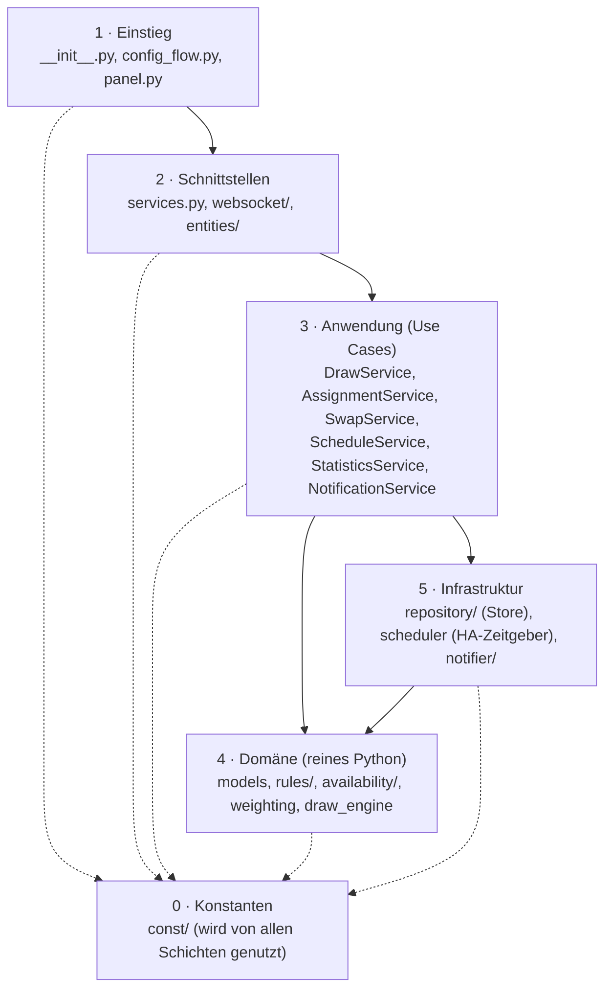
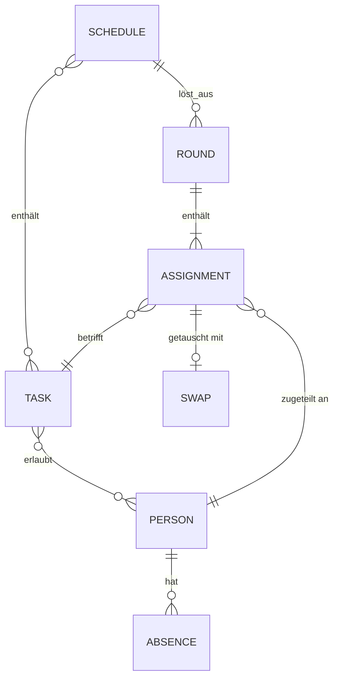
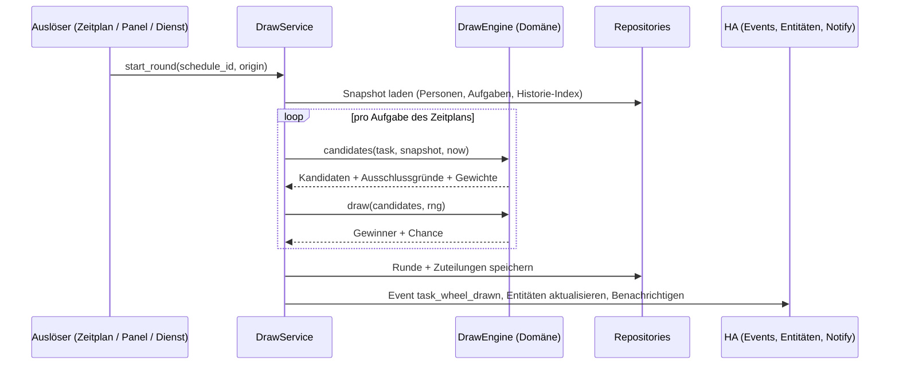

# Technisches Konzept: Aufgaben-Glücksrad für Home Assistant

Stand: 2026-11-03 · Status: **Abgestimmt** (Pattern und Annahmen §11 bestätigt) · Grundlage: UI-Mockups in `mockups/` (PR #1)

Dieses Dokument beschreibt Architektur, Datenmodell, Algorithmen, Schnittstellen und Qualitätsregeln der
Erweiterung. Die Umsetzung ist in [ARBEITSPAKETE.md](ARBEITSPAKETE.md) geschnitten, der Code selbst wird in
[CODE_DOKU.md](CODE_DOKU.md) mit Metriken und Abhängigkeiten erfasst.

---

## 1. Ziel und Umfang

Eine HACS-installierbare Home-Assistant-Erweiterung (Domain `task_wheel`), die Haushaltsaufgaben fair und
nachvollziehbar per Glücksrad an Personen verteilt.

| Bereich | Umfang (aus den Mockups) |
|---|---|
| Personen | Eigene Objekte (keine HA-Benutzer), Farbe im Rad, Belastbarkeit (voll / halb / pausiert), Anwesenheitsregeln, optionaler Benachrichtigungsdienst |
| Aufgaben | Erlaubte Personen, Punkte (Aufwand), Frist in Tagen, Häufigkeitsregel, Zusatzregeln (keine Wiederholung, Abwesenheit beachten, Tausch erlaubt) |
| Zeitpläne | Wiederkehrend (Wochentage + Uhrzeit + Rhythmus), einmalig (Datum + Uhrzeit), nur manuell (mit Erinnerung) |
| Auslosung | Automatisch per Zeitplan oder manuell im Panel mit Animation (Glücksrad, Lostrommel, Slot-Machine, Plinko, Scheinwerfer, je Zeitplan wählbar, bei mehreren zufällig je Auslosung); jede Auslosung gehört zu einem Zeitplan |
| Zuteilungen | Abhaken, Fristen, Status (offen, pünktlich, verspätet, getauscht, verpasst, „Bleibt unerledigt“), Tausch per Joker |
| Historie | Runden mit Zuteilungen, Chance, Status, Filter, CSV-Export |
| Statistik | KPIs, Punkte vs. fairer Anteil, Erledigungsquote pro Woche, Matrix Aufgabe × Person, Glückspilz/Pechvogel |
| HA-Integration | Dienste, Events, Sensoren, To-do-Listen, Buttons, Benachrichtigungen, Frontend-Panel in der Seitenleiste |

Nicht im ersten Release: Mehrmandantenfähigkeit (mehrere Haushalte), Lovelace-Karte (eigenes optionales Paket),
Synchronisation mit externen Kalendern.

---

## 2. Technologie und Zielplattform

| Thema | Entscheidung | Begründung |
|---|---|---|
| Backend-Sprache | Python **3.13** (Mindestversion von HA 2025.x/2026.x) | Aktuellste von HA unterstützte Syntax |
| Python-Syntax | PEP 695 `type`-Aliase und generische Klassen, `match`, `@dataclass(slots=True, frozen=True, kw_only=True)`, `StrEnum`, `Self`, `override` (PEP 698), `ExceptionGroup` wo sinnvoll | Speicher und Zugriffsgeschwindigkeit (slots), Unveränderlichkeit (frozen), eindeutige Typen |
| HA-Mindestversion | 2025.6 (wird im Gerüst-Paket final gepinnt) | `entry.runtime_data`, `StaticPathConfig`, `notify.send_message`, Todo-Plattform |
| Frontend | **Lit 3** + **TypeScript 5.x** (strict), ES2022-Module, Build mit **Vite** | HA selbst nutzt Lit; kleinste Bundle-Größe; Templates escapen automatisch |
| Grafik | SVG für das Rad, CSS-Transform für die Drehung, `prefers-reduced-motion` respektiert | Kein Canvas-Neuzeichnen pro Frame, GPU-beschleunigt |
| Zufall | `secrets.SystemRandom` | Nicht vorhersagbar, keine Seed-Manipulation; Ergebnis entsteht nur im Backend |
| Persistenz | `homeassistant.helpers.storage.Store` (JSON, versioniert, mit Migration) | Kein eigener DB-Zugriff nötig, Backups durch HA |
| Tests | pytest + `pytest-homeassistant-custom-component`, Vitest fürs Frontend | Standard im HA-Ökosystem |
| Qualität | ruff (strenges Regelset), mypy `--strict`, ESLint + typescript-eslint strict, Prettier | Durchsetzung der Code-Regeln in CI |
| Verteilung | HACS (Typ „Integration“), Frontend-Bundle liegt in der Integration | Ein Repository, eine Installation |

---

## 3. Architektur

### 3.1 Schichten

Abhängigkeiten zeigen **nur nach unten**. Keine Schicht kennt die darüberliegende. Die Domäne importiert
nichts aus `homeassistant` und ist dadurch ohne HA testbar und schnell.



| Schicht | Aufgabe | Darf nutzen | Darf **nicht** |
|---|---|---|---|
| 0 Konstanten | Schlüssel, Grenzen, Standardwerte, Event- und Dienstnamen | – | Logik enthalten |
| 1 Einstieg | Setup/Unload der Config Entry, Panel registrieren, Komposition (Objekte verdrahten) | 2, 3, 5 | Fachlogik enthalten |
| 2 Schnittstellen | Eingaben validieren (voluptuous), Rechte prüfen, an Use Cases weiterreichen, Entitäten bereitstellen | 3 | Store direkt lesen/schreiben |
| 3 Anwendung | Abläufe orchestrieren, Transaktionen, Events feuern | 4, 5 (über Protokolle) | HA-Objekte an die Domäne geben |
| 4 Domäne | Regeln, Gewichtung, Ziehung, Statusübergänge | 0 | `homeassistant`, I/O, Uhr (Zeit kommt als Parameter) |
| 5 Infrastruktur | Speichern, Zeitgeber, Benachrichtigung | 4 (Modelle) | Use Cases aufrufen |

Die Anwendungsschicht spricht die Infrastruktur nur über `typing.Protocol`-Schnittstellen an
(`ConfigRepository`, `HistoryRepository`, `Clock`, `Notifier`). Das hält die Schichten austauschbar und testbar.

### 3.2 Entwurfsmuster

Vorgabe: **Factory Pattern**, ergänzt um **Strategy** und **Repository** (entschieden, siehe unten). Es wird an allen Stellen eingesetzt, an denen aus Konfiguration Objekte
unterschiedlicher Art entstehen. Damit keine `if/elif`-Ketten entstehen, sind die Fabriken
**registrierungsbasiert**: eine unveränderliche Zuordnung `Art → Erzeuger` (`MappingProxyType`), Auswahl per
Schlüssel, unbekannte Arten werfen eine eigene Ausnahme.

| Fabrik | Erzeugt aus | Arten |
|---|---|---|
| `FrequencyRuleFactory` | `FrequencyConfig` | `every_round`, `max_per_period`, `interval` |
| `AvailabilityRuleFactory` | `AbsenceConfig` | `once`, `weekly_days`, `week_rhythm` |
| `TriggerFactory` | `TriggerConfig` | `recurring`, `once`, `manual` |
| `WeightingFactory` | `Settings.weighting` | `fairness` (Standard), `uniform` |
| `NotifierFactory` | Ziel des Benachrichtigungsdienstes | `notify_entity` (`notify.send_message`), `notify_service` (Legacy `notify.*`), `none` |
| `EntityFactory` | Personen, Zeitpläne | Sensoren, To-do-Listen, Buttons über `EntityDescription`-Tabellen |
| `ServiceFactory` (Komposition) | Config Entry | Verdrahtet Repositories, Services und Fabriken einmal beim Setup |

> **Entschieden (2026-11-03, Anton): Factory + Strategy + Repository.**
> - **Factory** ist das Leitmuster für die Erzeugung (Tabelle oben).
> - **Strategy:** Die Fabriken erzeugen Objekte, deren *Verhalten* sich je Art unterscheidet. Jede Regelart ist
>   eine Klasse mit derselben Schnittstelle (z. B. `FrequencyRule.is_due(...)`, `AvailabilityRule.is_present(...)`,
>   `Weighting.weights(...)`); Aufrufer kennen nur die Schnittstelle.
> - **Repository:** Persistenz liegt hinter `ConfigRepository` und `HistoryRepository` (`typing.Protocol`);
>   Services greifen nie direkt auf den `Store` zu. Für Tests gibt es eine In-Memory-Implementierung.

### 3.3 Verzeichnisstruktur

```text
custom_components/task_wheel/
├── __init__.py              # Einstieg: async_setup_entry / async_unload_entry
├── manifest.json
├── config_flow.py           # Einzelinstanz, Optionen (Joker/Monat, Fairness-Fenster, Aufbewahrung)
├── panel.py                 # Panel + statischer Pfad für das Frontend-Bundle
├── services.py              # task_wheel.draw, complete, swap, set_absence, …
├── services.yaml
├── const/                   # Schicht 0
│   ├── __init__.py
│   ├── keys.py              # Speicher- und API-Schlüssel
│   ├── limits.py            # Längen, Anzahlen, Zeitlimits
│   ├── defaults.py          # Standardwerte
│   └── events.py            # Event-, Dienst- und Befehlsnamen
├── domain/                  # Schicht 4 (ohne homeassistant-Import)
│   ├── models.py            # Person, Task, Schedule, Round, Assignment, …
│   ├── enums.py             # StrEnums: Load, AssignmentStatus, TriggerKind, …
│   ├── errors.py
│   ├── rules/               # FrequencyRule-Strategien + FrequencyRuleFactory
│   ├── availability/        # AvailabilityRule-Strategien + Factory
│   ├── weighting.py         # Gewichtung + WeightingFactory
│   ├── draw_engine.py       # Kandidaten → Gewichte → Ziehung
│   └── status.py            # Statusübergänge der Zuteilungen
├── application/             # Schicht 3
│   ├── protocols.py         # Repository-, Clock-, Notifier-Protokolle
│   ├── draw_service.py
│   ├── assignment_service.py
│   ├── swap_service.py
│   ├── schedule_service.py
│   ├── statistics_service.py
│   └── notification_service.py
├── infrastructure/          # Schicht 5
│   ├── repository/          # ConfigStore, HistoryStore, Migrationen
│   ├── scheduler.py         # HA-Zeitgeber → TriggerFactory
│   └── notifier/            # NotifierFactory + Implementierungen
├── websocket/               # Schicht 2: Befehle je Bereich
├── entities/                # Schicht 2: sensor.py, todo.py, button.py, EntityFactory
├── translations/            # de.json, en.json
└── frontend/dist/           # gebautes Panel (nicht von Hand bearbeiten)

frontend/                    # Quellcode des Panels
├── src/
│   ├── constants/           # Routen, Ereignisnamen, Grenzen, Design-Tokens
│   ├── i18n/                # de.ts, en.ts, typisierte Schlüssel
│   ├── api/                 # typisierter WebSocket-Client
│   ├── state/               # Store + @lit/context
│   ├── components/          # tw-wheel, tw-person-chip, tw-rule-editor, …
│   ├── views/               # overview, draw, tasks, persons, schedules, history, statistics
│   └── task-wheel-panel.ts  # Einstieg
├── vite.config.ts
└── package.json

docs/                        # Konzept, Arbeitspakete, Code-Doku (+ Generator)
tests/                       # backend (pytest) – frontend-Tests liegen unter frontend/src/**/*.test.ts
```

---

## 4. Datenmodell

Alle Modelle sind `@dataclass(slots=True, frozen=True, kw_only=True)`. Änderungen erzeugen neue Instanzen
(`dataclasses.replace`), dadurch gibt es keine geteilten veränderlichen Zustände zwischen Panel, Diensten und
Zeitgebern. IDs sind `uuid4().hex`; Slugs (für Entity-IDs) werden einmalig aus dem Namen erzeugt und bleiben stabil.



| Modell | Wichtige Felder |
|---|---|
| `Person` | `id`, `name`, `slug`, `color`, `load: Load` (`full`=1,0 · `half`=0,5 · `paused`=0), `absences: tuple[AbsenceConfig, ...]`, `notify_target: str \| None` |
| `AbsenceConfig` | `kind` + Felder je Art: `once(start, end)`, `weekly_days(weekdays)`, `week_rhythm(present_weeks, cycle_weeks, change_weekday, anchor)` |
| `Task` | `id`, `name`, `points`, `due_days`, `allowed: frozenset[PersonId]` (leer = alle Personen), `frequency: FrequencyConfig`, `no_repeat`, `respect_absence`, `swap_allowed`, `min_load: Load` (Mindest-Belastbarkeit, Standard `paused` = egal; `half` = mindestens halbe, `full` = nur volle Last) |
| `FrequencyConfig` | `every_round` · `max_per_period(count, period)` · `interval(days, tolerance)` |
| `Schedule` | `id`, `name`, `slug`, `trigger: TriggerConfig`, `task_ids: tuple[TaskId, ...]`, `enabled`, `notify`, `skip_absent`, `archived`, `animations: tuple[AnimationKind, ...]` (1 bis 5 verschiedene Arten, Standard `wheel`) (archiviert ⇒ nicht aktiv, nie auslösbar) |
| `TriggerConfig` | `recurring(weekdays, time, every_n_weeks \| monthly)` · `once(at, after: keep_manual \| archive \| delete)` · `manual(remind_after_days)` |
| `Round` | `id`, `schedule_id`, `origin: auto \| manual \| service`, `started_at`, `finished_at`, `assignments` |
| `Assignment` | `id`, `round_id`, `schedule_id` (auslosender Zeitplan), `task_id`, `person_id`, `chance` (0–1), `points`, `due_at`, `status`, `done_at`, `swap: Swap \| None` |
| `Settings` | `jokers_per_month`, `fairness_window_days`, `history_retention_days`, `weighting`, `late_points_factor` (0–1, Standard 1,0), `missed_points_factor` (−1–0, Standard 0), `missed_grace_hours` |

### 4.1 Speicher

| Store | Inhalt | Schreibstrategie |
|---|---|---|
| `task_wheel.config` (Version 1) | Personen, Aufgaben, Zeitpläne, Einstellungen | `async_delay_save` (gebündelt, Verzögerung als Konstante) |
| `task_wheel.history` (Version 1) | Runden, Zuteilungen, Monatsaggregate pro Person/Aufgabe | `async_delay_save`; Aufräumen nach `history_retention_days` einmal täglich |

Version 1.2 (beide Stores): Zuteilungen tragen `schedule_id`; die Migration 1.1 → 1.2 setzt den Zeitplan der Runde ein.

Migrationen laufen über `Store(..., minor_version=...)` und `_async_migrate_func`; jede Migration ist eine
eigene, getestete Funktion.

Im Speicher hält das Repository Indizes (`dict[PersonId, Person]`, offene Zuteilungen je Person, letzte
Zuteilung je Aufgabe), damit Regelprüfungen und Entitäten ohne Durchlauf der Historie auskommen.

---

## 5. Fachliche Abläufe und Algorithmen

### 5.1 Ablauf einer Runde



Beim manuellen Ablauf im Panel wird die Runde schrittweise gezogen (`draw/begin`, `draw/spin`, `draw/spin_rest`,
`draw/commit`, `draw/cancel`). Das **Ergebnis bestimmt immer das Backend**; das Frontend erhält Gewinner und
Segmentgrenzen und animiert nur dorthin. Eine offene Runde verfällt nach einer Zeitgrenze (Konstante) und
blockiert keine automatischen Runden desselben Zeitplans: löst der Zeitplan automatisch aus, wird die offene
Panel-Runde verworfen (der Zeitplan geht vor, eine Runde entsteht nie doppelt). Je Zeitplan ist höchstens eine
Panel-Runde offen (`begin` ersetzt die alte), insgesamt höchstens `MAX_OPEN_PANEL_ROUNDS`. Pausierte Zeitpläne
lösen nicht automatisch aus, lassen sich aber von Hand auslosen; archivierte nie.

### 5.2 Kandidatenfilter

Kandidaten einer Aufgabe = erlaubte Personen, aus denen nacheinander entfernt wird (jeder Filter ist ein eigenes
Objekt mit `reason`, die Gründe erscheinen im Panel unter „Wer ist im Rad?“):

1. **Belastung**: `load == paused`
2. **Mindest-Belastbarkeit** (wenn `min_load` nicht `paused`): `load.factor < min_load.factor` entfernt die Person (`load_too_low`); gibt es niemanden mit ausreichender Belastbarkeit, bleibt die Aufgabe unvergeben
3. **Anwesenheit** (wenn `respect_absence`): nicht an mindestens einem Tag im Fristfenster `[jetzt, jetzt + due_days]` anwesend
4. **Keine Wiederholung** (wenn `no_repeat`): hatte die Aufgabe in der letzten Zuteilung, sofern noch andere Kandidaten übrig sind (nur Vorliebe: wer sonst unvergeben bliebe, bekommt die Aufgabe trotzdem; vorher sperren harte Filter und eine Zuordnung stellt sicher, dass so viele Aufgaben wie möglich verteilt werden)
5. **Aufgabe in dieser Runde** (immer): Wer in derselben Runde schon eine Aufgabe gezogen hat, bekommt keine zweite und ist für die weiteren Aufgaben nicht mehr im Rad (`taken`). Gibt es mehr Aufgaben als Personen, bleiben die überzähligen unverteilt
6. **Ohne Kandidaten** wird die Aufgabe als „nicht verteilbar“ protokolliert, nicht erzwungen

Die Häufigkeitsregel wirkt **vor** dem Kandidatenfilter auf Aufgabenebene:

| Regel | `is_due(task, last, count_in_period, now)` |
|---|---|
| `every_round` | immer |
| `max_per_period(n, period)` | Anzahl Zuteilungen im laufenden Tag/Woche/Monat `< n` |
| `interval(d, tol)` | Tage seit letzter Zuteilung `≥ d − tol` |

### 5.3 Fairness-Gewichtung

Ziel: Wer im Fairness-Fenster (Standard 30 Tage) weniger Punkte im Verhältnis zu seinem fairen Anteil hatte,
bekommt ein größeres Segment.

- Kapazität `c_i = load_i × anwesende_Tage_i` im Fenster
- Fairer Anteil `f_i = c_i / Σ c`
- Ist-Anteil `a_i = p_i / Σ p` (bei `Σ p = 0`: `a_i = f_i`)
- Gewicht `w_i = f_i × exp(k × (f_i − a_i) / f_i)` mit Dämpfung `k` (Konstante), begrenzt auf `[w_min, w_max]`
- Chance `π_i = w_i / Σ w` (wird gespeichert und im Rad als Segmentgröße gezeigt)

Punkte, die innerhalb derselben Runde vergeben werden, fließen sofort in `p_i` ein, damit eine Runde nicht alle
Aufgaben an dieselbe Person verteilt. Aufwand pro Runde: `O(Aufgaben × Personen)`; bei realistischen Größen
(< 50 × < 15) im Mikrosekundenbereich.

### 5.4 Zuteilungen, Fristen, Tausch

| Übergang | Auslöser | Ergebnis |
|---|---|---|
| offen → pünktlich | `complete` vor `due_at` | Punkte zählen |
| offen → verspätet | `complete` nach `due_at` | Punkte × `late_points_factor` (einstellbar, Standard 1,0) |
| offen → verpasst | täglicher Lauf nach `due_at + missed_grace_hours` | Punkte × `missed_points_factor` (einstellbar, Standard 0; negativ = Abzug) |
| offen/getauscht → bleibt unerledigt | `skip` (Knopf „Bleibt unerledigt“, mit Rückfrage) | Punkte wie verpasst; in der Statistik zählt die Zuteilung als nicht erledigt (Erledigungsquote, Kennzahl „Verpasst“, Zuverlässigkeit), in der Historie bleibt sie als eigener Status sichtbar |
| offen → getauscht | `swap` mit Joker | neue Person übernimmt, Punkte gehen an sie, Joker −1 |

Tausch ist nur innerhalb derselben Auslosung möglich (die neue Person hat in der Runde selbst eine Zuteilung, sonst `swap_person_not_in_round`) und nur, wenn die Aufgabe `swap_allowed` hat, die neue Person die Aufgabe laut Regel bekommen
dürfte (erlaubt, nicht pausiert, mit ausreichender Belastbarkeit, anwesend) und die abgebende Person im laufenden Monat noch Joker hat.
Ist eine Aufgabe in mehreren Zeitplänen, kann sie mehrfach ausgelost werden (auch an dieselbe Person); jede Zuteilung kennt ihren Zeitplan und wird einzeln erledigt. Die Häufigkeitsregeln zählen Zuteilungen je Aufgabe über alle Zeitpläne.
Statusübergänge sind eine Tabelle `dict[(Status, Aktion), Status]` – keine Verzweigungsketten.

**Auslosung löschen** (`round/delete`, nur Administratoren): nur solange **keine** Zuteilung der Runde erledigt (pünktlich
oder verspätet) ist, sonst `round_has_done_assignments`. Die Runde verschwindet mit allen ihren Zuteilungen aus Historie und
Verlauf; die Monatsaggregate (Anzahl und Punkte) werden um genau diese Zuteilungen verringert, die Statistik sieht die Runde
danach nicht mehr. Getauschte Zuteilungen zählen ihre Joker nicht mehr mit, weil die Joker aus den Zuteilungen gezählt
werden. Entitäten der betroffenen Personen und des Zeitplans werden aktualisiert. Das Panel sperrt den Knopf mit Begründung,
sobald eine Aufgabe erledigt ist, und fragt sonst vor dem Löschen nach.

### 5.5 Zeitpläne

| Art | Umsetzung |
|---|---|
| `recurring` | `async_track_point_in_time` auf den nächsten berechneten Zeitpunkt; nach Auslösung wird der nächste berechnet (Wochenrhythmus über Ankerwoche; „monatlich“ = erster gewählter Wochentag des Monats) |
| `once` | einmaliger Zeitpunkt; danach je nach Einstellung behalten (nur manuell), archivieren oder löschen |
| `manual` | kein Zeitgeber; optional tägliche Prüfung (09:00 Ortszeit) „seit n Tagen nicht ausgelost“ → Erinnerung nach n, 2n, 3n … Tagen; ohne bisherige Auslosung gibt es keinen Bezugspunkt und keine Erinnerung |

Ein einmaliger Zeitplan, dessen Zeitpunkt beim Start schon vorbei ist (z. B. weil Home Assistant aus war), löst
nicht nachträglich aus. Schlägt eine automatische Auslosung fehl, wird das protokolliert und der nächste Zeitgeber
trotzdem gesetzt. Zeitgeber werden beim Ändern eines Zeitplans gezielt neu gesetzt (nur dieser Plan) und beim Entladen der
Integration vollständig abgemeldet. Zeitzone ist die von HA (`dt_util`).

---

## 6. Schnittstellen zu Home Assistant

### 6.1 Dienste

| Dienst | Daten | Wirkung |
|---|---|---|
| `task_wheel.draw` | `schedule` (Slug oder ID), optional `animate_on` | Runde ohne Panel ziehen; mit `animate_on` wird zusätzlich ein Event für eine Anzeige gefeuert |
| `task_wheel.complete` | `assignment_id` oder `person` + `task` | Zuteilung erledigen |
| `task_wheel.swap` | `assignment_id`, `to_person` | Tausch mit Joker |
| `task_wheel.set_absence` | `person`, `start`, `end` | Einmalige Abwesenheit (z. B. aus Kalender-Automation) |

Alle Dienste haben voluptuous-Schemas, unbekannte Felder werden abgelehnt. Fehler werden als
`ServiceValidationError` mit übersetzbarem Schlüssel gemeldet.

### 6.2 Events

`task_wheel_drawn`, `task_wheel_completed`, `task_wheel_swapped`, `task_wheel_missed`, `task_wheel_reminder`.
Payloads enthalten nur IDs, Namen und Zahlen (keine Konfiguration). Zusätzlich meldet `task_wheel.draw` mit `animate_on` das Event `task_wheel_animate` (gleicher Inhalt wie `task_wheel_drawn` plus `animate_on`).

### 6.3 Entitäten (über `EntityFactory`)

| Entität | Beispiel | Zweck |
|---|---|---|
| Sensor offene Aufgaben je Person | `sensor.task_wheel_anna_offen` | Dashboard, Automationen |
| Sensor Punkte im Monat je Person | `sensor.task_wheel_anna_punkte` | Statistik in HA-Verlauf |
| To-do-Liste je Person | `todo.task_wheel_anna` | Abhaken per App, Sprachassistent |
| Sensor nächste Auslosung je Zeitplan | `sensor.task_wheel_wochenplan_naechste_auslosung` (Zeitstempel) | Anzeige |
| Button je Zeitplan | `button.task_wheel_wochenplan_auslosen` | Dashboard-Button, Automation |

Entitäten lesen nur aus den Indizes des Repositories und werden über einen Dispatcher-Signal-Namen pro Person
bzw. Zeitplan aktualisiert – keine Abfragen (Polling), `should_poll = False`.

### 6.4 WebSocket-API für das Panel

Präfix `task_wheel/`. Befehle je Bereich in eigenen Modulen; jeder Befehl hat ein Schema.

| Bereich | Befehle | Recht |
|---|---|---|
| Lesen | `snapshot`, `subscribe` (Deltas), `history/list`, `statistics/get`, `availability/preview` (Anwesenheit der nächsten Wochen für ungespeicherte Regeln; einzige Quelle der Regeln ist das Backend) | angemeldeter Benutzer |
| Erledigen/Tauschen | `assignment/complete`, `assignment/swap`, `assignment/skip` | angemeldeter Benutzer |
| Auslosung löschen | `round/delete` | **Administrator** |
| Auslosen | `draw/begin`, `draw/spin`, `draw/spin_rest`, `draw/commit`, `draw/cancel` | angemeldeter Benutzer |
| Konfiguration | `person/*`, `task/*`, `schedule/*`, `settings/update` | **Administrator** (`@websocket_api.require_admin`) |

`subscribe` schickt nach dem ersten Snapshot nur noch Änderungen (Delta je Objekt-ID). Das hält die Datenmenge
klein und das Panel reaktiv.

**Nachrichten (umgesetzt in AP-10).** Konfigurationsobjekte stehen unter dem Schlüssel ihrer Art:
`person/create {person: {…}}`, `person/update {person_id, person: {…nur geänderte Felder…}}`,
`person/delete {person_id}` (abgelehnt mit `in_use`, solange eine Aufgabe die Person erlaubt oder sie offene Zuteilungen hat; `task/delete` ebenso, solange ein Zeitplan die Aufgabe enthält oder sie offen zugeteilt ist); ebenso `task/*` und `schedule/*`; `settings/update {settings: {…}}`. Die Kennung
vergibt das Backend, der Kurzname (`slug`) wird bei Bedarf aus dem Namen abgeleitet. Schemas lehnen unbekannte
Felder, zu lange Zeichenketten und Listen sowie zu tiefe Verschachtelung ab; die Bedeutung prüfen die Modelle.
Fachfehler kommen als Fehlerantwort, deren `code` der Übersetzungsschlüssel ist (z. B. `not_found`,
`limit_reached`, `in_use`). Wer ein Element löscht, das noch gebraucht wird (letzte erlaubte Person einer Aufgabe,
letzte Aufgabe eines Zeitplans), bekommt `in_use`; sonst wird es aus den Verweisen gestrichen. Ist
`panel_admin_only` gesetzt, gilt für alle Befehle: nur Administratoren.

`snapshot` und die Antwort auf `subscribe` enthalten `persons` (mit `jokers_left`), `tasks`, `schedules` (mit
`next_run`), die offenen `assignments`, die offenen `panel_rounds`, `settings` und `now`. Ein Delta nennt je
Sammlung `{upsert: […], remove: [ids]}` und bei Änderung die gesamten `settings`.

### 6.5 Panel

Registrierung über `panel_custom.async_register_panel` (Seitenleiste „Glücksrad“, Symbol `mdi:ferris-wheel`
o. ä.), Bundle über `hass.http.async_register_static_paths([StaticPathConfig(..., cache_headers=True)])`.
Der Dateiname enthält einen Inhalts-Hash, damit Browser-Caches bei Updates sicher erneuert werden.
`require_admin` für das Panel ist eine Option (Standard: aus, weil Kinder abhaken sollen; Konfiguration ist über
die API trotzdem nur für Admins möglich).

---

## 7. Frontend

| Thema | Konzept |
|---|---|
| Aufbau | `task-wheel-panel` (Einstieg, Routing über Tabs) → Views → Komponenten. Views kennen nur den Store und die API, Komponenten nur ihre Properties und Events |
| Zustand | Ein Store (Signals-artig, `@lit/context`), gespeist durch `subscribe`; Views abonnieren nur ihre Ausschnitte |
| Rendering | Ausschließlich Lit-Templates, **kein** `innerHTML`/`unsafeHTML`; Listen mit `repeat()` und Schlüsseln |
| Glücksrad | `tw-wheel`: SVG-Segmente aus `{person, chance, color}`; Drehwinkel = Zielsegment + volle Umdrehungen (Konstanten), `transitionend` meldet das Ende; reduzierte Bewegung → direkt Ergebnis |
| Auslosungs-Animationen | Strategy + Registry: `STAGE_TAGS` ordnet jede `AnimationKind` (`wheel`, `drum`, `slot`, `plinko`, `spotlight`, `scratch`, `news`, `oscar`) einem Element mit `segments`, `label`, `taskName`, `language`, `spinTo(id)` zu (Rubbellose melden das erste Rubbeln über `tw-stage-start`, dann zieht das Panel; ist das Gewinnerlos frei, endet die Animation); `tw-stage` baut das Element der gewählten Art, die Basisklasse `StageElement` liefert die Schablone (unbekannter Gewinner ignorieren, reduzierte Bewegung → `settle`, sonst `play`, Abbruch bei neuen Segmenten). Der Zeitplan trägt die erlaubten Arten (Mehrfachauswahl); bei jedem Start einer Auslosung wählt das Panel zufällig eine (`pickAnimation`, nur Optik, der Gewinner steht vorher im Backend fest). Größe = Chance in jeder Variante |
| Texte | Alle Texte über i18n-Schlüssel (`de`, `en`), Sprache aus `hass.locale` |
| Styling | Design-Tokens als CSS Custom Properties auf HA-Variablen (`--primary-color` …) gemappt; Farben, Abstände, Dauern als Konstanten |
| Performance | Bundle-Budget (Konstante in CI, Ziel < 120 kB gzip), Views per `import()` nachgeladen, Statistik-Diagramme als reines SVG ohne Diagrammbibliothek |
| CSV-Export | Im Frontend aus Historie-Daten; Felder, die mit `= + - @` beginnen, werden entschärft (CSV-Injection) |

**Literale im HTML:** Tag- und Attributnamen in Lit-Templates sind Sprachsyntax und keine fachlichen Literale.
Alles, was sich ändern kann – Texte, CSS-Klassen-Präfixe, Ereignisnamen, Routen, Zahlen, Farben – kommt aus
`constants/` bzw. `i18n/`. ESLint-Regeln (`no-magic-numbers`, eigene Regel gegen Textknoten in Templates)
setzen das durch.

---

## 8. Sicherheit

| Risiko | Maßnahme |
|---|---|
| Manipulierte Eingaben über WebSocket/Dienste | voluptuous-Schemas mit Längen- und Mengengrenzen (`const/limits.py`), `vol.Coerce` nur gezielt, `extra=vol.PREVENT_EXTRA` |
| Rechteausweitung | Konfigurationsbefehle nur für Admins; Lesebefehle prüfen die Verbindung (`connection.user`) |
| Ergebnismanipulation | Ziehung nur im Backend, `secrets.SystemRandom`, Runde wird mit Chance und Kandidatenliste gespeichert (nachvollziehbar) |
| XSS im Panel | Lit-Templates escapen; keine HTML-Zeichenketten aus Daten; Farben werden gegen `^#[0-9a-f]{6}$` validiert |
| CSV-Injection | Entschärfen beim Export |
| Benachrichtigungsdienst als Hebel | Ziel nur aus vorhandenen `notify`-Entitäten/-Diensten wählbar, Prüfung beim Speichern und beim Senden |
| Ressourcenverbrauch | Obergrenzen für Personen, Aufgaben, Zeitpläne, offene Panel-Runden; Historie wird nach Aufbewahrungsfrist gekürzt |
| Abhängigkeiten | Keine Python-Laufzeitabhängigkeiten außer HA; npm-Abhängigkeiten gepinnt, `npm audit` in CI, Dependabot |

### 8.1 Ergebnis des Security-Reviews (AP-18)

Geprüft wurden alle Eingänge: WebSocket-Befehle, Dienste, To-do-Entität, CSV-Export, Benachrichtigungsziel und das Panel.
Befunde der Stufe hoch oder mittel: **keine offen.**

| Eingang | Prüfung | Ergebnis |
|---|---|---|
| WebSocket | Fehlerhafte Werte (falsche Typen, Übergrößen, tiefe Verschachtelung, ungültige Daten, unbekannte Arten) für jedes Feld jedes Befehls, Tests `tests/websocket/test_hardening.py` | nur Schema- oder Fachfehler, nie eine Ausnahme |
| WebSocket | Rechte: Konfiguration nur Administratoren, `panel_admin_only` sperrt alle Befehle für Nicht-Administratoren | in `tests/websocket/test_registry.py` (Recht je Befehl) und `tests/test_websocket.py` (`panel_admin_only`) geprüft |
| Dienste | `vol.Length` für Verweise, `cv.date`, Fachfehler werden übersetzt; `set_absence` begrenzt die Regelzahl über das Modell | keine Befunde |
| To-do | Nur Abhaken, nur offene Zuteilungen der eigenen Liste | keine Befunde |
| CSV | Formelzeichen (`= + - @ Tab CR`) werden entschärft, alles in Anführungszeichen | keine Befunde |
| Ressourcen | Obergrenzen für Personen, Aufgaben, Zeitpläne, Abonnenten, offene Panel-Runden, Historie; Lasttest `tests/performance/` | eingehalten |
| Abhängigkeiten | `npm audit` (Panel und E2E), Dependabot, keine Laufzeitabhängigkeiten | keine Befunde |
| **Niedrig, akzeptiert** | Der Snapshot enthält das Benachrichtigungsziel (`notify_target`) jeder Person und geht an alle angemeldeten Benutzer (bzw. nur Administratoren bei `panel_admin_only`). Das Ziel ist ein Dienstname wie `notify.mobile_app_anna`, kein Geheimnis; Benutzer eines Haushalts sehen ohnehin dieselben Entitäten | bewusst belassen |
| **Niedrig, akzeptiert** | Jeder angemeldete Benutzer darf Zuteilungen anderer erledigen und tauschen und Runden auslosen (Haushaltsmodell, KONZEPT §11) | bewusst belassen; wer das nicht will, setzt „Panel nur für Administratoren“ |

---

## 9. Performance

- Alles läuft im HA-Event-Loop ohne blockierende Aufrufe; Store-I/O über HA (Executor).
- Indizes im Speicher statt Durchläufe über die Historie; Statistik aus Monatsaggregaten, die beim Erledigen
  inkrementell fortgeschrieben werden.
- Gebündeltes Speichern (`async_delay_save`), Entitäten-Updates nur für betroffene Personen/Zeitpläne.
- `slots=True` für alle Modelle, `frozenset` für Mengenprüfungen, keine Kopien großer Listen pro Anfrage.
- Frontend: Deltas statt Vollabzug, nachgeladene Views, CSS-Transform-Animation.
- Messgrößen werden im Code-Doku-Dokument geführt (LOC, Komplexität, Wartbarkeit, Kopplung) und in CI gegen
  Schwellwerte geprüft (siehe CODE_DOKU.md).

---

## 10. Code-Regeln (verbindlich)

| Regel | Umsetzung und Prüfung |
|---|---|
| Factory + Strategy + Repository | Registrierungsbasierte Fabriken erzeugen Strategien (Abschnitt 3.2); neue Arten werden registriert, nicht verzweigt; Persistenz nur über Repository-Protokolle |
| Aktuellste Syntax | Python 3.13-Features, ruff `target-version = "py313"` mit `UP`-Regeln; TS `target: ES2022`, `strict` |
| Kein duplizierter Code | Gemeinsames gehört in eine Funktion/Methode; Prüfung mit `pylint duplicate-code` bzw. `jscpd` in CI (Schwelle als Konstante in der CI-Konfiguration) |
| Keine Literale | Konstanten in `const/` (Python) und `constants/` (TS); ruff `PLR2004` (magic values), ESLint `no-magic-numbers`; Ausnahmen nur `0`, `1`, `-1` als Indizes und Tag/Attributnamen in Templates |
| Klare Schichten | Abschnitt 3.1; Prüfung der Importrichtung mit `import-linter` (Python) und `eslint-plugin-boundaries` (TS) |
| Keine wilden Verzweigungen | Tabellen/Registries statt `if/elif`-Ketten, `match` nur für Datenformen; Komplexitätsgrenze je Funktion (ruff `C901`, Schwelle 8) |
| Code-Doku | Jede Änderung am Code wird in CODE_DOKU.md (Änderungsprotokoll) erfasst; der Generator aktualisiert Metriken und Abhängigkeiten; CI schlägt fehl, wenn Code geändert wurde, aber die Doku nicht |
| README | Bei jeder sichtbaren Funktionsänderung aktualisieren |

---

## 11. Festgelegte Annahmen (bestätigt von Anton am 2026-11-03)

1. Anwesenheit im Fristfenster: Eine Person ist Kandidat, wenn sie an **mindestens einem Tag** zwischen Auslosung und Frist da ist.
2. Joker werden **pro Kalendermonat** zurückgesetzt, Anzahl global einstellbar (Standard 2).
3. Punkte für verspätete und verpasste Aufgaben sind **einstellbar** (Options Flow: `late_points_factor`, `missed_points_factor`, `missed_grace_hours`); Standard: verspätet volle Punkte, verpasst keine. Grenzen der Faktoren stehen in `const/limits.py`.
4. Panel ist für alle angemeldeten Benutzer sichtbar, Konfiguration nur für Admins.
5. `animate_on` im Dienst feuert ein Event für eine spätere optionale Lovelace-Karte; im ersten Release ohne eigene Karte.
